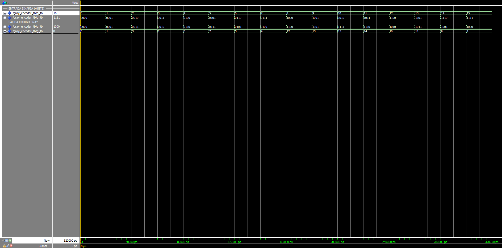
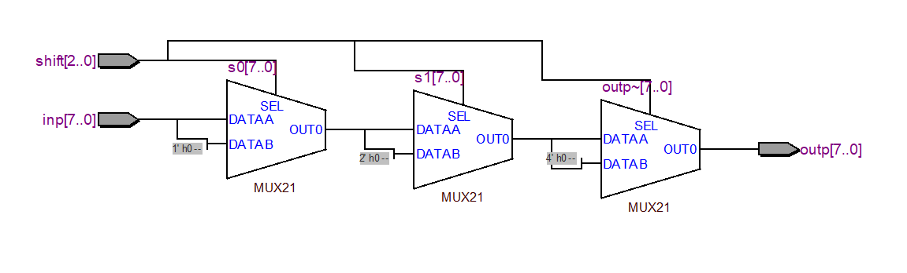
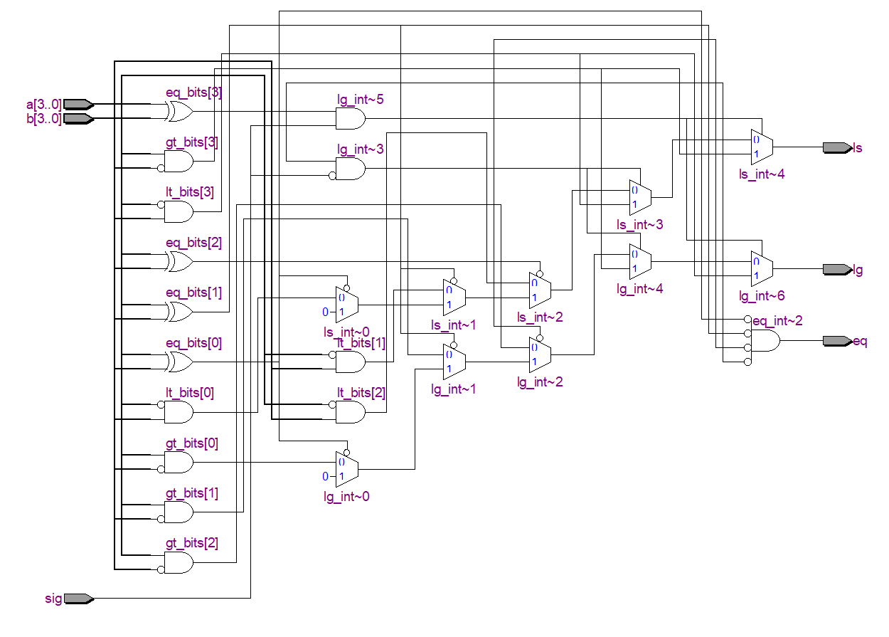
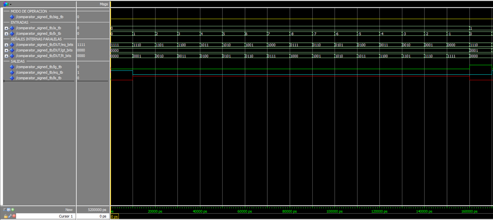

# Taller de Diseño: Circuitos Combinacionales a Nivel RTL
**Pontificia Universidad Javeriana**  
**Departamento de Electrónica**  
**System on Chip (SoC)**  

---

## Ejercicio Número 1: Encoders – Decoders (Código Gray)

Un circuito codificador de código Gray (*Gray Code*) convierte una palabra binaria estándar en una codificación donde dos valores numéricos consecutivos difieren únicamente en un solo bit ($distancia\ de\ Hamming = 1$). Esta propiedad elimina estados transitorios no deseados (*glitches*) en transiciones entre estados discretos.

---

### 1.1. Aplicaciones del Código Gray en Ingeniería

1. **Sistemas de Medición y Encoders Ópticos / Mecánicos de Posición:**
   - En encoders angulares de eje rotativo (*rotary encoders*), si se utilizara binario natural, al pasar de un valor como $3$ (`011`) a $4$ (`100`) los tres bits deberían cambiar simultáneamente. Dado que los sensores físicos nunca leen las ranuras al mismo instante infinitesimal, se generarían lecturas erróneas intermedias (como `000`, `111`, `110`). Con el código Gray, al cambiar un único bit por transición, nunca se presentan transiciones intermedias espurias.
2. **Sistemas Asíncronos de Comunicación y FIFOs (Clock Domain Crossing - CDC):**
   - En memorias FIFO de doble reloj, los punteros de lectura y escritura deben cruzar de un dominio de reloj a otro. Si se envían punteros en binario natural, el cambio multubit simultáneo puede causar metaestabilidad y lecturas catastróficas de valores aleatorios. Al codificar los punteros en código Gray y sincronizarlos con biestables en cascada, solo un bit cambia a la vez, garantizando integridad y seguridad en la sincronización.

---

### 1.2. Tabla de Verdad y Ecuaciones Booleanas

#### 1.2.1. Tabla de Verdad (4 Bits)

| Decimal | Binario ($B_3 B_2 B_1 B_0$) | Gray ($G_3 G_2 G_1 G_0$) | Ecuación / Expresión |
| :---: | :---: | :---: | :---: |
| **0**  | 0000 | 0000 | - |
| **1**  | 0001 | 0001 | - |
| **2**  | 0010 | 0011 | - |
| **3**  | 0011 | 0010 | - |
| **4**  | 0100 | 0110 | - |
| **5**  | 0101 | 0111 | - |
| **6**  | 0110 | 0101 | - |
| **7**  | 0111 | 0100 | - |
| **8**  | 1000 | 1100 | - |
| **9**  | 1001 | 1101 | - |
| **10** | 1010 | 1111 | - |
| **11** | 1011 | 1110 | - |
| **12** | 1100 | 1010 | - |
| **13** | 1101 | 1011 | - |
| **14** | 1110 | 1001 | - |
| **15** | 1111 | 1000 | - |

#### 1.2.2. Ecuaciones Lógicas Derivadas
Analizando la relación entre cada bit de salida $G_k$ y los bits de entrada $B$:
- $$G_3 = B_3$$
- $$G_2 = B_3 \oplus B_2$$
- $$G_1 = B_2 \oplus B_1$$
- $$G_0 = B_1 \oplus B_0$$

En forma general para $N$ bits:
$$G_{N-1} = B_{N-1}$$
$$G_i = B_{i+1} \oplus B_i \quad \forall\ 0 \le i < N-1$$

---

### 1.3. Códigos HDL y Testbenches

#### 1.3.1. Implementación en VHDL (`gray_encoder.vhd`)
*(Espacio reservado para el código HDL)*

#### 1.3.2. Testbench VHDL (`gray_encoder_tb.vhd`)
*(Espacio reservado para el testbench)*

#### 1.3.3. Implementación en Verilog (`gray_encoder.v`)
*(Espacio reservado para el código Verilog)*

#### 1.3.4. Testbench Verilog (`gray_encoder_tb.v`)
*(Espacio reservado para el testbench)*

---

### 1.4. Circuito Generado por Quartus (RTL Viewer)

> **[EVIDENCIA FOTOGRÁFICA 1: RTL VIEWER GRAY ENCODER]**  
> *Guarda la captura de Quartus (Tools $\rightarrow$ Netlist Viewers $\rightarrow$ RTL Viewer) con el nombre `images/gray_encoder_rtl.png`.*


---

### 1.5. Simulación en ModelSim y Análisis de Resultados

> **[EVIDENCIA FOTOGRÁFICA 2: SIMULACIÓN MODELSIM GRAY ENCODER]**  
> *Guarda la captura de la forma de onda de ModelSim con el nombre `images/gray_encoder_modelsim.png`.*



---

## Ejercicio Número 2: Barrel Shifter

Un circuito *Barrel Shifter* realiza desplazamientos combinacionales de palabras binarias en un solo ciclo de propagación de compuertas (sin depender de ciclos de reloj como los registros de desplazamiento secuenciales).

---

### 2.1. Barrel Shifter de 1 Bit de Desplazamiento

#### 2.1.1. Análisis y Ecuaciones
- **Entradas:** `inp(7 downto 0)`, `shift` (1 bit).
- **Salida:** `outp(7 downto 0)`.
- Si `shift = '0'`: $\text{outp} = \text{inp}$.
- Si `shift = '1'`: $\text{outp}(0) = \text{'0'}$, $\text{outp}(i) = \text{inp}(i-1)$ para $1 \le i \le 7$.

#### 2.1.2. Códigos HDL
*(Espacio reservado para implementación y testbench)*

#### 2.1.3. Circuito Generado por Quartus (RTL Viewer)
> **[EVIDENCIA FOTOGRÁFICA 3: RTL VIEWER BARREL SHIFTER 1-BIT]**  
> *Guarda la captura con el nombre `images/barrel_shifter_1bit_rtl.png`.*


#### 2.1.4. Simulación en ModelSim
> **[EVIDENCIA FOTOGRÁFICA 4: SIMULACIÓN MODELSIM BARREL SHIFTER 1-BIT]**  
> *Guarda la captura con el nombre `images/barrel_shifter_1bit_modelsim.png`.*


---

### 2.2. Barrel Shifter Multietapa de 0 a 7 Bits (8 Bits de Datos)

#### 2.2.1. Arquitectura en Cascada
Compuesto por 3 etapas secuenciales de multiplexores 2 a 1:
1. **Etapa 0 (controlada por `shift(0)`):** Desplaza 0 o 1 posición.
2. **Etapa 1 (controlada por `shift(1)`):** Desplaza 0 o 2 posiciones.
3. **Etapa 2 (controlada por `shift(2)`):** Desplaza 0 o 4 posiciones.

Cualquier desplazamiento entero de $0$ a $7$ ($2^3 - 1$) se sintetiza como suma de potencias de 2:
$$\text{Desplazamiento} = \text{shift}(0) \cdot 1 + \text{shift}(1) \cdot 2 + \text{shift}(2) \cdot 4$$

#### 2.2.2. Códigos HDL y Testbenches
*(Espacio reservado para implementación estructural y testbench exhaustivo de 0 a 7)*

#### 2.2.3. Circuito Generado por Quartus (RTL Viewer)
> **[EVIDENCIA FOTOGRÁFICA 5: RTL VIEWER BARREL SHIFTER 8-BIT]**  
> *Guarda la captura con el nombre `images/barrel_shifter_8bit_rtl.png`.*



#### 2.2.4. Simulación en ModelSim
> **[EVIDENCIA FOTOGRÁFICA 6: SIMULACIÓN MODELSIM BARREL SHIFTER 8-BIT]**  
> *Guarda la captura con el nombre `images/barrel_shifter_8bit_modelsim.png`.*


---

## Ejercicio Número 3: Comparador Signed - Unsigned

El módulo comparador evalúa la magnitud de dos palabras de 4 bits $a$ y $b$, interpretándolas como enteros sin signo o enteros con signo en complemento a dos según la señal de control `sig`.

---

### 3.1. Fundamentos Teóricos

- **Modo Unsigned (`sig = '0'`):**
  - Rango: $0 \le a, b \le 15$.
  - La comparación sigue el orden numérico binario estándar.
- **Modo Signed (`sig = '1'`):**
  - Rango: $-8 \le a, b \le +7$.
  - El bit más significativo ($a_3, b_3$) es el bit de signo ($1 \implies$ negativo, $0 \implies$ positivo).
  - Si los signos difieren: el operando con bit de signo `0` es estrictamente mayor que el operando con bit de signo `1`.
  - Si los signos son iguales: la comparación de magnitud de los bits restantes determina el resultado.

---

### 3.2. Códigos HDL y Testbenches

#### 3.2.1. Implementación en VHDL (`comparator_signed.vhd`)
El diseño implementa una arquitectura paralela dividida en dos etapas:
1. **Evaluación concurrente bit a bit:** Para cada posición $i \in \{0, 1, 2, 3\}$ se calculan en paralelo las condiciones de igualdad bit a bit (`xnor`), mayor directo (`a and not b`) y menor directo (`not a and b`).
2. **Selector priorizado (`when/else`):** Evalúa con máxima prioridad el bit más significativo (MSB, bit 3) considerando la señal `sig`. Si los operandos difieren en el bit de signo (`sig = '1'`), el número con bit `0` es positivo y por ende mayor. Si son iguales en el bit 3, se evalúan secuencialmente por prioridad descendente los bits 2, 1 y 0.

```vhdl
library IEEE;
use IEEE.STD_LOGIC_1164.ALL;

entity comparator_signed is
    port (
        a   : in  std_logic_vector(3 downto 0);
        b   : in  std_logic_vector(3 downto 0);
        sig : in  std_logic;
        lg  : out std_logic;
        eq  : out std_logic;
        ls  : out std_logic
    );
end entity comparator_signed;

architecture ParallelPriority of comparator_signed is
    signal eq_bits : std_logic_vector(3 downto 0);
    signal gt_bits : std_logic_vector(3 downto 0);
    signal lt_bits : std_logic_vector(3 downto 0);

    signal lg_int  : std_logic;
    signal eq_int  : std_logic;
    signal ls_int  : std_logic;
begin
    -- 1. Evaluacion paralela bit a bit
    GEN_PARALLEL: for i in 0 to 3 generate
        eq_bits(i) <= a(i) xnor b(i);
        gt_bits(i) <= a(i) and (not b(i));
        lt_bits(i) <= (not a(i)) and b(i);
    end generate GEN_PARALLEL;

    -- 2. Igualdad global
    eq_int <= eq_bits(3) and eq_bits(2) and eq_bits(1) and eq_bits(0);

    -- 3. Selector priorizado para LG (A > B)
    lg_int <= lt_bits(3) when (eq_bits(3) = '0' and sig = '1') else
              gt_bits(3) when (eq_bits(3) = '0' and sig = '0') else
              gt_bits(2) when (eq_bits(2) = '0') else
              gt_bits(1) when (eq_bits(1) = '0') else
              gt_bits(0) when (eq_bits(0) = '0') else
              '0';

    -- 4. Selector priorizado para LS (A < B)
    ls_int <= gt_bits(3) when (eq_bits(3) = '0' and sig = '1') else
              lt_bits(3) when (eq_bits(3) = '0' and sig = '0') else
              lt_bits(2) when (eq_bits(2) = '0') else
              lt_bits(1) when (eq_bits(1) = '0') else
              lt_bits(0) when (eq_bits(0) = '0') else
              '0';

    lg <= lg_int;
    eq <= eq_int;
    ls <= ls_int;
end architecture ParallelPriority;
```

#### 3.2.2. Testbench en VHDL (`comparator_signed_tb.vhd`)
El testbench realiza un barrido exhaustivo de las $2 \times 16 \times 16 = 512$ combinaciones posibles (256 en modo unsigned y 256 en modo signed de $-8$ a $+7$), verificando las salidas mediante aserciones automáticas (`assert`).

```vhdl
library IEEE;
use IEEE.STD_LOGIC_1164.ALL;
use IEEE.NUMERIC_STD.ALL;

entity comparator_signed_tb is
end entity comparator_signed_tb;

architecture Behavioral of comparator_signed_tb is
    component comparator_signed is
        port (
            a   : in  std_logic_vector(3 downto 0);
            b   : in  std_logic_vector(3 downto 0);
            sig : in  std_logic;
            lg  : out std_logic;
            eq  : out std_logic;
            ls  : out std_logic
        );
    end component;

    signal a_tb   : std_logic_vector(3 downto 0) := (others => '0');
    signal b_tb   : std_logic_vector(3 downto 0) := (others => '0');
    signal sig_tb : std_logic := '0';

    signal lg_tb  : std_logic;
    signal eq_tb  : std_logic;
    signal ls_tb  : std_logic;

    constant T_STEP : time := 10 ns;
begin
    DUT: comparator_signed
        port map (
            a   => a_tb,
            b   => b_tb,
            sig => sig_tb,
            lg  => lg_tb,
            eq  => eq_tb,
            ls  => ls_tb
        );

    stim_proc: process
        variable a_signed, b_signed : signed(3 downto 0);
        variable a_uns, b_uns       : unsigned(3 downto 0);
        variable exp_lg, exp_eq, exp_ls : std_logic;
    begin
        -- Modo Unsigned
        sig_tb <= '0';
        for i in 0 to 15 loop
            for j in 0 to 15 loop
                a_tb <= std_logic_vector(to_unsigned(i, 4));
                b_tb <= std_logic_vector(to_unsigned(j, 4));
                wait for T_STEP;
                a_uns := to_unsigned(i, 4);
                b_uns := to_unsigned(j, 4);
                if a_uns > b_uns then exp_lg := '1'; exp_eq := '0'; exp_ls := '0';
                elsif a_uns = b_uns then exp_lg := '0'; exp_eq := '1'; exp_ls := '0';
                else exp_lg := '0'; exp_eq := '0'; exp_ls := '1'; end if;
                assert (lg_tb = exp_lg and eq_tb = exp_eq and ls_tb = exp_ls) severity error;
            end loop;
        end loop;

        -- Modo Signed (-8 a +7)
        sig_tb <= '1';
        for i in -8 to 7 loop
            for j in -8 to 7 loop
                a_tb <= std_logic_vector(to_signed(i, 4));
                b_tb <= std_logic_vector(to_signed(j, 4));
                wait for T_STEP;
                a_signed := to_signed(i, 4);
                b_signed := to_signed(j, 4);
                if a_signed > b_signed then exp_lg := '1'; exp_eq := '0'; exp_ls := '0';
                elsif a_signed = b_signed then exp_lg := '0'; exp_eq := '1'; exp_ls := '0';
                else exp_lg := '0'; exp_eq := '0'; exp_ls := '1'; end if;
                assert (lg_tb = exp_lg and eq_tb = exp_eq and ls_tb = exp_ls) severity error;
            end loop;
        end loop;
        wait;
    end process;
end architecture Behavioral;
```

#### 3.2.3. Implementación en Verilog (`comparator_signed.v`)
```verilog
module comparator_signed (
    input  wire [3:0] a,
    input  wire [3:0] b,
    input  wire       sig,
    output wire       lg,
    output wire       eq,
    output wire       ls
);
    wire [3:0] eq_bits = ~(a ^ b);
    wire [3:0] gt_bits = a & (~b);
    wire [3:0] lt_bits = (~a) & b;

    assign eq = &eq_bits;

    assign lg = (~eq_bits[3] && sig)  ? lt_bits[3] :
                (~eq_bits[3] && !sig) ? gt_bits[3] :
                (~eq_bits[2])         ? gt_bits[2] :
                (~eq_bits[1])         ? gt_bits[1] :
                (~eq_bits[0])         ? gt_bits[0] : 1'b0;

    assign ls = (~eq_bits[3] && sig)  ? gt_bits[3] :
                (~eq_bits[3] && !sig) ? lt_bits[3] :
                (~eq_bits[2])         ? lt_bits[2] :
                (~eq_bits[1])         ? lt_bits[1] :
                (~eq_bits[0])         ? lt_bits[0] : 1'b0;
endmodule
```

#### 3.2.4. Testbench en Verilog (`comparator_signed_tb.v`)
```verilog
`timescale 1ns / 1ps

module comparator_signed_tb;
    reg  [3:0] a, b;
    reg        sig;
    wire       lg, eq, ls;

    comparator_signed dut (
        .a(a), .b(b), .sig(sig),
        .lg(lg), .eq(eq), .ls(ls)
    );

    integer i, j;
    reg signed [3:0] a_s, b_s;
    reg exp_lg, exp_eq, exp_ls;

    initial begin
        sig = 1'b0;
        for (i = 0; i < 16; i = i + 1) begin
            for (j = 0; j < 16; j = j + 1) begin
                a = i[3:0]; b = j[3:0]; #10;
            end
        end

        sig = 1'b1;
        for (i = -8; i <= 7; i = i + 1) begin
            for (j = -8; j <= 7; j = j + 1) begin
                a = i[3:0]; b = j[3:0];
                a_s = i[3:0]; b_s = j[3:0]; #10;
            end
        end
        $finish;
    end
endmodule
```

---

### 3.3. Circuito Generado por Quartus (RTL Viewer)

A continuación se presenta el circuito sintetizado a nivel RTL obtenido con la herramienta **Quartus II (64-bit)**:



#### Análisis del Esquema RTL:
1. **Etapa Paralela (Columna Izquierda):**
   - Se aprecian claramente las compuertas lógicas evaluadas concurrentemente bit a bit:
     - 4 compuertas **XNOR** para la detección de igualdad bit a bit: `eq_bits[3..0]`.
     - 4 compuertas **AND** con entradas invertidas para la comparación de magnitud: `gt_bits[3..0]` ($A_i \cdot \overline{B_i}$) y `lt_bits[3..0]` ($\overline{A_i} \cdot B_i$).
2. **Generación de Igualdad (`eq`):**
   - Una compuerta **AND de 4 entradas** (`eq_int~2`) reúne las cuatro salidas `eq_bits[3..0]`, activando `eq = '1'` únicamente cuando todos los bits son idénticos.
3. **Red de Selección Priorizada (Multiplexores en Cascada para `lg` y `ls`):**
   - Para las salidas `lg` (mayor) y `ls` (menor), Quartus sintetizó una red de **multiplexores 2:1 en cascada** gobernados por las diferencias detectadas en los bits:
     - En el primer nivel, la señal `sig` conmuta si la diferencia en el bit más significativo (MSB, bit 3) se interpreta de forma directa (binario natural) o invertida (complemento a dos con bit de signo).
     - Los multiplexores subsiguientes (`lg_int~1`, `lg_int~2`, `lg_int~4`, `lg_int~6` y sus contrapartes `ls_int~*`) propagan el resultado priorizando el bit 3 sobre el bit 2, este sobre el 1, y finalmente el bit 0, tal como se describió en la arquitectura concurrente.

---

### 3.4. Simulación en ModelSim y Análisis de Resultados

Se realizaron simulaciones funcionales exhaustivas con **ModelSim-Altera** ejecutando los 512 casos de prueba posibles ($2 \times 16 \times 16$).

#### 3.4.1. Panorama General de la Simulación Completa (512 Vectores)
En la vista global se observa la transición completa de la señal de control `sig_tb` (en amarillo): durante los primeros 2560 ns opera en modo **Unsigned** (`sig_tb = '0'`), y a partir de allí conmuta a modo **Signed** (`sig_tb = '1'`).


#### 3.4.2. Acercamiento: Modo Unsigned (`sig = '0'`, Rango 0 a 15)
En este segmento, `a_tb = 0` y `b_tb` barre cíclicamente de `0` a `15`:



- **Instante $t = 0\text{ ns}$:** `a = 0`, `b = 0`. Todos los bits coinciden (`eq_bits = 1111`). La salida `eq_tb` se activa en alto (`'1'`), mientras que `lg_tb = '0'` y `ls_tb = '0'`.
- **Instante $t = 10\text{ ns}$ a $150\text{ ns}$:** Al incrementarse `b` de `1` a `15` con `a = 0`, inmediatamente la salida `ls_tb` (menor, en rojo) permanece en nivel alto `'1'`, mientras que `eq_tb` y `lg_tb` permanecen en `'0'`. Se observa el comportamiento esperado donde cualquier número mayor a 0 provoca $A < B$.
- **Instante $t = 160\text{ ns}$:** `a` cambia a `1` y `b = 0`. Al ser $A > B$, la señal `lg_tb` (verde) conmuta a `'1'` y `ls_tb` cae a `'0'`.

#### 3.4.3. Acercamiento: Modo Signed (`sig = '1'`, Rango Complemento a Dos -8 a +7)
En este tramo, el módulo interpreta los vectores binarios en complemento a 2, donde el MSB representa el signo.


- **Caso Crítico $A = B = -8$ (`1000` en binario):** Al inicio de la ventana, tanto `a_tb` como `b_tb` valen `-8` (`1000`). Se observa `eq_bits = 1111` y la salida `eq_tb` se activa en `'1'`.
- **Transición $A = -8$ frente a $B \in [-7, +7]$:** A medida que `b` se incrementa hacia valores menos negativos ($-7, -6, \dots$) y luego positivos ($0, 1, \dots, +7$), la salida `ls_tb` (rojo) permanece en alto, pues $-8$ es el mínimo valor representable en 4 bits con signo.
- **Transición $A = -7$ frente a $B = -8$ ($t \approx 2740\text{ ns}$):** Cuando `a = -7` y `b = -8`, se observa claramente que **`lg_tb` conmuta a nivel alto ('1')**, demostrando que $-7 > -8$, a pesar de que en representación sin signo pura la magnitud binaria de `1001` (9) y `1000` (8) difiere en lógica de complemento a 2.
- **Exclusión Mutua:** En todos los ciclos se verifica que las tres salidas (`lg`, `eq`, `ls`) son **estrictamente mutuamente excluyentes** (exactamente una de las tres está en nivel alto en cualquier instante), confirmando el correcto funcionamiento de los selectores priorizados.
