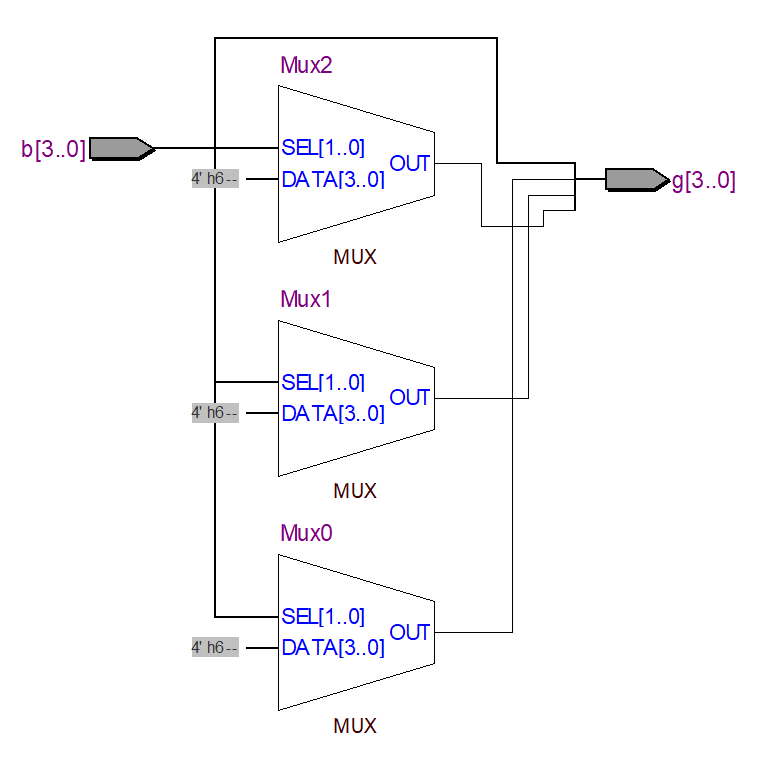
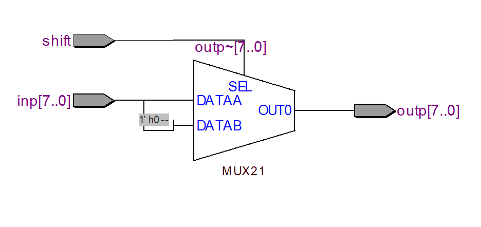
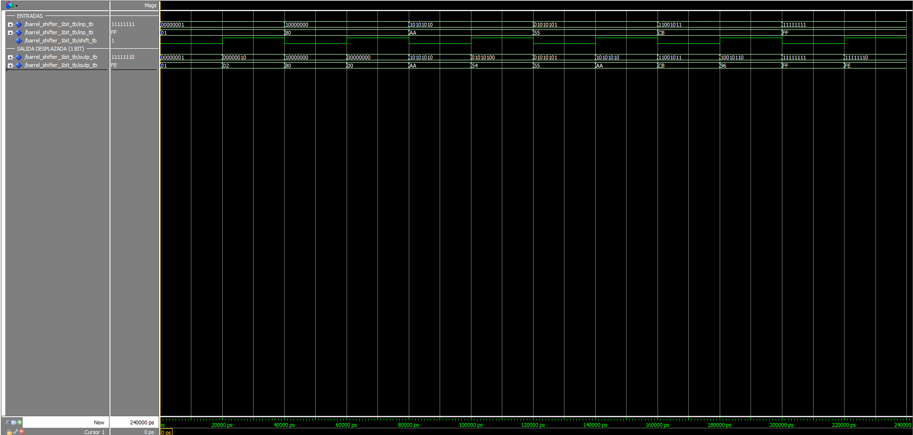
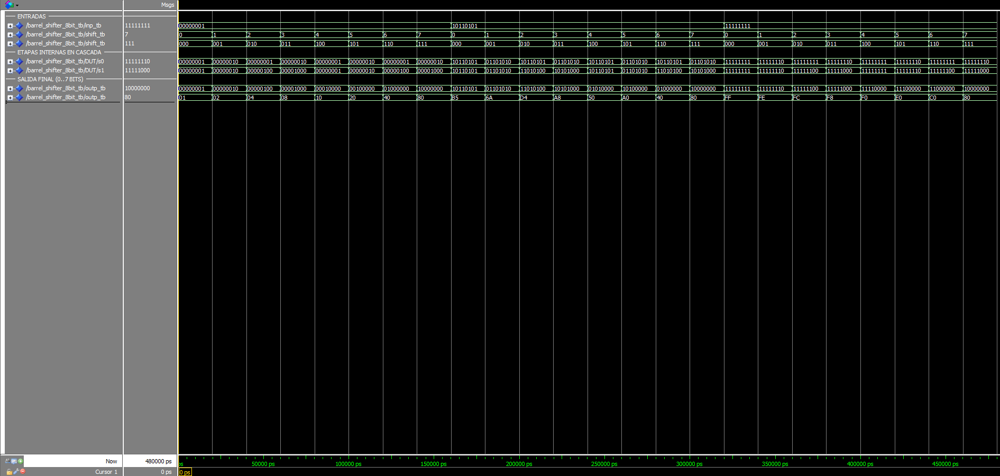
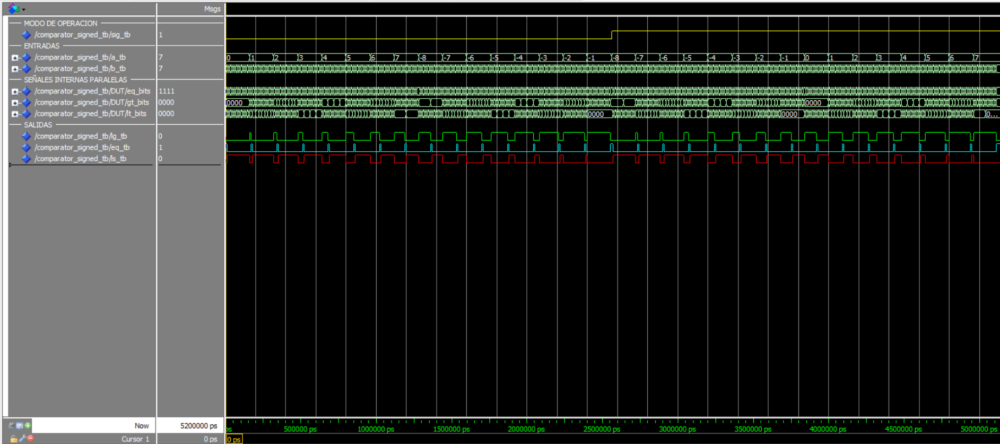
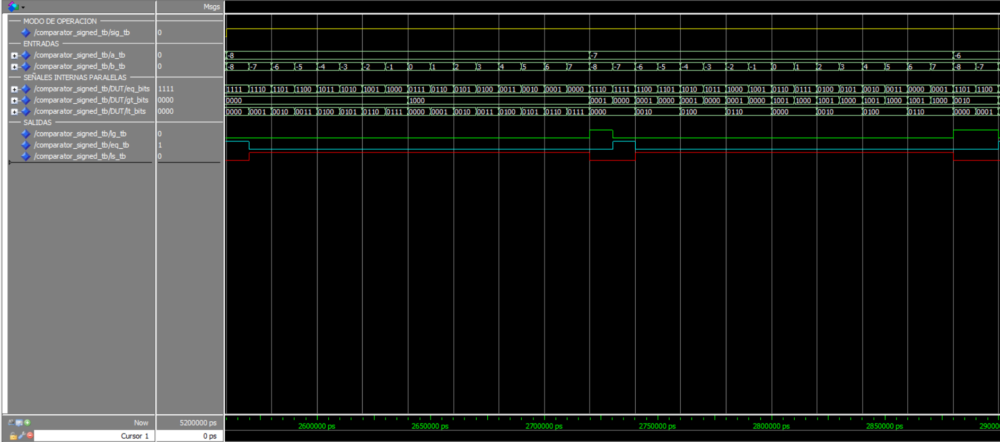

# Taller de Diseño: Circuitos Combinacionales a Nivel RTL
**Pontificia Universidad Javeriana**  
**Departamento de Electrónica**  
**System on Chip (SoC)**  

---

## Ejercicio Número 1: Encoders – Decoders (Código Gray)

Un circuito codificador de código Gray (*Gray Code*) convierte una palabra binaria estándar en una codificación donde dos valores numéricos consecutivos difieren únicamente en un solo bit ($distancia\ de\ Hamming = 1$). Esta propiedad elimina estados transitorios no deseados (*glitches*) en transiciones entre estados discretos.

---

### 1.1. Aplicaciones del Código Gray en Ingeniería

1. **Sistemas de Medición y Encoders Ópticos / Mecánicos de Posición:**
   - En encoders angulares de eje rotativo (*rotary encoders*), si se utilizara binario natural, al pasar de un valor como $3$ (`011`) a $4$ (`100`) los tres bits deberían cambiar simultáneamente. Dado que los sensores físicos nunca leen las ranuras al mismo instante infinitesimal, se generarían lecturas erróneas intermedias (como `000`, `111`, `110`). Con el código Gray, al cambiar un único bit por transición, nunca se presentan transiciones intermedias espurias.
2. **Sistemas Asíncronos de Comunicación y FIFOs (Clock Domain Crossing - CDC):**
   - En memorias FIFO de doble reloj, los punteros de lectura y escritura deben cruzar de un dominio de reloj a otro. Si se envían punteros en binario natural, el cambio multubit simultáneo puede causar metaestabilidad y lecturas catastróficas de valores aleatorios. Al codificar los punteros en código Gray y sincronizarlos con biestables en cascada, solo un bit cambia a la vez, garantizando integridad y seguridad en la sincronización.

---

### 1.2. Tabla de Verdad y Ecuaciones Booleanas

#### 1.2.1. Tabla de Verdad (4 Bits)

| Decimal | Binario ($B_3 B_2 B_1 B_0$) | Gray ($G_3 G_2 G_1 G_0$) | Ecuación / Expresión |
| :---: | :---: | :---: | :---: |
| **0**  | 0000 | 0000 | - |
| **1**  | 0001 | 0001 | - |
| **2**  | 0010 | 0011 | - |
| **3**  | 0011 | 0010 | - |
| **4**  | 0100 | 0110 | - |
| **5**  | 0101 | 0111 | - |
| **6**  | 0110 | 0101 | - |
| **7**  | 0111 | 0100 | - |
| **8**  | 1000 | 1100 | - |
| **9**  | 1001 | 1101 | - |
| **10** | 1010 | 1111 | - |
| **11** | 1011 | 1110 | - |
| **12** | 1100 | 1010 | - |
| **13** | 1101 | 1011 | - |
| **14** | 1110 | 1001 | - |
| **15** | 1111 | 1000 | - |

#### 1.2.2. Ecuaciones Lógicas Derivadas
Analizando la relación entre cada bit de salida $G_k$ y los bits de entrada $B$:
- $$G_3 = B_3$$
- $$G_2 = B_3 \oplus B_2$$
- $$G_1 = B_2 \oplus B_1$$
- $$G_0 = B_1 \oplus B_0$$

En forma general para $N$ bits:
$$G_{N-1} = B_{N-1}$$
$$G_i = B_{i+1} \oplus B_i \quad \forall\ 0 \le i < N-1$$

---

### 1.3. Códigos HDL y Testbenches

#### 1.3.1. Implementación en VHDL (`gray_encoder.vhd`)
```vhdl
library IEEE;
use IEEE.STD_LOGIC_1164.ALL;

-- Codificador Binario a Código Gray de 4 bits
-- Implementado a nivel RTL con asignación seleccionada (with/select/when)
entity gray_encoder is
    port (
        b : in  std_logic_vector(3 downto 0); -- Código binario de entrada
        g : out std_logic_vector(3 downto 0)  -- Código Gray de salida
    );
end entity gray_encoder;

architecture RTL of gray_encoder is
begin
    with b select
        g <= "0000" when "0000",
             "0001" when "0001",
             "0011" when "0010",
             "0010" when "0011",
             "0110" when "0100",
             "0111" when "0101",
             "0101" when "0110",
             "0100" when "0111",
             "1100" when "1000",
             "1101" when "1001",
             "1111" when "1010",
             "1110" when "1011",
             "1010" when "1100",
             "1011" when "1101",
             "1001" when "1110",
             "1000" when "1111",
             "0000" when others;
end architecture RTL;
```

#### 1.3.2. Testbench VHDL (`gray_encoder_tb.vhd`)
```vhdl
library IEEE;
use IEEE.STD_LOGIC_1164.ALL;
use IEEE.NUMERIC_STD.ALL;

entity gray_encoder_tb is
end entity gray_encoder_tb;

architecture Behavioral of gray_encoder_tb is
    component gray_encoder is
        port (
            b : in  std_logic_vector(3 downto 0);
            g : out std_logic_vector(3 downto 0)
        );
    end component;

    signal b_tb : std_logic_vector(3 downto 0) := "0000";
    signal g_tb : std_logic_vector(3 downto 0);

    constant T_STEP : time := 20 ns;

    type gray_array is array (0 to 15) of std_logic_vector(3 downto 0);
    constant EXPECTED_GRAY : gray_array := (
        0  => "0000", 1  => "0001", 2  => "0011", 3  => "0010",
        4  => "0110", 5  => "0111", 6  => "0101", 7  => "0100",
        8  => "1100", 9  => "1101", 10 => "1111", 11 => "1110",
        12 => "1010", 13 => "1011", 14 => "1001", 15 => "1000"
    );

    function hamming_distance(v1, v2 : std_logic_vector(3 downto 0)) return integer is
        variable diff_count : integer := 0;
    begin
        for i in 0 to 3 loop
            if v1(i) /= v2(i) then
                diff_count := diff_count + 1;
            end if;
        end loop;
        return diff_count;
    end function;

begin
    DUT: gray_encoder
        port map (
            b => b_tb,
            g => g_tb
        );

    stim_proc: process
        variable prev_g : std_logic_vector(3 downto 0) := "0000";
    begin
        for i in 0 to 15 loop
            b_tb <= std_logic_vector(to_unsigned(i, 4));
            wait for T_STEP;

            -- 1. Verificar valor exacto esperado
            assert g_tb = EXPECTED_GRAY(i)
                report "ERROR en Binario=" & integer'image(i) &
                       ": Esperado=" & integer'image(to_integer(unsigned(EXPECTED_GRAY(i)))) &
                       ", Obtenido=" & integer'image(to_integer(unsigned(g_tb)))
                severity error;

            -- 2. Verificar distancia de Hamming = 1 respecto al anterior
            if i > 0 then
                assert hamming_distance(g_tb, prev_g) = 1
                    report "ERROR Hamming en i=" & integer'image(i) severity error;
            end if;

            prev_g := g_tb;
        end loop;

        report ">>> SIMULACION EXITOSA: Todas las pruebas superadas. <<<";
        wait;
    end process;
end architecture Behavioral;
```

#### 1.3.3. Implementación en Verilog (`gray_encoder.v`)
```verilog
`timescale 1ns / 1ps

// Codificador Binario a Código Gray de 4 bits
// Implementado a nivel RTL mediante bloque always con sentencia case
module gray_encoder (
    input  wire [3:0] b, // Código binario de entrada
    output reg  [3:0] g  // Código Gray de salida
);

    always @(*) begin
        case (b)
            4'b0000: g = 4'b0000;
            4'b0001: g = 4'b0001;
            4'b0010: g = 4'b0011;
            4'b0011: g = 4'b0010;
            4'b0100: g = 4'b0110;
            4'b0101: g = 4'b0111;
            4'b0110: g = 4'b0101;
            4'b0111: g = 4'b0100;
            4'b1000: g = 4'b1100;
            4'b1001: g = 4'b1101;
            4'b1010: g = 4'b1111;
            4'b1011: g = 4'b1110;
            4'b1100: g = 4'b1010;
            4'b1101: g = 4'b1011;
            4'b1110: g = 4'b1001;
            4'b1111: g = 4'b1000;
            default: g = 4'b0000;
        endcase
    end

endmodule
```

#### 1.3.4. Testbench Verilog (`gray_encoder_tb.v`)
```verilog
`timescale 1ns / 1ps

module gray_encoder_tb;
    reg  [3:0] b;
    wire [3:0] g;

    integer i;
    integer errors = 0;
    reg [3:0] prev_g;
    reg [3:0] expected_lut [0:15];
    integer diff_bits;

    gray_encoder dut (
        .b(b),
        .g(g)
    );

    initial begin
        expected_lut[0]  = 4'b0000; expected_lut[1]  = 4'b0001;
        expected_lut[2]  = 4'b0011; expected_lut[3]  = 4'b0010;
        expected_lut[4]  = 4'b0110; expected_lut[5]  = 4'b0111;
        expected_lut[6]  = 4'b0101; expected_lut[7]  = 4'b0100;
        expected_lut[8]  = 4'b1100; expected_lut[9]  = 4'b1101;
        expected_lut[10] = 4'b1111; expected_lut[11] = 4'b1110;
        expected_lut[12] = 4'b1010; expected_lut[13] = 4'b1011;
        expected_lut[14] = 4'b1001; expected_lut[15] = 4'b1000;

        prev_g = 4'b0000;

        for (i = 0; i < 16; i = i + 1) begin
            b = i;
            #20;

            if (g !== expected_lut[i]) begin
                $display("ERROR en b=%0d: Esperado=%b, Obtenido=%b", i, expected_lut[i], g);
                errors = errors + 1;
            end

            if (i > 0) begin
                diff_bits = (g[0] ^ prev_g[0]) + (g[1] ^ prev_g[1]) +
                            (g[2] ^ prev_g[2]) + (g[3] ^ prev_g[3]);
                if (diff_bits !== 1) begin
                    $display("ERROR Hamming entre b=%0d y %0d", i-1, i);
                    errors = errors + 1;
                end
            end

            prev_g = g;
        end

        if (errors == 0)
            $display(">>> SIMULACION EXITOSA: 0 errores encontrados. <<<");
        else
            $display(">>> Simulacion finalizada con %0d errores. <<<", errors);

        $stop;
    end
endmodule
```

---

### 1.4. Circuito Generado por Quartus (RTL Viewer)



**Análisis del Esquemático RTL:**
- Al implementar la tabla de verdad mediante la sentencia concurrente seleccionada (`with b select`), el sintetizador RTL de Quartus Prime reduce automáticamente la tabla de 16 entradas a su representación funcional mínima para cada bit:
  - El bit más significativo `b[3]` se conecta directamente mediante un hilo conductor hacia `g[3]` ($G_3 = B_3$).
  - Los bits `g[2]`, `g[1]` y `g[0]` son generados por tres bloques multiplexores 4:1 (`Mux0`, `Mux1`, `Mux2`) cuyas entradas de datos están cableadas a la constante `4'h6` (`0110` en binario) y cuyas líneas de selección `SEL[1..0]` reciben los pares de bits adyacentes `(b[3], b[2])`, `(b[2], b[1])` y `(b[1], b[0])` respectivamente.
  - La constante `4'h6` (`0110`) evaluada sobre un multiplexor 4:1 implementa exactamente la tabla de verdad de una compuerta **XOR** de 2 entradas ($00 \rightarrow 0$, $01 \rightarrow 1$, $10 \rightarrow 1$, $11 \rightarrow 0$), confirmando físicamente las ecuaciones deducidas $G_i = B_{i+1} \oplus B_i$.

---

### 1.5. Simulación en ModelSim y Análisis de Resultados


**Análisis del Diagrama de Tiempos y Eventos de Interés:**
- En la simulación funcional (`0 ns` a `320 ns`, con pasos de `20 ns` por estímulo) se recorren exhaustivamente los 16 valores de entrada `b_tb` desde `0` (`0000`) hasta `15` (`1111`).
- **Evento Crítico 1 ($t = 60\text{ ns} \rightarrow 80\text{ ns}$, transición de 3 a 4):** En binario natural (`b_tb`), el paso de `0011` (3) a `0100` (4) obliga a conmutar 3 bits simultáneamente. En la salida Gray (`g_tb`), el valor pasa de `0010` (2) a `0110` (6), cambiando **únicamente el bit $G_2$**.
- **Evento Crítico 2 ($t = 140\text{ ns} \rightarrow 160\text{ ns}$, transición de 7 a 8):** En el cruce de mitad de escala, `b_tb` cambia todos sus 4 bits de `0111` (7) a `1000` (8). En contraste, la salida `g_tb` pasa de `0100` (4) a `1100` (12), conmutando exclusivamente el bit más significativo $G_3$.
- **Conclusión:** Las aserciones automáticas del testbench (`hamming_distance = 1`) finalizaron con **0 errores**, comprobando que el circuito elimina el riesgo de estados transitorios espurios entre códigos adyacentes.

---

## Ejercicio Número 2: Barrel Shifter

Un circuito *Barrel Shifter* realiza desplazamientos combinacionales de palabras binarias en un solo ciclo de propagación de compuertas (sin depender de ciclos de reloj como los registros de desplazamiento secuenciales).

---

### 2.1. Barrel Shifter de 1 Bit de Desplazamiento

#### 2.1.1. Análisis y Ecuaciones
- **Entradas:** `inp(7 downto 0)` (palabra de datos de 8 bits), `shift` (1 bit de control).
- **Salida:** `outp(7 downto 0)`.
- **Operación:**
  - Si `shift = '0'`: $\text{outp} = \text{inp}$ (el dato pasa intacto a través de las entradas `0` de los 8 multiplexores 2:1).
  - Si `shift = '1'`: $\text{outp}(0) = \text{'0'}$ y $\text{outp}(i) = \text{inp}(i-1)$ para $1 \le i \le 7$, lo que equivale a concatenar `'0'` en el LSB: `outp <= inp(6 downto 0) & '0'`.

#### 2.1.2. Códigos HDL y Testbenches

##### Implementación en VHDL (`barrel_shifter_1bit.vhd`)
```vhdl
library IEEE;
use IEEE.STD_LOGIC_1164.ALL;

entity barrel_shifter_1bit is
    port (
        inp   : in  std_logic_vector(7 downto 0); -- Vector de entrada (8 bits)
        shift : in  std_logic;                    -- Control: '0' = sin cambio, '1' = << 1
        outp  : out std_logic_vector(7 downto 0)  -- Vector de salida desplazado
    );
end entity barrel_shifter_1bit;

architecture Concurrent_RTL of barrel_shifter_1bit is
begin
    outp <= (inp(6 downto 0) & '0') when (shift = '1') else inp;
end architecture Concurrent_RTL;
```

##### Testbench VHDL (`barrel_shifter_1bit_tb.vhd`)
```vhdl
library IEEE;
use IEEE.STD_LOGIC_1164.ALL;
use IEEE.NUMERIC_STD.ALL;

entity barrel_shifter_1bit_tb is
end entity barrel_shifter_1bit_tb;

architecture Behavioral of barrel_shifter_1bit_tb is
    component barrel_shifter_1bit is
        port (
            inp   : in  std_logic_vector(7 downto 0);
            shift : in  std_logic;
            outp  : out std_logic_vector(7 downto 0)
        );
    end component;

    signal inp_tb   : std_logic_vector(7 downto 0) := (others => '0');
    signal shift_tb : std_logic := '0';
    signal outp_tb  : std_logic_vector(7 downto 0);

    constant T_STEP : time := 20 ns;

    type vec_array is array (0 to 5) of std_logic_vector(7 downto 0);
    constant TEST_PATTERNS : vec_array := (
        0 => "00000001", -- 0x01: bit en LSB
        1 => "10000000", -- 0x80: bit en MSB (se descarta al desplazar)
        2 => "10101010", -- 0xAA: patrón alternado 1010...
        3 => "01010101", -- 0x55: patrón alternado 0101...
        4 => "11001011", -- 0xCB: patrón asimétrico de prueba
        5 => "11111111"  -- 0xFF: todos en 1
    );
begin
    DUT: barrel_shifter_1bit
        port map (
            inp   => inp_tb,
            shift => shift_tb,
            outp  => outp_tb
        );

    stim_proc: process
        variable expected_out : std_logic_vector(7 downto 0);
    begin
        for i in TEST_PATTERNS'range loop
            inp_tb <= TEST_PATTERNS(i);

            -- Caso A: Sin desplazamiento (shift = '0')
            shift_tb <= '0';
            wait for T_STEP;
            expected_out := TEST_PATTERNS(i);
            assert outp_tb = expected_out
                report "ERROR con shift=0 en patron " & integer'image(i) severity error;

            -- Caso B: Desplazamiento de 1 bit a la izquierda (shift = '1')
            shift_tb <= '1';
            wait for T_STEP;
            expected_out := TEST_PATTERNS(i)(6 downto 0) & '0';
            assert outp_tb = expected_out
                report "ERROR con shift=1 en patron " & integer'image(i) severity error;
        end loop;

        report ">>> SIMULACION EXITOSA: barrel_shifter_1bit verificado. <<<";
        wait;
    end process;
end architecture Behavioral;
```

##### Implementación en Verilog (`barrel_shifter_1bit.v`)
```verilog
`timescale 1ns / 1ps

module barrel_shifter_1bit (
    input  wire [7:0] inp,   // Vector de entrada (8 bits)
    input  wire       shift, // Control: 0 = sin cambio, 1 = << 1
    output wire [7:0] outp   // Vector de salida desplazado
);

    assign outp = shift ? {inp[6:0], 1'b0} : inp;

endmodule
```

##### Testbench Verilog (`barrel_shifter_1bit_tb.v`)
```verilog
`timescale 1ns / 1ps

module barrel_shifter_1bit_tb;
    reg  [7:0] inp;
    reg        shift;
    wire [7:0] outp;

    integer i;
    integer errors = 0;
    reg [7:0] patterns [0:5];
    reg [7:0] expected;

    barrel_shifter_1bit dut (
        .inp(inp),
        .shift(shift),
        .outp(outp)
    );

    initial begin
        patterns[0] = 8'b0000_0001;
        patterns[1] = 8'b1000_0000;
        patterns[2] = 8'b1010_1010;
        patterns[3] = 8'b0101_0101;
        patterns[4] = 8'b1100_1011;
        patterns[5] = 8'b1111_1111;

        for (i = 0; i < 6; i = i + 1) begin
            inp = patterns[i];

            shift = 1'b0;
            expected = patterns[i];
            #20;
            if (outp !== expected) errors = errors + 1;

            shift = 1'b1;
            expected = {patterns[i][6:0], 1'b0};
            #20;
            if (outp !== expected) errors = errors + 1;
        end

        if (errors == 0)
            $display(">>> SIMULACION EXITOSA: 0 errores encontrados. <<<");
        else
            $display(">>> Simulacion finalizada con %0d errores. <<<", errors);

        $stop;
    end
endmodule
```

#### 2.1.3. Circuito Generado por Quartus (RTL Viewer)



**Análisis del Esquemático RTL:**
- El sintetizador de Quartus genera un bloque multiplexor vectorial de 8 bits denominado `MUX21`.
- La señal de control `shift` está conectada al puerto de selección `SEL`.
- El puerto `DATAA` recibe directamente el bus de entrada `inp[7..0]`, representando la condición `shift = '0'` donde la salida permanece inalterada (`outp = inp`).
- El puerto `DATAB` recibe el bus de entrada desplazado junto con una constante lógica `1'h0--` cableada al bit menos significativo (LSB, bit 0), mientras que los bits `inp[6..0]` se mapean a las posiciones `[7..1]`. Esto sintetiza fielmente el desplazamiento combinacional a la izquierda con descarte del bit más significativo `inp[7]`.
- La salida vectorial `OUT0` entrega directamente el bus de 8 bits `outp[7..0]`.

#### 2.1.4. Simulación en ModelSim



**Análisis del Diagrama de Tiempos y Eventos de Interés:**
- Se verifican 6 patrones de prueba representativos (`0x01`, `0x80`, `0xAA`, `0x55`, `0xCB`, `0xFF`) evaluando para cada uno el comportamiento con `shift = '0'` y `shift = '1'` en intervalos de 20 ns (duración total 240 ns):
  1. **Patrón LSB ($t = 0\text{ ns} \rightarrow 40\text{ ns}$, `inp = 0x01` / `00000001`):** Con `shift = 0`, `outp = 0x01`. Con `shift = 1`, el bit 1 se desplaza a la posición 1 (`outp = 0x02` / `00000010`) y entra un `0` en la posición 0.
  2. **Patrón MSB ($t = 40\text{ ns} \rightarrow 80\text{ ns}$, `inp = 0x80` / `10000000`):** Con `shift = 0`, `outp = 0x80`. Con `shift = 1`, el bit en la posición 7 se descarta al salir del bus y entra un `0` en LSB, resultando en `outp = 0x00` (`00000000`).
  3. **Patrón Alternado 1 ($t = 80\text{ ns} \rightarrow 120\text{ ns}$, `inp = 0xAA` / `10101010`):** Con `shift = 1`, se obtiene `outp = 0x54` (`01010100`), verificando el descarte del `1` en MSB y la inserción del `0` en LSB.
  4. **Patrón Alternado 2 ($t = 120\text{ ns} \rightarrow 160\text{ ns}$, `inp = 0x55` / `01010101`):** Con `shift = 1`, se obtiene `outp = 0xAA` (`10101010`), donde cada bit se multiplica efectivamente por 2 ($55_{16} \times 2 = \text{AA}_{16}$).
  5. **Patrón Asimétrico ($t = 160\text{ ns} \rightarrow 200\text{ ns}$, `inp = 0xCB` / `11001011`):** Con `shift = 1`, produce `outp = 0x96` (`10010110`).
  6. **Patrón Saturado ($t = 200\text{ ns} \rightarrow 240\text{ ns}$, `inp = 0xFF` / `11111111`):** Con `shift = 1`, produce `outp = 0xFE` (`11111110`), confirmando que únicamente el LSB se vuelve `'0'`.
- El banco de pruebas automático reportó **0 errores**.

---

### 2.2. Barrel Shifter Multietapa de 0 a 7 Bits (8 Bits de Datos)

#### 2.2.1. Arquitectura en Cascada
Compuesto por 3 etapas secuenciales de multiplexores 2 a 1:
1. **Etapa 0 (controlada por `shift(0)`):** Desplaza 0 o 1 posición (`inp(6 downto 0) & '0'`).
2. **Etapa 1 (controlada por `shift(1)`):** Desplaza 0 o 2 posiciones (`s0(5 downto 0) & "00"`).
3. **Etapa 2 (controlada por `shift(2)`):** Desplaza 0 o 4 posiciones (`s1(3 downto 0) & "0000"`).

Cualquier desplazamiento entero de $0$ a $7$ ($2^3 - 1$) se sintetiza como suma de potencias de 2:
$$\text{Desplazamiento} = \text{shift}(0) \cdot 1 + \text{shift}(1) \cdot 2 + \text{shift}(2) \cdot 4$$

#### 2.2.2. Códigos HDL y Testbenches

##### Implementación en VHDL (`barrel_shifter_8bit.vhd`)
```vhdl
library IEEE;
use IEEE.STD_LOGIC_1164.ALL;

entity barrel_shifter_8bit is
    port (
        inp   : in  std_logic_vector(7 downto 0); -- Vector de entrada (8 bits)
        shift : in  std_logic_vector(2 downto 0); -- Cantidad de desplazamiento (0 a 7)
        outp  : out std_logic_vector(7 downto 0)  -- Vector de salida desplazado
    );
end entity barrel_shifter_8bit;

architecture Cascaded_RTL of barrel_shifter_8bit is
    signal s0 : std_logic_vector(7 downto 0); -- Salida de Etapa 0 (+1 bit)
    signal s1 : std_logic_vector(7 downto 0); -- Salida de Etapa 1 (+2 bits)
begin
    -- Etapa 0: Desplazamiento de 1 posición controlado por shift(0)
    s0 <= (inp(6 downto 0) & '0') when (shift(0) = '1') else inp;

    -- Etapa 1: Desplazamiento de 2 posiciones controlado por shift(1)
    s1 <= (s0(5 downto 0) & "00") when (shift(1) = '1') else s0;

    -- Etapa 2: Desplazamiento de 4 posiciones controlado por shift(2)
    outp <= (s1(3 downto 0) & "0000") when (shift(2) = '1') else s1;
end architecture Cascaded_RTL;
```

##### Testbench VHDL (`barrel_shifter_8bit_tb.vhd`)
```vhdl
library IEEE;
use IEEE.STD_LOGIC_1164.ALL;
use IEEE.NUMERIC_STD.ALL;

entity barrel_shifter_8bit_tb is
end entity barrel_shifter_8bit_tb;

architecture Behavioral of barrel_shifter_8bit_tb is
    component barrel_shifter_8bit is
        port (
            inp   : in  std_logic_vector(7 downto 0);
            shift : in  std_logic_vector(2 downto 0);
            outp  : out std_logic_vector(7 downto 0)
        );
    end component;

    signal inp_tb   : std_logic_vector(7 downto 0) := "11010101";
    signal shift_tb : std_logic_vector(2 downto 0) := "000";
    signal outp_tb  : std_logic_vector(7 downto 0);

    constant T_STEP : time := 20 ns;
begin
    DUT: barrel_shifter_8bit
        port map (
            inp   => inp_tb,
            shift => shift_tb,
            outp  => outp_tb
        );

    stim_proc: process
        variable expected_out : std_logic_vector(7 downto 0);
    begin
        -- Prueba 1: Bit '1' caminando desde el bit 0 hasta el bit 7
        inp_tb <= "00000001";
        for s in 0 to 7 loop
            shift_tb <= std_logic_vector(to_unsigned(s, 3));
            wait for T_STEP;
            expected_out := std_logic_vector(shift_left(unsigned(inp_tb), s));
            assert outp_tb = expected_out
                report "ERROR en inp=00000001, shift=" & integer'image(s) severity error;
        end loop;

        -- Prueba 2: Patrón asimétrico "10110101" (0xB5) para shift = 0..7
        inp_tb <= "10110101";
        for s in 0 to 7 loop
            shift_tb <= std_logic_vector(to_unsigned(s, 3));
            wait for T_STEP;
            expected_out := std_logic_vector(shift_left(unsigned(inp_tb), s));
            assert outp_tb = expected_out
                report "ERROR en inp=10110101, shift=" & integer'image(s) severity error;
        end loop;

        -- Prueba 3: Vector "11111111" (0xFF) mostrando la inserción progresiva de ceros
        inp_tb <= "11111111";
        for s in 0 to 7 loop
            shift_tb <= std_logic_vector(to_unsigned(s, 3));
            wait for T_STEP;
            expected_out := std_logic_vector(shift_left(unsigned(inp_tb), s));
            assert outp_tb = expected_out
                report "ERROR en inp=11111111, shift=" & integer'image(s) severity error;
        end loop;

        report ">>> SIMULACION EXITOSA: Todos los desplazamientos 0..7 OK <<<";
        wait;
    end process;
end architecture Behavioral;
```

##### Implementación en Verilog (`barrel_shifter_8bit.v`)
```verilog
`timescale 1ns / 1ps

module barrel_shifter_8bit (
    input  wire [7:0] inp,   // Vector de entrada (8 bits)
    input  wire [2:0] shift, // Cantidad de desplazamiento (0 a 7)
    output wire [7:0] outp   // Vector de salida desplazado
);

    wire [7:0] s0; // Salida de Etapa 0 (+1 bit)
    wire [7:0] s1; // Salida de Etapa 1 (+2 bits)

    assign s0   = shift[0] ? {inp[6:0], 1'b0}    : inp;
    assign s1   = shift[1] ? {s0[5:0],  2'b00}   : s0;
    assign outp = shift[2] ? {s1[3:0],  4'b0000} : s1;

endmodule
```

##### Testbench Verilog (`barrel_shifter_8bit_tb.v`)
```verilog
`timescale 1ns / 1ps

module barrel_shifter_8bit_tb;
    reg  [7:0] inp;
    reg  [2:0] shift;
    wire [7:0] outp;

    integer s;
    integer errors = 0;
    reg [7:0] expected;

    barrel_shifter_8bit dut (
        .inp(inp),
        .shift(shift),
        .outp(outp)
    );

    initial begin
        inp = 8'b0000_0001;
        for (s = 0; s < 8; s = s + 1) begin
            shift = s[2:0]; expected = inp << s; #20;
            if (outp !== expected) errors = errors + 1;
        end

        inp = 8'b1011_0101;
        for (s = 0; s < 8; s = s + 1) begin
            shift = s[2:0]; expected = inp << s; #20;
            if (outp !== expected) errors = errors + 1;
        end

        inp = 8'b1111_1111;
        for (s = 0; s < 8; s = s + 1) begin
            shift = s[2:0]; expected = inp << s; #20;
            if (outp !== expected) errors = errors + 1;
        end

        if (errors == 0)
            $display(">>> SIMULACION EXITOSA: 0 errores encontrados. <<<");
        else
            $display(">>> Simulacion finalizada con %0d errores. <<<", errors);

        $stop;
    end
endmodule
```

#### 2.2.3. Circuito Generado por Quartus (RTL Viewer)


**Análisis del Esquemático RTL:**
- El esquemático sintetizado en Quartus evidencia fielmente la estructura en cascada de 3 etapas descrita en la arquitectura:
  1. **Primera etapa (`MUX21` izquierdo):** Controlada por el bit `shift[0]`. Recibe la entrada `inp[7..0]` en `DATAA` y la entrada desplazada con 1 cero (`1'h0--`) en `DATAB`. Su salida genera el bus intermedio `s0[7..0]`.
  2. **Segunda etapa (`MUX21` central):** Controlada por el bit `shift[1]`. Recibe `s0[7..0]` en `DATAA` y `s0` desplazada 2 posiciones con dos ceros (`2'h0--`) en `DATAB`. Su salida genera el bus intermedio `s1[7..0]`.
  3. **Tercera etapa (`MUX21` derecho):** Controlada por el bit `shift[2]`. Recibe `s1[7..0]` en `DATAA` y `s1` desplazada 4 posiciones con cuatro ceros (`4'h0--`) en `DATAB`. Su salida genera el bus final de salida `outp[7..0]`.
- Esta topología en cascada minimiza la complejidad de interconexión con un costo de propagación combinacional de solo 3 niveles de multiplexores ($3 \times t_{pd\_mux}$), logrando desplazamientos programables arbitrarios de $0$ a $7$ posiciones en un único paso combinacional.

#### 2.2.4. Simulación en ModelSim



**Análisis del Diagrama de Tiempos y Eventos de Interés:**
- La simulación cubre 480 ns analizando 3 secuencias completas de desplazamiento ($0$ a $7$):
  1. **Secuencia 1 ($0\text{ ns} \rightarrow 160\text{ ns}$, `inp = 0x01` / `00000001`):** Conforme `shift` incrementa de `0` a `7`, el bit `'1'` se traslada secuencialmente de la posición 0 a la posición 7:
     - `shift = 0` $\rightarrow$ `outp = 0x01` (`00000001`)
     - `shift = 1` $\rightarrow$ `outp = 0x02` (`00000010`)
     - `shift = 2` $\rightarrow$ `outp = 0x04` (`00000100`)
     - `shift = 3` $\rightarrow$ `outp = 0x08` (`00001000`)
     - `shift = 4` $\rightarrow$ `outp = 0x10` (`00010000`)
     - `shift = 5` $\rightarrow$ `outp = 0x20` (`00100000`)
     - `shift = 6` $\rightarrow$ `outp = 0x40` (`01000000`)
     - `shift = 7` $\rightarrow$ `outp = 0x80` (`10000000`)
     Se aprecian las transiciones de las etapas intermedias `s0` (activa cuando `shift[0] = 1`) y `s1` (activa cuando `shift[1] = 1`), corroborando la adición de desplazamientos en potencias de 2 ($1 + 2 + 4$).
  2. **Secuencia 2 ($160\text{ ns} \rightarrow 320\text{ ns}$, `inp = 0xB5` / `10110101`):** Se verifica el desplazamiento de un patrón denso: `B5` $\rightarrow$ `6A` $\rightarrow$ `D4` $\rightarrow$ `A8` $\rightarrow$ `50` $\rightarrow$ `A0` $\rightarrow$ `40` $\rightarrow$ `80`, demostrando que los bits que sobrepasan la posición 7 se descartan y los ceros ingresan rigurosamente por el LSB.
  3. **Secuencia 3 ($320\text{ ns} \rightarrow 480\text{ ns}$, `inp = 0xFF` / `11111111`):** Permite observar la penetración de una ráfaga creciente de ceros: `FF` (0 ceros) $\rightarrow$ `FE` (1 cero) $\rightarrow$ `FC` (2 ceros) $\rightarrow$ `F8` (3 ceros) $\rightarrow$ `F0` (4 ceros) $\rightarrow$ `E0` (5 ceros) $\rightarrow$ `C0` (6 ceros) $\rightarrow$ `80` (7 ceros).
- Todas las aserciones automáticas en el testbench finalizaron con **0 errores**.

---

## Ejercicio Número 3: Comparador Signed - Unsigned

El módulo comparador evalúa la magnitud de dos palabras de 4 bits $a$ y $b$, interpretándolas como enteros sin signo o enteros con signo en complemento a dos según la señal de control `sig`.

---

### 3.1. Fundamentos Teóricos

- **Modo Unsigned (`sig = '0'`):**
  - Rango: $0 \le a, b \le 15$.
  - La comparación sigue el orden numérico binario estándar.
- **Modo Signed (`sig = '1'`):**
  - Rango: $-8 \le a, b \le +7$.
  - El bit más significativo ($a_3, b_3$) es el bit de signo ($1 \implies$ negativo, $0 \implies$ positivo).
  - Si los signos difieren: el operando con bit de signo `0` es estrictamente mayor que el operando con bit de signo `1`.
  - Si los signos son iguales: la comparación de magnitud de los bits restantes determina el resultado.

---

### 3.2. Códigos HDL y Testbenches

#### 3.2.1. Implementación en VHDL (`comparator_signed.vhd`)
El diseño implementa una arquitectura paralela dividida en dos etapas:
1. **Evaluación concurrente bit a bit:** Para cada posición $i \in \{0, 1, 2, 3\}$ se calculan en paralelo las condiciones de igualdad bit a bit (`xnor`), mayor directo (`a and not b`) y menor directo (`not a and b`).
2. **Selector priorizado (`when/else`):** Evalúa con máxima prioridad el bit más significativo (MSB, bit 3) considerando la señal `sig`. Si los operandos difieren en el bit de signo (`sig = '1'`), el número con bit `0` es positivo y por ende mayor. Si son iguales en el bit 3, se evalúan secuencialmente por prioridad descendente los bits 2, 1 y 0.

```vhdl
library IEEE;
use IEEE.STD_LOGIC_1164.ALL;

entity comparator_signed is
    port (
        a   : in  std_logic_vector(3 downto 0);
        b   : in  std_logic_vector(3 downto 0);
        sig : in  std_logic;
        lg  : out std_logic;
        eq  : out std_logic;
        ls  : out std_logic
    );
end entity comparator_signed;

architecture ParallelPriority of comparator_signed is
    signal eq_bits : std_logic_vector(3 downto 0);
    signal gt_bits : std_logic_vector(3 downto 0);
    signal lt_bits : std_logic_vector(3 downto 0);

    signal lg_int  : std_logic;
    signal eq_int  : std_logic;
    signal ls_int  : std_logic;
begin
    -- 1. Evaluacion paralela bit a bit
    GEN_PARALLEL: for i in 0 to 3 generate
        eq_bits(i) <= a(i) xnor b(i);
        gt_bits(i) <= a(i) and (not b(i));
        lt_bits(i) <= (not a(i)) and b(i);
    end generate GEN_PARALLEL;

    -- 2. Igualdad global
    eq_int <= eq_bits(3) and eq_bits(2) and eq_bits(1) and eq_bits(0);

    -- 3. Selector priorizado para LG (A > B)
    lg_int <= lt_bits(3) when (eq_bits(3) = '0' and sig = '1') else
              gt_bits(3) when (eq_bits(3) = '0' and sig = '0') else
              gt_bits(2) when (eq_bits(2) = '0') else
              gt_bits(1) when (eq_bits(1) = '0') else
              gt_bits(0) when (eq_bits(0) = '0') else
              '0';

    -- 4. Selector priorizado para LS (A < B)
    ls_int <= gt_bits(3) when (eq_bits(3) = '0' and sig = '1') else
              lt_bits(3) when (eq_bits(3) = '0' and sig = '0') else
              lt_bits(2) when (eq_bits(2) = '0') else
              lt_bits(1) when (eq_bits(1) = '0') else
              lt_bits(0) when (eq_bits(0) = '0') else
              '0';

    lg <= lg_int;
    eq <= eq_int;
    ls <= ls_int;
end architecture ParallelPriority;
```

#### 3.2.2. Testbench en VHDL (`comparator_signed_tb.vhd`)
El testbench realiza un barrido exhaustivo de las $2 \times 16 \times 16 = 512$ combinaciones posibles (256 en modo unsigned y 256 en modo signed de $-8$ a $+7$), verificando las salidas mediante aserciones automáticas (`assert`).

```vhdl
library IEEE;
use IEEE.STD_LOGIC_1164.ALL;
use IEEE.NUMERIC_STD.ALL;

entity comparator_signed_tb is
end entity comparator_signed_tb;

architecture Behavioral of comparator_signed_tb is
    component comparator_signed is
        port (
            a   : in  std_logic_vector(3 downto 0);
            b   : in  std_logic_vector(3 downto 0);
            sig : in  std_logic;
            lg  : out std_logic;
            eq  : out std_logic;
            ls  : out std_logic
        );
    end component;

    signal a_tb   : std_logic_vector(3 downto 0) := (others => '0');
    signal b_tb   : std_logic_vector(3 downto 0) := (others => '0');
    signal sig_tb : std_logic := '0';

    signal lg_tb  : std_logic;
    signal eq_tb  : std_logic;
    signal ls_tb  : std_logic;

    constant T_STEP : time := 10 ns;
begin
    DUT: comparator_signed
        port map (
            a   => a_tb,
            b   => b_tb,
            sig => sig_tb,
            lg  => lg_tb,
            eq  => eq_tb,
            ls  => ls_tb
        );

    stim_proc: process
        variable a_signed, b_signed : signed(3 downto 0);
        variable a_uns, b_uns       : unsigned(3 downto 0);
        variable exp_lg, exp_eq, exp_ls : std_logic;
    begin
        -- Modo Unsigned
        sig_tb <= '0';
        for i in 0 to 15 loop
            for j in 0 to 15 loop
                a_tb <= std_logic_vector(to_unsigned(i, 4));
                b_tb <= std_logic_vector(to_unsigned(j, 4));
                wait for T_STEP;
                a_uns := to_unsigned(i, 4);
                b_uns := to_unsigned(j, 4);
                if a_uns > b_uns then exp_lg := '1'; exp_eq := '0'; exp_ls := '0';
                elsif a_uns = b_uns then exp_lg := '0'; exp_eq := '1'; exp_ls := '0';
                else exp_lg := '0'; exp_eq := '0'; exp_ls := '1'; end if;
                assert (lg_tb = exp_lg and eq_tb = exp_eq and ls_tb = exp_ls) severity error;
            end loop;
        end loop;

        -- Modo Signed (-8 a +7)
        sig_tb <= '1';
        for i in -8 to 7 loop
            for j in -8 to 7 loop
                a_tb <= std_logic_vector(to_signed(i, 4));
                b_tb <= std_logic_vector(to_signed(j, 4));
                wait for T_STEP;
                a_signed := to_signed(i, 4);
                b_signed := to_signed(j, 4);
                if a_signed > b_signed then exp_lg := '1'; exp_eq := '0'; exp_ls := '0';
                elsif a_signed = b_signed then exp_lg := '0'; exp_eq := '1'; exp_ls := '0';
                else exp_lg := '0'; exp_eq := '0'; exp_ls := '1'; end if;
                assert (lg_tb = exp_lg and eq_tb = exp_eq and ls_tb = exp_ls) severity error;
            end loop;
        end loop;
        wait;
    end process;
end architecture Behavioral;
```

#### 3.2.3. Implementación en Verilog (`comparator_signed.v`)
```verilog
module comparator_signed (
    input  wire [3:0] a,
    input  wire [3:0] b,
    input  wire       sig,
    output wire       lg,
    output wire       eq,
    output wire       ls
);
    wire [3:0] eq_bits = ~(a ^ b);
    wire [3:0] gt_bits = a & (~b);
    wire [3:0] lt_bits = (~a) & b;

    assign eq = &eq_bits;

    assign lg = (~eq_bits[3] && sig)  ? lt_bits[3] :
                (~eq_bits[3] && !sig) ? gt_bits[3] :
                (~eq_bits[2])         ? gt_bits[2] :
                (~eq_bits[1])         ? gt_bits[1] :
                (~eq_bits[0])         ? gt_bits[0] : 1'b0;

    assign ls = (~eq_bits[3] && sig)  ? gt_bits[3] :
                (~eq_bits[3] && !sig) ? lt_bits[3] :
                (~eq_bits[2])         ? lt_bits[2] :
                (~eq_bits[1])         ? lt_bits[1] :
                (~eq_bits[0])         ? lt_bits[0] : 1'b0;
endmodule
```

#### 3.2.4. Testbench en Verilog (`comparator_signed_tb.v`)
```verilog
`timescale 1ns / 1ps

module comparator_signed_tb;
    reg  [3:0] a, b;
    reg        sig;
    wire       lg, eq, ls;

    comparator_signed dut (
        .a(a), .b(b), .sig(sig),
        .lg(lg), .eq(eq), .ls(ls)
    );

    integer i, j;
    reg signed [3:0] a_s, b_s;
    reg exp_lg, exp_eq, exp_ls;

    initial begin
        sig = 1'b0;
        for (i = 0; i < 16; i = i + 1) begin
            for (j = 0; j < 16; j = j + 1) begin
                a = i[3:0]; b = j[3:0]; #10;
            end
        end

        sig = 1'b1;
        for (i = -8; i <= 7; i = i + 1) begin
            for (j = -8; j <= 7; j = j + 1) begin
                a = i[3:0]; b = j[3:0];
                a_s = i[3:0]; b_s = j[3:0]; #10;
            end
        end
        $finish;
    end
endmodule
```

---

### 3.3. Circuito Generado por Quartus (RTL Viewer)

A continuación se presenta el circuito sintetizado a nivel RTL obtenido con la herramienta **Quartus II (64-bit)**:


#### Análisis del Esquema RTL:
1. **Etapa Paralela (Columna Izquierda):**
   - Se aprecian claramente las compuertas lógicas evaluadas concurrentemente bit a bit:
     - 4 compuertas **XNOR** para la detección de igualdad bit a bit: `eq_bits[3..0]`.
     - 4 compuertas **AND** con entradas invertidas para la comparación de magnitud: `gt_bits[3..0]` ($A_i \cdot \overline{B_i}$) y `lt_bits[3..0]` ($\overline{A_i} \cdot B_i$).
2. **Generación de Igualdad (`eq`):**
   - Una compuerta **AND de 4 entradas** (`eq_int~2`) reúne las cuatro salidas `eq_bits[3..0]`, activando `eq = '1'` únicamente cuando todos los bits son idénticos.
3. **Red de Selección Priorizada (Multiplexores en Cascada para `lg` y `ls`):**
   - Para las salidas `lg` (mayor) y `ls` (menor), Quartus sintetizó una red de **multiplexores 2:1 en cascada** gobernados por las diferencias detectadas en los bits:
     - En el primer nivel, la señal `sig` conmuta si la diferencia en el bit más significativo (MSB, bit 3) se interpreta de forma directa (binario natural) o invertida (complemento a dos con bit de signo).
     - Los multiplexores subsiguientes (`lg_int~1`, `lg_int~2`, `lg_int~4`, `lg_int~6` y sus contrapartes `ls_int~*`) propagan el resultado priorizando el bit 3 sobre el bit 2, este sobre el 1, y finalmente el bit 0, tal como se describió en la arquitectura concurrente.

---

### 3.4. Simulación en ModelSim y Análisis de Resultados

Se realizaron simulaciones funcionales exhaustivas con **ModelSim-Altera** ejecutando los 512 casos de prueba posibles ($2 \times 16 \times 16$).

#### 3.4.1. Panorama General de la Simulación Completa (512 Vectores)
En la vista global se observa la transición completa de la señal de control `sig_tb` (en amarillo): durante los primeros 2560 ns opera en modo **Unsigned** (`sig_tb = '0'`), y a partir de allí conmuta a modo **Signed** (`sig_tb = '1'`).



#### 3.4.2. Acercamiento: Modo Unsigned (`sig = '0'`, Rango 0 a 15)
En este segmento, `a_tb = 0` y `b_tb` barre cíclicamente de `0` a `15`:


- **Instante $t = 0\text{ ns}$:** `a = 0`, `b = 0`. Todos los bits coinciden (`eq_bits = 1111`). La salida `eq_tb` se activa en alto (`'1'`), mientras que `lg_tb = '0'` y `ls_tb = '0'`.
- **Instante $t = 10\text{ ns}$ a $150\text{ ns}$:** Al incrementarse `b` de `1` a `15` con `a = 0`, inmediatamente la salida `ls_tb` (menor, en rojo) permanece en nivel alto `'1'`, mientras que `eq_tb` y `lg_tb` permanecen en `'0'`. Se observa el comportamiento esperado donde cualquier número mayor a 0 provoca $A < B$.
- **Instante $t = 160\text{ ns}$:** `a` cambia a `1` y `b = 0`. Al ser $A > B$, la señal `lg_tb` (verde) conmuta a `'1'` y `ls_tb` cae a `'0'`.

#### 3.4.3. Acercamiento: Modo Signed (`sig = '1'`, Rango Complemento a Dos -8 a +7)
En este tramo, el módulo interpreta los vectores binarios en complemento a 2, donde el MSB representa el signo.



- **Caso Crítico $A = B = -8$ (`1000` en binario):** Al inicio de la ventana, tanto `a_tb` como `b_tb` valen `-8` (`1000`). Se observa `eq_bits = 1111` y la salida `eq_tb` se activa en `'1'`.
- **Transición $A = -8$ frente a $B \in [-7, +7]$:** A medida que `b` se incrementa hacia valores menos negativos ($-7, -6, \dots$) y luego positivos ($0, 1, \dots, +7$), la salida `ls_tb` (rojo) permanece en alto, pues $-8$ es el mínimo valor representable en 4 bits con signo.
- **Transición $A = -7$ frente a $B = -8$ ($t \approx 2740\text{ ns}$):** Cuando `a = -7` y `b = -8`, se observa claramente que **`lg_tb` conmuta a nivel alto ('1')**, demostrando que $-7 > -8$, a pesar de que en representación sin signo pura la magnitud binaria de `1001` (9) y `1000` (8) difiere en lógica de complemento a 2.
- **Exclusión Mutua:** En todos los ciclos se verifica que las tres salidas (`lg`, `eq`, `ls`) son **estrictamente mutuamente excluyentes** (exactamente una de las tres está en nivel alto en cualquier instante), confirmando el correcto funcionamiento de los selectores priorizados.
