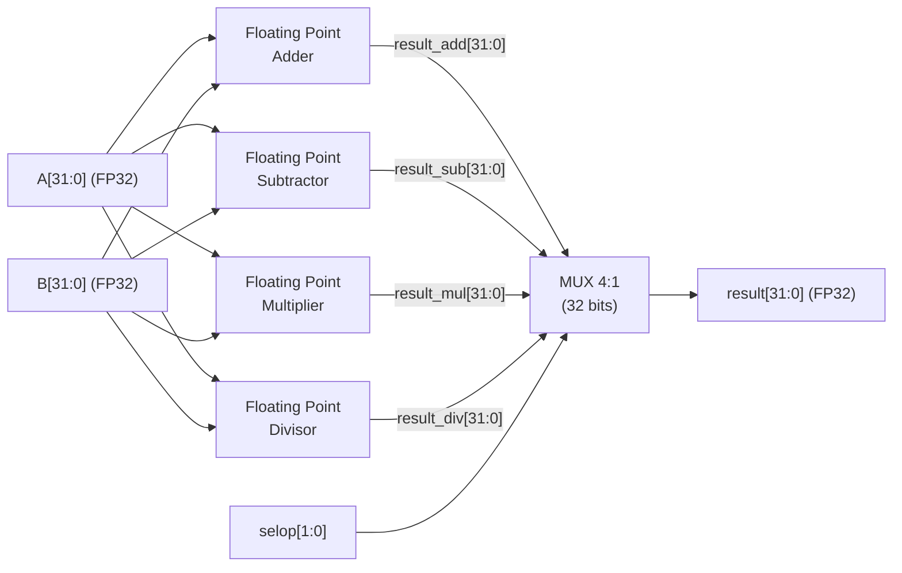

# Pontificia Universidad Javeriana
## Departamento de Electrónica
### System on Chip (SoC)

---

# Taller 3: RTL Design II — Circuitos Aritméticos

> **Condiciones de entrega:**  
> Se debe desarrollar un informe que reporte cada uno de los puntos requeridos en el taller mostrando evidencia de su desarrollo en la tarjeta:
> 1. Código generado (**VHDL** y **Verilog**, circuito y testbench).
> 2. Circuito sintetizado (**Quartus RTL Viewer** y reporte de recursos cuando corresponda).
> 3. Simulaciones (**ModelSim**) resaltando los eventos de interés y latencias.
> 4. Enlace a video en línea con el funcionamiento en la tarjeta **DE1-SoC** de los ejercicios que así lo requieran.

---

## Configuración del Interruptor MSEL (Tarjeta DE1-SoC)

Al encender la tarjeta **DE1-SoC**, la porción de FPGA puede ser configurada desde distintas fuentes tales como la FPGA, el HPS o la tarjeta SD. Los pines del *DIP switch* `MSEL[4:0]` (interruptor `SW10` en la parte posterior de la tarjeta) se utilizan para seleccionar el esquema de configuración.

Asegúrese de dejar los pines en la posición **`10010`** ($\text{MSEL}[4:0] = 10010_2$). Esta configuración corresponde al funcionamiento de la FPGA en modo **ASx4** (arranque directo desde la FPGA):

| Pin MSEL (`SW10`) | `MSEL[4]` (Pin 5) | `MSEL[3]` (Pin 4) | `MSEL[2]` (Pin 3) | `MSEL[1]` (Pin 2) | `MSEL[0]` (Pin 1) |
| :---: | :---: | :---: | :---: | :---: | :---: |
| **Posición (ASx4)** | `1` (Abajo / ON) | `0` (Arriba / OFF) | `0` (Arriba / OFF) | `1` (Abajo / ON) | `0` (Arriba / OFF) |

*Figura 1. Configuración de MSEL para arranque desde FPGA (in ASx4 Mode).*

---

## Parte I: Sumador - Restador

### Punto 1 — Verificación de `adders.vhd` y `add_w_carry.vhd`
1. Diseñe un *testbench* para verificar el funcionamiento del circuito generado en [`adders.vhd`](file:///c:/Users/Pedro/Documents/Ponti/SoC/SoC/Taller3/ej1_adders/vhdl/src/adders.vhd) (el cual instancia dos módulos [`add_w_carry.vhd`](file:///c:/Users/Pedro/Documents/Ponti/SoC/SoC/Taller3/ej1_adders/vhdl/src/add_w_carry.vhd)) adjunto a la presente guía.
2. Utilice las constantes genéricas:
   - `LARGE = 6`
   - `SMALL = 4`
3. No es necesario probar todos los casos; diseñe un vector de pruebas con suficientes casos para observar la suma correcta en ambos sumadores (incluyendo casos con y sin acarreo de salida `cout`).
4. Verifique los circuitos generados (RTL Viewer), el funcionamiento de los sumadores y las características de tiempos.

---

### Punto 2 — Traducción a Verilog
1. Traduzca los códigos del punto anterior (`add_w_carry` y `adders`, junto con su *testbench*) a **Verilog** y repita el procedimiento de síntesis y simulación.

---

### Punto 3 — Sumador-Restador Parametrizable Asincrónico (`add_subs`)
1. Utilice como base el código del módulo [`add_w_carry.vhd`](file:///c:/Users/Pedro/Documents/Ponti/SoC/SoC/Taller3/ej2_add_subs/vhdl/src/add_w_carry.vhd) para diseñar un **sumador-restador parametrizable asincrónico** (sin reloj) con la siguiente definición de puertos:

```vhdl
ENTITY add_subs IS
    GENERIC (
        EXTENDED_RANGE : INTEGER := 4
    );
    PORT (
        a         : in  std_logic_vector(EXTENDED_RANGE-1 DOWNTO 0);
        b         : in  std_logic_vector(EXTENDED_RANGE-1 DOWNTO 0);
        add_subsn : in  std_logic;
        cout      : out std_logic;
        sum       : out std_logic_vector(EXTENDED_RANGE-1 DOWNTO 0)
    );
END ENTITY add_subs;
```
*Figura 2. Definición de puertos del circuito `add_subs.vhd`.*

2. **Especificaciones de operación:**
   - El módulo `add_subs` debe recibir dos operandos `a` y `b` de 4 bits interpretados como **binario sin signo** y entregar una señal de 4 bits `sum` como salida.
   - Esta salida podrá ser interpretada como **binario con signo de 5 bits** (complemento a 2, concatenando `cout & sum`) dependiendo del estado de la señal `add_subsn`.
   - La señal `add_subsn` (*addition/subtraction negated*) determinará si los dos operandos deben:
     - **Sumarse ($a + b$)** si `add_subsn = '1'`.
     - **Restarse ($a - b$)** si `add_subsn = '0'`.
   - Recuerde que restar es sumar el negativo ($a - b = a + (-b)$). Utilice **complemento a 2** para encontrar el número recíproco ($-b = \overline{b} + 1$).
   - Diseñe una manera eficiente para determinar el complemento a 2 de un número binario, por ejemplo, utilizando una compuerta **XOR** bit a bit junto con estructuras de selección (`when-else` o `with-select`) dentro del sumador para determinar la operación que debe realizarse.
   - Adicionalmente, el módulo entrega la señal `cout` indicando el *carry* / quinto bit de la operación.
3. **Verificación:**
   - Diseñe un *testbench* para verificar el funcionamiento del circuito. Pruebe únicamente algunos casos representativos donde sea posible verificar suma correcta, resta correcta (resultado positivo y negativo) y *carry*.

---

### Punto 4 — Integración con Visualización en 7 Segmentos en la Tarjeta DE1-SoC
1. Diseñe un circuito adicional que integre el módulo `add_subs` del punto anterior, el módulo `sevenSegmentDecoder` visto en clase (modificado en caso de ser necesario) y los circuitos adicionales que se requieran, para ser descargado en la tarjeta **DE1-SoC**.
2. **Asignación de entradas y salidas en la tarjeta:**
   - **8 interruptores deslizantes (`SW`)** representarán los operandos `a` (4 bits, sin signo) y `b` (4 bits, sin signo).
   - **1 interruptor adicional (`SW`)** será utilizado para la entrada `add_subsn`.
   - **Salidas:** Serán visualizadas en los displays de **7 segmentos** (`HEX`).
3. **Rango y formato de visualización:**
   - El rango de visualización debe cubrir desde **`+15` (`0b01111`)** hasta **`-16` (`0b10000`)** (además de sumas de hasta $15 + 15 = 30$ cuando `add_subsn = '1'`).
   - El quinto bit será la señal `cout`:
     - Cuando **`add_subsn = '0'` (resta):** La salida (`cout & sum`) será interpretada como número binario de **5 bits con signo en complemento a 2** (mostrando el signo `-` en un display cuando el resultado sea negativo).
     - Cuando **`add_subsn = '1'` (suma):** La salida será interpretada como binario **sin signo de 4 bits** y `cout` determinará el *overflow* (o quinto bit de magnitud para representar sumas entre 16 y 30).

#### Casos Ilustrativos de Funcionamiento en la DE1-SoC (Figura 3):

| Operando `a` (`SW`) | Operando `b` (`SW`) | `add_subsn` (`SW`) | Operación | Visualización en 7 Segmentos (`HEX`) |
| :---: | :---: | :---: | :---: | :---: |
| `0101` ($5$) | `0011` ($3$) | `1` — On ($+$) | $5 + 3 = +8$ | `   8` |
| `0101` ($5$) | `0011` ($3$) | `0` — Off ($-$) | $5 - 3 = +2$ | `   2` |
| `0011` ($3$) | `0101` ($5$) | `0` — Off ($-$) | $3 - 5 = -2$ | `  -2` |
| `1111` ($15$) | `1111` ($15$) | `1` — On ($+$) | $15 + 15 = 30$ | `  30` |
| `1101` ($13$) | `0010` ($2$) | `1` — On ($+$) | $13 + 2 = 15$ | `  15` |
| `0111` ($7$) | `1111` ($15$) | `0` — Off ($-$) | $7 - 15 = -8$ | `  -8` |
| `0001` ($1$) | `1111` ($15$) | `0` — Off ($-$) | $1 - 15 = -14$ | ` -14` |

*Figura 3. Ejemplo de funcionamiento de un sumador-restador binario en la tarjeta DE1-SoC.*

---

## Parte II: Unidad de Punto Flotante (FP32 IEEE 754)

### Punto 5 — Diseño de la Unidad Aritmética en Punto Flotante con IPs de Quartus
La **Figura 4** presenta una unidad aritmética en punto flotante:
- **Entradas:**
  - `A[31:0]`: Primer operando en formato **FP32 IEEE 754** (32 bits).
  - `B[31:0]`: Segundo operando en formato **FP32 IEEE 754** (32 bits).
  - `selop[1:0]`: Señal de selección de operación de 2 bits (Suma, Resta, Multiplicación, División).
  - `clk`: Señal de reloj (requerida por los bloques IP de punto flotante).
- **Salida:**
  - `result[31:0]`: Resultado en formato **FP32 IEEE 754** (32 bits).


*Figura 4. Unidad aritmética de punto flotante.*

**Requerimientos del Punto 5:**
1. Diseñe un proyecto en hardware reconfigurable que integre **IPs de punto flotante** (`ALTFP_ADD_SUB`, `ALTFP_MULT`, `ALTFP_DIV`) de acuerdo con la arquitectura de la Figura 4.
2. Seleccione la **menor latencia posible** para cada uno de los módulos aritméticos en el asistente MegaWizard / IP Catalog.
3. Verifique la implementación que Quartus realiza del circuito diseñado, identificando:
   - Componentes implementados en **elementos lógicos** (ALMs / LEs).
   - Componentes implementados en **módulos dedicados de multiplicación (DSP blocks)**.
   - El **total de recursos** utilizados en la FPGA.
   *(Este circuito será utilizado más adelante en el curso).*

---

### Punto 6 — Implementación en VHDL y en Verilog
1. Implemente el proyecto de la Unidad de Punto Flotante tanto en **VHDL** como en **Verilog**.

---

### Punto 7 — Simulación y Análisis de Latencias a 50 MHz
1. Simule la operación de la unidad de punto flotante para verificar su funcionamiento.
2. Identifique claramente los **tiempos de latencia** (en ciclos de reloj y en nanosegundos) de cada una de las 4 operaciones (suma, resta, multiplicación y división).
3. Recuerde que los circuitos de punto flotante incluyen reloj: utilice una **frecuencia de reloj de 50 MHz** ($T_{\text{clk}} = 20\text{ ns}$) para las simulaciones.

