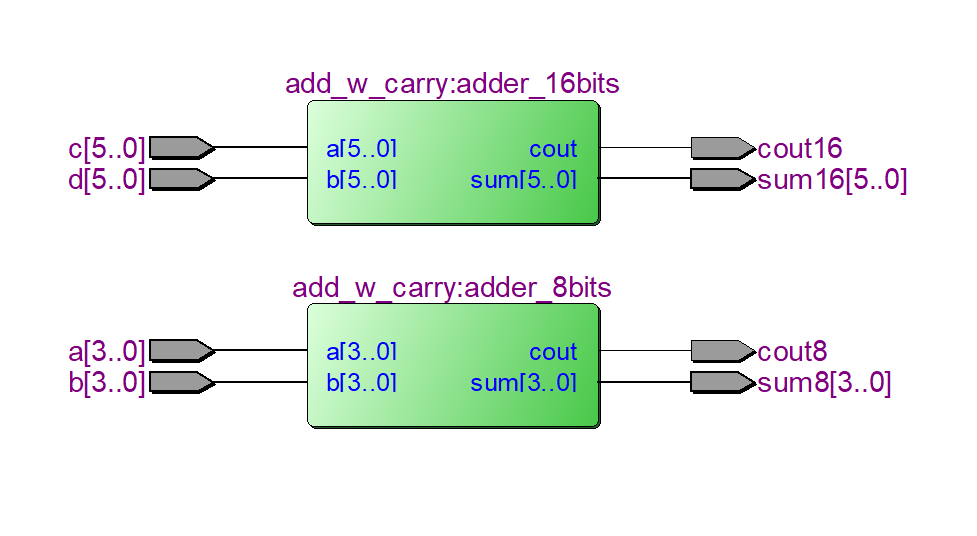
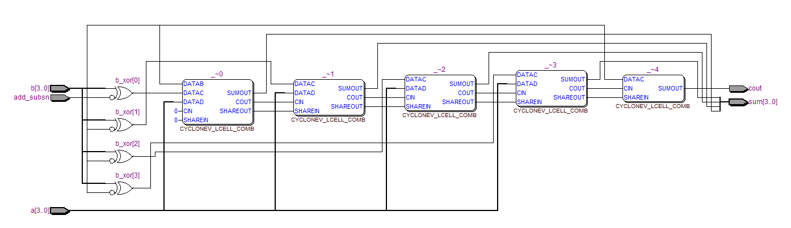
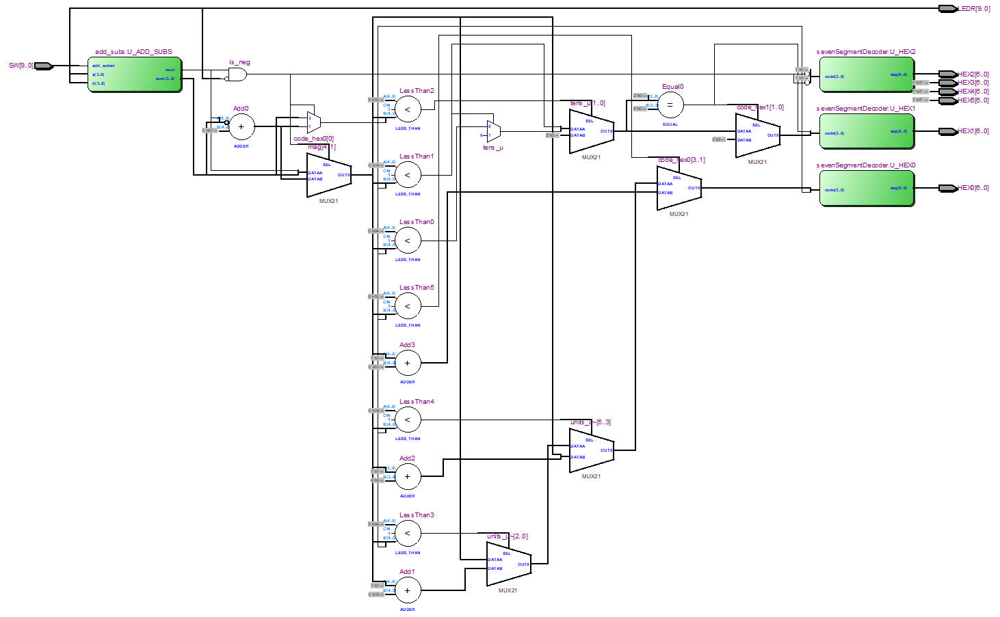
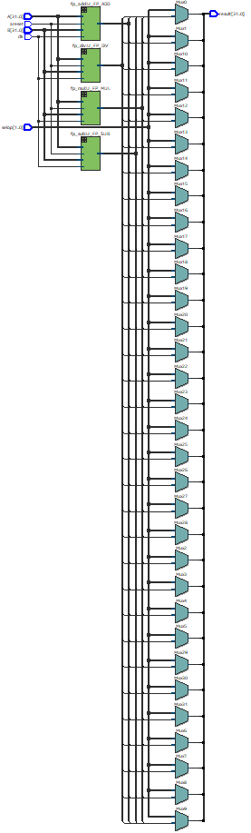
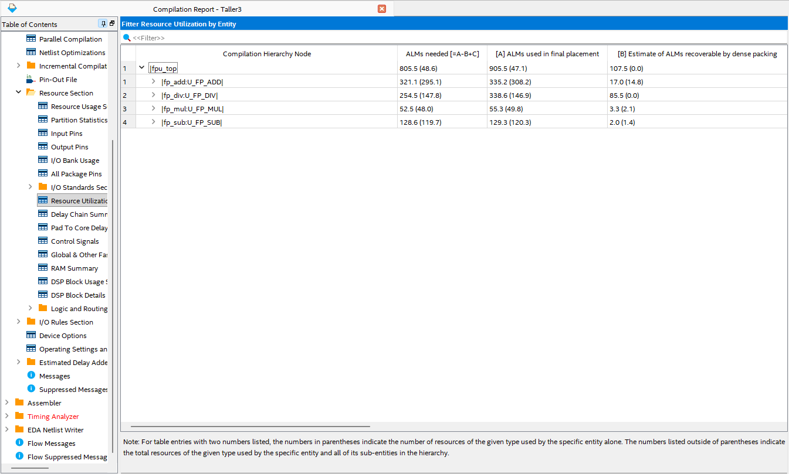

# Taller 3: RTL Design II — Circuitos Aritméticos
**Pontificia Universidad Javeriana**  
**Departamento de Electrónica**  
**System on Chip (SoC)**  

---

## Parte I: Sumador - Restador

### 1.1. Puntos 1 y 2: Sumadores Parametrizables (`adders` y `add_w_carry`)

El diseño base consta del módulo parametrizable `add_w_carry` (que extiende en 1 bit los operandos sin signo `a` y `b` para capturar el acarreo de salida `cout`) y de la entidad superior `adders`, la cual instancia dos sumadores independientes parametrizados con `SMALL = 4` (4 bits) y `LARGE = 6` (6 bits).

#### 1.1.1. Implementación en VHDL (`add_w_carry.vhd` y `adders.vhd`)
*(Espacio reservado para el código VHDL)*

#### 1.1.2. Testbench en VHDL (`adders_tb.vhd`)
*(Espacio reservado para el testbench VHDL con `LARGE = 6` y `SMALL = 4`)*

#### 1.1.3. Traducción a Verilog (`add_w_carry.v`, `adders.v` y `adders_tb.v`)
*(Espacio reservado para los módulos y testbench en Verilog)*

#### 1.1.4. Circuito Generado por Quartus (RTL Viewer)
> **[EVIDENCIA FOTOGRÁFICA 1: RTL VIEWER ADDERS]**  
> *Guarda la captura con el nombre `images/adders_rtl.png`.*

#### 1.1.5. Simulación en ModelSim y Características de Tiempos
> **[EVIDENCIA FOTOGRÁFICA 2: SIMULACIÓN MODELSIM ADDERS]**  
> *Guarda la captura con el nombre `images/adders_modelsim.png`.*

---

### 1.2. Punto 3: Sumador-Restador Parametrizable Asincrónico (`add_subs`)

#### 1.2.1. Fundamento Matemático (Complemento a 2 y Selección de Operación)
Para realizar tanto la suma ($A + B$) como la resta ($A - B = A + \overline{B} + 1$) empleando un único sumador:
- Cuando `add_subsn = '1'` (**Suma**): se suma $A + B + 0$.
- Cuando `add_subsn = '0'` (**Resta**): se invierten los bits de $B$ mediante una operación XOR con `'1'` y se suma `'1'` como acarreo de entrada ($C_{\text{in}} = \overline{\text{add\_subsn}}$), obteniendo el complemento a 2 de $B$: $-B = \overline{B} + 1$.

#### 1.2.2. Implementación en HDL (`add_subs.vhd` y `add_subs.v`)
*(Espacio reservado para los códigos HDL)*

#### 1.2.3. Testbench (`add_subs_tb.vhd` y `add_subs_tb.v`)
*(Espacio reservado para el testbench)*

#### 1.2.4. Circuito Generado por Quartus (RTL Viewer)
> **[EVIDENCIA FOTOGRÁFICA 3: RTL VIEWER ADD_SUBS]**  
> *Guarda la captura con el nombre `images/add_subs_rtl.png`.*

#### 1.2.5. Simulación en ModelSim y Análisis de Casos
> **[EVIDENCIA FOTOGRÁFICA 4: SIMULACIÓN MODELSIM ADD_SUBS]**  
> *Guarda la captura con el nombre `images/add_subs_modelsim.png`.*

---

### 1.3. Punto 4: Integración con Visualización en 7 Segmentos en la Tarjeta DE1-SoC

#### 1.3.1. Arquitectura de Visualización Decimal Con Signo (`[-16, +15]` y Suma hasta `+30`)
*(Espacio reservado para la explicación del conversor magnitud/signo + decodificador de 7 segmentos y asignación de pines en la DE1-SoC)*

#### 1.3.2. Códigos HDL (`add_subs_de1soc.vhd` / `sevenSegmentDecoder.vhd`)
*(Espacio reservado para el código)*

#### 1.3.3. Circuito Generado por Quartus (RTL Viewer)
> **[EVIDENCIA FOTOGRÁFICA 5: RTL VIEWER DE1-SOC TOP]**  
> *Guarda la captura con el nombre `images/add_subs_de1soc_rtl.png`.*

#### 1.3.4. Evidencia de Funcionamiento en la Tarjeta DE1-SoC (Video)
- **Enlace al video demostrativo en la tarjeta DE1-SoC:** *(Insertar enlace aquí)*

---

## Parte II: Unidad de Punto Flotante (FP32 IEEE 754)

### 2.1. Punto 5: Arquitectura e Integración de IPs de Punto Flotante en Quartus

#### 2.1.1. Configuración de Módulos IP (Menor Latencia Posible)
| Módulo IP | Operación (`selop`) | Latencia Configurada (Ciclos) | Elementos Lógicos (ALMs) | Bloques DSP |
| :--- | :---: | :---: | :---: | :---: |
| `fp_add` (`ALTFP_ADD_SUB`) | `00` (Suma) | - | - | - |
| `fp_sub` (`ALTFP_ADD_SUB`) | `01` (Resta) | - | - | - |
| `fp_mul` (`ALTFP_MULT`) | `10` (Multiplicación) | - | - | - |
| `fp_div` (`ALTFP_DIV`) | `11` (División) | - | - | - |
| **Total Unidad FPU** | **Todas** | - | - | - |

#### 2.1.2. Circuito Generado por Quartus (RTL Viewer y Compilation Report)
> **[EVIDENCIA FOTOGRÁFICA 6: RTL VIEWER Y RECURSOS FPU]**  
> *Guarda las capturas con los nombres `images/fpu_rtl.png` y `images/fpu_resources.png`.*

---

### 2.2. Punto 6: Implementación en VHDL y en Verilog

#### 2.2.1. Top-Level FPU en VHDL (`fpu_top.vhd`)
*(Espacio reservado para el código VHDL)*

#### 2.2.2. Top-Level FPU en Verilog (`fpu_top.v`)
*(Espacio reservado para el código Verilog)*

---

### 2.3. Punto 7: Simulación a 50 MHz y Análisis de Latencias

#### 2.3.1. Testbench a 50 MHz ($T_{\text{clk}} = 20\text{ ns}$)
*(Espacio reservado para el testbench)*

#### 2.3.2. Resultados de Simulación y Medición de Latencias
> **[EVIDENCIA FOTOGRÁFICA 7: SIMULACIÓN MODELSIM FPU]**  
> *Guarda la captura con el nombre `images/fpu_modelsim.png`.*

