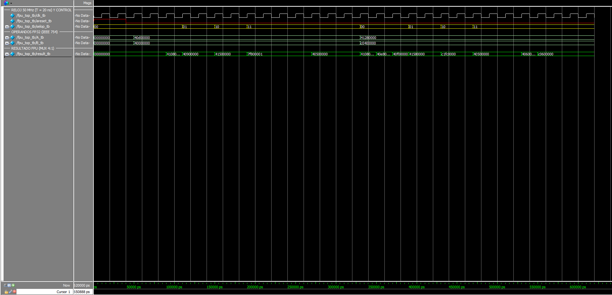

# Taller 3: RTL Design II — Circuitos Aritméticos
**Pontificia Universidad Javeriana**  
**Departamento de Electrónica**  
**System on Chip (SoC)**  

---

## Parte I: Sumador - Restador

### 1.1. Puntos 1 y 2: Sumadores Parametrizables (`adders` y `add_w_carry`)

El diseño base consta del módulo parametrizable `add_w_carry` (que extiende en 1 bit los operandos sin signo `a` y `b` para capturar el acarreo de salida `cout`) y de la entidad superior `adders`, la cual instancia dos sumadores independientes parametrizados con `SMALL = 4` (4 bits) y `LARGE = 6` (6 bits).

#### 1.1.1. Implementación en VHDL (`add_w_carry.vhd` y `adders.vhd`)

**Módulo `add_w_carry.vhd`:**
```vhdl
LIBRARY ieee;
USE ieee.std_logic_1164.all;
USE ieee.numeric_std.all;

ENTITY add_w_carry IS
    GENERIC (EXTENDED_RANGE : INTEGER := 4);
    PORT (
        a    : in  std_logic_vector(EXTENDED_RANGE-1 DOWNTO 0);
        b    : in  std_logic_vector(EXTENDED_RANGE-1 DOWNTO 0);
        cout : out std_logic;
        sum  : out std_logic_vector(EXTENDED_RANGE-1 DOWNTO 0)
    );
END ENTITY add_w_carry;

ARCHITECTURE generic_arch OF add_w_carry IS
    SIGNAL a_extended, b_extended, sum_extended : UNSIGNED(EXTENDED_RANGE DOWNTO 0);
BEGIN
    a_extended   <= unsigned('0' & a);
    b_extended   <= unsigned('0' & b);
    sum_extended <= a_extended + b_extended;
    sum          <= std_logic_vector(sum_extended(EXTENDED_RANGE-1 downto 0));
    cout         <= sum_extended(EXTENDED_RANGE);
END ARCHITECTURE generic_arch;
```

**Módulo superior `adders.vhd` (parametrizado con `SMALL = 4`, `LARGE = 6` en síntesis y simulación):**
```vhdl
LIBRARY ieee;
USE ieee.std_logic_1164.all;
USE ieee.numeric_std.all;

ENTITY adders IS
    GENERIC (
        LARGE : INTEGER := 16;
        SMALL : INTEGER := 8
    );
    PORT (
        a      : in  std_logic_vector(SMALL-1 DOWNTO 0);
        b      : in  std_logic_vector(SMALL-1 DOWNTO 0);
        c      : in  std_logic_vector(LARGE-1 DOWNTO 0);
        d      : in  std_logic_vector(LARGE-1 DOWNTO 0);
        cout8  : out std_logic;
        sum8   : out std_logic_vector(SMALL-1 DOWNTO 0);
        cout16 : out std_logic;
        sum16  : out std_logic_vector(LARGE-1 DOWNTO 0)
    );
END ENTITY adders;

ARCHITECTURE rtl OF adders IS
BEGIN
    adder_8bits: entity work.add_w_carry
        GENERIC MAP (EXTENDED_RANGE => SMALL)
        PORT MAP (
            a    => a,
            b    => b,
            cout => cout8,
            sum  => sum8
        );

    adder_16bits: entity work.add_w_carry
        GENERIC MAP (EXTENDED_RANGE => LARGE)
        PORT MAP (
            a    => c,
            b    => d,
            cout => cout16,
            sum  => sum16
        );
END ARCHITECTURE rtl;
```

#### 1.1.2. Testbench en VHDL (`adders_tb.vhd`)
Se diseñaron 8 vectores representativos (cada 20 ns) que validan sumas en cero, sumas sin acarreo, límites máximos sin desbordamiento (`15+0` y `63+0`, `9+6` y `40+23`) y casos con acarreo de salida (`15+1`, `63+1`, `15+15`, `63+63`).

```vhdl
library IEEE;
use IEEE.STD_LOGIC_1164.ALL;
use IEEE.NUMERIC_STD.ALL;

entity adders_tb is
end entity adders_tb;

architecture Behavioral of adders_tb is
    constant C_LARGE : integer := 6;
    constant C_SMALL : integer := 4;
    constant T_STEP  : time    := 20 ns;

    component adders is
        generic (
            LARGE : integer := 16;
            SMALL : integer := 8
        );
        port (
            a      : in  std_logic_vector(SMALL-1 downto 0);
            b      : in  std_logic_vector(SMALL-1 downto 0);
            c      : in  std_logic_vector(LARGE-1 downto 0);
            d      : in  std_logic_vector(LARGE-1 downto 0);
            cout8  : out std_logic;
            sum8   : out std_logic_vector(SMALL-1 downto 0);
            cout16 : out std_logic;
            sum16  : out std_logic_vector(LARGE-1 downto 0)
        );
    end component;

    signal a_tb : std_logic_vector(C_SMALL-1 downto 0) := (others => '0');
    signal b_tb : std_logic_vector(C_SMALL-1 downto 0) := (others => '0');
    signal c_tb : std_logic_vector(C_LARGE-1 downto 0) := (others => '0');
    signal d_tb : std_logic_vector(C_LARGE-1 downto 0) := (others => '0');

    signal cout8_tb  : std_logic;
    signal sum8_tb   : std_logic_vector(C_SMALL-1 downto 0);
    signal cout16_tb : std_logic;
    signal sum16_tb  : std_logic_vector(C_LARGE-1 downto 0);
begin
    DUT: adders
        generic map (
            LARGE => C_LARGE,
            SMALL => C_SMALL
        )
        port map (
            a      => a_tb,
            b      => b_tb,
            c      => c_tb,
            d      => d_tb,
            cout8  => cout8_tb,
            sum8   => sum8_tb,
            cout16 => cout16_tb,
            sum16  => sum16_tb
        );

    stim_proc: process
        type test_vec_t is record
            a_val, b_val, c_val, d_val : integer;
        end record;
        type test_array_t is array (natural range <>) of test_vec_t;
        constant VECTORS : test_array_t := (
            ( 0,  0,  0,  0),
            ( 3,  5, 10, 20),
            (15,  0, 63,  0),
            ( 9,  6, 40, 23),
            (15,  1, 63,  1),
            (10, 12, 50, 30),
            (15, 15, 63, 63),
            ( 7,  8, 32, 32)
        );
        variable exp_small : unsigned(C_SMALL downto 0);
        variable exp_large : unsigned(C_LARGE downto 0);
    begin
        for idx in VECTORS'range loop
            a_tb <= std_logic_vector(to_unsigned(VECTORS(idx).a_val, C_SMALL));
            b_tb <= std_logic_vector(to_unsigned(VECTORS(idx).b_val, C_SMALL));
            c_tb <= std_logic_vector(to_unsigned(VECTORS(idx).c_val, C_LARGE));
            d_tb <= std_logic_vector(to_unsigned(VECTORS(idx).d_val, C_LARGE));
            wait for T_STEP;

            exp_small := to_unsigned(VECTORS(idx).a_val + VECTORS(idx).b_val, C_SMALL + 1);
            exp_large := to_unsigned(VECTORS(idx).c_val + VECTORS(idx).d_val, C_LARGE + 1);

            assert (sum8_tb = std_logic_vector(exp_small(C_SMALL-1 downto 0))) and (cout8_tb = exp_small(C_SMALL))
                report "ERROR SUMADOR SMALL" severity error;
            assert (sum16_tb = std_logic_vector(exp_large(C_LARGE-1 downto 0))) and (cout16_tb = exp_large(C_LARGE))
                report "ERROR SUMADOR LARGE" severity error;
        end loop;
        wait;
    end process;
end architecture Behavioral;
```

#### 1.1.3. Traducción a Verilog (`add_w_carry.v`, `adders.v` y `adders_tb.v`)
*(Espacio reservado para los módulos y testbench en Verilog)*

#### 1.1.4. Circuito Generado por Quartus (RTL Viewer)

En el nivel superior (`adders`), Quartus instancia en paralelo los dos módulos parametrizados `add_w_carry`: `adder_8bits` con ancho de 4 bits (`SMALL = 4`) y `adder_16bits` con ancho de 6 bits (`LARGE = 6`).


Al inspeccionar el interior de cada instancia, se observa cómo la síntesis traduce la concatenación `'0' & a` y `'0' & b` en hardware: añade un bit constante `1'h0` en el MSB de cada operando para alimentar un sumador de $N+1$ bits (`Add0`), separando luego el bit más significativo hacia `cout` y los $N$ bits inferiores hacia `sum`.


#### 1.1.5. Simulación en ModelSim y Características de Tiempos


**Análisis de la simulación (intervalos de 20 ns):**
- **$0 - 80\text{ ns}$ (Sumas sin acarreo, `cout = '0'`):**
  - `0 + 0 = 0` y `3 + 5 = 8` en 4 bits; `0 + 0 = 0` y `10 + 20 = 30` en 6 bits.
  - En `40 - 80 ns` se validan los límites máximos representables sin desbordamiento: `15 + 0 = 15` y `9 + 6 = 15` en 4 bits (`cout8 = '0'`); `63 + 0 = 63` y `40 + 23 = 63` en 6 bits (`cout16 = '0'`).
- **$80 - 140\text{ ns}$ (Sumas con acarreo, `cout = '1'`):**
  - En $t = 80\text{ ns}$ ocurre el primer desbordamiento en ambos sumadores: `15 + 1 = 16` (`sum8 = 0`, `cout8 = '1'`) y `63 + 1 = 64` (`sum16 = 0`, `cout16 = '1'`).
  - En `100 - 140 ns` se comprueba el residuo correcto con acarreo activo: `10 + 12 = 22` (`16 + 6`), `15 + 15 = 30` (`16 + 14`) en 4 bits; `50 + 30 = 80` (`64 + 16`) y `63 + 63 = 126` (`64 + 62`) en 6 bits.
- **$140 - 180\text{ ns}$ (Independencia entre ambos módulos):**
  - `7 + 8 = 15` mantiene `cout8 = '0'`, mientras que simultáneamente `32 + 32 = 64` produce `sum16 = 0` y `cout16 = '1'`, verificando que ambos sumadores operan de forma completamente independiente.
- **Características de tiempos:** Al tratarse de lógica puramente combinacional (sin reloj), los cambios en `sum8`, `cout8`, `sum16` y `cout16` ocurren de forma inmediata en simulación funcional ante cada transición de entrada cada $20\text{ ns}$.

---

### 1.2. Punto 3: Sumador-Restador Parametrizable Asincrónico (`add_subs`)

#### 1.2.1. Fundamento Matemático (Complemento a 2 y Selección de Operación)
Para realizar tanto la suma ($A + B$) como la resta ($A - B = A + \overline{B} + 1$) empleando un único sumador:
- Cuando `add_subsn = '1'` (**Suma**): se suma $A + B + 0$.
- Cuando `add_subsn = '0'` (**Resta**): se invierten los bits de $B$ mediante una operación XOR con `'1'` y se suma `'1'` como acarreo de entrada ($C_{\text{in}} = \overline{\text{add\_subsn}}$), obteniendo el complemento a 2 de $B$: $-B = \overline{B} + 1$.

#### 1.2.2. Implementación en HDL (`add_subs.vhd` y `add_subs.v`)
*(Espacio reservado para los códigos HDL)*

#### 1.2.3. Testbench (`add_subs_tb.vhd` y `add_subs_tb.v`)
*(Espacio reservado para el testbench)*

#### 1.2.4. Circuito Generado por Quartus (RTL Viewer)
> **[EVIDENCIA FOTOGRÁFICA 3: RTL VIEWER ADD_SUBS]**  
> *Guarda la captura con el nombre `images/add_subs_rtl.png`.*


#### 1.2.5. Simulación en ModelSim y Análisis de Casos
> **[EVIDENCIA FOTOGRÁFICA 4: SIMULACIÓN MODELSIM ADD_SUBS]**  
> *Guarda la captura con el nombre `images/add_subs_modelsim.png`.*


---

### 1.3. Punto 4: Integración con Visualización en 7 Segmentos en la Tarjeta DE1-SoC

#### 1.3.1. Arquitectura de Visualización Decimal Con Signo (`[-16, +15]` y Suma hasta `+30`)
*(Espacio reservado para la explicación del conversor magnitud/signo + decodificador de 7 segmentos y asignación de pines en la DE1-SoC)*

#### 1.3.2. Códigos HDL (`add_subs_de1soc.vhd` / `sevenSegmentDecoder.vhd`)
*(Espacio reservado para el código)*

#### 1.3.3. Circuito Generado por Quartus (RTL Viewer)
> **[EVIDENCIA FOTOGRÁFICA 5: RTL VIEWER DE1-SOC TOP]**  
> *Guarda la captura con el nombre `images/add_subs_de1soc_rtl.png`.*


#### 1.3.4. Evidencia de Funcionamiento en la Tarjeta DE1-SoC (Video)
- **Enlace al video demostrativo en la tarjeta DE1-SoC:** *(Insertar enlace aquí)*

---

## Parte II: Unidad de Punto Flotante (FP32 IEEE 754)

### 2.1. Punto 5: Arquitectura e Integración de IPs de Punto Flotante en Quartus

#### 2.1.1. Configuración de Módulos IP (Menor Latencia Posible)
| Módulo IP | Operación (`selop`) | Latencia Configurada (Ciclos) | Elementos Lógicos (ALMs) | Bloques DSP |
| :--- | :---: | :---: | :---: | :---: |
| `fp_add` (`ALTFP_ADD_SUB`) | `00` (Suma) | - | - | - |
| `fp_sub` (`ALTFP_ADD_SUB`) | `01` (Resta) | - | - | - |
| `fp_mul` (`ALTFP_MULT`) | `10` (Multiplicación) | - | - | - |
| `fp_div` (`ALTFP_DIV`) | `11` (División) | - | - | - |
| **Total Unidad FPU** | **Todas** | - | - | - |

#### 2.1.2. Circuito Generado por Quartus (RTL Viewer y Compilation Report)
> **[EVIDENCIA FOTOGRÁFICA 6: RTL VIEWER Y RECURSOS FPU]**  
> *Guarda las capturas con los nombres `images/fpu_rtl.png` y `images/fpu_resources.png`.*


---

### 2.2. Punto 6: Implementación en VHDL y en Verilog

#### 2.2.1. Top-Level FPU en VHDL (`fpu_top.vhd`)
*(Espacio reservado para el código VHDL)*

#### 2.2.2. Top-Level FPU en Verilog (`fpu_top.v`)
*(Espacio reservado para el código Verilog)*

---

### 2.3. Punto 7: Simulación a 50 MHz y Análisis de Latencias

#### 2.3.1. Testbench a 50 MHz ($T_{\text{clk}} = 20\text{ ns}$)
*(Espacio reservado para el testbench)*

#### 2.3.2. Resultados de Simulación y Medición de Latencias
> **[EVIDENCIA FOTOGRÁFICA 7: SIMULACIÓN MODELSIM FPU]**  
> *Guarda la captura con el nombre `images/fpu_modelsim.png`.*



