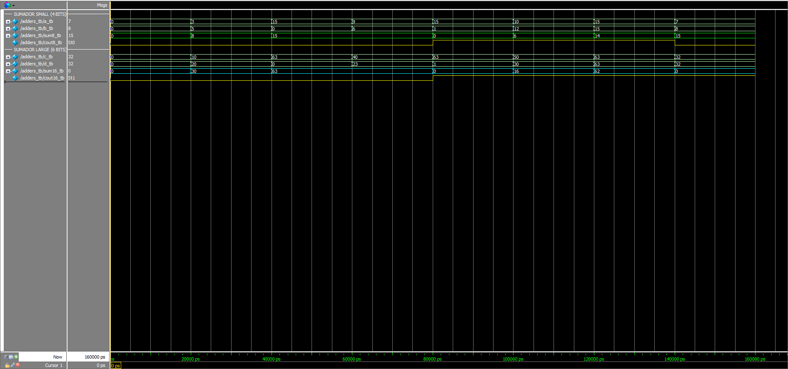
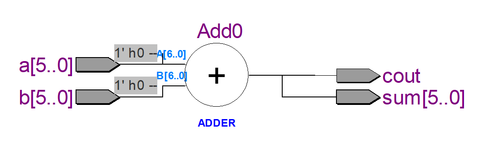
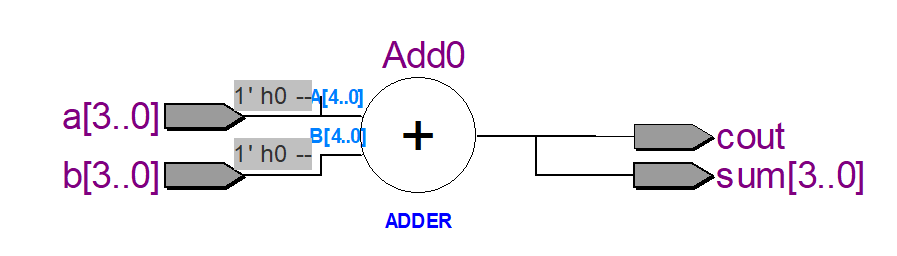
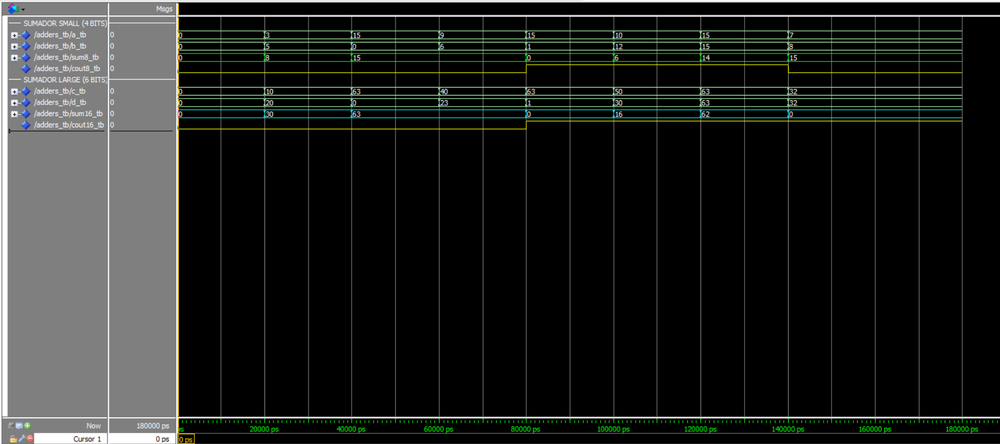
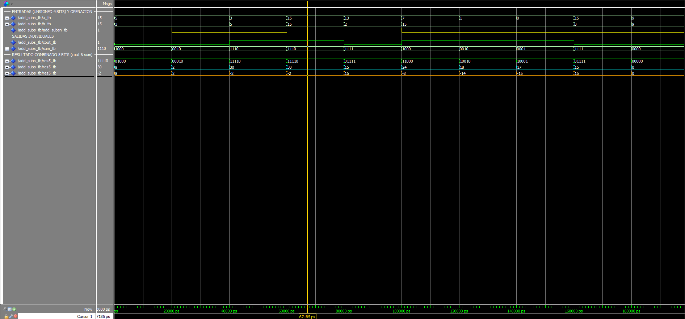

# Taller 3: RTL Design II — Circuitos Aritméticos
**Pontificia Universidad Javeriana**  
**Departamento de Electrónica**  
**System on Chip (SoC)**  

---

## Parte I: Sumador - Restador

### 1.1. Puntos 1 y 2: Sumadores Parametrizables (`adders` y `add_w_carry`)

El diseño base consta del módulo parametrizable `add_w_carry` (que extiende en 1 bit los operandos sin signo `a` y `b` para capturar el acarreo de salida `cout`) y de la entidad superior `adders`, la cual instancia dos sumadores independientes parametrizados con `SMALL = 4` (4 bits) y `LARGE = 6` (6 bits).

#### 1.1.1. Implementación en VHDL (`add_w_carry.vhd` y `adders.vhd`)

**Módulo `add_w_carry.vhd`:**
```vhdl
LIBRARY ieee;
USE ieee.std_logic_1164.all;
USE ieee.numeric_std.all;

ENTITY add_w_carry IS
    GENERIC (EXTENDED_RANGE : INTEGER := 4);
    PORT (
        a    : in  std_logic_vector(EXTENDED_RANGE-1 DOWNTO 0);
        b    : in  std_logic_vector(EXTENDED_RANGE-1 DOWNTO 0);
        cout : out std_logic;
        sum  : out std_logic_vector(EXTENDED_RANGE-1 DOWNTO 0)
    );
END ENTITY add_w_carry;

ARCHITECTURE generic_arch OF add_w_carry IS
    SIGNAL a_extended, b_extended, sum_extended : UNSIGNED(EXTENDED_RANGE DOWNTO 0);
BEGIN
    a_extended   <= unsigned('0' & a);
    b_extended   <= unsigned('0' & b);
    sum_extended <= a_extended + b_extended;
    sum          <= std_logic_vector(sum_extended(EXTENDED_RANGE-1 downto 0));
    cout         <= sum_extended(EXTENDED_RANGE);
END ARCHITECTURE generic_arch;
```

**Módulo superior `adders.vhd` (parametrizado con `SMALL = 4`, `LARGE = 6` en síntesis y simulación):**
```vhdl
LIBRARY ieee;
USE ieee.std_logic_1164.all;
USE ieee.numeric_std.all;

ENTITY adders IS
    GENERIC (
        LARGE : INTEGER := 16;
        SMALL : INTEGER := 8
    );
    PORT (
        a      : in  std_logic_vector(SMALL-1 DOWNTO 0);
        b      : in  std_logic_vector(SMALL-1 DOWNTO 0);
        c      : in  std_logic_vector(LARGE-1 DOWNTO 0);
        d      : in  std_logic_vector(LARGE-1 DOWNTO 0);
        cout8  : out std_logic;
        sum8   : out std_logic_vector(SMALL-1 DOWNTO 0);
        cout16 : out std_logic;
        sum16  : out std_logic_vector(LARGE-1 DOWNTO 0)
    );
END ENTITY adders;

ARCHITECTURE rtl OF adders IS
BEGIN
    adder_8bits: entity work.add_w_carry
        GENERIC MAP (EXTENDED_RANGE => SMALL)
        PORT MAP (
            a    => a,
            b    => b,
            cout => cout8,
            sum  => sum8
        );

    adder_16bits: entity work.add_w_carry
        GENERIC MAP (EXTENDED_RANGE => LARGE)
        PORT MAP (
            a    => c,
            b    => d,
            cout => cout16,
            sum  => sum16
        );
END ARCHITECTURE rtl;
```

#### 1.1.2. Testbench en VHDL (`adders_tb.vhd`)
Se diseñaron 8 vectores representativos (cada 20 ns) que validan sumas en cero, sumas sin acarreo, límites máximos sin desbordamiento (`15+0` y `63+0`, `9+6` y `40+23`) y casos con acarreo de salida (`15+1`, `63+1`, `15+15`, `63+63`).

```vhdl
library IEEE;
use IEEE.STD_LOGIC_1164.ALL;
use IEEE.NUMERIC_STD.ALL;

entity adders_tb is
end entity adders_tb;

architecture Behavioral of adders_tb is
    constant C_LARGE : integer := 6;
    constant C_SMALL : integer := 4;
    constant T_STEP  : time    := 20 ns;

    component adders is
        generic (
            LARGE : integer := 16;
            SMALL : integer := 8
        );
        port (
            a      : in  std_logic_vector(SMALL-1 downto 0);
            b      : in  std_logic_vector(SMALL-1 downto 0);
            c      : in  std_logic_vector(LARGE-1 downto 0);
            d      : in  std_logic_vector(LARGE-1 downto 0);
            cout8  : out std_logic;
            sum8   : out std_logic_vector(SMALL-1 downto 0);
            cout16 : out std_logic;
            sum16  : out std_logic_vector(LARGE-1 downto 0)
        );
    end component;

    signal a_tb : std_logic_vector(C_SMALL-1 downto 0) := (others => '0');
    signal b_tb : std_logic_vector(C_SMALL-1 downto 0) := (others => '0');
    signal c_tb : std_logic_vector(C_LARGE-1 downto 0) := (others => '0');
    signal d_tb : std_logic_vector(C_LARGE-1 downto 0) := (others => '0');

    signal cout8_tb  : std_logic;
    signal sum8_tb   : std_logic_vector(C_SMALL-1 downto 0);
    signal cout16_tb : std_logic;
    signal sum16_tb  : std_logic_vector(C_LARGE-1 downto 0);
begin
    DUT: adders
        generic map (
            LARGE => C_LARGE,
            SMALL => C_SMALL
        )
        port map (
            a      => a_tb,
            b      => b_tb,
            c      => c_tb,
            d      => d_tb,
            cout8  => cout8_tb,
            sum8   => sum8_tb,
            cout16 => cout16_tb,
            sum16  => sum16_tb
        );

    stim_proc: process
        type test_vec_t is record
            a_val, b_val, c_val, d_val : integer;
        end record;
        type test_array_t is array (natural range <>) of test_vec_t;
        constant VECTORS : test_array_t := (
            ( 0,  0,  0,  0),
            ( 3,  5, 10, 20),
            (15,  0, 63,  0),
            ( 9,  6, 40, 23),
            (15,  1, 63,  1),
            (10, 12, 50, 30),
            (15, 15, 63, 63),
            ( 7,  8, 32, 32)
        );
        variable exp_small : unsigned(C_SMALL downto 0);
        variable exp_large : unsigned(C_LARGE downto 0);
    begin
        for idx in VECTORS'range loop
            a_tb <= std_logic_vector(to_unsigned(VECTORS(idx).a_val, C_SMALL));
            b_tb <= std_logic_vector(to_unsigned(VECTORS(idx).b_val, C_SMALL));
            c_tb <= std_logic_vector(to_unsigned(VECTORS(idx).c_val, C_LARGE));
            d_tb <= std_logic_vector(to_unsigned(VECTORS(idx).d_val, C_LARGE));
            wait for T_STEP;

            exp_small := to_unsigned(VECTORS(idx).a_val + VECTORS(idx).b_val, C_SMALL + 1);
            exp_large := to_unsigned(VECTORS(idx).c_val + VECTORS(idx).d_val, C_LARGE + 1);

            assert (sum8_tb = std_logic_vector(exp_small(C_SMALL-1 downto 0))) and (cout8_tb = exp_small(C_SMALL))
                report "ERROR SUMADOR SMALL" severity error;
            assert (sum16_tb = std_logic_vector(exp_large(C_LARGE-1 downto 0))) and (cout16_tb = exp_large(C_LARGE))
                report "ERROR SUMADOR LARGE" severity error;
        end loop;
        wait;
    end process;
end architecture Behavioral;
```

#### 1.1.3. Traducción a Verilog (`add_w_carry.v`, `adders.v` y `adders_tb.v`)

##### Módulo `add_w_carry.v`
```verilog
`timescale 1ns / 1ps

module add_w_carry #(
    parameter EXTENDED_RANGE = 4
)(
    input  wire [EXTENDED_RANGE-1:0] a,
    input  wire [EXTENDED_RANGE-1:0] b,
    output wire                      cout,
    output wire [EXTENDED_RANGE-1:0] sum
);

    wire [EXTENDED_RANGE:0] a_extended;
    wire [EXTENDED_RANGE:0] b_extended;
    wire [EXTENDED_RANGE:0] sum_extended;

    assign a_extended   = {1'b0, a};
    assign b_extended   = {1'b0, b};
    assign sum_extended = a_extended + b_extended;

    assign sum  = sum_extended[EXTENDED_RANGE-1:0];
    assign cout = sum_extended[EXTENDED_RANGE];

endmodule
```

##### Módulo `adders.v`
```verilog
`timescale 1ns / 1ps

module adders #(
    parameter LARGE = 16,
    parameter SMALL = 8
)(
    input  wire [SMALL-1:0] a,
    input  wire [SMALL-1:0] b,
    input  wire [LARGE-1:0] c,
    input  wire [LARGE-1:0] d,
    output wire             cout8,
    output wire [SMALL-1:0] sum8,
    output wire             cout16,
    output wire [LARGE-1:0] sum16
);

    add_w_carry #(
        .EXTENDED_RANGE(SMALL)
    ) adder_8bits (
        .a    (a),
        .b    (b),
        .cout (cout8),
        .sum  (sum8)
    );

    add_w_carry #(
        .EXTENDED_RANGE(LARGE)
    ) adder_16bits (
        .a    (c),
        .b    (d),
        .cout (cout16),
        .sum  (sum16)
    );

endmodule
```

##### Testbench `adders_tb.v`
```verilog
`timescale 1ns / 1ps

module adders_tb;

    localparam C_LARGE = 6;
    localparam C_SMALL = 4;

    reg  [C_SMALL-1:0] a_tb;
    reg  [C_SMALL-1:0] b_tb;
    reg  [C_LARGE-1:0] c_tb;
    reg  [C_LARGE-1:0] d_tb;

    wire               cout8_tb;
    wire [C_SMALL-1:0] sum8_tb;
    wire               cout16_tb;
    wire [C_LARGE-1:0] sum16_tb;

    integer idx;
    integer errors = 0;

    reg [C_SMALL-1:0] vec_a [0:7];
    reg [C_SMALL-1:0] vec_b [0:7];
    reg [C_LARGE-1:0] vec_c [0:7];
    reg [C_LARGE-1:0] vec_d [0:7];

    reg [C_SMALL:0] exp_small;
    reg [C_LARGE:0] exp_large;

    adders #(
        .LARGE(C_LARGE),
        .SMALL(C_SMALL)
    ) DUT (
        .a      (a_tb),
        .b      (b_tb),
        .c      (c_tb),
        .d      (d_tb),
        .cout8  (cout8_tb),
        .sum8   (sum8_tb),
        .cout16 (cout16_tb),
        .sum16  (sum16_tb)
    );

    initial begin
        vec_a[0] = 4'd0;  vec_b[0] = 4'd0;  vec_c[0] = 6'd0;  vec_d[0] = 6'd0;
        vec_a[1] = 4'd3;  vec_b[1] = 4'd5;  vec_c[1] = 6'd10; vec_d[1] = 6'd20;
        vec_a[2] = 4'd15; vec_b[2] = 4'd0;  vec_c[2] = 6'd63; vec_d[2] = 6'd0;
        vec_a[3] = 4'd9;  vec_b[3] = 4'd6;  vec_c[3] = 6'd40; vec_d[3] = 6'd23;
        vec_a[4] = 4'd15; vec_b[4] = 4'd1;  vec_c[4] = 6'd63; vec_d[4] = 6'd1;
        vec_a[5] = 4'd10; vec_b[5] = 4'd12; vec_c[5] = 6'd50; vec_d[5] = 6'd30;
        vec_a[6] = 4'd15; vec_b[6] = 4'd15; vec_c[6] = 6'd63; vec_d[6] = 6'd63;
        vec_a[7] = 4'd7;  vec_b[7] = 4'd8;  vec_c[7] = 6'd32; vec_d[7] = 6'd32;

        for (idx = 0; idx < 8; idx = idx + 1) begin
            a_tb = vec_a[idx];
            b_tb = vec_b[idx];
            c_tb = vec_c[idx];
            d_tb = vec_d[idx];
            #20;

            exp_small = {1'b0, vec_a[idx]} + {1'b0, vec_b[idx]};
            exp_large = {1'b0, vec_c[idx]} + {1'b0, vec_d[idx]};

            if ({cout8_tb, sum8_tb} !== exp_small) errors = errors + 1;
            if ({cout16_tb, sum16_tb} !== exp_large) errors = errors + 1;
        end

        if (errors == 0)
            $display(">> VERIFICACION EXITOSA: Todos los vectores (SMALL=4, LARGE=6) pasaron sin errores!");
        else
            $display(">> VERIFICACION CON FALLAS: Total errores = %0d", errors);
    end
endmodule
```

**Simulación en ModelSim (Verilog):**



> Los resultados en Verilog son idénticos a la simulación VHDL ($0 - 160\text{ ns}$), verificando los mismos 8 vectores de prueba con 0 errores y confirmando la equivalencia funcional entre ambas descripciones HDL.

#### 1.1.4. Circuito Generado por Quartus (RTL Viewer)

En el nivel superior (`adders`), Quartus instancia en paralelo los dos módulos parametrizados `add_w_carry`: `adder_8bits` con ancho de 4 bits (`SMALL = 4`) y `adder_16bits` con ancho de 6 bits (`LARGE = 6`).


Al inspeccionar el interior de cada instancia, se observa cómo la síntesis traduce la concatenación `'0' & a` y `'0' & b` en hardware: añade un bit constante `1'h0` en el MSB de cada operando para alimentar un sumador de $N+1$ bits (`Add0`), separando luego el bit más significativo hacia `cout` y los $N$ bits inferiores hacia `sum`.




#### 1.1.5. Simulación en ModelSim y Características de Tiempos



**Análisis de la simulación (intervalos de 20 ns):**
- **$0 - 80\text{ ns}$ (Sumas sin acarreo, `cout = '0'`):**
  - `0 + 0 = 0` y `3 + 5 = 8` en 4 bits; `0 + 0 = 0` y `10 + 20 = 30` en 6 bits.
  - En `40 - 80 ns` se validan los límites máximos representables sin desbordamiento: `15 + 0 = 15` y `9 + 6 = 15` en 4 bits (`cout8 = '0'`); `63 + 0 = 63` y `40 + 23 = 63` en 6 bits (`cout16 = '0'`).
- **$80 - 140\text{ ns}$ (Sumas con acarreo, `cout = '1'`):**
  - En $t = 80\text{ ns}$ ocurre el primer desbordamiento en ambos sumadores: `15 + 1 = 16` (`sum8 = 0`, `cout8 = '1'`) y `63 + 1 = 64` (`sum16 = 0`, `cout16 = '1'`).
  - En `100 - 140 ns` se comprueba el residuo correcto con acarreo activo: `10 + 12 = 22` (`16 + 6`), `15 + 15 = 30` (`16 + 14`) en 4 bits; `50 + 30 = 80` (`64 + 16`) y `63 + 63 = 126` (`64 + 62`) en 6 bits.
- **$140 - 180\text{ ns}$ (Independencia entre ambos módulos):**
  - `7 + 8 = 15` mantiene `cout8 = '0'`, mientras que simultáneamente `32 + 32 = 64` produce `sum16 = 0` y `cout16 = '1'`, verificando que ambos sumadores operan de forma completamente independiente.
- **Características de tiempos:** Al tratarse de lógica puramente combinacional (sin reloj), los cambios en `sum8`, `cout8`, `sum16` y `cout16` ocurren de forma inmediata en simulación funcional ante cada transición de entrada cada $20\text{ ns}$.

---

### 1.2. Punto 3: Sumador-Restador Parametrizable Asincrónico (`add_subs`)

#### 1.2.1. Fundamento Matemático y Lógica del Circuito (Complemento a 2 en $N+1$ Bits)
El módulo `add_subs` recibe dos operandos `a` y `b` de $N=4$ bits interpretados como enteros **sin signo** ($0$ a $15$) y una señal de control `add_subsn` (*addition / subtraction negated*):
- **Suma (`add_subsn = '1'`):** Realiza $A + B$ con resultados sin signo en el rango $[0, 30]$ ($5$ bits).
- **Resta (`add_subsn = '0'`):** Realiza $A - B = A + (-B)$ con resultados con signo en **complemento a 2 de 5 bits** en el rango $[-15, +15]$.

Para unificar ambas operaciones en un único sumador combinacional sin signo de **$N+1$ bits** ($5$ bits):
1. **Extensión de operandos a $N+1$ bits:** Se antepone un `'0'` al bit más significativo de ambos operandos (`'0' & a` y `'0' & b`) para evitar ambigüedades entre el acarreo de la suma (valores $16 \dots 30$) y el bit de signo de la resta (valores negativos $-15 \dots -1$).
2. **Generación del Complemento a 2 mediante XOR y selección `when-else`:**
   - **Máscara XOR (`b_mask`):** Toma `"00000"` cuando `add_subsn = '1'` (deja `b` intacto) y `"11111"` cuando `add_subsn = '0'` (invierte todos los bits de `'0' & b`, generando el **complemento a 1**: `'1' & (not b)`).
   - **Acarreo de entrada (`c_in`):** Toma `'0'` en suma y `'1'` en resta para completar el **complemento a 2** ($-B = \overline{B} + 1$).
3. **Suma unificada e interpretación de `cout & sum`:**
   $$\text{sum\_ext} = \text{a\_ext} + \big((\text{'0'} \& b) \oplus \text{b\_mask}\big) + c_{\text{in}}$$
   - Los 4 bits inferiores alimentan `sum`, y el bit 4 alimenta `cout`.
   - En **suma**, `cout & sum` representa directamente el valor binario sin signo de $5$ bits (hasta $30$).
   - En **resta**, al truncar el acarreo de salida del bit 5, `cout & sum` forma el número exacto en **complemento a 2 de 5 bits**, donde `cout` actúa como bit de signo (`0` para positivos $0 \dots +15$, `1` para negativos $-1 \dots -15$).

#### 1.2.2. Implementación en HDL (`add_subs.vhd` y `add_subs.v`)

##### Implementación en VHDL (`add_subs.vhd`)
```vhdl
library IEEE;
use IEEE.STD_LOGIC_1164.ALL;
use IEEE.NUMERIC_STD.ALL;

entity add_subs is
    generic (
        EXTENDED_RANGE : integer := 4
    );
    port (
        a         : in  std_logic_vector(EXTENDED_RANGE-1 downto 0);
        b         : in  std_logic_vector(EXTENDED_RANGE-1 downto 0);
        add_subsn : in  std_logic; -- '1' = Suma, '0' = Resta
        cout      : out std_logic;
        sum       : out std_logic_vector(EXTENDED_RANGE-1 downto 0)
    );
end entity add_subs;

architecture rtl of add_subs is
    signal a_ext    : unsigned(EXTENDED_RANGE downto 0);
    signal b_mask   : std_logic_vector(EXTENDED_RANGE downto 0);
    signal b_xor    : unsigned(EXTENDED_RANGE downto 0);
    signal c_in     : unsigned(0 downto 0);
    signal sum_ext  : unsigned(EXTENDED_RANGE downto 0);
begin
    -- Extensión a N+1 bits sin signo
    a_ext <= unsigned('0' & a);

    -- Selección de máscara XOR y acarreo de entrada mediante when-else
    b_mask <= (others => '0') when (add_subsn = '1') else (others => '1');
    c_in   <= "0"             when (add_subsn = '1') else "1";

    -- Inversión bit a bit mediante compuerta XOR para complemento a 1
    b_xor <= unsigned(('0' & b) xor b_mask);

    -- Sumador único de N+1 bits: suma A + B + 0 ó A + (~B) + 1
    sum_ext <= a_ext + b_xor + c_in;

    sum  <= std_logic_vector(sum_ext(EXTENDED_RANGE-1 downto 0));
    cout <= sum_ext(EXTENDED_RANGE);
end architecture rtl;
```

##### Implementación en Verilog (`add_subs.v`)
```verilog
`timescale 1ns / 1ps

module add_subs #(
    parameter EXTENDED_RANGE = 4
)(
    input  wire [EXTENDED_RANGE-1:0] a,
    input  wire [EXTENDED_RANGE-1:0] b,
    input  wire                      add_subsn, // 1 = Suma, 0 = Resta
    output wire                      cout,
    output wire [EXTENDED_RANGE-1:0] sum
);

    wire [EXTENDED_RANGE:0] a_ext;
    wire [EXTENDED_RANGE:0] b_mask;
    wire [EXTENDED_RANGE:0] b_xor;
    wire                    c_in;
    wire [EXTENDED_RANGE:0] sum_ext;

    assign a_ext  = {1'b0, a};
    assign b_mask = add_subsn ? {(EXTENDED_RANGE+1){1'b0}} : {(EXTENDED_RANGE+1){1'b1}};
    assign c_in   = add_subsn ? 1'b0 : 1'b1;

    assign b_xor   = {1'b0, b} ^ b_mask;
    assign sum_ext = a_ext + b_xor + c_in;

    assign sum  = sum_ext[EXTENDED_RANGE-1:0];
    assign cout = sum_ext[EXTENDED_RANGE];

endmodule
```

#### 1.2.3. Testbench (`add_subs_tb.vhd` y `add_subs_tb.v`)

##### Testbench en VHDL (`add_subs_tb.vhd`)
```vhdl
library IEEE;
use IEEE.STD_LOGIC_1164.ALL;
use IEEE.NUMERIC_STD.ALL;

entity add_subs_tb is
end entity add_subs_tb;

architecture Behavioral of add_subs_tb is
    constant C_RANGE : integer := 4;
    constant T_STEP  : time    := 20 ns;

    component add_subs is
        generic ( EXTENDED_RANGE : integer := 4 );
        port (
            a         : in  std_logic_vector(EXTENDED_RANGE-1 downto 0);
            b         : in  std_logic_vector(EXTENDED_RANGE-1 downto 0);
            add_subsn : in  std_logic;
            cout      : out std_logic;
            sum       : out std_logic_vector(EXTENDED_RANGE-1 downto 0)
        );
    end component;

    signal a_tb, b_tb     : std_logic_vector(C_RANGE-1 downto 0) := (others => '0');
    signal add_subsn_tb   : std_logic := '1';
    signal cout_tb        : std_logic;
    signal sum_tb         : std_logic_vector(C_RANGE-1 downto 0);
    signal res5_tb        : std_logic_vector(C_RANGE downto 0);
begin
    DUT: add_subs
        generic map ( EXTENDED_RANGE => C_RANGE )
        port map ( a => a_tb, b => b_tb, add_subsn => add_subsn_tb, cout => cout_tb, sum => sum_tb );

    res5_tb <= cout_tb & sum_tb;

    stim_proc: process
        type test_vec_t is record
            a_val : integer;
            b_val : integer;
            op    : std_logic;
        end record;
        type test_array_t is array (natural range <>) of test_vec_t;
        constant VECTORS : test_array_t := (
            (a_val =>  5, b_val =>  3, op => '1'), --  5 +  3 = +8
            (a_val =>  5, b_val =>  3, op => '0'), --  5 -  3 = +2
            (a_val =>  3, b_val =>  5, op => '0'), --  3 -  5 = -2
            (a_val => 15, b_val => 15, op => '1'), -- 15 + 15 = 30
            (a_val => 13, b_val =>  2, op => '1'), -- 13 +  2 = 15
            (a_val =>  7, b_val => 15, op => '0'), --  7 - 15 = -8
            (a_val =>  1, b_val => 15, op => '0'), --  1 - 15 = -14
            (a_val =>  0, b_val => 15, op => '0'), --  0 - 15 = -15
            (a_val => 15, b_val =>  0, op => '0'), -- 15 -  0 = +15
            (a_val =>  9, b_val =>  9, op => '0')  --  9 -  9 =  0
        );
        variable exp_u  : unsigned(C_RANGE downto 0);
        variable exp_s  : signed(C_RANGE downto 0);
        variable errors : integer := 0;
    begin
        for idx in VECTORS'range loop
            a_tb <= std_logic_vector(to_unsigned(VECTORS(idx).a_val, C_RANGE));
            b_tb <= std_logic_vector(to_unsigned(VECTORS(idx).b_val, C_RANGE));
            add_subsn_tb <= VECTORS(idx).op;
            wait for T_STEP;

            if VECTORS(idx).op = '1' then
                exp_u := to_unsigned(VECTORS(idx).a_val + VECTORS(idx).b_val, C_RANGE + 1);
                if res5_tb /= std_logic_vector(exp_u) then errors := errors + 1; end if;
            else
                exp_s := to_signed(VECTORS(idx).a_val - VECTORS(idx).b_val, C_RANGE + 1);
                if res5_tb /= std_logic_vector(exp_s) then errors := errors + 1; end if;
            end if;
        end loop;

        if errors = 0 then
            report ">> VERIFICACION EXITOSA: Todos los casos de suma y resta pasaron sin errores!" severity note;
        else
            report ">> VERIFICACION CON FALLAS: Total errores = " & integer'image(errors) severity error;
        end if;
        wait;
    end process;
end architecture Behavioral;
```

##### Testbench en Verilog (`add_subs_tb.v`)
```verilog
`timescale 1ns / 1ps

module add_subs_tb;
    localparam C_RANGE = 4;

    reg  [C_RANGE-1:0] a_tb, b_tb;
    reg                add_subsn_tb;
    wire               cout_tb;
    wire [C_RANGE-1:0] sum_tb;
    wire [C_RANGE:0]   res5_tb;

    integer idx, errors = 0;
    reg [C_RANGE-1:0] vec_a [0:9], vec_b [0:9];
    reg               vec_op [0:9];
    reg        [C_RANGE:0] exp_u;
    reg signed [C_RANGE:0] exp_s;

    add_subs #(.EXTENDED_RANGE(C_RANGE)) DUT (
        .a(a_tb), .b(b_tb), .add_subsn(add_subsn_tb), .cout(cout_tb), .sum(sum_tb)
    );

    assign res5_tb = {cout_tb, sum_tb};

    initial begin
        vec_a[0] = 4'd5;  vec_b[0] = 4'd3;  vec_op[0] = 1'b1;
        vec_a[1] = 4'd5;  vec_b[1] = 4'd3;  vec_op[1] = 1'b0;
        vec_a[2] = 4'd3;  vec_b[2] = 4'd5;  vec_op[2] = 1'b0;
        vec_a[3] = 4'd15; vec_b[3] = 4'd15; vec_op[3] = 1'b1;
        vec_a[4] = 4'd13; vec_b[4] = 4'd2;  vec_op[4] = 1'b1;
        vec_a[5] = 4'd7;  vec_b[5] = 4'd15; vec_op[5] = 1'b0;
        vec_a[6] = 4'd1;  vec_b[6] = 4'd15; vec_op[6] = 1'b0;
        vec_a[7] = 4'd0;  vec_b[7] = 4'd15; vec_op[7] = 1'b0;
        vec_a[8] = 4'd15; vec_b[8] = 4'd0;  vec_op[8] = 1'b0;
        vec_a[9] = 4'd9;  vec_b[9] = 4'd9;  vec_op[9] = 1'b0;

        for (idx = 0; idx < 10; idx = idx + 1) begin
            a_tb = vec_a[idx]; b_tb = vec_b[idx]; add_subsn_tb = vec_op[idx];
            #20;
            if (vec_op[idx] == 1'b1) begin
                exp_u = {1'b0, vec_a[idx]} + {1'b0, vec_b[idx]};
                if (res5_tb !== exp_u) errors = errors + 1;
            end else begin
                exp_s = $signed({1'b0, vec_a[idx]}) - $signed({1'b0, vec_b[idx]});
                if ($signed(res5_tb) !== exp_s) errors = errors + 1;
            end
        end

        if (errors == 0)
            $display(">> VERIFICACION EXITOSA: Todos los casos de suma y resta pasaron sin errores!");
        else
            $display(">> VERIFICACION CON FALLAS: Total errores = %0d", errors);
    end
endmodule
```

#### 1.2.4. Circuito Generado por Quartus (RTL Viewer / Technology Map)


**Análisis del Esquemático:**
- Se observa claramente la estructura de **inversión condicional + sumador en cadena de acarreo** mapeada sobre la arquitectura Cyclone V (`5` celdas lógicas combinacionales `CYCLONEV_LCELL_COMB`):
  1. **Etapa de Inversión Condicional (Izquierda):** Cuatro compuertas `b_xor[0..3]` reciben los bits de `b[3..0]` y la señal de control `add_subsn`. Cuando `add_subsn = '0'` (resta), invierten los bits de `b` generando el complemento a 1.
  2. **Cadena de Suma de 5 Bits (`_~0` a `_~4`):** Las 5 celdas lógicas se encadenan mediante las líneas dedicadas de acarreo rápido (`COUT` $\rightarrow$ `CIN` y `SHAREOUT` $\rightarrow$ `SHAREIN`). La primera etapa (`_~0`) recibe también `add_subsn` para inyectar el `+1` requerido por el complemento a 2 en modo resta, y la última etapa (`_~4`) genera directamente el quinto bit `cout` (acarreo en suma / bit de signo en resta).

#### 1.2.5. Simulación en ModelSim y Análisis de Casos



**Análisis del Diagrama de Tiempos (`0 ns` a `200 ns`, intervalos de `20 ns`):**
- **$0 - 20\text{ ns}$ (`5 + 3`, `add_subsn = '1'`):** Entrega `res5_tb = 01000` ($+8$, `cout = '0'`).
- **$20 - 40\text{ ns}$ (`5 - 3`, `add_subsn = '0'`):** Entrega `res5_tb = 00010` ($+2$, `cout = '0'`).
- **$40 - 60\text{ ns}$ (`3 - 5`, `add_subsn = '0'`):** Resultado negativo en complemento a 2 de 5 bits: `res5_tb = 11110` (`cout = '1'`, valor con signo $= -2$).
- **$60 - 80\text{ ns}$ (`15 + 15`, `add_subsn = '1'`):** Produce exactamente el mismo patrón binario `11110`, pero al estar `add_subsn = '1'` se interpreta como **sin signo** ($30$). Esto evidencia por qué la lógica de visualización del Punto 4 requiere `add_subsn` para distinguir entre $-2$ y $+30$.
- **$80 - 100\text{ ns}$ (`13 + 2`, `add_subsn = '1'`):** Máximo en 4 bits sin acarreo: `01111` ($15$, `cout = '0'`).
- **$100 - 160\text{ ns}$ (`7 - 15`, `1 - 15`, `0 - 15`, `add_subsn = '0'`):** Restas negativas que producen respectivamente `11000` ($-8$), `10010` ($-14$) y el mínimo del rango `10001` ($-15$), todas con `cout = '1'`.
- **$160 - 200\text{ ns}$ (`15 - 0` y `9 - 9`, `add_subsn = '0'`):** Máximo positivo en resta (`01111` $= +15$) y cero exacto (`00000` $= 0$), ambos con `cout = '0'`.
- Las verificaciones automáticas en VHDL y Verilog finalizaron con **0 errores**.

---

### 1.3. Punto 4: Integración con Visualización en 7 Segmentos en la Tarjeta DE1-SoC

#### 1.3.1. Arquitectura de Visualización Decimal Con Signo (`[-16, +15]` y Suma hasta `+30`)
Para visualizar el resultado de `add_subs` en los displays de 7 segmentos de la tarjeta **DE1-SoC** (lógica **activa en bajo**), se diseñó el módulo integrador `add_subs_de1soc`:

1. **Detección de signo (`is_neg`):** Solo es negativo cuando se está restando (`add_subsn = '0'`) y el bit de signo/acarreo está activo (`cout = '1'`):
   $$\text{is\_neg} = (\text{not } \text{add\_subsn}) \land \text{cout}$$
2. **Conversión a Magnitud Absoluta (`mag`, rango $0$ a $30$):**
   - Si `is_neg = '1'`, se aplica el complemento a 2 inverso sobre el bus de 5 bits `res5 = cout & sum`: `mag = unsigned(not res5) + 1`.
   - Si `is_neg = '0'`, la magnitud es directamente `unsigned(res5)` (cubre tanto restas positivas $0 \dots 15$ como sumas sin signo $0 \dots 30$).
3. **Conversión Combinacional a BCD (Decenas y Unidades):**
   - Mediante selectores `when-else` sobre el rango $0 \dots 30$ se extraen `tens_u` ($0, 1, 2, 3$) y `units_u` ($0 \dots 9$), evitando el costo de área de divisores hardware genéricos.
   - Si `tens_u = 0`, se envía el código `"1111"` a `HEX1` para suprimir el cero a la izquierda (p. ej., mostrar `  8` en lugar de `08`).
   - Si `is_neg = '1'`, se envía el código `"1010"` a `HEX2` para encender únicamente el segmento `g` (`-`).

**Asignación de Pines en la Tarjeta DE1-SoC (Cyclone V `5CSEMA5F31C6`, `3.3-V LVTTL`):**
| Señal HDL | Periférico DE1-SoC | Función | Pines FPGA |
| :--- | :--- | :--- | :--- |
| `SW[3:0]` | Interruptores `SW0..SW3` | Operando `b` (4 bits) | `AB12, AC12, AF9, AF10` |
| `SW[7:4]` | Interruptores `SW4..SW7` | Operando `a` (4 bits) | `AD11, AD12, AE11, AC9` |
| `SW[9]` | Interruptor `SW9` | Control `add_subsn` (`1`: $+$, `0`: $-$) | `AE12` |
| `LEDR[9:0]` | LEDs `LEDR0..LEDR9` | Indicador visual de `SW[9:0]` | `V16..Y21` |
| `HEX0[6:0]` | Display 0 (activo en bajo) | Unidades (`0..9`) | `AE26..AH28` |
| `HEX1[6:0]` | Display 1 (activo en bajo) | Decenas (`1..3` o apagado) | `AJ29..AD27` |
| `HEX2[6:0]` | Display 2 (activo en bajo) | Signo `-` o apagado | `AB23..AC30` |
| `HEX3..HEX5` | Displays 3, 4 y 5 | Apagados (`"1111111"`) | `AD26..AA25` |

#### 1.3.2. Códigos HDL (`add_subs_de1soc.vhd` / `sevenSegmentDecoder.vhd` y Verilog)

##### Decodificador `sevenSegmentDecoder.vhd`
```vhdl
library IEEE;
use IEEE.STD_LOGIC_1164.ALL;

entity sevenSegmentDecoder is
    port (
        code : in  std_logic_vector(3 downto 0);
        seg  : out std_logic_vector(6 downto 0)
    );
end entity sevenSegmentDecoder;

architecture rtl of sevenSegmentDecoder is
begin
    with code select
        seg <= "1000000" when "0000", -- 0
               "1111001" when "0001", -- 1
               "0100100" when "0010", -- 2
               "0110000" when "0011", -- 3
               "0011001" when "0100", -- 4
               "0010010" when "0101", -- 5
               "0000010" when "0110", -- 6
               "1111000" when "0111", -- 7
               "0000000" when "1000", -- 8
               "0010000" when "1001", -- 9
               "0111111" when "1010", -- '-'
               "1111111" when others; -- Apagado
end architecture rtl;
```

##### Integrador Top-Level `add_subs_de1soc.vhd`
```vhdl
library IEEE;
use IEEE.STD_LOGIC_1164.ALL;
use IEEE.NUMERIC_STD.ALL;

entity add_subs_de1soc is
    port (
        SW   : in  std_logic_vector(9 downto 0);
        LEDR : out std_logic_vector(9 downto 0);
        HEX0 : out std_logic_vector(6 downto 0);
        HEX1 : out std_logic_vector(6 downto 0);
        HEX2 : out std_logic_vector(6 downto 0);
        HEX3 : out std_logic_vector(6 downto 0);
        HEX4 : out std_logic_vector(6 downto 0);
        HEX5 : out std_logic_vector(6 downto 0)
    );
end entity add_subs_de1soc;

architecture rtl of add_subs_de1soc is
    signal a_in, b_in : std_logic_vector(3 downto 0);
    signal add_subsn, cout_s, is_neg : std_logic;
    signal sum_s : std_logic_vector(3 downto 0);
    signal res5  : std_logic_vector(4 downto 0);
    signal mag   : unsigned(4 downto 0);
    signal tens_u, units_u : unsigned(3 downto 0);
    signal code_hex0, code_hex1, code_hex2 : std_logic_vector(3 downto 0);
begin
    a_in      <= SW(7 downto 4);
    b_in      <= SW(3 downto 0);
    add_subsn <= SW(9);
    LEDR      <= SW;

    U_ADD_SUBS: entity work.add_subs
        generic map ( EXTENDED_RANGE => 4 )
        port map ( a => a_in, b => b_in, add_subsn => add_subsn, cout => cout_s, sum => sum_s );

    res5   <= cout_s & sum_s;
    is_neg <= (not add_subsn) and cout_s;
    mag    <= (unsigned(not res5) + 1) when (is_neg = '1') else unsigned(res5);

    tens_u <= to_unsigned(3, 4) when (mag >= 30) else
              to_unsigned(2, 4) when (mag >= 20) else
              to_unsigned(1, 4) when (mag >= 10) else
              to_unsigned(0, 4);

    units_u <= resize(mag - 30, 4) when (mag >= 30) else
               resize(mag - 20, 4) when (mag >= 20) else
               resize(mag - 10, 4) when (mag >= 10) else
               resize(mag, 4);

    code_hex0 <= std_logic_vector(units_u);
    code_hex1 <= "1111" when (tens_u = 0) else std_logic_vector(tens_u);
    code_hex2 <= "1010" when (is_neg = '1') else "1111";

    U_HEX0: entity work.sevenSegmentDecoder port map (code => code_hex0, seg => HEX0);
    U_HEX1: entity work.sevenSegmentDecoder port map (code => code_hex1, seg => HEX1);
    U_HEX2: entity work.sevenSegmentDecoder port map (code => code_hex2, seg => HEX2);

    HEX3 <= (others => '1');
    HEX4 <= (others => '1');
    HEX5 <= (others => '1');
end architecture rtl;
```

##### Contraparte en Verilog (`sevenSegmentDecoder.v` y `add_subs_de1soc.v`)
```verilog
module sevenSegmentDecoder (
    input  wire [3:0] code,
    output reg  [6:0] seg
);
    always @(*) begin
        case (code)
            4'b0000: seg = 7'b1000000;
            4'b0001: seg = 7'b1111001;
            4'b0010: seg = 7'b0100100;
            4'b0011: seg = 7'b0110000;
            4'b0100: seg = 7'b0011001;
            4'b0101: seg = 7'b0010010;
            4'b0110: seg = 7'b0000010;
            4'b0111: seg = 7'b1111000;
            4'b1000: seg = 7'b0000000;
            4'b1001: seg = 7'b0010000;
            4'b1010: seg = 7'b0111111;
            default: seg = 7'b1111111;
        endcase
    end
endmodule

module add_subs_de1soc (
    input  wire [9:0] SW,
    output wire [9:0] LEDR,
    output wire [6:0] HEX0, HEX1, HEX2, HEX3, HEX4, HEX5
);
    wire       cout_s;
    wire [3:0] sum_s;
    wire [4:0] res5   = {cout_s, sum_s};
    wire       is_neg = (~SW[9]) & cout_s;
    wire [4:0] mag    = is_neg ? (~res5 + 5'd1) : res5;
    wire [3:0] tens_u = (mag >= 5'd30) ? 4'd3 : (mag >= 5'd20) ? 4'd2 : (mag >= 5'd10) ? 4'd1 : 4'd0;
    wire [3:0] units_u= (mag >= 5'd30) ? (mag - 5'd30) : (mag >= 5'd20) ? (mag - 5'd20) : (mag >= 5'd10) ? (mag - 5'd10) : mag[3:0];

    assign LEDR = SW;
    add_subs #(.EXTENDED_RANGE(4)) U_ADD_SUBS (.a(SW[7:4]), .b(SW[3:0]), .add_subsn(SW[9]), .cout(cout_s), .sum(sum_s));

    sevenSegmentDecoder U_HEX0 (.code(units_u), .seg(HEX0));
    sevenSegmentDecoder U_HEX1 (.code((tens_u == 4'd0) ? 4'b1111 : tens_u), .seg(HEX1));
    sevenSegmentDecoder U_HEX2 (.code(is_neg ? 4'b1010 : 4'b1111), .seg(HEX2));

    assign HEX3 = 7'b1111111;
    assign HEX4 = 7'b1111111;
    assign HEX5 = 7'b1111111;
endmodule
```

#### 1.3.3. Circuito Generado por Quartus (RTL Viewer)


**Análisis del Esquemático RTL:**
- En la vista jerárquica superior se distinguen claramente las cuatro etapas del sistema combinacional:
  1. **Núcleo Aritmético (`add_subs:U_ADD_SUBS`):** Bloque verde a la izquierda que recibe `SW[7..4]`, `SW[3..0]` y `SW[9]`, mientras `LEDR[9..0]` refleja directamente el estado de los 10 interruptores.
  2. **Etapa Signo-Magnitud (`is_neg`, `Add0`, `MUX21`):** La compuerta AND con entrada negada calcula `is_neg`, seleccionando entre `res5` directo o su complemento a 2 (`Add0` invierte y suma `1`) para obtener la magnitud absoluta `mag` ($0 \dots 30$).
  3. **Conversor BCD Combinacional:** Los comparadores (`LessThan0..5`), sumadores de ajuste (`Add1..3`) y multiplexores `MUX21` separan las decenas (`tens_u`) y unidades (`units_u`), mientras `Equal0` suprime el cero a la izquierda en `HEX1` cuando `tens_u = 0`.
  4. **Etapa de Visualización (`sevenSegmentDecoder: U_HEX2, U_HEX1, U_HEX0`):** Tres instancias verdes decodifican el signo, las decenas y las unidades hacia `HEX2..HEX0`, manteniendo `HEX3..HEX5` apagados (`7'h7F`).

#### 1.3.4. Evidencia de Funcionamiento en la Tarjeta DE1-SoC (Video)
- **Enlace al video demostrativo en la tarjeta DE1-SoC:** [Ver video en OneDrive (Carpeta Videos — SoC)](https://livejaverianaedu-my.sharepoint.com/:f:/r/personal/pedrol_acosta_javeriana_edu_co/_layouts/15/onedrive.aspx?id=%2Fpersonal%2Fpedrol%5Facosta%5Fjaveriana%5Fedu%5Fco%2FDocuments%2F2%20IoT%2FSoC%2FVideos&share=cgpU%5FTJasd6qR6WwhX0yVfAbEgUCdu0y%2DQ2YseAM4J7lNFt7Hw)
- **Casos verificados en vivo sobre la FPGA Cyclone V (`5CSEMA5F31C6`):** $5+3=8$, $5-3=2$, $3-5=-2$, $15+15=30$, $13+2=15$, $7-15=-8$ y $1-15=-14$, validando la actualización instantánea de los displays `HEX2..HEX0` y el apagado de ceros a la izquierda.

---

## Parte II: Unidad de Punto Flotante (FP32 IEEE 754)

### 2.1. Punto 5: Arquitectura e Integración de IPs de Punto Flotante en Quartus

#### 2.1.1. Configuración de Módulos IP (Menor Latencia Posible)
| Módulo IP | Operación (`selop`) | Latencia Configurada (Ciclos) | Elementos Lógicos (ALMs) | Bloques DSP |
| :--- | :---: | :---: | :---: | :---: |
| `fp_add` (`ALTFP_ADD_SUB`) | `00` (Suma) | - | - | - |
| `fp_sub` (`ALTFP_ADD_SUB`) | `01` (Resta) | - | - | - |
| `fp_mul` (`ALTFP_MULT`) | `10` (Multiplicación) | - | - | - |
| `fp_div` (`ALTFP_DIV`) | `11` (División) | - | - | - |
| **Total Unidad FPU** | **Todas** | - | - | - |

#### 2.1.2. Circuito Generado por Quartus (RTL Viewer y Compilation Report)
> **[EVIDENCIA FOTOGRÁFICA 6: RTL VIEWER Y RECURSOS FPU]**  
> *Guarda las capturas con los nombres `images/fpu_rtl.png` y `images/fpu_resources.png`.*


---

### 2.2. Punto 6: Implementación en VHDL y en Verilog

#### 2.2.1. Top-Level FPU en VHDL (`fpu_top.vhd`)
*(Espacio reservado para el código VHDL)*

#### 2.2.2. Top-Level FPU en Verilog (`fpu_top.v`)
*(Espacio reservado para el código Verilog)*

---

### 2.3. Punto 7: Simulación a 50 MHz y Análisis de Latencias

#### 2.3.1. Testbench a 50 MHz ($T_{\text{clk}} = 20\text{ ns}$)
*(Espacio reservado para el testbench)*

#### 2.3.2. Resultados de Simulación y Medición de Latencias
> **[EVIDENCIA FOTOGRÁFICA 7: SIMULACIÓN MODELSIM FPU]**  
> *Guarda la captura con el nombre `images/fpu_modelsim.png`.*


