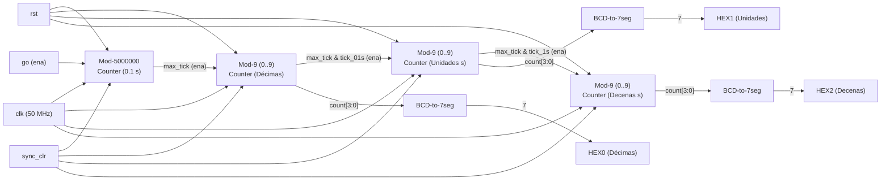

# Pontificia Universidad Javeriana
## Departamento de Electrónica
### System on Chip (SoC)

---

# Taller 4: Circuitos Secuenciales — Contadores

> **Condiciones de Entrega:**  
> Presentar un informe breve que incluya:
> 1. La **descripción general del diseño**.
> 2. Los **códigos fuente en VHDL y Verilog** (circuitos y *testbenches*).
> 3. Los **esquemas de síntesis (Quartus RTL Viewer)** y **simulación funcional (ModelSim)**.
> 4. Los **resultados obtenidos** durante la verificación del sistema.
> 5. **Videos de evidencia** del funcionamiento implementado en la tarjeta **DE1-SoC**, mostrando claramente los resultados del segundo punto, es decir, la operación del cronómetro básico.

---

## Ejercicio Número 1: Contador Binario Universal (`univ_bin_counter`)

1. La **Figura 1** presenta la descripción de puertos de un circuito **Contador Binario Universal**. Modifique los códigos discutidos en clase para el circuito `univ_bin_counter` para crear un contador universal, tanto en **VHDL** como en **Verilog**. Las siguientes son las características de operación del contador universal:

   a. Puede contar en **orden ascendente** y en **orden descendente**, dependiendo del valor de la señal `up`.  
   b. Se puede definir el **tamaño del registro de conteo** en tiempo de compilación, mediante el valor asignado al parámetro `N`.  
   c. El contador tiene un **valor máximo de conteo parametrizable** modificado en tiempo de compilación a través del valor dado a `MAX_COUNT`. Este parámetro podría también recibirse como señal de entrada con el fin de variar el conteo máximo en tiempo de ejecución. Escoja la manera como su circuito recibirá el parámetro.  
   d. El contador puede hacer **pausa y reanudar su operación** mediante la señal de control `ena`.  
   e. Puede ser **cargado con un valor específico inicial** (señal `d`) mediante la señal de control `load`, la cual tendrá una duración de un ciclo de reloj. El valor de la señal `d` representa el valor con el cual se inicia el conteo, que a su vez irá hasta el valor dado por `MAX_COUNT`.  
   f. Tiene una **señal de reinicio síncrona**, `syn_clr`, distinta al *reset* asincrónico (`rst`) utilizado para inicialización.  
   g. El contador generará las banderas `max_tick` y `min_tick` para indicar cuando el valor de conteo ha llegado a sus valores máximo y mínimo respectivamente, así como la posibilidad de observar el estado actual del conteo mediante la señal de salida `counter` (*count*).

```vhdl
ENTITY univ_bin_counter IS
    GENERIC (
        N         : INTEGER := 4;
        MAX_COUNT : STD_LOGIC_VECTOR(N-1 DOWNTO 0) := (OTHERS => '1')
    );
    PORT (
        clk      : IN  STD_LOGIC;
        rst      : IN  STD_LOGIC;
        ena      : IN  STD_LOGIC;
        syn_clr  : IN  STD_LOGIC;
        load     : IN  STD_LOGIC;
        up       : IN  STD_LOGIC;
        d        : IN  STD_LOGIC_VECTOR(N-1 DOWNTO 0);
        max_tick : OUT STD_LOGIC;
        min_tick : OUT STD_LOGIC;
        counter  : OUT STD_LOGIC_VECTOR(N-1 DOWNTO 0)
    );
END ENTITY;
```
*Figura 1. Definición de la entidad para un circuito contador binario universal.*

2. Genere un archivo de *testbench* para verificar el funcionamiento del contador, de forma que se observen todas las funcionalidades descritas anteriormente. Modifique los parámetros de operación en el archivo de *testbench*.

---

## Ejercicio Número 2: Cronómetro Digital en Displays 7-Segmentos (00.0 a 99.9 s)

La medición de tiempo es una de las funciones más utilizadas en sistemas digitales. Tal tarea se realiza mediante el conteo de pulsos de reloj de tal forma que una cuenta de pulsos se ajuste de la forma más aproximada posible al tiempo que se requiere medir. Por ejemplo, si se requiere medir $1\text{ segundo}$ en un sistema que opera con una frecuencia de operación de $50\text{ kHz}$ se deben contar $50\,000\text{ pulsos de reloj}$, ya que una frecuencia de $50\text{ kHz}$ corresponde a un periodo de $20\ \mu\text{s}$ ($0.02\text{ ms}$), y de esta manera $1\text{ s} / 20\ \mu\text{s} = 50\,000\text{ pulsos}$. *(En la tarjeta DE1-SoC con reloj de $50\text{ MHz}$, $T_{\text{clk}} = 20\text{ ns}$, por lo que cada décima de segundo $0.1\text{ s}$ equivale a $5\,000\,000$ pulsos de reloj).*

Para este ejercicio se busca diseñar un **cronómetro** utilizando los *displays* **7-segmentos** de la tarjeta **DE1-SoC**, para mostrar desde **`00.0`** hasta **`99.9` segundos** y comience de nuevo.

### Especificaciones de Operación y Controles:
- **Rango de visualización:** `00.0` a `99.9` segundos en 3 displays de 7 segmentos (`HEX2`, `HEX1`, `HEX0`), con reinicio automático al superar `99.9`.
- **Señal de reset sincrónica (`syn_clr` / `sync_clr`):** Para volver a cero en cualquier momento (implementada utilizando un **pulsador** de la tarjeta, `KEY`).
- **Señal `enable` (`rst` / activación general):** Para activar el circuito (implementada utilizando uno de los **interruptores** `SW` de la tarjeta).
- **Señal `go`:** Para activar o pausar el conteo de tiempo (implementada utilizando otro de los **interruptores** `SW` de la tarjeta).

### Interpretación como Contador BCD en Cascada:
Este sistema puede ser interpretado como un contador **BCD (*Binary-Coded Decimal*)**, que cuenta en formato BCD. En el formato BCD cada dígito en un número decimal es interpretado por una secuencia de 4 dígitos binarios. Por ejemplo, el número $139_{10}$ es representado en BCD como `"0001 0011 1001"`, y el número $140_{10}$ corresponde a `"0001 0100 0000"`. Adicionalmente, se incluirá un contador divisor de frecuencia encargado de verificar las **décimas de segundo ($0.1\text{ s}$)** que representa la resolución mínima del cronómetro.

Desarrolle el mismo circuito tanto en **VHDL** como en **Verilog**. Incluya un enlace a un **video en línea** que muestre el funcionamiento del cronómetro en la tarjeta **DE1-SoC**.


*Figura 2. Cronómetro — Diagrama en bloques.*
