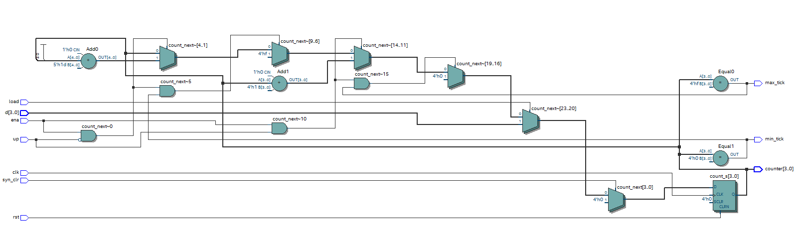
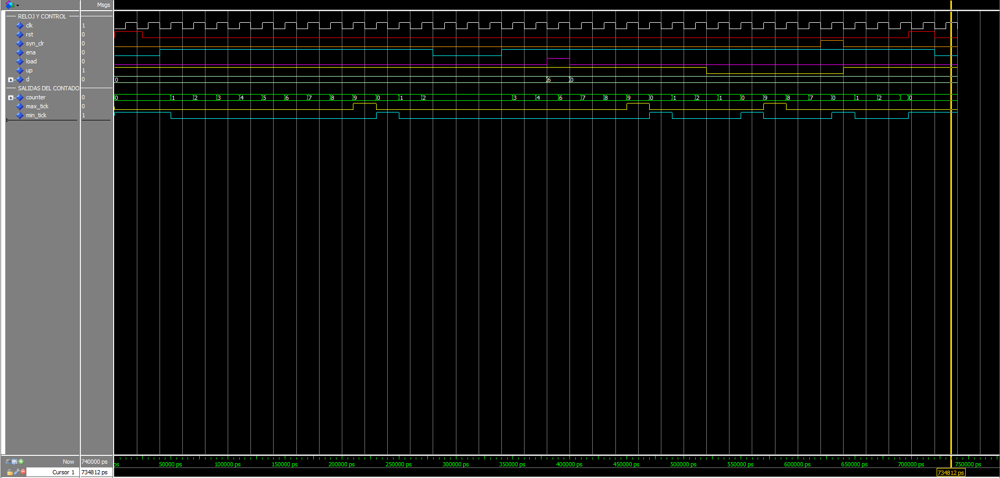
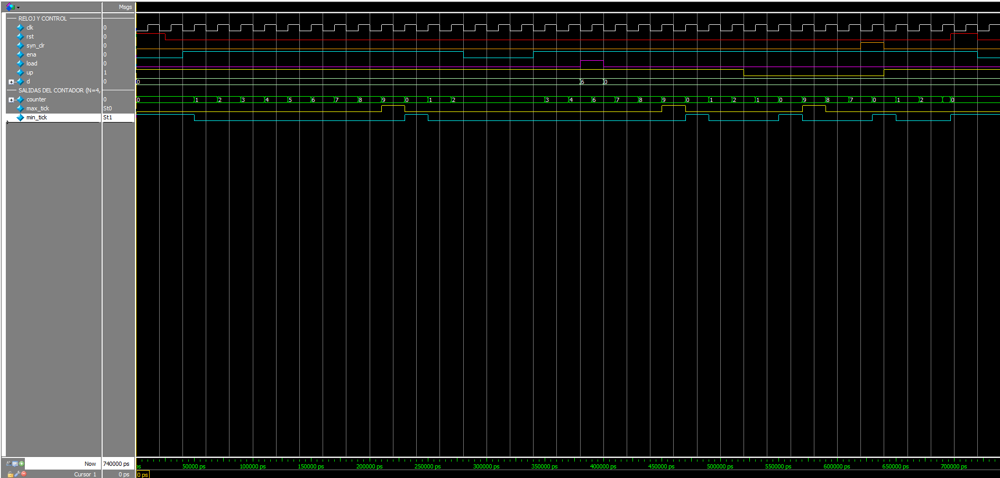
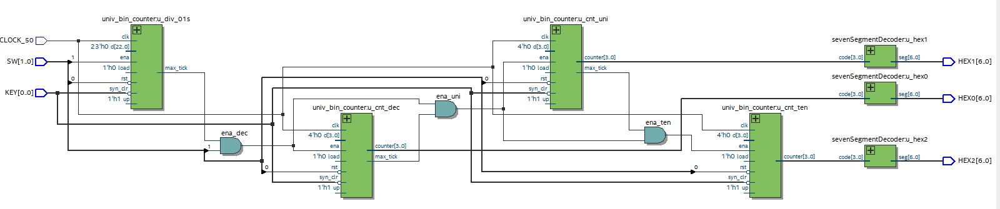
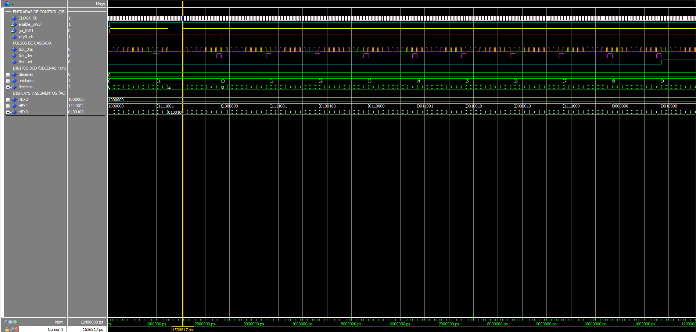
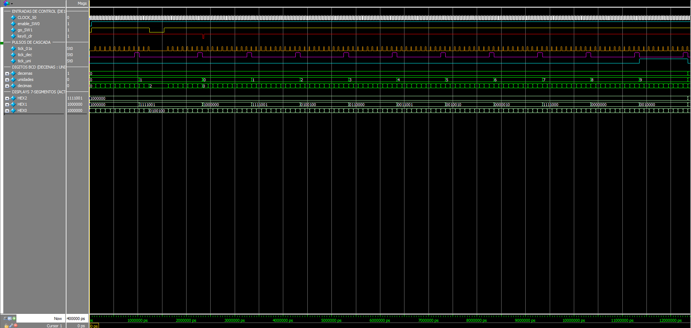

# Taller 4: Circuitos Secuenciales — Contadores
**Pontificia Universidad Javeriana**  
**Departamento de Electrónica**  
**System on Chip (SoC)**  

---

## Ejercicio Número 1: Contador Binario Universal (`univ_bin_counter`)

### 1.1. Descripción General del Diseño

El **Contador Binario Universal** (`univ_bin_counter`) es un circuito secuencial síncrono parametrizable de $N$ bits capaz de operar en modo ascendente o descendente con límite superior configurable `MAX_COUNT`, carga paralela síncrona, reinicio síncrono, habilitación de conteo (*pause/resume*), reset asíncrono de inicialización y generación de banderas de estado (`max_tick` y `min_tick`).

#### 1.1.1. Jerarquía de Prioridades y Tabla de Operación
El registro de estado interno `count_reg` se actualiza en el flanco ascendente de `clk` (o asíncronamente ante `rst = '1'`). La lógica de estado siguiente (`count_next`) sigue la jerarquía de control estándar:

| Prioridad | Señal Activa | Tipo | Condición | Acción sobre `counter` (`count_next`) |
| :---: | :---: | :---: | :---: | :--- |
| **1 (Máxima)** | `rst` | Asíncrono | `rst = '1'` | Inicializa inmediatamente el registro a `0` (`(others => '0')`) sin esperar a `clk`. |
| **2** | `syn_clr` | Síncrono | `syn_clr = '1'` | Reinicia el contador a `0` en el flanco de subida de `clk`. |
| **3** | `load` | Síncrono | `load = '1'` | Carga en paralelo el valor de entrada `d[N-1:0]` durante un ciclo de reloj. |
| **4** | `ena` y `up` | Síncrono | `ena = '1'`, `up = '1'` | **Conteo ascendente:** Si `count_reg = MAX_COUNT`, envuelve a `0`; de lo contrario, `count_reg + 1`. |
| **5** | `ena` y `up` | Síncrono | `ena = '1'`, `up = '0'` | **Conteo descendente:** Si `count_reg = 0`, envuelve a `MAX_COUNT`; de lo contrario, `count_reg - 1`. |
| **6 (Mínima)** | `ena` | Síncrono | `ena = '0'` | **Pausa:** Mantiene el estado actual (`count_next = count_reg`). |

#### 1.1.2. Lógica de Banderas de Fin de Conteo (`max_tick` y `min_tick`)
- **`max_tick`**: Se activa en `'1'` de forma combinacional cuando el estado actual del contador alcanza el valor máximo parametrizado (`count_reg = MAX_COUNT`).
- **`min_tick`**: Se activa en `'1'` de forma combinacional cuando el estado actual del contador se encuentra en cero (`count_reg = 0`).

---

### 1.2. Implementación en VHDL (`univ_bin_counter.vhd` y `univ_bin_counter_tb.vhd`)

> **Nota técnica de compatibilidad VHDL-93 (`MAX_COUNT`):** En la definición de puertos de la Figura 1 del enunciado se sugiere `MAX_COUNT : STD_LOGIC_VECTOR(N-1 DOWNTO 0) := (OTHERS => '1')`, lo cual produce el error `vcom-1396` bajo el estándar VHDL-93 (ModelSim-Altera 10.1d / Quartus II 13.0 SP1) al referenciar un genérico (`N`) dentro de la misma lista `GENERIC`. Para mantener compatibilidad estricta con VHDL-93 y con el uso de `MAX_COUNT` como genérico en tiempo de compilación, se declara `MAX_COUNT : STD_LOGIC_VECTOR := "1111"` (vector no restringido) y se normaliza internamente al ancho `N` mediante `RESIZE(UNSIGNED(MAX_COUNT), N)`.

#### 1.2.1. Módulo Principal (`univ_bin_counter.vhd`)
```vhdl
LIBRARY ieee;
USE ieee.std_logic_1164.all;
USE ieee.numeric_std.all;

ENTITY univ_bin_counter IS
    GENERIC (
        N         : INTEGER := 4;
        MAX_COUNT : STD_LOGIC_VECTOR := "1111"
    );
    PORT (
        clk      : IN  STD_LOGIC;
        rst      : IN  STD_LOGIC;
        ena      : IN  STD_LOGIC;
        syn_clr  : IN  STD_LOGIC;
        load     : IN  STD_LOGIC;
        up       : IN  STD_LOGIC;
        d        : IN  STD_LOGIC_VECTOR(N-1 DOWNTO 0);
        max_tick : OUT STD_LOGIC;
        min_tick : OUT STD_LOGIC;
        counter  : OUT STD_LOGIC_VECTOR(N-1 DOWNTO 0)
    );
END ENTITY univ_bin_counter;

ARCHITECTURE rtl OF univ_bin_counter IS
    CONSTANT ZEROS      : UNSIGNED(N-1 DOWNTO 0) := (OTHERS => '0');
    CONSTANT MAX_VAL    : UNSIGNED(N-1 DOWNTO 0) := RESIZE(UNSIGNED(MAX_COUNT), N);

    SIGNAL count_s      : UNSIGNED(N-1 DOWNTO 0) := (OTHERS => '0');
    SIGNAL count_next   : UNSIGNED(N-1 DOWNTO 0);
BEGIN

    -- 1. Registro de estado secuencial (flanco ascendente de clk, reset asincrono)
    seq_reg : PROCESS(clk, rst)
    BEGIN
        IF (rst = '1') THEN
            count_s <= ZEROS;
        ELSIF (rising_edge(clk)) THEN
            count_s <= count_next;
        END IF;
    END PROCESS seq_reg;

    -- 2. Logica combinacional de estado siguiente
    --    Prioridad: syn_clr > load > (ena & up) > (ena & not up) > hold
    count_next <= ZEROS            WHEN (syn_clr = '1') ELSE
                  UNSIGNED(d)      WHEN (load = '1') ELSE
                  ZEROS            WHEN (ena = '1' AND up = '1' AND count_s = MAX_VAL) ELSE
                  count_s + 1      WHEN (ena = '1' AND up = '1') ELSE
                  MAX_VAL          WHEN (ena = '1' AND up = '0' AND count_s = ZEROS) ELSE
                  count_s - 1      WHEN (ena = '1' AND up = '0') ELSE
                  count_s;

    -- 3. Logica de salida y banderas de fin de conteo
    counter  <= STD_LOGIC_VECTOR(count_s);
    max_tick <= '1' WHEN (count_s = MAX_VAL) ELSE '0';
    min_tick <= '1' WHEN (count_s = ZEROS)   ELSE '0';

END ARCHITECTURE rtl;
```

#### 1.2.2. Testbench Autoverificable en VHDL (`univ_bin_counter_tb.vhd`)
El banco de pruebas modifica los genéricos a **`N = 4`** y **`MAX_COUNT = "1001"` (9 decimal)** con reloj de **50 MHz ($T_{\text{clk}} = 20\text{ ns}$)**, verificando mediante sentencias `ASSERT` las 7 fases: reset asíncrono inicial, conteo ascendente con *rollover* ($0 \to 9 \to 0$) y `max_tick`, pausa y reanudación (`ena`), carga paralela (`load` con $d = 6$ durante 1 ciclo), conteo descendente con *underflow* ($2 \to 0 \to 9$) y `min_tick`, reinicio síncrono (`syn_clr`) y reset asíncrono en mitad de ciclo (`rst`).

```vhdl
LIBRARY ieee;
USE ieee.std_logic_1164.all;
USE ieee.numeric_std.all;

ENTITY univ_bin_counter_tb IS
END ENTITY univ_bin_counter_tb;

ARCHITECTURE sim OF univ_bin_counter_tb IS
    CONSTANT C_N         : INTEGER := 4;
    CONSTANT C_MAX_COUNT : STD_LOGIC_VECTOR(C_N-1 DOWNTO 0) := "1001"; -- 9 decimal
    CONSTANT T_CLK       : TIME := 20 ns;                              -- 50 MHz

    SIGNAL clk_tb      : STD_LOGIC := '0';
    SIGNAL rst_tb      : STD_LOGIC := '0';
    SIGNAL ena_tb      : STD_LOGIC := '0';
    SIGNAL syn_clr_tb  : STD_LOGIC := '0';
    SIGNAL load_tb     : STD_LOGIC := '0';
    SIGNAL up_tb       : STD_LOGIC := '1';
    SIGNAL d_tb        : STD_LOGIC_VECTOR(C_N-1 DOWNTO 0) := (OTHERS => '0');
    SIGNAL max_tick_tb : STD_LOGIC;
    SIGNAL min_tick_tb : STD_LOGIC;
    SIGNAL counter_tb  : STD_LOGIC_VECTOR(C_N-1 DOWNTO 0);
    SIGNAL sim_done    : BOOLEAN := FALSE;
BEGIN
    dut : ENTITY work.univ_bin_counter
        GENERIC MAP (N => C_N, MAX_COUNT => C_MAX_COUNT)
        PORT MAP (
            clk => clk_tb, rst => rst_tb, ena => ena_tb,
            syn_clr => syn_clr_tb, load => load_tb, up => up_tb,
            d => d_tb, max_tick => max_tick_tb, min_tick => min_tick_tb,
            counter => counter_tb
        );

    clk_gen : PROCESS
    BEGIN
        WHILE NOT sim_done LOOP
            clk_tb <= '0'; WAIT FOR T_CLK / 2;
            clk_tb <= '1'; WAIT FOR T_CLK / 2;
        END LOOP;
        WAIT;
    END PROCESS clk_gen;

    stim_proc : PROCESS
    BEGIN
        -- 1. Reset asincrono inicial
        rst_tb <= '1'; ena_tb <= '0'; syn_clr_tb <= '0'; load_tb <= '0'; up_tb <= '1'; d_tb <= "0000";
        WAIT FOR 25 ns;
        ASSERT (counter_tb = "0000" AND min_tick_tb = '1' AND max_tick_tb = '0')
            REPORT "Error en Fase 1: Reset asincrono inicial" SEVERITY ERROR;

        rst_tb <= '0';
        WAIT UNTIL falling_edge(clk_tb);

        -- 2. Conteo ascendente completo: 0 -> 9 (max_tick) -> 0 (rollover) -> 2
        ena_tb <= '1'; up_tb <= '1';
        FOR i IN 1 TO 9 LOOP
            WAIT UNTIL rising_edge(clk_tb); WAIT FOR 2 ns;
            ASSERT (to_integer(unsigned(counter_tb)) = i)
                REPORT "Error en Fase 2 (ascendente)" SEVERITY ERROR;
        END LOOP;
        ASSERT (max_tick_tb = '1' AND min_tick_tb = '0')
            REPORT "Error en Fase 2: max_tick en 9" SEVERITY ERROR;

        WAIT UNTIL rising_edge(clk_tb); WAIT FOR 2 ns; -- Rollover 9 -> 0
        ASSERT (counter_tb = "0000" AND min_tick_tb = '1' AND max_tick_tb = '0')
            REPORT "Error en Fase 2: rollover 9 -> 0" SEVERITY ERROR;

        FOR i IN 1 TO 2 LOOP WAIT UNTIL rising_edge(clk_tb); WAIT FOR 2 ns; END LOOP;

        -- 3. Pausa (ena = '0') durante 3 ciclos y reanudacion (ena = '1')
        WAIT UNTIL falling_edge(clk_tb); ena_tb <= '0';
        FOR i IN 1 TO 3 LOOP
            WAIT UNTIL rising_edge(clk_tb); WAIT FOR 2 ns;
            ASSERT (counter_tb = "0010") REPORT "Error en Fase 3: pausa" SEVERITY ERROR;
        END LOOP;
        WAIT UNTIL falling_edge(clk_tb); ena_tb <= '1';
        WAIT UNTIL rising_edge(clk_tb); WAIT FOR 2 ns; -- 3
        WAIT UNTIL rising_edge(clk_tb); WAIT FOR 2 ns; -- 4

        -- 4. Carga paralela sincrona (load = '1' por 1 ciclo, d = 6) -> 6..9..0..2
        WAIT UNTIL falling_edge(clk_tb); d_tb <= "0110"; load_tb <= '1';
        WAIT UNTIL rising_edge(clk_tb); WAIT FOR 2 ns;
        ASSERT (counter_tb = "0110") REPORT "Error en Fase 4: load = 6" SEVERITY ERROR;
        WAIT UNTIL falling_edge(clk_tb); load_tb <= '0';
        FOR i IN 7 TO 9 LOOP
            WAIT UNTIL rising_edge(clk_tb); WAIT FOR 2 ns;
            ASSERT (to_integer(unsigned(counter_tb)) = i) REPORT "Error en Fase 4" SEVERITY ERROR;
        END LOOP;
        WAIT UNTIL rising_edge(clk_tb); -- 0
        WAIT UNTIL rising_edge(clk_tb); -- 1
        WAIT UNTIL rising_edge(clk_tb); -- 2

        -- 5. Conteo descendente (up = '0'): 2 -> 1 -> 0 (min_tick) -> 9 (underflow) -> 7
        WAIT UNTIL falling_edge(clk_tb); up_tb <= '0';
        WAIT UNTIL rising_edge(clk_tb); -- 1
        WAIT UNTIL rising_edge(clk_tb); WAIT FOR 2 ns; -- 0
        ASSERT (counter_tb = "0000" AND min_tick_tb = '1') REPORT "Error en Fase 5: min_tick" SEVERITY ERROR;
        WAIT UNTIL rising_edge(clk_tb); WAIT FOR 2 ns; -- 9
        ASSERT (counter_tb = "1001" AND max_tick_tb = '1') REPORT "Error en Fase 5: underflow" SEVERITY ERROR;
        WAIT UNTIL rising_edge(clk_tb); -- 8
        WAIT UNTIL rising_edge(clk_tb); -- 7

        -- 6. Reinicio sincrono (syn_clr = '1')
        WAIT UNTIL falling_edge(clk_tb); syn_clr_tb <= '1';
        WAIT FOR 4 ns;
        ASSERT (counter_tb = "0111") REPORT "Error en Fase 6: syn_clr prematuro" SEVERITY ERROR;
        WAIT UNTIL rising_edge(clk_tb); WAIT FOR 2 ns;
        ASSERT (counter_tb = "0000" AND min_tick_tb = '1') REPORT "Error en Fase 6: syn_clr" SEVERITY ERROR;
        WAIT UNTIL falling_edge(clk_tb); syn_clr_tb <= '0'; up_tb <= '1';
        FOR i IN 1 TO 3 LOOP WAIT UNTIL rising_edge(clk_tb); END LOOP;

        -- 7. Reset asincrono en mitad de ciclo
        WAIT FOR 7 ns; rst_tb <= '1'; WAIT FOR 2 ns;
        ASSERT (counter_tb = "0000" AND min_tick_tb = '1') REPORT "Error en Fase 7: rst asincrono" SEVERITY ERROR;
        WAIT FOR 20 ns; rst_tb <= '0'; WAIT FOR 20 ns;

        REPORT "=== SIMULACION VHDL COMPLETADA EXITOSAMENTE (0 ERRORES) ===" SEVERITY NOTE;
        sim_done <= TRUE;
        WAIT;
    END PROCESS stim_proc;
END ARCHITECTURE sim;
```

---

### 1.3. Implementación en Verilog (`univ_bin_counter.v` y `univ_bin_counter_tb.v`)

#### 1.3.1. Módulo Principal (`univ_bin_counter.v`)
```verilog
module univ_bin_counter #(
    parameter integer N = 4,
    parameter [N-1:0] MAX_COUNT = {N{1'b1}}
) (
    input  wire         clk,
    input  wire         rst,
    input  wire         ena,
    input  wire         syn_clr,
    input  wire         load,
    input  wire         up,
    input  wire [N-1:0] d,
    output wire         max_tick,
    output wire         min_tick,
    output wire [N-1:0] counter
);

    localparam [N-1:0] ZEROS = {N{1'b0}};

    reg [N-1:0] count_s;
    reg [N-1:0] count_next;

    // 1. Registro de estado secuencial (flanco ascendente de clk, reset asincrono)
    always @(posedge clk or posedge rst) begin
        if (rst)
            count_s <= ZEROS;
        else
            count_s <= count_next;
    end

    // 2. Logica combinacional de estado siguiente
    //    Prioridad: syn_clr > load > (ena & up) > (ena & ~up) > hold
    always @(*) begin
        if (syn_clr)
            count_next = ZEROS;
        else if (load)
            count_next = d;
        else if (ena && up)
            count_next = (count_s == MAX_COUNT) ? ZEROS : (count_s + 1'b1);
        else if (ena && !up)
            count_next = (count_s == ZEROS) ? MAX_COUNT : (count_s - 1'b1);
        else
            count_next = count_s;
    end

    // 3. Logica de salida y banderas de fin de conteo
    assign counter  = count_s;
    assign max_tick = (count_s == MAX_COUNT) ? 1'b1 : 1'b0;
    assign min_tick = (count_s == ZEROS)     ? 1'b1 : 1'b0;

endmodule
```

#### 1.3.2. Testbench en Verilog (`univ_bin_counter_tb.v`)
Replica exactamente la misma secuencia de 7 fases de verificación con `C_N = 4`, `C_MAX_COUNT = 4'b1001` (`9` decimal) y reloj de `50 MHz` (`T_CLK = 20 ns`). La simulación automatizada en ModelSim reportó **0 errores** tanto en VHDL como en Verilog.

---

### 1.4. Síntesis RTL y Simulación Funcional (ModelSim)

#### 1.4.1. Síntesis en Quartus (Cyclone V `5CSEMA5F31C6`)
El módulo `univ_bin_counter` sintetizado con sus parámetros por defecto ($N = 4$, $\text{MAX\_COUNT} = 15$) utilizó **17 celdas lógicas**, **10 pines de entrada** y **6 pines de salida** con **0 errores**.


*Figura 1.1. Esquemático RTL sintetizado en Quartus (`univ_bin_counter`).*

#### 1.4.2. Resultados de Simulación Funcional en ModelSim (`N = 4`, `MAX_COUNT = 9`, `50 MHz`)

| Fase | Ventana Aprox. | Estímulo Principal | Comportamiento Observado en Simulación |
| :---: | :---: | :--- | :--- |
| **1** | $0 - 25\text{ ns}$ | `rst = 1` | Inicialización asíncrona inmediata: `counter = 0`, `min_tick = 1`, `max_tick = 0`. |
| **2** | $30 - 270\text{ ns}$ | `ena = 1`, `up = 1` | Conteo ascendente $0 \to 9$ (activa `max_tick = 1` en $9$), *rollover* a `0` (`min_tick = 1`) y avance hasta `2`. |
| **3** | $280 - 380\text{ ns}$ | `ena = 0` (3 ciclos) $\to$ `ena = 1` | Congela el registro en `2` durante 3 ciclos y reanuda $2 \to 3 \to 4$. |
| **4** | $380 - 530\text{ ns}$ | `load = 1` (1 ciclo, `d = 6`) | Carga síncrona de `6`, continúa $6 \to 7 \to 8 \to 9$ (`max_tick = 1`) $\to 0 \to 1 \to 2$. |
| **5** | $540 - 650\text{ ns}$ | `up = 0` | Conteo descendente $2 \to 1 \to 0$ (`min_tick = 1`), *underflow* a `9` (`max_tick = 1`) $\to 8 \to 7$. |
| **6** | $660 - 700\text{ ns}$ | `syn_clr = 1` | Mantiene `7` hasta el flanco ascendente de `clk`, reinicia síncronamente a `0` (`min_tick = 1`) y retoma $0 \to 3$. |
| **7** | $700 - 740\text{ ns}$ | `rst = 1` (en mitad de ciclo) | Limpia inmediatamente `counter` a `0` sin esperar al flanco ascendente de `clk`, evidenciando su naturaleza asíncrona frente a `syn_clr`. |


*Figura 1.2. Simulación funcional en ModelSim del módulo `univ_bin_counter` en VHDL (`N = 4`, `MAX_COUNT = 9`).*


*Figura 1.3. Simulación funcional en ModelSim del módulo `univ_bin_counter` en Verilog (`N = 4`, `MAX_COUNT = 9`).*

---

## Ejercicio Número 2: Cronómetro Digital en Displays 7-Segmentos (00.0 a 99.9 s)

### 2.1. Descripción General del Diseño

El sistema de cronómetro digital mide intervalos de tiempo desde **`00.0`** hasta **`99.9` segundos** con una resolución de **décimas de segundo ($0.1\text{ s}$)** utilizando el reloj base de $50\text{ MHz}$ ($T_{\text{clk}} = 20\text{ ns}$) de la tarjeta **DE1-SoC**.

#### 2.1.1. Arquitectura de Contadores en Cascada y Divisor de Frecuencia
Siguiendo el diagrama en bloques de la Figura 2 de la guía, el diseño se estructura en cuatro etapas secuenciales basadas en instancias del contador universal (`univ_bin_counter`) y tres decodificadores BCD a 7 segmentos:

1. **Base de Tiempo de $0.1\text{ s}$ (Contador Módulo $5\,000\,000$):**
   - Con $f_{\text{clk}} = 50\text{ MHz}$, se requieren $50\,000\,000 \times 0.1\text{ s} = 5\,000\,000$ ciclos de reloj para generar un pulso de habilitación cada décima de segundo.
   - Se parametriza con $N = 23\text{ bits}$ ($2^{23} = 8\,388\,608 > 5\,000\,000$) y $\text{MAX\_COUNT} = 4\,999\,999$ (conteo de $0$ a $4\,999\,999$).
   - Su bandera `max_tick` (`tick_01s`) dura exactamente 1 ciclo de reloj cada $0.1\text{ s}$.
2. **Contador BCD de Décimas de Segundo (`HEX0`, $0.0\text{ s} \dots 0.9\text{ s}$):**
   - Parametrizado con $N = 4\text{ bits}$ y $\text{MAX\_COUNT} = 9$ (`"1001"`).
   - Se habilita cuando `ena_dec = go AND tick_01s`.
3. **Contador BCD de Unidades de Segundo (`HEX1`, $0\text{ s} \dots 9\text{ s}$):**
   - Parametrizado con $N = 4\text{ bits}$ y $\text{MAX\_COUNT} = 9$ (`"1001"`).
   - Se habilita en cascada síncrona cuando `ena_uni = go AND tick_01s AND max_tick_dec`.
4. **Contador BCD de Decenas de Segundo (`HEX2`, $00\text{ s} \dots 90\text{ s}$):**
   - Parametrizado con $N = 4\text{ bits}$ y $\text{MAX\_COUNT} = 9$ (`"1001"`).
   - Se habilita en cascada síncrona cuando `ena_ten = go AND tick_01s AND max_tick_dec AND max_tick_uni`.

---

### 2.2. Implementación en VHDL (`stopwatch_top.vhd` y `stopwatch_tb.vhd`)

#### 2.2.1. Módulo Superior (`stopwatch_top.vhd`)
Instancia cuatro contadores `univ_bin_counter` (un divisor de frecuencia `Mod-5000000` de 23 bits y tres contadores BCD `Mod-9` de 4 bits) junto con tres decodificadores `sevenSegmentDecoder` activos en bajo para `HEX0`, `HEX1` y `HEX2`.

```vhdl
LIBRARY ieee;
USE ieee.std_logic_1164.all;
USE ieee.numeric_std.all;

ENTITY stopwatch_top IS
    GENERIC (
        DIV_MAX : INTEGER := 4999999 -- 50 MHz * 0.1 s = 5,000,000 ciclos
    );
    PORT (
        CLOCK_50 : IN  STD_LOGIC;
        SW       : IN  STD_LOGIC_VECTOR(1 DOWNTO 0);
        KEY      : IN  STD_LOGIC_VECTOR(0 DOWNTO 0);
        HEX0     : OUT STD_LOGIC_VECTOR(6 DOWNTO 0);
        HEX1     : OUT STD_LOGIC_VECTOR(6 DOWNTO 0);
        HEX2     : OUT STD_LOGIC_VECTOR(6 DOWNTO 0)
    );
END ENTITY stopwatch_top;

ARCHITECTURE rtl OF stopwatch_top IS
    SIGNAL rst_s, go_s, syn_clr_s       : STD_LOGIC;
    SIGNAL tick_01s, tick_dec, tick_uni : STD_LOGIC;
    SIGNAL ena_dec, ena_uni, ena_ten    : STD_LOGIC;
    SIGNAL dec_s, uni_s, ten_s          : STD_LOGIC_VECTOR(3 DOWNTO 0);
BEGIN
    rst_s     <= NOT SW(0);  -- SW(0) = '1' habilita el sistema; '0' lo resetea
    go_s      <= SW(1);      -- SW(1) = '1' inicia/reanuda; '0' pausa
    syn_clr_s <= NOT KEY(0); -- KEY(0) activo en bajo en la DE1-SoC

    u_div_01s : ENTITY work.univ_bin_counter
        GENERIC MAP (N => 23, MAX_COUNT => STD_LOGIC_VECTOR(TO_UNSIGNED(DIV_MAX, 23)))
        PORT MAP (clk => CLOCK_50, rst => rst_s, ena => go_s, syn_clr => syn_clr_s,
                  load => '0', up => '1', d => (OTHERS => '0'),
                  max_tick => tick_01s, min_tick => OPEN, counter => OPEN);

    ena_dec <= go_s AND tick_01s;
    ena_uni <= ena_dec AND tick_dec;
    ena_ten <= ena_uni AND tick_uni;

    u_cnt_dec : ENTITY work.univ_bin_counter
        GENERIC MAP (N => 4, MAX_COUNT => "1001")
        PORT MAP (clk => CLOCK_50, rst => rst_s, ena => ena_dec, syn_clr => syn_clr_s,
                  load => '0', up => '1', d => "0000", max_tick => tick_dec, min_tick => OPEN, counter => dec_s);

    u_cnt_uni : ENTITY work.univ_bin_counter
        GENERIC MAP (N => 4, MAX_COUNT => "1001")
        PORT MAP (clk => CLOCK_50, rst => rst_s, ena => ena_uni, syn_clr => syn_clr_s,
                  load => '0', up => '1', d => "0000", max_tick => tick_uni, min_tick => OPEN, counter => uni_s);

    u_cnt_ten : ENTITY work.univ_bin_counter
        GENERIC MAP (N => 4, MAX_COUNT => "1001")
        PORT MAP (clk => CLOCK_50, rst => rst_s, ena => ena_ten, syn_clr => syn_clr_s,
                  load => '0', up => '1', d => "0000", max_tick => OPEN, min_tick => OPEN, counter => ten_s);

    u_hex0 : ENTITY work.sevenSegmentDecoder PORT MAP (code => dec_s, seg => HEX0);
    u_hex1 : ENTITY work.sevenSegmentDecoder PORT MAP (code => uni_s, seg => HEX1);
    u_hex2 : ENTITY work.sevenSegmentDecoder PORT MAP (code => ten_s, seg => HEX2);
END ARCHITECTURE rtl;
```

#### 2.2.2. Testbench en VHDL (`stopwatch_tb.vhd`)
Para acelerar la simulación manteniendo el reloj de **50 MHz ($T_{\text{clk}} = 20\text{ ns}$)**, se parametriza `DIV_MAX = 4` (5 ciclos = $100\text{ ns}$ por cada décima de segundo), verificando: inicio en `00.0`, conteo hasta `01.2`, pausa con `SW(1) = '0'`, reanudación hasta `02.0`, reinicio síncrono con `KEY(0) = '0'` y acarreo hasta las decenas (`10.0`).

---

### 2.3. Implementación en Verilog (`stopwatch_top.v` y `stopwatch_tb.v`)

```verilog
module stopwatch_top #(
    parameter integer DIV_MAX = 4999999
) (
    input  wire       CLOCK_50,
    input  wire [1:0] SW,
    input  wire [0:0] KEY,
    output wire [6:0] HEX0,
    output wire [6:0] HEX1,
    output wire [6:0] HEX2
);
    localparam [22:0] DIV_MAX_VEC = DIV_MAX[22:0];

    wire rst_s     = ~SW[0];
    wire go_s      = SW[1];
    wire syn_clr_s = ~KEY[0];

    wire tick_01s, tick_dec, tick_uni;
    wire ena_dec = go_s & tick_01s;
    wire ena_uni = ena_dec & tick_dec;
    wire ena_ten = ena_uni & tick_uni;

    wire [3:0] dec_s, uni_s, ten_s;

    univ_bin_counter #(.N(23), .MAX_COUNT(DIV_MAX_VEC)) u_div_01s (
        .clk(CLOCK_50), .rst(rst_s), .ena(go_s), .syn_clr(syn_clr_s),
        .load(1'b0), .up(1'b1), .d(23'd0), .max_tick(tick_01s), .min_tick(), .counter()
    );

    univ_bin_counter #(.N(4), .MAX_COUNT(4'b1001)) u_cnt_dec (
        .clk(CLOCK_50), .rst(rst_s), .ena(ena_dec), .syn_clr(syn_clr_s),
        .load(1'b0), .up(1'b1), .d(4'd0), .max_tick(tick_dec), .min_tick(), .counter(dec_s)
    );

    univ_bin_counter #(.N(4), .MAX_COUNT(4'b1001)) u_cnt_uni (
        .clk(CLOCK_50), .rst(rst_s), .ena(ena_uni), .syn_clr(syn_clr_s),
        .load(1'b0), .up(1'b1), .d(4'd0), .max_tick(tick_uni), .min_tick(), .counter(uni_s)
    );

    univ_bin_counter #(.N(4), .MAX_COUNT(4'b1001)) u_cnt_ten (
        .clk(CLOCK_50), .rst(rst_s), .ena(ena_ten), .syn_clr(syn_clr_s),
        .load(1'b0), .up(1'b1), .d(4'd0), .max_tick(), .min_tick(), .counter(ten_s)
    );

    sevenSegmentDecoder u_hex0 (.code(dec_s), .seg(HEX0));
    sevenSegmentDecoder u_hex1 (.code(uni_s), .seg(HEX1));
    sevenSegmentDecoder u_hex2 (.code(ten_s), .seg(HEX2));
endmodule
```

El banco de pruebas equivalente (`stopwatch_tb.v`) replica exactamente las mismas 6 fases de verificación y finaliza con **0 errores**.

---

### 2.4. Síntesis RTL, Simulación Funcional y Verificación en Hardware (DE1-SoC)

#### 2.4.1. Síntesis en Quartus (Cyclone V `5CSEMA5F31C6`)
La entidad superior `stopwatch_top` sintetizada para la tarjeta **DE1-SoC** utilizó **67 celdas lógicas**, **4 pines de entrada** (`CLOCK_50`, `SW[0]`, `SW[1]`, `KEY[0]`) y **21 pines de salida** (`HEX0[6:0]`, `HEX1[6:0]`, `HEX2[6:0]`) con **0 errores**.


*Figura 2.1. Esquemático RTL sintetizado en Quartus (`stopwatch_top`).*

#### 2.4.2. Simulación Funcional en ModelSim (`DIV_MAX = 4`, `50 MHz`)

| Fase | Estímulo | Resultado Esperado / Observado |
| :---: | :--- | :--- |
| **1** | `SW = "00"` (`enable = 0`) | Sistema en reset: `00.0` (`HEX2=0`, `HEX1=0`, `HEX0=0`). |
| **2** | `SW = "11"` (`enable = 1`, `go = 1`) | Avanza décimas y unidades hasta `01.0` (50 ciclos) y `01.2` (60 ciclos). |
| **3** | `SW = "01"` (`go = 0`, pausa 15 ciclos) | Congela el cronómetro exactamente en `01.2`. |
| **4** | `SW = "11"` (`go = 1`, reanudar 40 ciclos) | Continúa el conteo hasta `02.0`. |
| **5** | `KEY(0) = '0'` (reinicio síncrono) | Vuelve inmediatamente a `00.0` en el siguiente flanco de subida de `clk`. |
| **6** | `SW = "11"` (500 ciclos = 100 décimas) | Verifica el acarreo en cascada hasta las decenas (`10.0`). |


*Figura 2.2. Simulación funcional en ModelSim del cronómetro `stopwatch_top` en VHDL (`DIV_MAX = 4`).*


*Figura 2.3. Simulación funcional en ModelSim del cronómetro `stopwatch_top` en Verilog (`DIV_MAX = 4`).*

#### 2.4.3. Evidencia en Tarjeta DE1-SoC
- **Asignación de controles:** `SW[0]` = `enable` general (`1` habilita, `0` reset), `SW[1]` = `go` (`1` cuenta, `0` pausa), `KEY[0]` = `sync_clr` (reinicio síncrono a `00.0`).
- **Enlace al video demostrativo en la tarjeta DE1-SoC:** [Ver video en OneDrive (Carpeta Videos — SoC)](https://livejaverianaedu-my.sharepoint.com/:f:/r/personal/pedrol_acosta_javeriana_edu_co/_layouts/15/onedrive.aspx?id=%2Fpersonal%2Fpedrol%5Facosta%5Fjaveriana%5Fedu%5Fco%2FDocuments%2F2%20IoT%2FSoC%2FVideos&share=cgpU%5FTJasd6qR6WwhX0yVfAbEgUCdu0y%2DQ2YseAM4J7lNFt7Hw)
