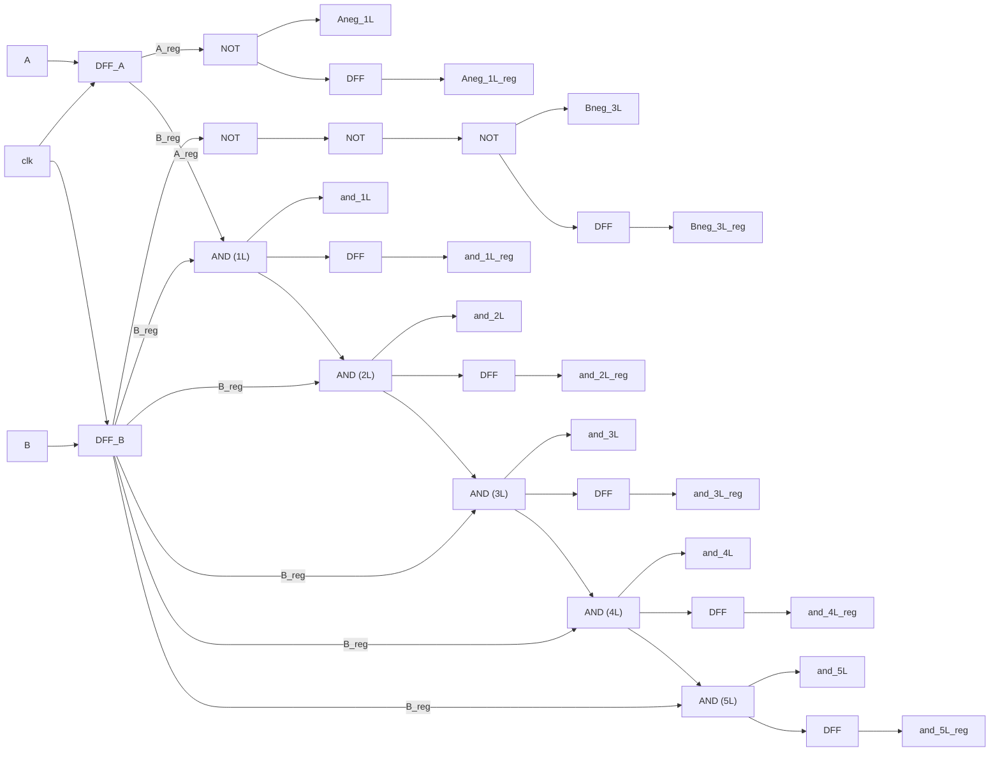

# Pontificia Universidad Javeriana
## Departamento de Electrónica
### System on Chip (SoC)

---

# Taller 5: Timing Simulation

---

## Ejercicio No. 1: Flip-flop (`dff_timing`)

1. Cree en **Quartus II / Quartus Prime** un proyecto nuevo llamado `dff_timing`. Asigne el dispositivo FPGA que utiliza la tarjeta de desarrollo asignada (**Cyclone V `5CSEMA5F31C6`** en la tarjeta **DE1-SoC**, o el dispositivo de referencia del laboratorio).
2. Incluya los siguientes archivos entregados:
   - `my_dff.vhd` (Flip-Flop tipo D con habilitación `en` y reset asíncrono `rst`)
   - `test_signal_generator.vhd` (Generador BIST de señales de prueba mediante FSM y contador de retardo `DELAY_PULSES`)
   - `dff_timing.vhd` (Entidad superior que interconecta `DUT: my_dff` y `BIST: test_signal_generator`)
   - `dff_timing_tb.vhd` (*Testbench* para simulación funcional a $50\text{ MHz}$)
3. Compile y verifique que no existan errores de sintaxis.
4. Realice una simulación por **$500\text{ ns}$** del funcionamiento del flip-flop en **ModelSim** utilizando las señales generadas entregadas en el archivo `dff_timing_tb.vhd`: `clk_tb`, `rst_tb`, `en_tb`, `d_tb` y `q_tb`. Verifique en la ventana *Wave* los momentos en que suceden las transiciones de `d` y `q` con respecto a los pulsos de reloj, de acuerdo con la **Figura 1** del enunciado (*Simulación funcional - ModelSim*, donde en simulación RTL ideal las transiciones de `d` y `q` ocurren exactamente alineadas con los flancos de subida del reloj cada $20\text{ ns}$, p. ej. entre $270\text{ ns} \to 290\text{ ns}$ y $370\text{ ns} \to 390\text{ ns}$).
5. En Quartus, realice una compilación completa del proyecto. En el informe de compilación (*Compilation Report*), expanda la pestaña indicada como **TimeQuest Timing Analyzer** (Figura 2):
   - Expanda la pestaña indicada como **`Slow 1200mV 85C Model`** (o el modelo *Slow* equivalente del dispositivo).
   - Identifique la **frecuencia máxima de operación (`Fmax` y `Restricted Fmax`)** del circuito (Figura 3).
6. En el menú **Assignments**, seleccione **Settings**. En la lista de categorías seleccione **Simulation** en la pestaña **EDA Tool Settings**. En la lista desplegable de *Tool name*, seleccione **ModelSim-Altera** (formato **VHDL**). Esta lista contiene las herramientas de simulación compatibles con Quartus. **NO SELECCIONE** *Run gate-level simulation automatically*. Presione **OK**.
7. Compile de nuevo el proyecto.
8. En Quartus siga la ruta: **Processing $\rightarrow$ Start $\rightarrow$ Start EDA Netlist Writer** (Figura 4). Este comando generará los archivos necesarios para realizar la simulación de tiempos (*Gate-Level Timing Simulation*).
   - Dentro de la carpeta del proyecto, se creará una carpeta `simulation/modelsim/`. En esta ruta podrá encontrar una serie de archivos con extensión **`.vho`** (*VHDL Output*) y **`.sdo`** (*Standard Delay Format Output*), como se observa en la Figura 5.
9. En seguida se realizará la **simulación de tiempos**:
   - En ModelSim termine la simulación anterior con el comando `quit -sim`.
   - Cambie el directorio de trabajo a la ruta `simulation/modelsim`.
   - Seleccione **Compile**, compile el archivo **`dff_timing.vho`** y seleccione **Done** (Figura 6).
10. Seleccione **Simulate $\rightarrow$ Start Simulation** (Figura 7):
    - Se abrirá una ventana de diálogo. Sobre la pestaña **SDF**, busque y añada el archivo **`dff_timing_vhd.sdo`** aplicado a la región `/` (Figuras 8 y 9).
    - En la pestaña **Design**, seleccione **`work.dff_timing`**, que es la entidad superior del diseño, y seleccione **OK** para iniciar la simulación (Figura 10).
11. Seleccione las señales `clk`, `rst`, `en`, `d` y `q` y añádalas a la ventana *Wave*:
    - La desventaja de este tipo de simulación es que no es posible incluir directamente los archivos de *testbench* creados en donde se define el reloj y la señal de reset (o bien se debe instanciar la netlist `.vho`). Sin embargo, el hecho de utilizar un circuito **BIST** (*Built-In Self-Test*) para generación de señales simplifica el proceso, pues ModelSim permite forzar las señales de entrada `clk` y `rst` a los valores requeridos.
    - Seleccione la señal `clk`, y con clic derecho vaya a la opción **Clock...**. En la ventana de diálogo emergente seleccione el ciclo útil (*Duty*) al **50%**, y en la casilla del periodo (*Period*) escriba **`20000`** ($20\,000\text{ ps} = 20\text{ ns}$) para generar un reloj de **$50\text{ MHz}$** (Figura 11).
    - En la ventana de comandos (*Transcript*), escriba:
      ```tcl
      force rst 1 0, 0 50000
      ```
      para forzar la señal de reset ($1$ en $0\text{ ps}$ y $0$ a los $50\,000\text{ ps} = 50\text{ ns}$).
    - Corra la simulación por **$500\text{ ns}$** (`run 500ns`). Verifique los tiempos de transición de las señales `d` y `q` comparadas con los pulsos de subida del reloj (Figura 12: *Simulación de tiempos. Se observan retardos de propagación física*).

---

## Ejercicio No. 2: Caso de Estudio (Cadena de Compuertas y Registros)

1. Implemente en **VHDL** el circuito observado en la **Figura 13** y verifique el hardware generado en la compilación de Quartus (*RTL Viewer* y *Technology Map Viewer*, cuidando preservar los nodos intermedios de las cadenas de inversores y compuertas AND para que el sintetizador no los simplifique algebraicamente).
2. Realice una **simulación de tiempos** en **ModelSim**. Contraste los resultados entre la **simulación funcional (RTL)** y la **simulación de tiempos (Gate-Level + SDF)**.
3. Aumente la frecuencia del reloj hasta los límites sugeridos de **frecuencia máxima (`Fmax`)** arrojados por **Quartus TimeQuest Timing Analyzer** y verifique el impacto en el funcionamiento del circuito.
4. Vuelva a Quartus, siga la ruta **Assignments $\rightarrow$ Device**, y seleccione esta vez un dispositivo diferente al que venía utilizando; por ejemplo, el dispositivo **`EP4SGX530NF45C4ES`** perteneciente a la familia **Stratix IV (GT/GX/E)** que se encuentra incluido en la tarjeta **Terasic DE4** (o una familia alternativa disponible en su instalación de Quartus). La familia Stratix pertenece a una tecnología diferente a la Cyclone III / IV, y la supera tanto en cantidad de elementos lógicos disponibles y arquitectura, como en tecnología de fabricación (por ejemplo, las FPGA de la familia Cyclone III pertenecen a una tecnología de $65\text{ nm}$, mientras que las Stratix IV se encuentran en el rango de los $40\text{ nm}$ y Cyclone V en $28\text{ nm}$).
5. Repita la simulación temporal en **ModelSim**. Determine los retardos de las compuertas para la segunda familia FPGA. **¿Hay diferencias entre las dos familias?**

### Esquema del Circuito Caso de Estudio (Figura 13)

El circuito consta de dos flip-flops tipo D de entrada que registran las entradas `A` y `B` con el reloj `clk` (produciendo `A_reg` y `B_reg`), seguidos de diferentes caminos combinacionales con distinta profundidad lógica (1 inversor, 3 inversores en serie, y una cadena en cascada de 1 a 5 compuertas AND de dos entradas), donde cada salida combinacional se observa tanto de forma directa (`*_XL`) como registrada por un flip-flop tipo D de salida (`*_XL_reg`):


*Figura 13. Circuito caso de estudio: comparación de retardos por niveles lógicos combinacionales y salidas registradas.*
