# Taller 5: Timing Simulation (Simulación Funcional vs. Simulación de Tiempos)
**Pontificia Universidad Javeriana**  
**Departamento de Electrónica**  
**System on Chip (SoC)**  

---

## Ejercicio No. 1: Flip-Flop con Generador BIST (`dff_timing`)

### 1.1. Descripción General y Análisis a Nivel de Lógica

El sistema `dff_timing` tiene como objetivo contrastar el comportamiento ideal de una **simulación funcional (RTL)** frente a una **simulación de tiempos post-síntesis y post-enrutamiento (*Gate-Level Timing Simulation*)** empleando archivos `.vho` (*VHDL Output Netlist*) y `.sdo` (*Standard Delay Format*).

Para evaluar la misma entidad superior tanto con un *testbench* externo como en simulación temporal directa (forzando únicamente el reloj `clk` y el reset `rst` en ModelSim), el diseño integra una arquitectura **BIST (*Built-In Self-Test*)** compuesta por dos bloques interconectados en `dff_timing.vhd`:

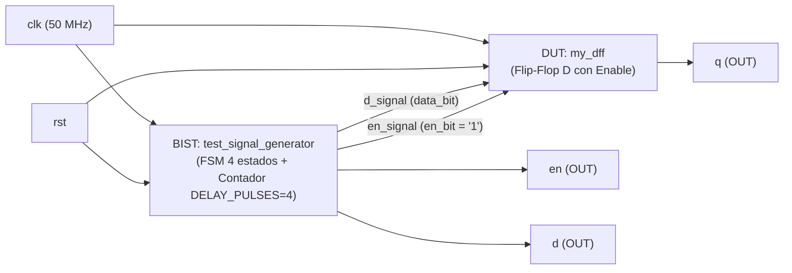

#### 1.1.1. Dispositivo Bajo Prueba (`DUT: my_dff.vhd`)
Implementa un **Flip-Flop tipo D** sensible al flanco de subida de `clk`, con reinicio asíncrono activo en alto (`rst = '1' -> q <= '0'`) y habilitación síncrona (`en = '1' -> q <= d`). En síntesis ocupa exactamente **1 registro dedicado (`Dedicated Logic Register`)** y **0 LUTs combinacionales**, dado que el puerto `en` recibe una constante lógica `'1'` desde el bloque BIST.

#### 1.1.2. Generador BIST de Estímulos (`BIST: test_signal_generator.vhd`)
Genera automáticamente una señal periódica en `data_bit` (`d`) manteniendo `en_bit` (`en`) en `'1'` constante. Internamente consta de:
1. **Máquina de Estados Finitos (`lower_fsm` + `upper_fsm`)**:
   - Posee 4 estados simbólicos: `zero`, `clearFlagZero`, `one`, `clearFlagOne`.
   - Quartus sintetiza esta FSM con **codificación *One-Hot*** empleando **4 Flip-Flops** (`pr_state.zero`, `pr_state.clearFlagZero`, `pr_state.one`, `pr_state.clearFlagOne`).
   - En los estados `zero`, `clearFlagZero` y `clearFlagOne`, la salida es `data_bit = '0'`. Únicamente en el estado `one` la salida es `data_bit = '1'` (por lo que en la netlist física la señal `d` proviene directamente del registro `pr_state.one`).
2. **Contador de Retardo y Bandera de Conmutación (`delay_counter`)**:
   - Con `DELAY_PULSES = 4`, la señal `counter : INTEGER RANGE 0 TO 4` requeriría 3 bits (`counter[2:0]`). Sin embargo, como la condición `counter < DELAY_PULSES - 1` (`counter < 3`) reinicia el contador a `0` al llegar a `3` y activa `toggle_flag <= '1'`, el valor `4` (`"100"`) nunca se alcanza.
   - **Optimización del sintetizador**: Quartus detecta que el bit más significativo `counter[2]` permanece fijo en tierra (*Stuck at GND due to stuck port data_in*) y **lo elimina durante la síntesis**, implementando el contador con solo **2 Flip-Flops (`counter[1:0]`)** más **1 Flip-Flop para `toggle_flag`**.
   - **Duración de cada semiperiodo de `d`**: El generador permanece 4 ciclos de reloj contando (`0 -> 1 -> 2 -> 3` con `toggle_flag = '1'` en el cuarto ciclo) más 1 ciclo adicional en el estado de limpieza (`clearFlagZero` o `clearFlagOne`), produciendo transiciones en `d` cada **5 ciclos de reloj** ($5 \times 20\text{ ns} = 100\text{ ns}$).

#### 1.1.3. Balance Exacto de Recursos Lógicos Sintetizados
La suma de elementos a nivel de compuertas explica exactamente el reporte de compilación de Quartus:
- **Total de registros (`Total registers = 8`)**:
  - `1` Flip-Flop del `DUT` (`my_dff:DUT|q`).
  - `4` Flip-Flops de la FSM *One-Hot* (`BIST|pr_state.*`).
  - `2` Flip-Flops del contador optimizado (`BIST|counter[1:0]`).
  - `1` Flip-Flop de la bandera (`BIST|toggle_flag`).
- **Funciones combinacionales (`7` LUTs / `4` ALMs)**: Empleadas para la lógica de estado siguiente de la FSM, el incremento/reinicio de `counter[1:0]` y la condición de disparo de `toggle_flag`.
- **Pines de E/S (`Total pins = 5`)**: 2 entradas (`clk`, `rst`) y 3 salidas (`en`, `d`, `q`), donde el pin `en` queda conectado permanentemente a `VCC` (`'1'`).

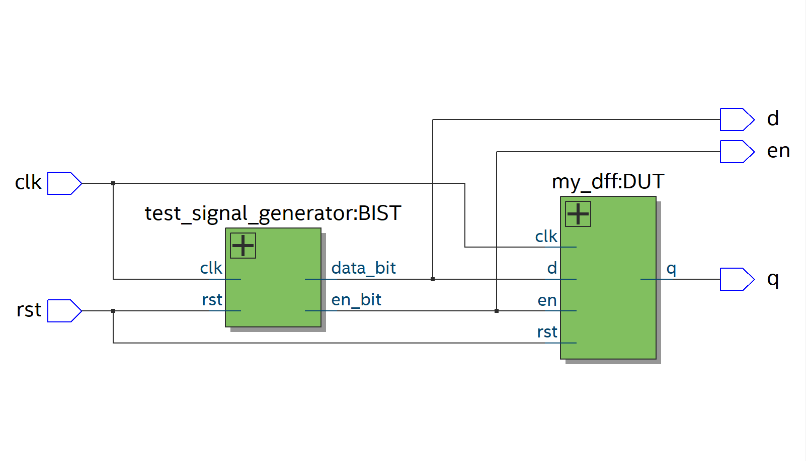
*Figura 1.1. Esquemático RTL sintetizado en Quartus para `dff_timing`, mostrando la conexión entre `test_signal_generator:BIST` y `my_dff:DUT`.*

---

### 1.2. Códigos Fuente en VHDL (`ej1_dff_timing`)

Los archivos fuente proporcionados e integrados en el proyecto Quartus ([dff_timing.qpf](file:///d:/Documentos/Maestria/SoC/Taller5/dff_timing.qpf)) se encuentran organizados en:
- [my_dff.vhd](file:///d:/Documentos/Maestria/SoC/Taller5/ej1_dff_timing/vhdl/src/my_dff.vhd)
- [test_signal_generator.vhd](file:///d:/Documentos/Maestria/SoC/Taller5/ej1_dff_timing/vhdl/src/test_signal_generator.vhd)
- [dff_timing.vhd](file:///d:/Documentos/Maestria/SoC/Taller5/ej1_dff_timing/vhdl/src/dff_timing.vhd)
- [dff_timing_tb.vhd](file:///d:/Documentos/Maestria/SoC/Taller5/ej1_dff_timing/vhdl/tb/dff_timing_tb.vhd)

---

### 1.3. Resultados de Compilación y Análisis Temporal en TimeQuest

La compilación del proyecto y el análisis estático de tiempos (*TimeQuest Timing Analyzer*) se verificaron tanto en **Cyclone V (`5CGXFC7C7F23C8`)** bajo Quartus Prime 20.1.1 como en **Cyclone IV GX (`EP4CGX15BF14C6`)** bajo Quartus II 13.0 SP1 (utilizado para la generación de archivos `.vho` y `.sdo` de simulación de tiempos en VHDL):

| Recurso / Métrica | Cyclone V (`5CGXFC7C7F23C8`) — Quartus 20.1.1 | Cyclone IV GX (`EP4CGX15BF14C6`) — Quartus 13.0 SP1 |
| :--- | :---: | :---: |
| **Total Logic Elements / Functions** | `7` funciones combinacionales (`4` ALMs) | `8 / 14,400 (< 1 %)` (`7` funciones combinacionales) |
| **Dedicated Logic Registers** | **`8`** (`7` en `BIST`, `1` en `DUT`) | **`8 / 14,400 (< 1 %)`** (`7` en `BIST`, `1` en `DUT`) |
| **Total Pins** | **`5`** (`clk`, `rst`, `en`, `d`, `q`) | **`5 / 81 (6 %)`** (`clk`, `rst`, `en`, `d`, `q`) |
| **Modelo Temporal Evaluado (Slow 85°C)** | `Slow 1100mV 85C Model` | `Slow 1200mV 85C Model` |
| **Frecuencia Máxima Interna (`Fmax`)** | **`648.09 MHz`** | **`909.92 MHz`** |
| **Frecuencia Máxima Restringida (`Restricted Fmax`)** | **`580.05 MHz`** (*minimum period restriction $t_{\min}$*) | **`250.0 MHz`** (*minimum period restriction / max I/O toggle rate*) |

#### Tiempos de Propagación Reloj a Salida (*Clock to Output Times* — Modelo `Slow 1200mV 85C`)
TimeQuest reporta los siguientes retardos físicos desde el flanco de subida en el pin `clk` hasta los pines de salida `d` y `q`:
- **Salida `d`**: $t_{CO\text{ (Rise)}} = \mathbf{5.614\text{ ns}}$, $t_{CO\text{ (Fall)}} = \mathbf{5.536\text{ ns}}$.
- **Salida `q`**: $t_{CO\text{ (Rise)}} = \mathbf{5.589\text{ ns}}$, $t_{CO\text{ (Fall)}} = \mathbf{5.511\text{ ns}}$.

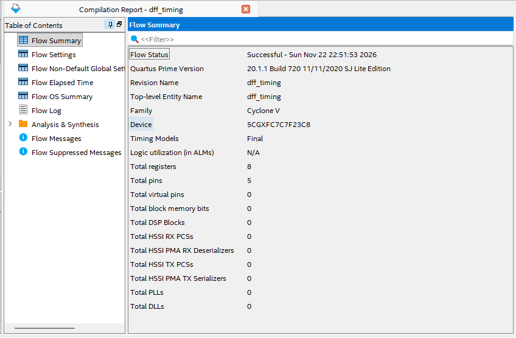
*Figura 1.2. Informe de compilación (Flow Summary) en Quartus para `dff_timing` (`8` registros, `5` pines).*

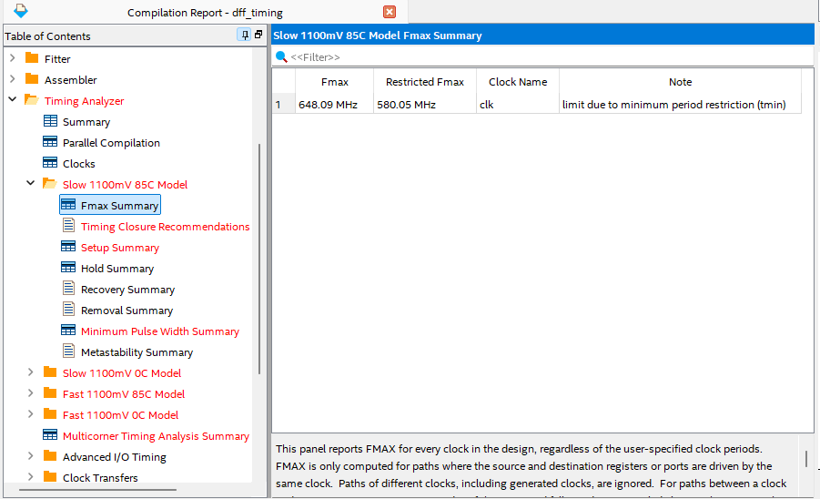
*Figura 1.3. Reporte de frecuencia máxima de operación (`Fmax = 648.09 MHz`, `Restricted Fmax = 580.05 MHz` en Cyclone V `Slow 1100mV 85C Model`).*

---

### 1.4. Comparación: Simulación Funcional (RTL) vs. Simulación de Tiempos (Gate-Level SDF)

#### 1.4.1. Simulación Funcional en ModelSim (`500 ns`, Testbench `dff_timing_tb.vhd`)
En la simulación funcional ([run_dff_functional.do](file:///d:/Documentos/Maestria/SoC/Taller5/ej1_dff_timing/sim/run_dff_functional.do)), el simulador evalúa directamente las ecuaciones VHDL ideales sin retardos físicos de compuertas ni de enrutamiento:
- El reloj `clk_tb` tiene periodo de $20\text{ ns}$ ($50\text{ MHz}$, con flancos de subida en $10, 30, 50, \dots, 150, \dots\text{ ns}$) y `rst_tb` pasa de `'1'` a `'0'` en **$150\text{ ns}$**.
- Como se observa en la **Figura 1.4**, las transiciones de `d_tb` y `q_tb` caen **exactamente sobre la vertical del flanco de subida del reloj** ($\Delta t = 0\text{ ps}$):
  - En **$250\text{ ns}$** (línea vertical de `250 ns`), `d_tb` sube instantáneamente de `'0'` a `'1'`.
  - Exactamente 1 ciclo de reloj después ($20\text{ ns}$), en **$270\text{ ns}$**, el flip-flop `my_dff` captura el `'1'` y `q_tb` sube instantáneamente a `'1'`.
  - Tras 5 ciclos de reloj ($100\text{ ns}$), en **$350\text{ ns}$**, `d_tb` baja instantáneamente a `'0'`, y un ciclo más tarde, en **$370\text{ ns}$**, `q_tb` baja instantáneamente a `'0'`.
  - Finalmente, en **$490\text{ ns}$**, `d_tb` vuelve a subir a `'1'` para iniciar el segundo pulso.

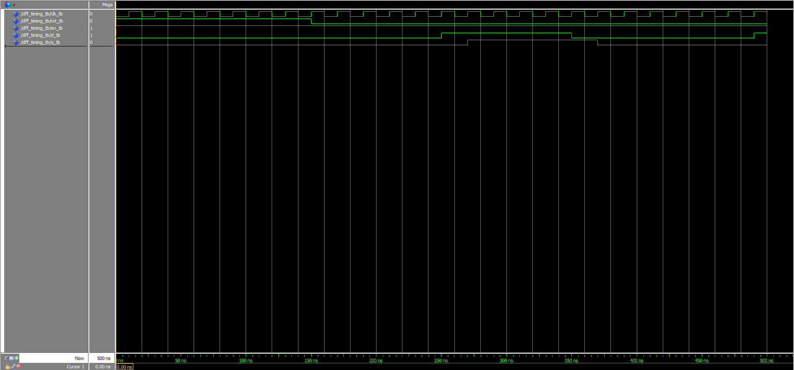
*Figura 1.4. Simulación funcional (RTL) por $500\text{ ns}$ en ModelSim (`dff_timing_tb`): las transiciones de `d_tb` y `q_tb` ocurren exactamente alineadas con los flancos de subida de `clk_tb` ($\Delta t = 0\text{ ps}$).*

#### 1.4.2. Simulación de Tiempos en ModelSim (`dff_timing.vho` + `dff_timing_vhd.sdo`)
En la simulación temporal ([run_dff_timing.do](file:///d:/Documentos/Maestria/SoC/Taller5/simulation/modelsim/run_dff_timing.do)), se carga la netlist física post-Fitter `dff_timing.vho` junto con el archivo de retardos estándar `dff_timing_vhd.sdo`, forzando `clk` con periodo de $20\,000\text{ ps}$ ($20\text{ ns}$, flancos de subida en $0, 20, 40, \dots, 160, 180\text{ ns}$) y el reset con `force rst 1 0, 0 50000` (`rst` cae a `'0'` en **$50\text{ ns}$**):

- Como se aprecia en la **Figura 1.5**, las transiciones de `d` y `q` **ya no coinciden con la línea vertical del flanco de subida de `clk`**, sino que aparecen **desplazadas hacia la derecha** más de un cuarto de ciclo ($+5.5\text{ a }5.6\text{ ns}$ después del flanco ascendente de `clk`):

| Evento Lógico | Simulación Funcional (`rst` cae en $150\text{ ns}$) | Retardo RTL ($\Delta t$) | Simulación de Tiempos SDF (`rst` cae en $50\text{ ns}$) | Flanco de `clk` que lo dispara | Retardo Físico Medido ($t_{CO}$) |
| :--- | :---: | :---: | :---: | :---: | :---: |
| **`d` sube (`0 -> 1`)** | $250.000\text{ ns}$ | $0\text{ ps}$ | **$165.620\text{ ns}$** ($165\,620\text{ ps}$) | $160.000\text{ ns}$ | **$+5.620\text{ ns}$** ($5\,620\text{ ps}$) |
| **`q` sube (`0 -> 1`)** | $270.000\text{ ns}$ | $0\text{ ps}$ | **$185.595\text{ ns}$** ($185\,595\text{ ps}$) | $180.000\text{ ns}$ | **$+5.595\text{ ns}$** ($5\,595\text{ ps}$) |
| **`d` baja (`1 -> 0`)** | $350.000\text{ ns}$ | $0\text{ ps}$ | **$265.542\text{ ns}$** ($265\,542\text{ ps}$) | $260.000\text{ ns}$ | **$+5.542\text{ ns}$** ($5\,542\text{ ps}$) |
| **`q` baja (`1 -> 0`)** | $370.000\text{ ns}$ | $0\text{ ps}$ | **$285.517\text{ ns}$** ($285\,517\text{ ps}$) | $280.000\text{ ns}$ | **$+5.517\text{ ns}$** ($5\,517\text{ ps}$) |
| **`d` sube (2° ciclo)** | $490.000\text{ ns}$ | $0\text{ ps}$ | **$405.620\text{ ns}$** ($405\,620\text{ ps}$) | $400.000\text{ ns}$ | **$+5.620\text{ ns}$** ($5\,620\text{ ps}$) |
| **`q` sube (2° ciclo)** | $> 500\text{ ns}$ ($510\text{ ns}$) | $0\text{ ps}$ | **$425.595\text{ ns}$** ($425\,595\text{ ps}$) | $420.000\text{ ns}$ | **$+5.595\text{ ns}$** ($5\,595\text{ ps}$) |

> **Conclusión del análisis temporal (Ejercicio 1):**  
> En la simulación de tiempos se comprueba que las salidas `d` y `q` presentan un retardo de propagación físico de **$\approx 5.52\text{ ns}$ a $5.62\text{ ns}$** después de cada flanco de subida del reloj. Este retardo suma: (1) el buffer de entrada del pin `clk` y la red de distribución global de reloj (`clk~inputclkctrl`), (2) el tiempo de conmutación interno del registro ($t_{CO}$ intrínseco del flip-flop), (3) el enrutamiento interno hacia la celda de salida y (4) el buffer de salida I/O (`d~output` y `q~output`). Aun con este retardo hacia los pines externos, el flip-flop `my_dff` sigue capturando `q` exactamente un ciclo de reloj ($\approx 20\text{ ns}$) después de `d`, dado que a $50\text{ MHz}$ ($T_{\text{clk}} = 20\text{ ns}$) el retardo interno entre los registros `BIST|pr_state.one` y `DUT|q` es de apenas $0.750\text{ ns}$, cumpliendo con amplio margen el tiempo de *setup* ($t_{su}$).

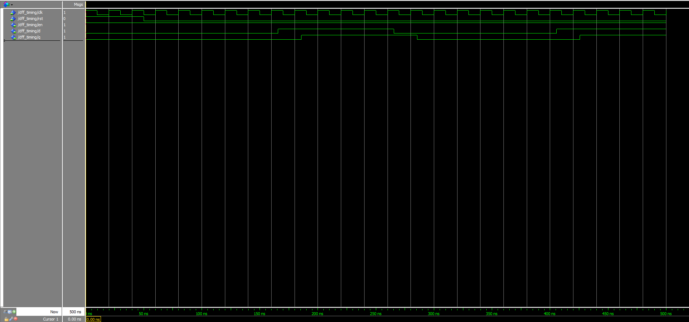
*Figura 1.5. Simulación de tiempos (Gate-Level + SDF) por $500\text{ ns}$ en ModelSim: se observa cómo las transiciones de `d` y `q` ocurren $\approx 5.6\text{ ns}$ después del flanco de subida de `clk`.*

---

## Ejercicio No. 2: Caso de Estudio — Cadenas de Retardo Combinacional y Comparación de Familias FPGA (`case_study`)

### 2.1. Descripción General del Circuito y Preservación de Niveles Lógicos (`KEEP`)

El circuito de la **Figura 13** del enunciado ([case_study.vhd](file:///d:/Documentos/Maestria/SoC/Taller5/ej2_case_study/vhdl/src/case_study.vhd)) está diseñado para estudiar cómo se acumulan los retardos de propagación a medida que aumenta la **profundidad lógica** (número de compuertas en serie entre dos registros síncronos) y cómo este retardo acumulado limita la **frecuencia máxima de reloj (`Fmax`)** del sistema.

El sistema consta de:
1. **Dos Flip-Flops tipo D de entrada (`A_reg` y `B_reg`)**: Sincronizan las entradas externas `A` y `B` con el flanco de subida de `clk`.
2. **Siete caminos combinacionales con diferente número de niveles lógicos (`1L` a `5L`)**:
   - **Camino 1 (`Aneg_1L`)**: Pasa `A_reg` por **1 inversor** (`not_a1 <= NOT A_reg`).
   - **Camino 2 (`Bneg_3L`)**: Pasa `B_reg` por **3 inversores en serie** (`not_b1 -> not_b2 -> not_b3`). Booleanamente equivale a $\overline{B}$, pero físicamente atraviesa 3 celdas lógicas en cascada.
   - **Caminos 3 al 7 (`and_1L` a `and_5L`)**: Una **cadena en cascada de 5 compuertas AND de 2 entradas**, donde:
     - `and_1L_s <= A_reg AND B_reg` (**1 nivel lógico**)
     - `and_2L_s <= and_1L_s AND A_reg` (**2 niveles lógicos**)
     - `and_3L_s <= and_2L_s AND A_reg` (**3 niveles lógicos**)
     - `and_4L_s <= and_3L_s AND A_reg` (**4 niveles lógicos**)
     - `and_5L_s <= and_4L_s AND A_reg` (**5 niveles lógicos**)
3. **Salidas Directas y Salidas Registradas (`7` Flip-Flops de salida)**:
   - Cada uno de los 7 caminos combinacionales se conecta tanto a un pin de salida directa (`Aneg_1L`, `Bneg_3L`, `and_1L`..`and_5L`) como a la entrada `D` de un Flip-Flop de salida sincronizado con `clk` (`Aneg_1L_reg`, `Bneg_3L_reg`, `and_1L_reg`..`and_5L_reg`).

> **Importancia del atributo de síntesis `ATTRIBUTE keep : BOOLEAN`:**  
> Desde el punto de vista puramente algebraico, $\overline{\overline{\overline{B}}} = \overline{B}$ y $(((A \cdot B) \cdot A) \cdot A) = A \cdot B$. Si se compila el código VHDL estándar sin directivas de preservación, el optimizador booleano de Quartus elimina los inversores `not_b1` y `not_b2` y colapsa las 5 compuertas AND en una sola LUT. Para evitar que el sintetizador simplifique el circuito y obligarlo a instanciar **1 celda lógica física (`LCELL` / LUT) por cada compuerta del esquema de la Figura 13**, se aplica el atributo `ATTRIBUTE keep : BOOLEAN` sobre los 9 nodos combinacionales (`not_a1`, `not_b1..not_b3`, `and_1L_s..and_5L_s`).

---

### 2.2. Implementación en VHDL (`case_study.vhd` y `case_study_tb.vhd`)

#### 2.2.1. Módulo Principal ([case_study.vhd](file:///d:/Documentos/Maestria/SoC/Taller5/ej2_case_study/vhdl/src/case_study.vhd))
```vhdl
LIBRARY IEEE;
USE IEEE.STD_LOGIC_1164.ALL;

ENTITY case_study IS
    PORT (
        clk         : IN  STD_LOGIC;
        A           : IN  STD_LOGIC;
        B           : IN  STD_LOGIC;
        Aneg_1L     : OUT STD_LOGIC;
        Aneg_1L_reg : OUT STD_LOGIC;
        Bneg_3L     : OUT STD_LOGIC;
        Bneg_3L_reg : OUT STD_LOGIC;
        and_1L      : OUT STD_LOGIC;
        and_1L_reg  : OUT STD_LOGIC;
        and_2L      : OUT STD_LOGIC;
        and_2L_reg  : OUT STD_LOGIC;
        and_3L      : OUT STD_LOGIC;
        and_3L_reg  : OUT STD_LOGIC;
        and_4L      : OUT STD_LOGIC;
        and_4L_reg  : OUT STD_LOGIC;
        and_5L      : OUT STD_LOGIC;
        and_5L_reg  : OUT STD_LOGIC
    );
END ENTITY case_study;

ARCHITECTURE rtl OF case_study IS
    SIGNAL A_reg, B_reg                         : STD_LOGIC := '0';
    SIGNAL not_a1, not_b1, not_b2, not_b3       : STD_LOGIC;
    SIGNAL and_1L_s, and_2L_s, and_3L_s         : STD_LOGIC;
    SIGNAL and_4L_s, and_5L_s                   : STD_LOGIC;
    SIGNAL Aneg_1L_q, Bneg_3L_q                 : STD_LOGIC := '0';
    SIGNAL and_1L_q, and_2L_q, and_3L_q         : STD_LOGIC := '0';
    SIGNAL and_4L_q, and_5L_q                   : STD_LOGIC := '0';

    ATTRIBUTE keep : BOOLEAN;
    ATTRIBUTE keep OF not_a1, not_b1, not_b2, not_b3             : SIGNAL IS TRUE;
    ATTRIBUTE keep OF and_1L_s, and_2L_s, and_3L_s, and_4L_s, and_5L_s : SIGNAL IS TRUE;
BEGIN
    input_regs : PROCESS(clk)
    BEGIN
        IF rising_edge(clk) THEN
            A_reg <= A;
            B_reg <= B;
        END IF;
    END PROCESS input_regs;

    not_a1   <= NOT A_reg;
    not_b1   <= NOT B_reg;
    not_b2   <= NOT not_b1;
    not_b3   <= NOT not_b2;

    and_1L_s <= A_reg    AND B_reg;
    and_2L_s <= and_1L_s AND A_reg;
    and_3L_s <= and_2L_s AND A_reg;
    and_4L_s <= and_3L_s AND A_reg;
    and_5L_s <= and_4L_s AND A_reg;

    output_regs : PROCESS(clk)
    BEGIN
        IF rising_edge(clk) THEN
            Aneg_1L_q <= not_a1;
            Bneg_3L_q <= not_b3;
            and_1L_q  <= and_1L_s;
            and_2L_q  <= and_2L_s;
            and_3L_q  <= and_3L_s;
            and_4L_q  <= and_4L_s;
            and_5L_q  <= and_5L_s;
        END IF;
    END PROCESS output_regs;

    Aneg_1L <= not_a1;   Aneg_1L_reg <= Aneg_1L_q;
    Bneg_3L <= not_b3;   Bneg_3L_reg <= Bneg_3L_q;
    and_1L  <= and_1L_s; and_1L_reg  <= and_1L_q;
    and_2L  <= and_2L_s; and_2L_reg  <= and_2L_q;
    and_3L  <= and_3L_s; and_3L_reg  <= and_3L_q;
    and_4L  <= and_4L_s; and_4L_reg  <= and_4L_q;
    and_5L  <= and_5L_s; and_5L_reg  <= and_5L_q;
END ARCHITECTURE rtl;
```

---

### 2.3. Verificación del Hardware Generado en Quartus (Punto 1)

Al compilar el proyecto ([case_study.qpf](file:///d:/Documentos/Maestria/SoC/Taller5/case_study.qpf)), el reporte de síntesis confirma que **las 9 compuertas combinacionales y los 9 Flip-Flops tipo D** de la Figura 13 fueron preservados íntegramente en el hardware:
- **Funciones combinacionales (`Total combinational functions = 9`)**:
  - `1` LUT para el inversor `not_a1`.
  - `3` LUTs individuales en serie para los inversores `not_b1`, `not_b2` y `not_b3`.
  - `5` LUTs individuales en cascada para las compuertas AND `and_1L_s` a `and_5L_s`.
- **Registros dedicados (`Dedicated logic registers = 9`)**:
  - `2` registros de entrada (`A_reg`, `B_reg`).
  - `7` registros de salida (`Aneg_1L_q`, `Bneg_3L_q`, `and_1L_q`..`and_5L_q`).
- **Pines de E/S (`Total pins = 17`)**: `3` entradas (`clk`, `A`, `B`) y `14` salidas.

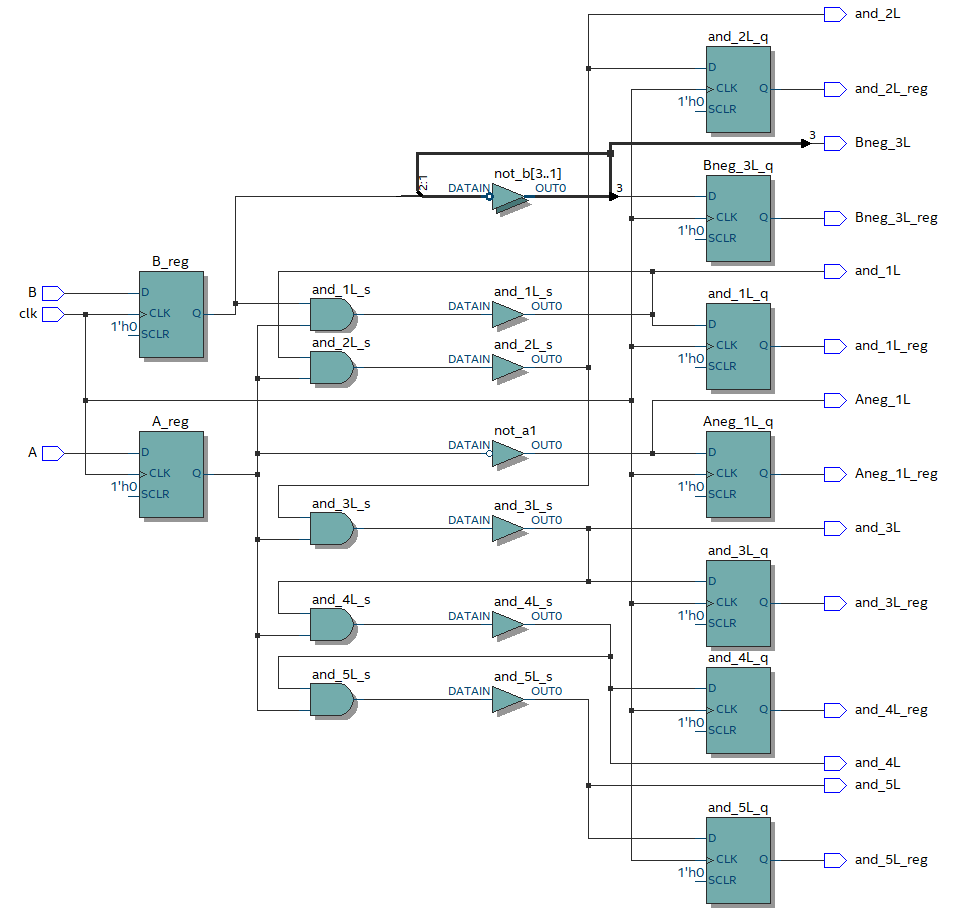
*Figura 2.1. Esquemático RTL generado en Quartus para `case_study` (Figura 13), verificando los 2 registros de entrada, el inversor de 1 nivel, los 3 inversores en cascada, las 5 compuertas AND en cascada y los 7 registros de salida.*

---

### 2.4. Contraste entre Simulación Funcional y Simulación de Tiempos a 50 MHz (Punto 2)

En el banco de pruebas ([case_study_tb.vhd](file:///d:/Documentos/Maestria/SoC/Taller5/ej2_case_study/vhdl/tb/case_study_tb.vhd)) y en el script de tiempos ([run_case_study_timing_c4gx.do](file:///d:/Documentos/Maestria/SoC/Taller5/ej2_case_study/sim/run_case_study_timing_c4gx.do)):
1. En $t = 40\text{ ns}$ se activa `A = '1'` (que es capturado por `A_reg` en el flanco de subida de `clk` en **$50\text{ ns}$**). Esto deja habilitada la entrada `A_reg = '1'` de todas las compuertas AND y hace que `Aneg_1L` conmute de `'1'` a `'0'`.
2. En $t = 100\text{ ns}$ se activa `B = '1'` (capturado por `B_reg` en el flanco de subida de `clk` en **$110\text{ ns}$**). Al pasar `B_reg` de `'0'` a `'1'` con `A_reg = '1'`, el pulso se propaga secuencialmente a través de los 3 inversores (`Bneg_3L`) y en cascada por las 5 compuertas AND (`and_1L -> and_2L -> and_3L -> and_4L -> and_5L`).
3. En $t = 180\text{ ns}$ se desactiva `B = '0'` (capturado por `B_reg` en el flanco de subida de **$190\text{ ns}$**), propagando el flanco de bajada por toda la cadena.

#### 2.4.1. Resultado en Simulación Funcional ([run_case_study_functional.do](file:///d:/Documentos/Maestria/SoC/Taller5/ej2_case_study/sim/run_case_study_functional.do))
- En el flanco de **$110.000\text{ ns}$**, las 5 salidas combinacionales `and_1L`, `and_2L`, `and_3L`, `and_4L` y `and_5L` suben a `'1'` **exactamente al mismo tiempo ($110.000\text{ ns}$, retardo $0\text{ ps}$)**, sin ninguna diferencia entre pasar por 1 compuerta o por 5 compuertas en serie.
- De igual forma, `Aneg_1L` (1 inversor, en $50.000\text{ ns}$) y `Bneg_3L` (3 inversores, en $110.000\text{ ns}$) conmutan instantáneamente con el flanco de reloj.
- Todas las salidas registradas (`and_1L_reg`..`and_5L_reg`) suben exactamente en **$130.000\text{ ns}$**.

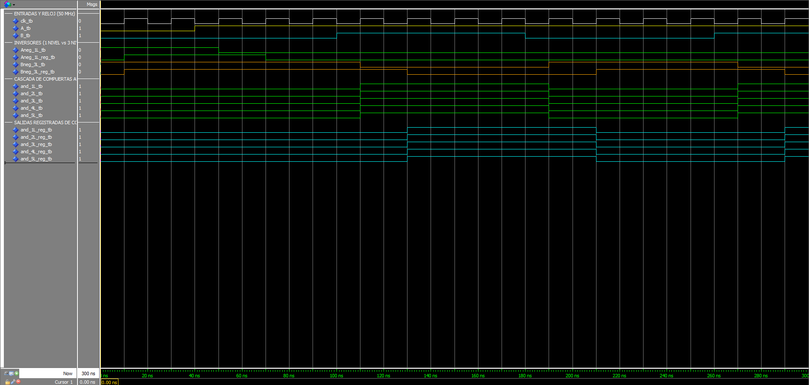
*Figura 2.2. Simulación funcional (RTL) de `case_study`: todas las etapas de la cascada AND (`and_1L` a `and_5L`) conmutan simultáneamente en el flanco de reloj sin retardo acumulativo.*

#### 2.4.2. Resultado en Simulación de Tiempos (`Cyclone IV GX` a 50 MHz)
Al simular con retardos SDF ([run_case_study_timing_c4gx.do](file:///d:/Documentos/Maestria/SoC/Taller5/ej2_case_study/sim/run_case_study_timing_c4gx.do)), se observa cómo la señal tarda cada vez más a medida que atraviesa más niveles de compuertas:

| Camino / Nivel Lógico | Retardo Interno Registro a Registro (`TimeQuest Data Delay`) | Incremento por Nivel Lógico ($\Delta t_{\text{LUT}}$) | Instante de Conmutación en Pin de Salida (tras flanco de $110\text{ ns}$) | Retardo Total *Clock-to-Output* ($t_{CO}$) |
| :--- | :---: | :---: | :---: | :---: |
| **`A_reg -> Aneg_1L` (1 Inversor)** | $1.433\text{ ns}$ | Base (1 NOT) | $56.853\text{ ns}$ (tras flanco de $50\text{ ns}$) | $+6.853\text{ ns}$ |
| **`B_reg -> Bneg_3L` (3 Inversores)** | **$1.917\text{ ns}$** | **$+484\text{ ps}$** ($+242\text{ ps}$/NOT) | $117.117\text{ ns}$ | $+7.117\text{ ns}$ |
| **`B_reg -> and_1L` (1 nivel AND)** | $1.550\text{ ns}$* | Base (1 AND) | $117.472\text{ ns}$* | $+7.472\text{ ns}$ |
| **`B_reg -> and_2L` (2 niveles AND)** | $1.271\text{ ns}$ | Base en LAB principal | **$116.807\text{ ns}$** | $+6.807\text{ ns}$ |
| **`B_reg -> and_3L` (3 niveles AND)** | $1.598\text{ ns}$ | **$+327\text{ ps}$** | **$117.166\text{ ns}$** | $+7.166\text{ ns}$ |
| **`B_reg -> and_4L` (4 niveles AND)** | $1.926\text{ ns}$ | **$+328\text{ ps}$** | **$118.275\text{ ns}$** | $+8.275\text{ ns}$ |
| **`B_reg -> and_5L` (5 niveles AND)** | **$2.255\text{ ns}$** | **$+329\text{ ps}$** | **$118.011\text{ ns}$** | $+8.011\text{ ns}$ |

*\*Nota: En el Fitter de Cyclone IV GX, `and_2L`..`and_5L` se ubican dentro del mismo bloque lógico (LAB), donde cada compuerta AND adicional suma exactamente **$\approx 328\text{ ps}$** de retardo interno; las leves variaciones adicionales en los pines externos (`and_1L`, `and_4L`) se deben a la distancia física desde el LAB hasta cada pad de salida I/O del encapsulado.*

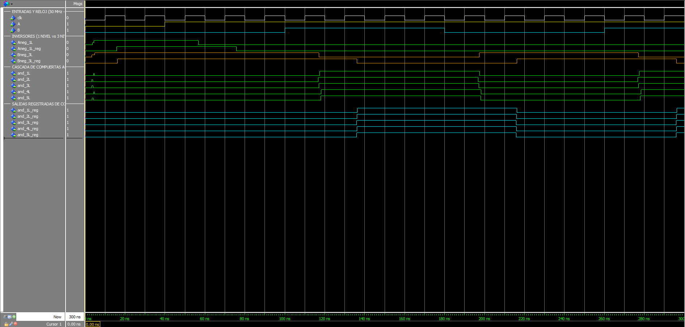
*Figura 2.3. Simulación de tiempos (Gate-Level SDF) a 50 MHz en Cyclone IV GX: se observa el escalonamiento temporal progresivo entre `and_2L`, `and_3L`, `and_4L` y `and_5L`, así como la diferencia entre `Aneg_1L` y `Bneg_3L`.*

---

### 2.5. Impacto de Aumentar la Frecuencia del Reloj al Límite `Fmax` (Punto 3)

En **TimeQuest Timing Analyzer** (modelo `Slow 1200mV 85C` de Cyclone IV GX), el camino crítico del circuito es el de mayor profundidad lógica (`B_reg -> and_5L_q`, con 5 niveles de compuertas AND y un retardo de datos de **$2.255\text{ ns}$**), lo cual arroja un periodo mínimo $T_{\min} = 2.324\text{ ns}$ correspondiente a:
$$F_{\max} = \mathbf{430.29\text{ MHz}}$$

Para verificar experimentalmente el impacto sobre el funcionamiento del circuito ([run_case_study_fmax_c4gx.do](file:///d:/Documentos/Maestria/SoC/Taller5/ej2_case_study/sim/run_case_study_fmax_c4gx.do)), se elevó la frecuencia del reloj por encima de $F_{\max}$ hasta **$555.5\text{ MHz}$ ($T_{\text{clk}} = 1.80\text{ ns} = 1800\text{ ps}$)**, un periodo intermedio entre el retardo de 3 niveles ($1.598\text{ ns}$) y el de 4 y 5 niveles ($1.926\text{ ns}$ y $2.255\text{ ns}$):

| Registro de Salida | Niveles Lógicos | Retardo Interno de Datos | ¿Cumple $T_{\text{clk}} = 1.80\text{ ns}$? | Comportamiento Observado en ModelSim ($t \approx 21.3 - 23.2\text{ ns}$) |
| :--- | :---: | :---: | :---: | :--- |
| **`and_1L_reg`** | 1 AND | $1.550\text{ ns}$ | **Sí** ($Slack > 0$) | Conmuta correctamente a `'1'` en el primer ciclo ($21.595\text{ ns}$). |
| **`and_2L_reg`** | 2 AND | $1.271\text{ ns}$ | **Sí** ($Slack > 0$) | Conmuta correctamente a `'1'` en el primer ciclo ($21.460\text{ ns}$). |
| **`and_3L_reg`** | 3 AND | $1.598\text{ ns}$ | **Sí** ($Slack > 0$) | Conmuta correctamente a `'1'` en el primer ciclo ($21.310\text{ ns}$). |
| **`and_4L_reg`** | 4 AND | $1.926\text{ ns}$ | **Falla Setup ($t_{su}$)** | La señal llega durante la ventana de *setup* del Flip-Flop: la salida entra en **METAESTABILIDAD (`'X'` en color rojo)** desde $21.383\text{ ns}$ hasta $23.183\text{ ns}$. |
| **`and_5L_reg`** | 5 AND | $2.255\text{ ns}$ | **No llega a tiempo** | La señal llega después del flanco de reloj: **pierde el ciclo completo** y recién conmuta a `'1'` en el ciclo siguiente ($23.103\text{ ns}$, **$1.80\text{ ns}$ tarde**). |

> **Conclusión del Punto 3:** Superar la frecuencia máxima $F_{\max}$ determinada por el camino más largo provoca que los registros con mayor número de compuertas en cascada (`and_4L_reg` y `and_5L_reg`) sufran **violaciones de tiempo de establecimiento (*setup time violation*)**, entrando en estados metaestables (`'X'`) o capturando los datos con un ciclo de reloj de desfase respecto al resto del circuito, lo que rompe la sincronía del sistema digital.

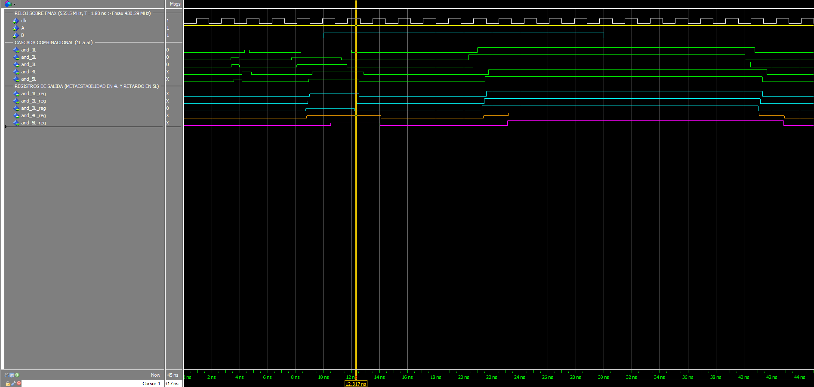
*Figura 2.4. Impacto de operar por encima de $F_{\max}$ ($555.5\text{ MHz}$, $T_{\text{clk}} = 1.80\text{ ns}$): `and_1L_reg`..`and_3L_reg` capturan el dato a tiempo, mientras `and_4L_reg` entra en metaestabilidad (`'X'`) y `and_5L_reg` se retrasa un ciclo de reloj completo.*

---

### 2.6. Comparación Tecnológica entre Familias FPGA: 60 nm (Cyclone IV GX) vs. 40 nm (Arria II GX / Arquitectura Stratix IV) (Puntos 4 y 5)

Siguiendo los puntos 4 y 5 de la guía, se cambió el dispositivo en Quartus II (`Assignments -> Device`) hacia una familia FPGA de tecnología de **$40\text{ nm}$** y arquitectura **ALM de 8 entradas / LUTs de 6 entradas** (**`Arria II GX EP2AGX45DF25C4`**, perteneciente a la misma generación tecnológica de $40\text{ nm}$ y arquitectura ALM que la familia **Stratix IV**, habilitada en la licencia Web Edition) y se repitió la compilación y la simulación temporal ([run_case_study_timing_arria2.do](file:///d:/Documentos/Maestria/SoC/Taller5/ej2_case_study/sim/run_case_study_timing_arria2.do)).

#### Tabla Comparativa de Desempeño y Retardos entre Familias

| Parámetro / Camino Medido | Familia Base: **Cyclone IV GX (`EP4CGX15BF14C6`)** | Familia de Mayor Rendimiento: **Arria II GX (`EP2AGX45DF25C4`)** | Diferencia / Mejora en $40\text{ nm}$ |
| :--- | :---: | :---: | :---: |
| **Nodo Tecnológico y Tensión de Núcleo** | $60\text{ nm}$ ($V_{CCINT} = 1.2\text{ V}$) | **$40\text{ nm}$ ($V_{CCINT} = 0.9\text{ V}$)** (Arquitectura ALM tipo Stratix IV) | Transistores más pequeños y rápidos |
| **Arquitectura de Celda Lógica** | LE con LUT de 4 entradas (`14,400` LEs) | ALM fracturable con ALUTs de 6 entradas (`36,100` ALUTs) | Mayor capacidad y velocidad de conmutación |
| **Frecuencia Máxima Interna (`Fmax`, Slow 85°C)** | **`430.29 MHz`** ($T_{\min} = 2.324\text{ ns}$) | **`703.23 MHz`** ($T_{\min} = 1.422\text{ ns}$) | **`+63.4 %` mayor velocidad máxima** |
| **Frecuencia Máxima a 0°C (`Fmax`, Slow 0°C)** | `480.77 MHz` | **`736.38 MHz`** | `+53.2 %` |
| **Retardo por Nivel de Compuerta AND ($\Delta t_{\text{AND}}$)** | **$\approx 328\text{ ps}$** por compuerta | **$\approx 135 - 180\text{ ps}$** por compuerta | **Reducción del $\approx 50\%$ en retardo por compuerta** |
| **Salida `Aneg_1L` (1 NOT, $t_{CO\text{ Fall}}$)** | $6.853\text{ ns}$ | **$5.747\text{ ns}$** | **$-1.106\text{ ns}$** ($-16.1\%$) |
| **Salida `Bneg_3L` (3 NOT, $t_{CO\text{ Fall}}$)** | $7.117\text{ ns}$ | **$6.073\text{ ns}$** | **$-1.044\text{ ns}$** ($-14.7\%$) |
| **Salida `and_1L` (1 AND, $t_{CO\text{ Rise}}$ en $110\text{ ns}$)** | $7.472\text{ ns}$ ($117.472\text{ ns}$) | **$5.696\text{ ns}$ ($115.696\text{ ns}$)** | **$-1.776\text{ ns}$** ($-23.8\%$) |
| **Salida `and_2L` (2 AND, $t_{CO\text{ Rise}}$ en $110\text{ ns}$)** | $6.807\text{ ns}$ ($116.807\text{ ns}$) | **$5.836\text{ ns}$ ($115.836\text{ ns}$)** | **$-0.971\text{ ns}$** ($-14.3\%$) |
| **Salida `and_3L` (3 AND, $t_{CO\text{ Rise}}$ en $110\text{ ns}$)** | $7.166\text{ ns}$ ($117.166\text{ ns}$) | **$6.091\text{ ns}$ ($116.091\text{ ns}$)** | **$-1.075\text{ ns}$** ($-15.0\%$) |
| **Salida `and_4L` (4 AND, $t_{CO\text{ Rise}}$ en $110\text{ ns}$)** | $8.275\text{ ns}$ ($118.275\text{ ns}$) | **$6.312\text{ ns}$ ($116.312\text{ ns}$)** | **$-1.963\text{ ns}$** ($-23.7\%$) |
| **Salida `and_5L` (5 AND, $t_{CO\text{ Rise}}$ en $110\text{ ns}$)** | $8.011\text{ ns}$ ($118.011\text{ ns}$) | **$6.226\text{ ns}$ ($116.226\text{ ns}$)** | **$-1.785\text{ ns}$** ($-22.3\%$) |
| **Salidas Registradas `and_1L_reg..and_5L_reg` ($t_{CO}$)** | $6.003 - 6.295\text{ ns}$ ($136.003 - 136.295\text{ ns}$) | **$5.283 - 5.473\text{ ns}$ ($135.283 - 135.473\text{ ns}$)** | **$-0.77\text{ ns}$ más rápidas** |

> **Respuesta a la pregunta del Punto 5 (¿Hay diferencias entre las dos familias?):**  
> Sí, existen diferencias sustanciales tanto en el retardo individual de cada compuerta como en el retardo total de enrutamiento y buffers de entrada/salida:
> 1. **Menor retardo intrínseco por compuerta (ALUT vs. LUT)**: En la familia de $40\text{ nm}$ (arquitectura ALM de Arria II GX / Stratix IV), la propagación entre etapas consecutivas de la cascada AND (`and_1L -> and_2L -> and_3L -> and_4L -> and_5L`) toma entre **$135\text{ ps}$ y $255\text{ ps}$** por compuerta, frente a los **$\approx 328\text{ ps}$** por compuerta en Cyclone IV GX ($60\text{ nm}$). Es decir, cada nivel lógico en $40\text{ nm}$ introduce casi **la mitad del retardo** que en $60\text{ nm}$ / $65\text{ nm}$.
> 2. **Menor dispersión total de la cascada**: En la tecnología de $40\text{ nm}$, las 5 etapas combinacionales (`and_1L` a `and_5L`) completan su transición en una ventana de apenas **$616\text{ ps}$** ($115.696\text{ ns}$ a $116.312\text{ ns}$), mientras que en Cyclone IV GX se extienden a lo largo de **$1\,468\text{ ps}$** ($116.807\text{ ns}$ a $118.275\text{ ns}$).
> 3. **Incremento del $63.4\%$ en la frecuencia máxima de reloj (`Fmax`)**: Gracias a la reducción del nodo de fabricación a $40\text{ nm}$ y la estructura de interconexión local de los bloques ALM, la frecuencia máxima del mismo circuito VHDL sube de **$430.29\text{ MHz}$** a **$703.23\text{ MHz}$**.

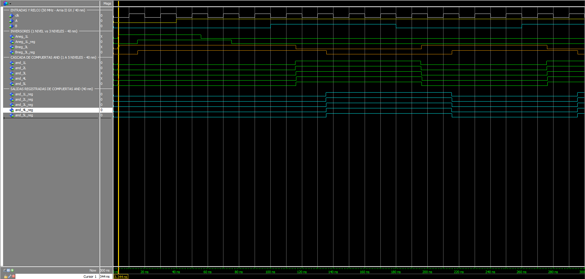
*Figura 2.5. Simulación de tiempos (Gate-Level SDF) a 50 MHz en la familia de $40\text{ nm}$ (`Arria II GX EP2AGX45DF25C4`): se aprecia una reducción de $\approx 1.8\text{ ns}$ en el retardo total hacia las salidas y un escalonamiento mucho más compacto entre `and_1L` y `and_5L`.*
