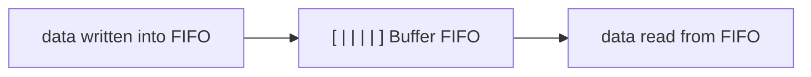
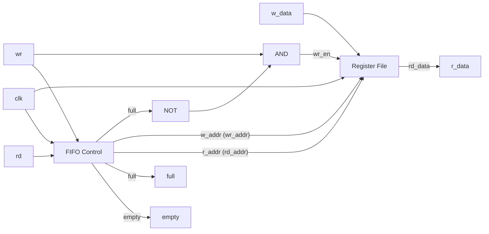
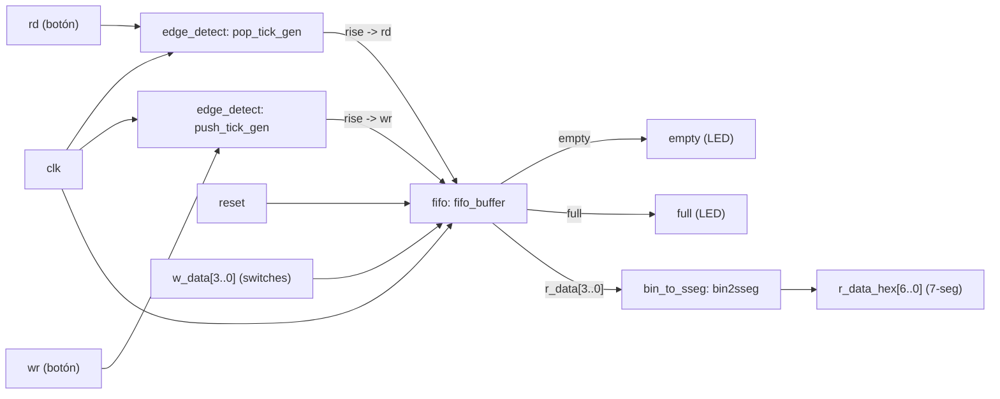

# Pontificia Universidad Javeriana
## Departamento de Electrónica
### System on Chip (SoC)

---

# Taller 6: Circuitos de Memoria - Buffer FIFO

---

## FIFO Buffer

Una estructura de datos **FIFO** (*first-in-first-out*) representa un espacio de almacenamiento "elástico" que permite comunicar dos sub-sistemas que pueden o no trabajar a la misma velocidad. En la **Figura 1** se observa un diagrama conceptual de una estructura FIFO.

El sistema implementa dos señales de control: `wr` y `rd`, para determinar la escritura y lectura de datos respectivamente. Cuando la señal `wr` está en `'1'`, el dato de entrada es escrito en el buffer (*push*). Se debe poner especial atención en la operación de escritura. La cabeza de la FIFO siempre se encuentra disponible para lectura. Por otro lado, la señal `rd` actúa como una señal que indica que el dato deberá ser borrado de la estructura. Cuando `rd` se encuentra en `'1'`, la cabeza del buffer es retirada y quedará disponible para lectura el siguiente elemento de la fila.

*Figura 1. Diagrama conceptual del funcionamiento de un buffer FIFO.*

---

## 1. Implementación Circular de un buffer FIFO

Una manera eficiente de implementar un buffer FIFO es mediante un circuito *register file* junto con un módulo de control de escritura y lectura. Este módulo tendrá apuntadores tanto a la cabeza como a la cola de la fila de datos. Los dos apuntadores avanzarán una posición por cada operación de lectura y escritura respectivamente. La implementación circular de una FIFO de ocho posiciones se observa en la **Figura 2**.

Una FIFO normalmente incluye dos señales de estado: `full` y `empty`, que indican si la estructura está llena y por tanto no puede ser escrita, o está vacía y por tanto no puede ser leída. Una de las condiciones ocurrirá cuando el apuntador de escritura es igual al apuntador de lectura, como se observa en la **Figura 2(a), (f) e (i)**. La tarea del controlador es diferenciar cada una de las dos condiciones. Una manera de hacerlo es manteniendo dos banderas (implementadas con un DFF), que serán inicializadas `empty = '1'` y `full = '0'`, y serán actualizadas en cada ciclo de reloj de acuerdo con los valores de las señales `wr` y `rd`.

### Secuencia de estados del buffer FIFO circular (Figura 2)

| Paso | Operación | `rd_ptr` | `wr_ptr` | Estado / Banderas |
| :--- | :--- | :---: | :---: | :--- |
| **(a)** | Estado inicial | `0` | `0` | `empty = '1'`, `full = '0'` |
| **(b)** | Después de 1 escritura | `0` | `1` | 1 elemento en `[0]` |
| **(c)** | Después de 3 escrituras más | `0` | `4` | 4 elementos en `[0..3]` |
| **(d)** | Después de 1 lectura | `1` | `4` | 3 elementos en `[1..3]` |
| **(e)** | 4 escrituras más | `1` | `0` | 7 elementos en `[1..7]` |
| **(f)** | 1 escritura más | `1` | `1` | `full = '1'`, `empty = '0'` (8 elementos) |
| **(g)** | 2 lecturas | `3` | `1` | 6 elementos en `[3..7, 0]` |
| **(h)** | 5 lecturas más | `0` | `1` | 1 elemento en `[0]` |
| **(i)** | 1 lectura | `1` | `1` | `empty = '1'`, `full = '0'` |

*Figura 2. Funcionamiento de un buffer FIFO circular de 8 posiciones.*

La **Figura 3** presenta el diagrama en bloques general de la implementación descrita (`fifo.vhd`, `register_file.vhd`, `fifo_ctrl.vhd`):

*Figura 3. Diagrama en bloques de un buffer FIFO circular implementada mediante un register file y un circuito controlador.*

### Actividades - Parte 1

1. Implemente un buffer FIFO circular parametrizable utilizando un circuito *register file* y su desarrollo del circuito de control (completando `fifo_ctrl.vhd` a partir de los archivos provistos `fifo.vhd`, `fifo_ctrl.vhd` y `register_file.vhd`).
2. Escriba un *testbench* que replique las condiciones observadas en la **Figura 2**.

---

## 2. Prueba de la estructura Buffer FIFO en hardware

Para verificar el funcionamiento de la estructura FIFO en hardware, se propone crear una interfase de usuario que permita guardar datos en el buffer y así mismo leerlos y visualizarlos en uno de los displays 7-segmentos de la tarjeta **DE1-SoC**. La **Figura 4** presenta el circuito de prueba para el buffer FIFO y su respectiva interfase de usuario.

Las señales de escritura (*push*) y lectura (*pop*) serán recibidas de los botones de la tarjeta. De acuerdo con la simulación realizada en la sección anterior, se observa que las señales `wr` y `rd` deben estar activas únicamente por un solo ciclo de reloj para poder escribir en la memoria de forma adecuada. En caso contrario, el funcionamiento del buffer FIFO hará varias lecturas y/o escrituras sucesivas ocasionando un comportamiento errático.

Por esta razón, se observan en la **Figura 4** dos instancias del circuito `edge_detect.vhd`, los cuales se encargan de generar un pulso de duración un ciclo de reloj cuando se detecta un flanco de subida en una señal asincrónica de duración indeterminada, como es el caso de un botón de usuario. Una vez se garantiza que las señales de escritura y lectura tienen una duración apropiada, son conectadas a las señales respectivas en la estructura FIFO. Los datos de entrada serán recibidos mediante interruptores (*switches*) de la tarjeta, y los datos de lectura de salida serán visualizados utilizando un conversor de BCD/binario a 7-segmentos (`bin_to_sseg: bin2sseg`). Finalmente, las señales `full` y `empty` serán conectadas a los LEDs de la tarjeta, para indicar de forma visual el estado de la memoria interna del buffer.

*Figura 4. Circuito de prueba de la estructura FIFO con interfase de usuario.*

El circuito de la **Figura 4** debe funcionar de la siguiente manera:
- **PUSH**: la escritura de la FIFO se realiza en dos etapas. En primer lugar, el usuario configura una palabra utilizando los interruptores de la tarjeta. En seguida, el usuario oprime el botón asignado a la señal `wr`, para finalizar la función *push* en el buffer FIFO.
- **POP**: la lectura solo requiere que el usuario oprima el botón asignado a la señal `rd`. El dato en la primera posición del buffer FIFO será observado en el display 7-segmentos asignado.

### Actividades - Parte 2

1. Verifique el funcionamiento del circuito `edge_detect.vhd` mediante simulación utilizando el *testbench* provisto (`edge_tb.vhd`).
2. Implemente el sistema de buffer FIFO e interfase de usuario observado en la **Figura 4**. Utilice datos de 4 bits como entrada (`DATA_WIDTH = 4`) y configure la profundidad de la FIFO a **16 registros** (`ADDR_WIDTH = 4`).
3. Verifique el funcionamiento del circuito en la tarjeta **DE0 / DE1-SoC**. Incluya en su informe un *link* a un video en línea que presente las funciones de escritura, lectura y visualización del sistema.
