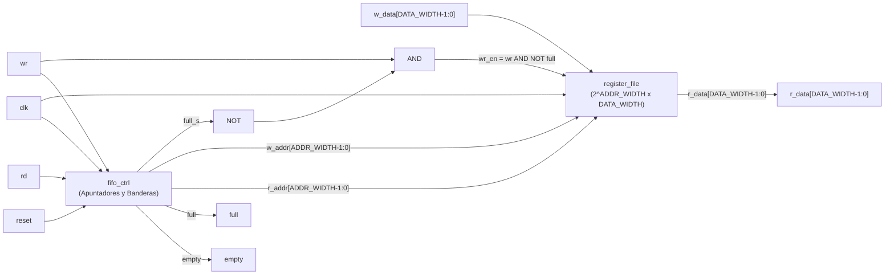
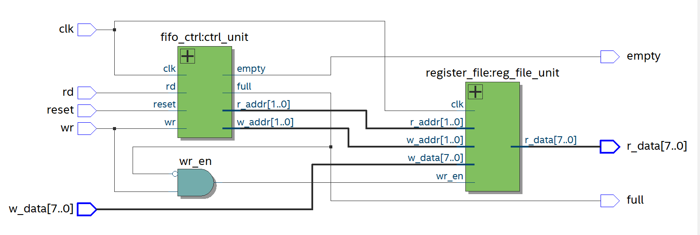
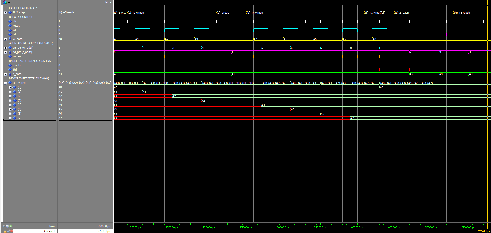
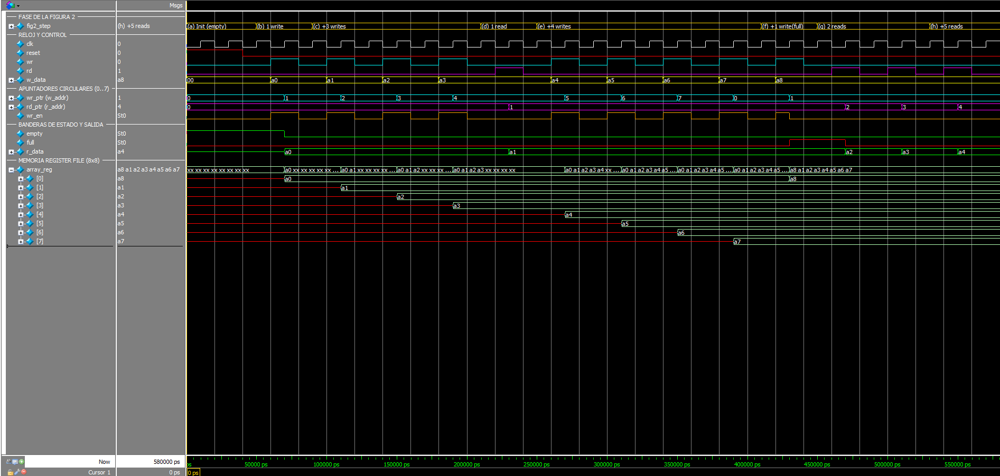
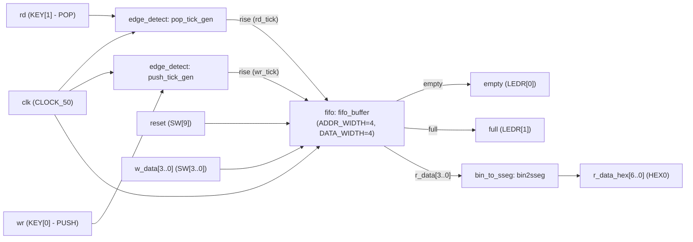
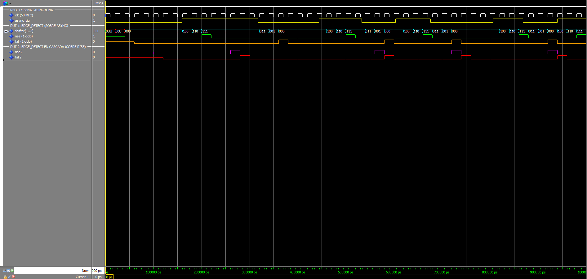
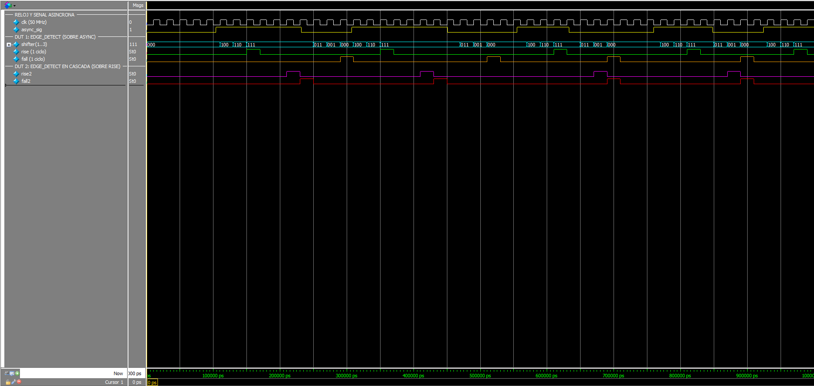
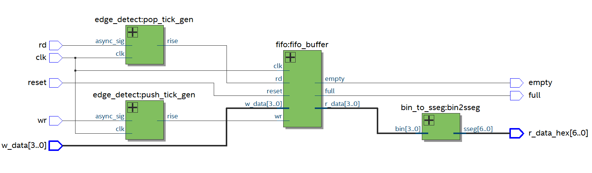
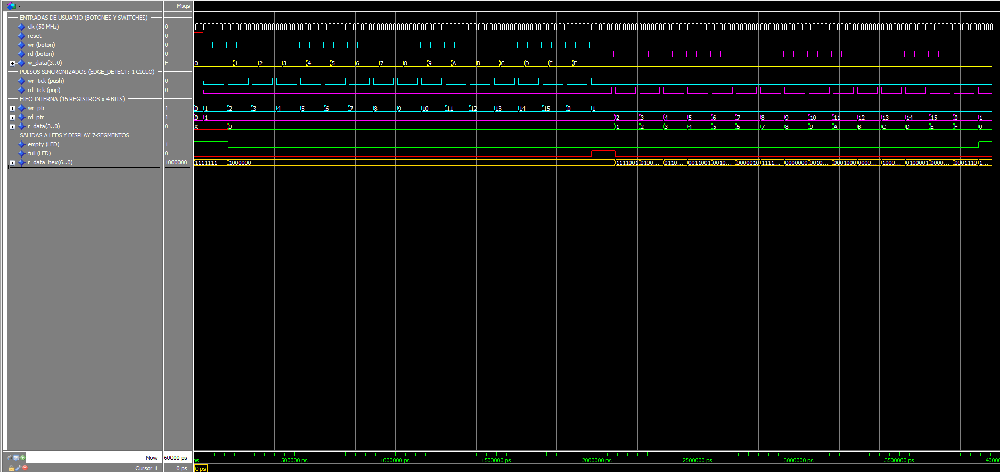
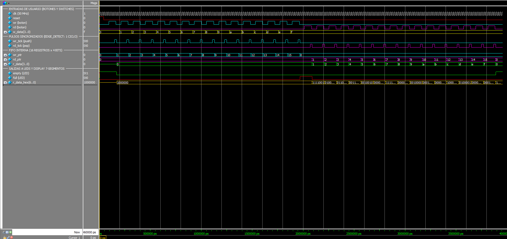

# Taller 6: Circuitos de Memoria — Buffer FIFO
**Pontificia Universidad Javeriana**  
**Departamento de Electrónica**  
**System on Chip (SoC)**  

---

## Parte 1: Implementación Circular de un Buffer FIFO (`ej1_fifo_buffer`)

### 1.1. Descripción General del Diseño

Un buffer **FIFO (*First-In, First-Out*)** circular es una estructura de memoria elástica empleada para comunicar dos subsistemas digitales que producen y consumen datos a diferentes tasas. Siguiendo el esquema de la **Figura 3** de la guía, el diseño se divide modularmente en dos bloques principales interconectados en la entidad superior `fifo`:



1. **Banco de Registros (`register_file`)**:
   - Arreglo bidimensional parametrizable de $2^{\text{ADDR\_WIDTH}}$ palabras de $\text{DATA\_WIDTH}$ bits (`TYPE mem_2d_type IS ARRAY (0 TO 2**ADDR_WIDTH-1) OF STD_LOGIC_VECTOR(DATA_WIDTH-1 DOWNTO 0)`).
   - **Puerto de escritura síncrono**: cuando `wr_en = '1'` en el flanco ascendente de `clk`, almacena `w_data` en la dirección `w_addr`. La señal de habilitación está protegida en el nivel superior mediante `wr_en <= wr AND (NOT full_s)` para impedir sobreescrituras cuando la cola está llena.
   - **Puerto de lectura asíncrono (*First-Word Fall-Through*)**: la salida `r_data <= array_reg(to_integer(unsigned(r_addr)))` expone permanentemente el dato ubicado en la cabeza de la fila (`r_addr`), de modo que el elemento más antiguo siempre está disponible para lectura y la señal `rd` actúa retirándolo de la estructura al avanzar el apuntador de lectura.

2. **Unidad de Control Circular (`fifo_ctrl`)**:
   - Mantiene dos apuntadores de $\text{ADDR\_WIDTH}$ bits registrados en flip-flops tipo D: el apuntador de escritura **`w_ptr_reg`** (cola de la fila) y el apuntador de lectura **`r_ptr_reg`** (cabeza de la fila), junto con sus valores sucesivos combinacionales `w_ptr_succ = w_ptr_reg + 1` y `r_ptr_succ = r_ptr_reg + 1` (que envuelven circularmente de $2^{\text{ADDR\_WIDTH}}-1$ a `0` por aritmética módulo $2^{\text{ADDR\_WIDTH}}$).
   - Como la igualdad `w_ptr_reg = r_ptr_reg` ocurre tanto cuando la FIFO está **vacía** (Figura 2a y 2i) como cuando está **llena** (Figura 2f), el controlador desambigua ambas condiciones mediante dos flip-flops de estado (`empty_reg` inicializado en `'1'` y `full_reg` inicializado en `'0'`) actualizados según la combinación `wr_op = wr & rd`:

| `wr_op` (`wr & rd`) | Operación | Condición de Guarda | Acción sobre Apuntadores (`w_ptr_next`, `r_ptr_next`) | Actualización de Banderas (`empty_next`, `full_next`) |
| :---: | :--- | :---: | :--- | :--- |
| **`"00"`** | **No Op** | Ninguna | Mantiene `w_ptr_reg` y `r_ptr_reg`. | Mantiene `empty_reg` y `full_reg`. |
| **`"01"`** | **Read (Pop)** | `empty_reg /= '1'` | Avanza cabeza: `r_ptr_next <= r_ptr_succ`. | `full_next <= '0'`. Si `r_ptr_succ = w_ptr_reg` (alcanzó a escritura), activa `empty_next <= '1'`. |
| **`"10"`** | **Write (Push)** | `full_reg /= '1'` | Avanza cola: `w_ptr_next <= w_ptr_succ`. | `empty_next <= '0'`. Si `w_ptr_succ = r_ptr_reg` (alcanzó a lectura), activa `full_next <= '1'`. |
| **`"11"`** | **Write & Read** | Simultáneo | Avanza ambos: `w_ptr_next <= w_ptr_succ`, `r_ptr_next <= r_ptr_succ`. | Mantiene el número neto de elementos (`empty_reg` y `full_reg` sin cambio). |

---

### 1.2. Implementación en VHDL (`ej1_fifo_buffer/vhdl/`)

Los archivos que conforman la implementación en VHDL se encuentran en:
- [register_file.vhd](file:///d:/Documentos/Maestria/SoC/Taller6/ej1_fifo_buffer/vhdl/src/register_file.vhd)
- [fifo_ctrl.vhd](file:///d:/Documentos/Maestria/SoC/Taller6/ej1_fifo_buffer/vhdl/src/fifo_ctrl.vhd)
- [fifo.vhd](file:///d:/Documentos/Maestria/SoC/Taller6/ej1_fifo_buffer/vhdl/src/fifo.vhd)
- [fifo_tb.vhd](file:///d:/Documentos/Maestria/SoC/Taller6/ej1_fifo_buffer/vhdl/tb/fifo_tb.vhd)

#### 1.2.1. Controlador del Buffer FIFO ([fifo_ctrl.vhd](file:///d:/Documentos/Maestria/SoC/Taller6/ej1_fifo_buffer/vhdl/src/fifo_ctrl.vhd))
```vhdl
LIBRARY ieee;
USE ieee.std_logic_1164.all;
USE ieee.numeric_std.all;
--------------------------------------------
ENTITY fifo_ctrl IS
	GENERIC (ADDR_WIDTH: NATURAL := 4 );
	PORT( clk			:	IN		STD_LOGIC;
			reset			:	IN		STD_LOGIC;
			rd				:	IN		STD_LOGIC;
			wr				:	IN		STD_LOGIC;
			empty			:	OUT	STD_LOGIC;
			full 			: 	OUT	STD_LOGIC;
			w_addr		: 	OUT	STD_LOGIC_VECTOR(ADDR_WIDTH-1 DOWNTO 0);
			r_addr		:	OUT	STD_LOGIC_VECTOR(ADDR_WIDTH-1 DOWNTO 0));
END ENTITY;
----------------------------------------------
ARCHITECTURE arch OF fifo_ctrl IS
	SIGNAL w_ptr_reg, w_ptr_next, w_ptr_succ	: STD_LOGIC_VECTOR(ADDR_WIDTH-1 DOWNTO 0);
	SIGNAL r_ptr_reg, r_ptr_next, r_ptr_succ 	: STD_LOGIC_VECTOR(ADDR_WIDTH-1 DOWNTO 0);
	SIGNAL full_reg, full_next						: STD_LOGIC;
	SIGNAL empty_reg, empty_next					: STD_LOGIC;
	SIGNAL wr_op										: STD_LOGIC_VECTOR(1 downto 0);
	SIGNAL wr_en										: STD_LOGIC;
BEGIN
	-- register for read and write pointers
	PROCESS(clk, reset)
	BEGIN
		IF (reset='1') THEN
			w_ptr_reg	<= (OTHERS => '0');
			r_ptr_reg	<= (OTHERS => '0');
			full_reg		<= '0';
			empty_reg 	<= '1';
		ELSIF (rising_edge(clk)) THEN
			w_ptr_reg 	<= w_ptr_next;
			r_ptr_reg 	<= r_ptr_next;
			full_reg 	<= full_next;
			empty_reg 	<= empty_next;
		END IF;
	END PROCESS;
	
	-- succesive pointer values
	w_ptr_succ <= STD_LOGIC_VECTOR(unsigned(w_ptr_reg) + 1);
	r_ptr_succ <= STD_LOGIC_VECTOR(unsigned(r_ptr_reg) + 1);
	
	-- next state logic for read and write pointers
	wr_op <= wr & rd;
	PROCESS(w_ptr_reg, w_ptr_succ, r_ptr_reg, r_ptr_succ, wr_op, empty_reg, full_reg)
	BEGIN
		-- Valores por defecto: mantener estado actual
		w_ptr_next <= w_ptr_reg;
		r_ptr_next <= r_ptr_reg;
		full_next  <= full_reg;
		empty_next <= empty_reg;

		CASE wr_op IS
			WHEN "00" => -- no op
				NULL;
			--=========================================
			WHEN "01" => -- read
				IF (empty_reg /= '1') THEN -- not empty
					r_ptr_next <= r_ptr_succ;
					full_next  <= '0';
					IF (r_ptr_succ = w_ptr_reg) THEN
						empty_next <= '1';
					END IF;
				END IF;
			--=========================================
			WHEN "10" => -- write
				IF (full_reg /= '1') THEN -- not full
					w_ptr_next <= w_ptr_succ;
					empty_next <= '0';
					IF (w_ptr_succ = r_ptr_reg) THEN
						full_next <= '1';
					END IF;
				END IF;
			--=========================================
			WHEN OTHERS => -- write / read simultaneo ("11")
				w_ptr_next <= w_ptr_succ;
				r_ptr_next <= r_ptr_succ;
			--=========================================
		END CASE;
	END PROCESS;
	
	---output
	w_addr <= w_ptr_reg;
	r_addr <= r_ptr_reg;
	full   <= full_reg;
	empty  <= empty_reg;

END ARCHITECTURE;
```

#### 1.2.2. Testbench de la Figura 2 ([fifo_tb.vhd](file:///d:/Documentos/Maestria/SoC/Taller6/ej1_fifo_buffer/vhdl/tb/fifo_tb.vhd))
El banco de pruebas instancia `fifo` con **`ADDR_WIDTH = 3` ($2^3 = 8$ posiciones, direcciones `0` a `7`)** y **`DATA_WIDTH = 8`**, operando a $50\text{ MHz}$ ($T_{\text{clk}} = 20\text{ ns}$). Incluye los procedimientos `push_word` y `pop_word` (que activan `wr` o `rd` durante exactamente 1 ciclo de reloj), una señal de texto `fig2_step` para identificar cada etapa `(a)` a `(i)` en la ventana *Wave* de ModelSim, y aserciones automáticas (`ASSERT`) para verificar las banderas `empty`, `full` y el dato en la cabeza de la fila `r_data` tras cada paso.

---

### 1.3. Implementación Equivalente en Verilog (`ej1_fifo_buffer/verilog/`)

Para mantener la paridad bilingüe del repositorio, se implementaron también los módulos equivalentes en Verilog HDL y su banco de pruebas autoverificable:
- [register_file.v](file:///d:/Documentos/Maestria/SoC/Taller6/ej1_fifo_buffer/verilog/src/register_file.v)
- [fifo_ctrl.v](file:///d:/Documentos/Maestria/SoC/Taller6/ej1_fifo_buffer/verilog/src/fifo_ctrl.v)
- [fifo.v](file:///d:/Documentos/Maestria/SoC/Taller6/ej1_fifo_buffer/verilog/src/fifo.v)
- [fifo_tb.v](file:///d:/Documentos/Maestria/SoC/Taller6/ej1_fifo_buffer/verilog/tb/fifo_tb.v)

---

### 1.4. Síntesis RTL en Quartus y Simulación Funcional en ModelSim

#### 1.4.1. Síntesis RTL en Quartus Prime ([Taller6.qpf](file:///d:/Documentos/Maestria/SoC/Taller6/Taller6.qpf))
Al sintetizar la entidad superior `fifo` (con sus parámetros por defecto `ADDR_WIDTH = 2`, es decir $2^2 = 4$ registros, y `DATA_WIDTH = 8` bits) en Quartus Prime 20.1.1 para el dispositivo **Cyclone V `5CSEMA5F31C6`** (tarjeta **DE1-SoC**), el reporte de síntesis (`Taller6.map.rpt`) arroja **0 errores** y el siguiente desglose exacto por jerarquía:

| Instancia Jerárquica | Entidad | Combinational ALUTs | Dedicated Logic Registers | Desglose Físico en Hardware |
| :--- | :---: | :---: | :---: | :--- |
| **`|fifo` (Total Top-Level)** | `fifo` | **`22` (`25` ALMs)** | **`38`** | **`22` pines I/O** (`12` entradas, `10` salidas), `0` bloques de RAM dedicada |
| `├── fifo_ctrl:ctrl_unit` | `fifo_ctrl` | `10` | `6` | `2` FFs (`w_ptr_reg[1:0]`) + `2` FFs (`r_ptr_reg[1:0]`) + `1` FF (`full_reg`) + `1` FF (`empty_reg`) |
| `└── register_file:reg_file_unit` | `register_file` | `12` | `32` | $2^2 \times 8 = 4 \times 8 = 32$ FFs (`array_reg`) + `8` MUX 4:1 de lectura + `4` decodificadores `wr_en` |

El visor *RTL Viewer* (**Figura 1.1**) confirma la interconexión estructural de la **Figura 3** del enunciado: la compuerta `wr_en = wr AND (NOT full)`, la unidad de control `fifo_ctrl:ctrl_unit` generando `empty`, `full`, `r_addr[1..0]` y `w_addr[1..0]`, y el banco de registros `register_file:reg_file_unit` entregando `r_data[7..0]`.


*Figura 1.1. Esquemático RTL sintetizado en Quartus Prime para la entidad `fifo` (`fifo_ctrl:ctrl_unit` + `register_file:reg_file_unit` + compuerta `wr_en`).*

#### 1.4.2. Verificación de las Condiciones de la Figura 2 en ModelSim (`ADDR_WIDTH = 3`, `8` posiciones)
La simulación ejecutada mediante los scripts [run_fifo_vhdl.do](file:///d:/Documentos/Maestria/SoC/Taller6/ej1_fifo_buffer/sim/run_fifo_vhdl.do) y [run_fifo_verilog.do](file:///d:/Documentos/Maestria/SoC/Taller6/ej1_fifo_buffer/sim/run_fifo_verilog.do) instancia el buffer con **`ADDR_WIDTH = 3` ($2^3 = 8$ registros, direcciones `0` a `7`)** y **`DATA_WIDTH = 8`**, reproduciendo paso a paso las 9 configuraciones de la **Figura 2** con **0 errores**:

| Paso Fig. 2 | Intervalo ($t$) | Flancos Activos (`clk ↑`) | Operación Realizada | `wr_ptr` (`w_addr`) | `rd_ptr` (`r_addr`) | `empty` | `full` | Cabeza `r_data` | Contenido Activo en `array_reg[0..7]` |
| :---: | :---: | :---: | :--- | :---: | :---: | :---: | :---: | :---: | :--- |
| **(a)** | $0 - 50\text{ ns}$ | Reset ($0 - 40\text{ ns}$) | **Estado inicial (`reset = 1 -> 0`)** | `0` | `0` | **`1`** | `0` | `XX` | Vacía ($0$ elementos) |
| **(b)** | $50 - 90\text{ ns}$ | $70\text{ ns}$ | **Después de 1 escritura (`0xA0`)** | `1` | `0` | `0` | `0` | **`A0`** | `[0]=A0` ($1$ elemento) |
| **(c)** | $90 - 210\text{ ns}$ | $110, 150, 190\text{ ns}$ | **Después de 3 escrituras más (`A1..A3`)** | `4` | `0` | `0` | `0` | **`A0`** | `[0..3]=A0,A1,A2,A3` ($4$ elementos) |
| **(d)** | $210 - 250\text{ ns}$ | $230\text{ ns}$ | **Después de 1 lectura** (retira `[0]`) | `4` | `1` | `0` | `0` | **`A1`** | `[1..3]=A1,A2,A3` ($3$ elementos) |
| **(e)** | $250 - 410\text{ ns}$ | $270, 310, 350, 390\text{ ns}$ | **4 escrituras más (`A4..A7`)** (*wrap-around*) | `0` | `1` | `0` | `0` | **`A1`** | `[1..7]=A1..A7` ($7$ elementos, `wr_ptr: 7 -> 0`) |
| **(f)** | $410 - 450\text{ ns}$ | $430\text{ ns}$ | **1 escritura más (`A8` en `[0]`) $\rightarrow$ FULL** | `1` | `1` | `0` | **`1`** | **`A1`** | `[1..7, 0]=A1..A8` ($8$ elementos, **llena**, `wr_en = 0`) |
| **(g)** | $450 - 530\text{ ns}$ | $470, 510\text{ ns}$ | **2 lecturas** (retira `[1]` y `[2]`) | `1` | `3` | `0` | `0` | **`A3`** | `[3..7, 0]=A3..A8` ($6$ elementos, `full` baja a `0`) |
| **(h)** | $530 - 730\text{ ns}$ | $550, 590, 630, 670, 710\text{ ns}$ | **5 lecturas más** (retira `[3..7]`, *wrap-around*) | `1` | `0` | `0` | `0` | **`A8`** | `[0]=A8` ($1$ elemento restante, `rd_ptr: 7 -> 0`) |
| **(i)** | $730 - 790\text{ ns}$ | $750\text{ ns}$ | **1 lectura final** (retira `[0]`) $\rightarrow$ **EMPTY** | `1` | `1` | **`1`** | `0` | `A8` | Vacía ($0$ elementos, `wr_ptr = rd_ptr = 1`) |

En las formas de onda (**Figuras 1.2 y 1.3**), al expandir el arreglo `array_reg(0..7)` se observa cómo las posiciones `(0)` a `(7)` se van poblando secuencialmente con `A0`..`A7`, cómo en $t = 390\text{ ns}$ el apuntador `wr_ptr` envuelve circularmente de `7` a `0`, y cómo en $t = 430\text{ ns}$ se sobreescribe la posición `(0)` con `A8`, haciendo que `wr_ptr = rd_ptr = 1` y elevando la bandera `full = 1` (lo que bloquea inmediatamente `wr_en = 0`).


*Figura 1.2. Simulación funcional en ModelSim del buffer FIFO circular en VHDL (`ADDR_WIDTH = 3`, `DATA_WIDTH = 8`), mostrando la evolución de `fig2_step`, los apuntadores `wr_ptr` y `rd_ptr`, las banderas `empty`/`full` y el contenido de los 8 registros `array_reg(0..7)`.*


*Figura 1.3. Simulación funcional en ModelSim del buffer FIFO circular en Verilog (`ADDR_WIDTH = 3`, `DATA_WIDTH = 8`).*

---

## Parte 2: Prueba de la Estructura Buffer FIFO en Hardware (`ej2_fifo_hw`)

### 2.1. Descripción General del Sistema e Interfase de Usuario

Al llevar el buffer FIFO circular a una tarjeta FPGA física (**DE1-SoC**, reloj base de $50\text{ MHz}$, $T_{\text{clk}} = 20\text{ ns}$), las señales de escritura (`wr`, *PUSH*) y lectura (`rd`, *POP*) provienen de pulsadores mecánicos operados manualmente por el usuario. Una pulsación humana típica dura entre $50\text{ ms}$ y $200\text{ ms}$, lo que equivale a **entre $2.500.000$ y $10.000.000$ ciclos de reloj** a $50\text{ MHz}$. Si los botones se conectaran directamente a las entradas `wr` y `rd` del módulo `fifo`, un solo botonazo llenaría o vaciaría por completo la memoria en microsegundos.

Para garantizar que cada presión del botón produzca **exactamente una escritura o una lectura de 1 solo ciclo de reloj ($20\text{ ns}$)**, el circuito de la **Figura 4** incorpora dos detectores de flanco de subida (`edge_detect`) junto con una FIFO configurada a **16 registros de 4 bits** (`ADDR_WIDTH = 4`, `DATA_WIDTH = 4`) y un decodificador hexadecimal a 7 segmentos (`bin_to_sseg`):



---

### 2.2. Análisis y Verificación del Detector de Flancos (`edge_detect.vhd` y `edge_tb.vhd`)

#### 2.2.1. Principio de Funcionamiento de `edge_detect` ([edge_detect.vhd](file:///d:/Documentos/Maestria/SoC/Taller6/ej2_fifo_hw/vhdl/src/edge_detect.vhd))
El circuito implementa un registro de desplazamiento síncrono de 3 etapas (`resync(1 TO 3)`) actualizado en cada flanco de subida de `clk`:
1. **Doble sincronización anti-metaestabilidad (`resync(1)` y `resync(2)`)**: La señal asíncrona `async_sig` entra por `resync(1)` y pasa a `resync(2)` en el siguiente ciclo, aislando al resto del sistema de posibles violaciones de *setup/hold* producidas por el botón asíncrono.
2. **Memoria del estado anterior (`resync(3)`) y detección de flancos**:
   - **Flanco de subida (`rise`)**: `rise <= resync(2) AND (NOT resync(3))` se activa en `'1'` durante **un único ciclo de reloj** cuando la muestra actual sincronizada `resync(2)` vale `'1'` y la muestra del ciclo previo `resync(3)` valía `'0'`.
   - **Flanco de bajada (`fall`)**: `fall <= resync(3) AND (NOT resync(2))` se activa en `'1'` durante **un único ciclo de reloj** cuando la muestra previa `resync(3)` valía `'1'` y la actual `resync(2)` vale `'0'`.

```vhdl
LIBRARY ieee;
	USE ieee.std_logic_1164.all;
--------------------------------------------------
ENTITY edge_detect IS
  PORT (	clk       : in std_logic;
			async_sig : in std_logic;
			rise      : out std_logic;
			fall      : out std_logic);
END ENTITY edge_detect;
-----------------------------------------------------
ARCHITECTURE rtl OF edge_detect IS
	SIGNAL shifter : std_logic_vector(1 to 3);
BEGIN
  sync1 : PROCESS(clk)
    VARIABLE resync : std_logic_vector(1 to 3); --SHIFT REGISTER FOR EDGE DETECTION
  BEGIN
    IF (rising_edge(clk)) THEN
      -- detect rising and falling edges.
      rise <= resync(2) AND NOT resync(3);
      fall <= resync(3) AND NOT resync(2);
      -- update history shifter.
      resync := async_sig & resync(1 to 2);
		shifter <= resync;
    end if;
  end process;

end architecture;
```

#### 2.2.2. Simulación Funcional de `edge_detect` con el Testbench Provisto ([edge_tb.vhd](file:///d:/Documentos/Maestria/SoC/Taller6/ej2_fifo_hw/vhdl/tb/edge_tb.vhd))
El banco de pruebas provisto [edge_tb.vhd](file:///d:/Documentos/Maestria/SoC/Taller6/ej2_fifo_hw/vhdl/tb/edge_tb.vhd) (y su equivalente [edge_tb.v](file:///d:/Documentos/Maestria/SoC/Taller6/ej2_fifo_hw/verilog/tb/edge_tb.v)) genera un reloj de $50\text{ MHz}$ ($T_{\text{clk}} = 20\text{ ns}$) durante $1000\text{ ns}$ y conmuta la señal `async` en intervalos pseudoaleatorios de entre $50\text{ ns}$ y $150\text{ ns}$, instanciando dos detectores en cascada (`DUT` sobre `async` y `DUT2` sobre `rise`):
- En `DUT`, cada vez que `async` presenta una transición $0 \to 1$ de duración arbitraria, el registro `shifter(1..3)` desplaza el nivel alto (`"100" -> "110" -> "111"`) y la salida **`rise`** emite un pulso limpio de **$20\text{ ns}$ (1 ciclo de reloj)**. Análogamente, cada transición $1 \to 0$ de `async` produce un pulso de $20\text{ ns}$ en **`fall`**.
- En `DUT2` (cuya entrada es el pulso `rise` de 1 solo ciclo de reloj), `rise2` se activa al detectar el ascenso de `rise` y `fall2` se activa inmediatamente en el ciclo siguiente al detectar su caída.


*Figura 2.1. Simulación funcional en ModelSim del circuito `edge_detect.vhd` con `edge_tb.vhd` durante $1000\text{ ns}$.*


*Figura 2.2. Simulación funcional en ModelSim del circuito `edge_detect.v` con `edge_tb.v` durante $1000\text{ ns}$.*

---

### 2.3. Implementación del Sistema Buffer FIFO e Interfase de Usuario (Figura 4)

Los archivos fuente y bancos de prueba del sistema completo de la **Figura 4** se encuentran organizados en:
- **VHDL (`ej2_fifo_hw/vhdl/`)**:
  - [edge_detect.vhd](file:///d:/Documentos/Maestria/SoC/Taller6/ej2_fifo_hw/vhdl/src/edge_detect.vhd)
  - [bin_to_sseg.vhd](file:///d:/Documentos/Maestria/SoC/Taller6/ej2_fifo_hw/vhdl/src/bin_to_sseg.vhd)
  - [fifo_hw_top.vhd](file:///d:/Documentos/Maestria/SoC/Taller6/ej2_fifo_hw/vhdl/src/fifo_hw_top.vhd)
  - [fifo_hw_tb.vhd](file:///d:/Documentos/Maestria/SoC/Taller6/ej2_fifo_hw/vhdl/tb/fifo_hw_tb.vhd)
- **Verilog (`ej2_fifo_hw/verilog/`)**:
  - [edge_detect.v](file:///d:/Documentos/Maestria/SoC/Taller6/ej2_fifo_hw/verilog/src/edge_detect.v)
  - [bin_to_sseg.v](file:///d:/Documentos/Maestria/SoC/Taller6/ej2_fifo_hw/verilog/src/bin_to_sseg.v)
  - [fifo_hw_top.v](file:///d:/Documentos/Maestria/SoC/Taller6/ej2_fifo_hw/verilog/src/fifo_hw_top.v)
  - [fifo_hw_tb.v](file:///d:/Documentos/Maestria/SoC/Taller6/ej2_fifo_hw/verilog/tb/fifo_hw_tb.v)

#### 2.3.1. Conversor Hexadecimal/BCD a 7 Segmentos ([bin_to_sseg.vhd](file:///d:/Documentos/Maestria/SoC/Taller6/ej2_fifo_hw/vhdl/src/bin_to_sseg.vhd))
Decodifica la palabra de 4 bits `r_data[3..0]` (`0x0` a `0xF`) proveniente de la cabeza de la FIFO hacia los 7 segmentos activos en bajo (`sseg[6..0] = g f e d c b a`) del display `HEX0` de la tarjeta:

```vhdl
LIBRARY ieee;
USE ieee.std_logic_1164.all;

ENTITY bin_to_sseg IS
    PORT (
        bin  : IN  STD_LOGIC_VECTOR(3 DOWNTO 0);
        sseg : OUT STD_LOGIC_VECTOR(6 DOWNTO 0)
    );
END ENTITY bin_to_sseg;

ARCHITECTURE rtl OF bin_to_sseg IS
BEGIN
    WITH bin SELECT
        sseg <= "1000000" WHEN "0000", -- 0
                "1111001" WHEN "0001", -- 1
                "0100100" WHEN "0010", -- 2
                "0110000" WHEN "0011", -- 3
                "0011001" WHEN "0100", -- 4
                "0010010" WHEN "0101", -- 5
                "0000010" WHEN "0110", -- 6
                "1111000" WHEN "0111", -- 7
                "0000000" WHEN "1000", -- 8
                "0010000" WHEN "1001", -- 9
                "0001000" WHEN "1010", -- A
                "0000011" WHEN "1011", -- b
                "1000110" WHEN "1100", -- C
                "0100001" WHEN "1101", -- d
                "0000110" WHEN "1110", -- E
                "0001110" WHEN "1111", -- F
                "1111111" WHEN OTHERS; -- Apagado
END ARCHITECTURE rtl;
```

#### 2.3.2. Entidad Superior con Interfase de Usuario ([fifo_hw_top.vhd](file:///d:/Documentos/Maestria/SoC/Taller6/ej2_fifo_hw/vhdl/src/fifo_hw_top.vhd))
Instancia los dos generadores de pulso `pop_tick_gen` y `push_tick_gen`, el buffer `fifo_buffer` parametrizado con **`ADDR_WIDTH = 4` (16 registros)** y **`DATA_WIDTH = 4` (4 bits)**, y el conversor `bin2sseg`:

```vhdl
LIBRARY ieee;
USE ieee.std_logic_1164.all;
USE ieee.numeric_std.all;

ENTITY fifo_hw_top IS
    GENERIC (
        ADDR_WIDTH : INTEGER := 4; -- 2^4 = 16 registros de profundidad
        DATA_WIDTH : INTEGER := 4  -- Palabras de 4 bits
    );
    PORT (
        clk        : IN  STD_LOGIC;
        reset      : IN  STD_LOGIC;
        rd         : IN  STD_LOGIC;
        wr         : IN  STD_LOGIC;
        w_data     : IN  STD_LOGIC_VECTOR(DATA_WIDTH-1 DOWNTO 0);
        empty      : OUT STD_LOGIC;
        full       : OUT STD_LOGIC;
        r_data_hex : OUT STD_LOGIC_VECTOR(6 DOWNTO 0)
    );
END ENTITY fifo_hw_top;

ARCHITECTURE structural OF fifo_hw_top IS
    SIGNAL rd_tick  : STD_LOGIC;
    SIGNAL wr_tick  : STD_LOGIC;
    SIGNAL r_data_s : STD_LOGIC_VECTOR(DATA_WIDTH-1 DOWNTO 0);
BEGIN

    pop_tick_gen : ENTITY work.edge_detect
        PORT MAP (clk => clk, async_sig => rd, rise => rd_tick, fall => OPEN);

    push_tick_gen : ENTITY work.edge_detect
        PORT MAP (clk => clk, async_sig => wr, rise => wr_tick, fall => OPEN);

    fifo_buffer : ENTITY work.fifo
        GENERIC MAP (ADDR_WIDTH => ADDR_WIDTH, DATA_WIDTH => DATA_WIDTH)
        PORT MAP (
            clk => clk, reset => reset, rd => rd_tick, wr => wr_tick,
            w_data => w_data, empty => empty, full => full, r_data => r_data_s
        );

    bin2sseg : ENTITY work.bin_to_sseg
        PORT MAP (bin => r_data_s, sseg => r_data_hex);

END ARCHITECTURE structural;
```

---

### 2.4. Síntesis RTL, Simulación del Sistema Completo y Prueba en Hardware

#### 2.4.1. Síntesis RTL en Quartus Prime (`fifo_hw_top`)
Al compilar `fifo_hw_top` (`ADDR_WIDTH = 4`, `DATA_WIDTH = 4`) como entidad superior en Quartus Prime 20.1.1 ([Taller6.qpf](file:///d:/Documentos/Maestria/SoC/Taller6/Taller6.qpf)) para el dispositivo **Cyclone V `5CSEMA5F31C6`**, el reporte de síntesis (`Taller6.map.rpt`) arroja **0 errores** y el siguiente balance exacto de recursos por entidad:

| Instancia Jerárquica | Entidad | Combinational ALUTs | Dedicated Logic Registers | Desglose Físico en Hardware |
| :--- | :---: | :---: | :---: | :--- |
| **`|fifo_hw_top` (Total Top-Level)** | `fifo_hw_top` | **`62` (`62` ALMs)** | **`82`** | **`17` pines I/O** (`8` entradas, `9` salidas), `0` bloques de RAM dedicada |
| `├── edge_detect:pop_tick_gen` | `edge_detect` | `1` | `4` | `3` FFs del sincronizador (`resync(1..3)`) + `1` FF de salida `rise` (`fall` abierto optimizado) |
| `├── edge_detect:push_tick_gen` | `edge_detect` | `1` | `4` | `3` FFs del sincronizador (`resync(1..3)`) + `1` FF de salida `rise` (`fall` abierto optimizado) |
| `├── fifo:fifo_buffer` | `fifo` | `53` | `74` | Subsistema completo del buffer FIFO circular de $16 \times 4\text{ bits}$ |
| `│   ├── fifo_ctrl:ctrl_unit` | `fifo_ctrl` | `17` | `10` | `4` FFs (`w_ptr_reg[3:0]`) + `4` FFs (`r_ptr_reg[3:0]`) + `1` FF (`full_reg`) + `1` FF (`empty_reg`) |
| `│   └── register_file:reg_file_unit` | `register_file` | `36` | `64` | $2^4 \times 4 = 16 \times 4 = 64$ FFs (`array_reg`) + MUX 16:1 de lectura (4 bits) + decodificación `wr_en` |
| `└── bin_to_sseg:bin2sseg` | `bin_to_sseg` | `7` | `0` | `7` LUTs combinacionales de 4 entradas (1 LUT por cada segmento `sseg[6:0]`) |

El visor *RTL Viewer* (**Figura 2.3**) reproduce exactamente la topología de la **Figura 4** del enunciado, interconectando `edge_detect:pop_tick_gen`, `edge_detect:push_tick_gen`, `fifo:fifo_buffer` y `bin_to_sseg:bin2sseg`.


*Figura 2.3. Esquemático RTL sintetizado en Quartus Prime para `fifo_hw_top` (idéntico a la Figura 4 del enunciado).*

#### 2.4.2. Simulación Funcional del Sistema Integrado (`16` registros $\times$ `4` bits)
Los scripts [run_fifo_hw_vhdl.do](file:///d:/Documentos/Maestria/SoC/Taller6/ej2_fifo_hw/sim/run_fifo_hw_vhdl.do) y [run_fifo_hw_verilog.do](file:///d:/Documentos/Maestria/SoC/Taller6/ej2_fifo_hw/sim/run_fifo_hw_verilog.do) verifican la operación completa de la interfaz de usuario:
1. **Reset inicial ($0 - 80\text{ ns}$)**: Inicializa `wr_ptr = 0`, `rd_ptr = 0`, `empty = 1`, `full = 0`.
2. **16 operaciones PUSH con pulsaciones largas ($80 - 2000\text{ ns}$)**: Se ingresan los 16 dígitos hexadecimales `0x0` a `0xF` manteniendo el botón `wr` en `'1'` durante $70\text{ ns}$ ($3.5$ ciclos de reloj) por cada dato. Se comprueba cómo `push_tick_gen` recorta cada pulsación larga a un único pulso `wr_tick` de $20\text{ ns}$ (1 ciclo), incrementando `wr_ptr` de `0` a `15 -> 0` hasta activar **`full = 1`** tras la decimosexta escritura.
3. **16 operaciones POP con pulsaciones largas ($2000 - 3920\text{ ns}$)**: Se presiona el botón `rd` durante $70\text{ ns}$ en 16 ocasiones consecutivas. Cada flanco genera un único pulso `rd_tick` de 1 ciclo que retira ordenada y secuencialmente los valores `0x0` a `0xF`, actualizando en tiempo real la salida `r_data_hex[6:0]` del display 7 segmentos hasta activar nuevamente **`empty = 1`**.


*Figura 2.4. Simulación funcional en ModelSim del sistema `fifo_hw_top` en VHDL (`16` registros $\times$ `4` bits, detectores de flanco y salida 7 segmentos).*


*Figura 2.5. Simulación funcional en ModelSim del sistema `fifo_hw_top` en Verilog (`16` registros $\times$ `4` bits).*

#### 2.4.3. Asignación de Pines y Verificación en Tarjeta FPGA

| Puerto en `fifo_hw_top` | Periférico en Tarjeta DE1-SoC | Pin Cyclone V (`5CSEMA5F31C6`) | Función en la Interfase de Usuario |
| :---: | :---: | :---: | :--- |
| `clk` | `CLOCK_50` | `PIN_AF14` | Reloj del sistema a $50\text{ MHz}$. |
| `w_data[3:0]` | `SW[3:0]` | `PIN_AF10`, `PIN_AF9`, `PIN_AC12`, `PIN_AB12` | Selección binaria/hexadecimal ($0\text{ a }\text{F}$) de la palabra de 4 bits a insertar. |
| `reset` | `SW[9]` | `PIN_AE12` | Reinicio general de la FIFO (`'1'` = reset, `'0'` = operación normal). |
| `wr` | `KEY[0]` | `PIN_AA14` | Botón **PUSH**: genera 1 pulso en `wr_tick` para escribir `w_data[3:0]` en la cola de la FIFO. |
| `rd` | `KEY[1]` | `PIN_AA15` | Botón **POP**: genera 1 pulso en `rd_tick` para retirar la cabeza de la FIFO y avanzar al siguiente dato. |
| `empty` | `LEDR[0]` | `PIN_V16` | LED indicador de FIFO vacía (`empty = '1'`). |
| `full` | `LEDR[1]` | `PIN_W16` | LED indicador de FIFO llena (`full = '1'`, tras 16 escrituras sin lectura). |
| `r_data_hex[6:0]` | `HEX0[6:0]` | `PIN_AE26` .. `PIN_AH28` | Display 7 segmentos que muestra en todo momento el dato en la cabeza de la FIFO. |

- **Enlace al video demostrativo de escritura (PUSH), lectura (POP) y visualización en la tarjeta:** [Ver video en OneDrive (Carpeta Videos — SoC)](https://livejaverianaedu-my.sharepoint.com/:f:/r/personal/pedrol_acosta_javeriana_edu_co/_layouts/15/onedrive.aspx?id=%2Fpersonal%2Fpedrol%5Facosta%5Fjaveriana%5Fedu%5Fco%2FDocuments%2F2%20IoT%2FSoC%2FVideos&share=cgpU%5FTJasd6qR6WwhX0yVfAbEgUCdu0y%2DQ2YseAM4J7lNFt7Hw)
