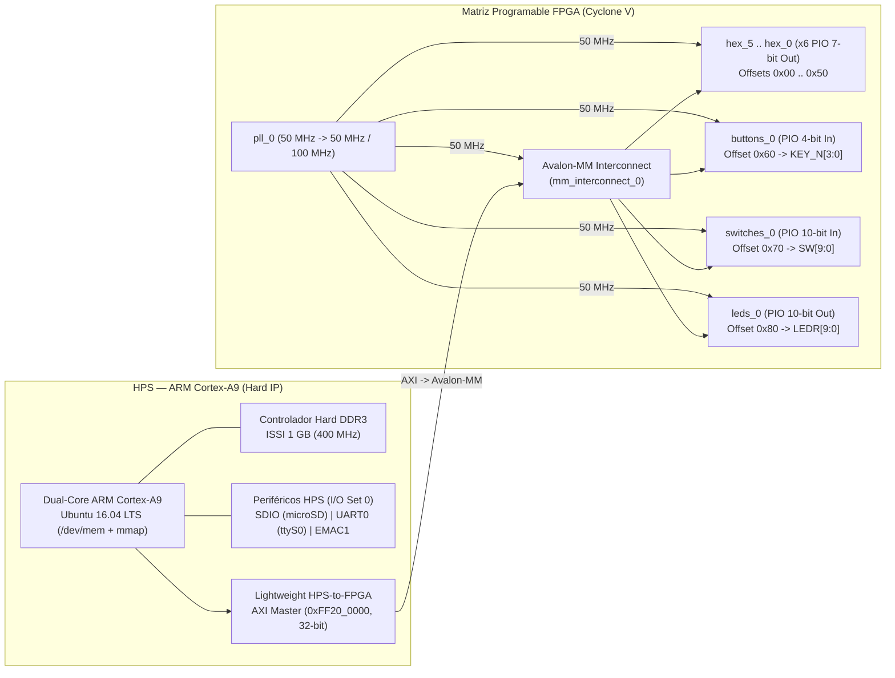
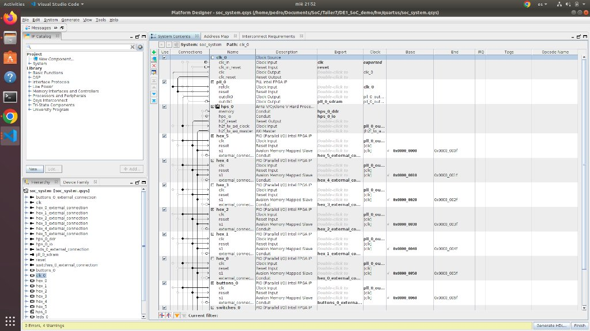
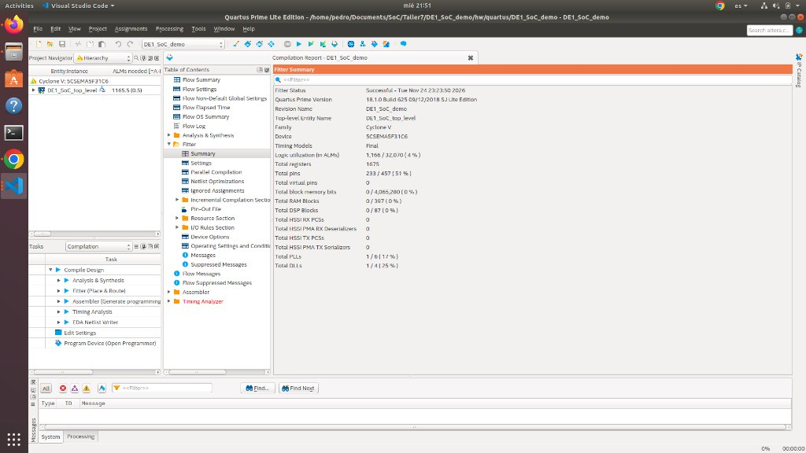
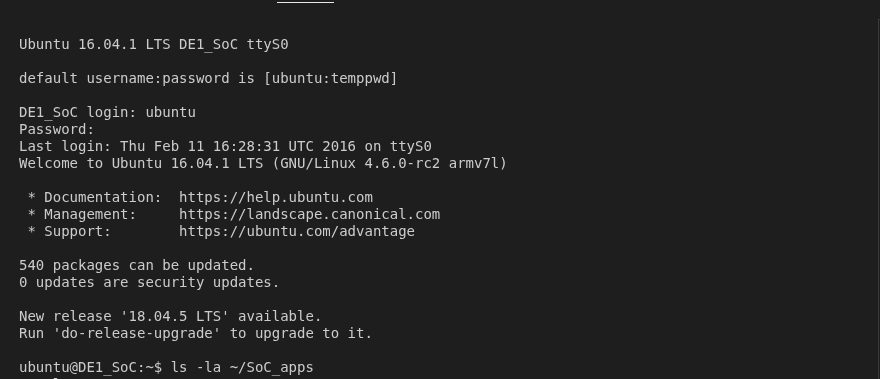
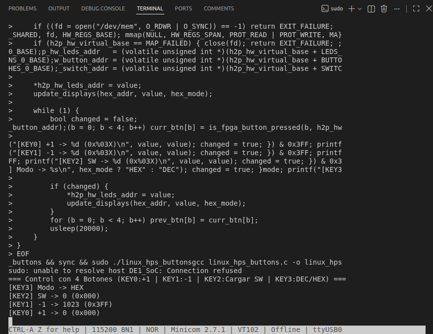

# Taller 7: DE1-SoC — Programación SoC en ARM-Linux
**Pontificia Universidad Javeriana**  
**Departamento de Electrónica**  
**System on Chip (SoC)**  

---

## 1. Arquitectura General del Sistema Híbrido HPS + FPGA (`DE1_SoC_demo`)

### 1.1. Descripción Arquitectónica
El proyecto **`DE1_SoC_demo`** integra en un mismo chip **Intel Cyclone V SoC (`5CSEMA5F31C6`)** de la tarjeta **Terasic DE1-SoC** el subsistema procesador de propósito general **HPS (*Hard Processor System*, Dual-Core ARM Cortex-A9 MPCore)** ejecutando **Ubuntu 16.04.1 LTS (Linux `4.6.0-rc2 armv7l`)** junto con periféricos digitales sintetizados sobre la matriz programable **FPGA**, interconectados internamente mediante el puente maestro AXI ligero (**Lightweight HPS-to-FPGA Bridge**, `32 bits` a $50\text{ MHz}$).



1. **Dominio HPS (*Hard Processor System*)**:
   - Opera sobre silicio dedicado (*Hard IP*), por lo que el procesador ARM, el controlador de memoria DDR3 de 32 bits (`400 MHz`), el controlador **SDIO** (arranque desde tarjeta microSD), la consola serial **UART0** (`115200 8N1` hacia el conversor USB-UART `/dev/ttyUSB0`) y la interfaz **EMAC1 (RGMII)** no consumen celdas lógicas de la FPGA.
   - Expone hacia la FPGA la señal de reinicio `h2f_reset` y el puente **Lightweight HPS-to-FPGA** mapeado físicamente en el espacio de direcciones del procesador ARM a partir de **`0xFF200000`** (`HW_REGS_BASE`, ventana de $2\text{ MB}$).

2. **Dominio FPGA (`soc_system` en Platform Designer)**:
   - Recibe el reloj maestro `CLOCK_50` ($50\text{ MHz}$) en `pll_0`, generando `outclk0 = 50 MHz` para sincronizar el puente `h2f_lw_axi_clock` y los periféricos Avalon-MM, y `outclk1 = 100 MHz` ($\Delta\phi = -3758\text{ ps}$) para la SDRAM de la FPGA (`DRAM_CLK`).
   - Instancia **9 bloques `altera_avalon_pio`** esclavos conectados a `hps_0.h2f_lw_axi_master` para gobernar los **6 displays de 7 segmentos** (`HEX5_N..HEX0_N`, activos en bajo, valor de reset `0x7F`), los **4 pulsadores** (`KEY_N[3:0]`, activos en bajo), los **10 interruptores** (`SW[9:0]`) y los **10 LEDs rojos** (`LEDR[9:0]`).

---

## 2. Diseño de Hardware y Síntesis en Quartus Prime (`hw/`)

Los archivos fuente de hardware que conforman el sistema se ubican en:
- [DE1_SoC_top_level.vhd](file:///home/pedro/Documents/SoC/Taller7/DE1_SoC_demo/hw/hdl/DE1_SoC_top_level.vhd) — Entidad superior VHDL con el mapeo estructural de pines FPGA y HPS (`DDR3`, `SDIO`, `UART0`, `EMAC1`, `USB1`, `QSPI`, `SPIM1`, `I2C0/1` y `GPIO`).
- [soc_system.qsys](file:///home/pedro/Documents/SoC/Taller7/DE1_SoC_demo/hw/quartus/soc_system.qsys) — Sistema integrado en **Platform Designer (Quartus Prime 18.1)**.
- [pin_assignment_DE1_SoC.tcl](file:///home/pedro/Documents/SoC/Taller7/DE1_SoC_demo/hw/quartus/pin_assignment_DE1_SoC.tcl) — Restricciones de ubicación e I/O Standard (`3.3-V LVTTL`) para la FPGA, complementadas con `hps_sdram_p0_pin_assignments.tcl` para la interfaz DDR3 del HPS.

### 2.1. Mapa de Memoria del Puente Lightweight AXI (`0xFF200000`)

La asignación de direcciones base en Platform Designer y su exportación automática mediante `sopc-create-header-files` hacia [hps_soc_system.h](file:///home/pedro/Documents/SoC/Taller7/DE1_SoC_demo/sw/hps/application/hps_soc_system.h) definen el siguiente mapa de registros:

| Instancia Qsys | Tipo IP | Dirección / Ancho | Valor de Reset | Offset (`hps_soc_system.h`) | Dirección Física ARM | Periférico DE1-SoC |
| :--- | :---: | :---: | :---: | :---: | :---: | :--- |
| **`hex_5`** | `altera_avalon_pio` | Output / `7 bits` | `0x7F` (apagado) | `0x0000_0000` | `0xFF20_0000` | Display `HEX5_N[6:0]` |
| **`hex_4`** | `altera_avalon_pio` | Output / `7 bits` | `0x7F` (apagado) | `0x0000_0010` | `0xFF20_0010` | Display `HEX4_N[6:0]` |
| **`hex_3`** | `altera_avalon_pio` | Output / `7 bits` | `0x7F` (apagado) | `0x0000_0020` | `0xFF20_0020` | Display `HEX3_N[6:0]` |
| **`hex_2`** | `altera_avalon_pio` | Output / `7 bits` | `0x7F` (apagado) | `0x0000_0030` | `0xFF20_0030` | Display `HEX2_N[6:0]` |
| **`hex_1`** | `altera_avalon_pio` | Output / `7 bits` | `0x7F` (apagado) | `0x0000_0040` | `0xFF20_0040` | Display `HEX1_N[6:0]` |
| **`hex_0`** | `altera_avalon_pio` | Output / `7 bits` | `0x7F` (apagado) | `0x0000_0050` | `0xFF20_0050` | Display `HEX0_N[6:0]` |
| **`buttons_0`** | `altera_avalon_pio` | Input / `4 bits` | — | `0x0000_0060` | `0xFF20_0060` | Pulsadores `KEY_N[3:0]` (activos en bajo) |
| **`switches_0`** | `altera_avalon_pio` | Input / `10 bits` | — | `0x0000_0070` | `0xFF20_0070` | Interruptores `SW[9:0]` |
| **`leds_0`** | `altera_avalon_pio` | Output / `10 bits` | `0x00` (apagado) | `0x0000_0080` | `0xFF20_0080` | LEDs rojos `LEDR[9:0]` |


*Figura 2.1. Sistema `soc_system.qsys` en Platform Designer con `pll_0`, `hps_0` y los 9 periféricos PIO conectados al bus `h2f_lw_axi_master`.*

### 2.2. Resultados de Síntesis, Fitter y Cierre Temporal DDR3

La compilación completa en **Quartus Prime 18.1.0 Build 625 Lite Edition** sobre el dispositivo **`5CSEMA5F31C6`** finalizó con **0 errores**, generando el archivo `DE1_SoC_demo.sof` ($7.1\text{ MB}$) y su conversión en crudo `sdcard/fat32/socfpga.rbf` ($6.7\text{ MB}$) mediante `quartus_cpf`.

#### Balance Global y Desglose Jerárquico de Recursos (`DE1_SoC_demo.fit.summary` / `.map.rpt`)

| Instancia Jerárquica | Entidad / IP | Combinational ALUTs | Dedicated Logic Registers | Observaciones Físicas en Cyclone V |
| :--- | :---: | :---: | :---: | :--- |
| **`|DE1_SoC_top_level` (Total Fitter)** | `DE1_SoC_top_level` | **`1,977` (`1,166 / 32,070` ALMs, `4%`)** | **`1,675`** (`1,434` lógicos + I/O) | **`233 / 457` pines (`51%`)**, `1 / 6` PLLs (`17%`), `1 / 4` DLLs (`25%`), `0` BRAM/DSP |
| `├── mm_interconnect_0` | `soc_system_mm_interconnect_0` | `1,861` | `1,329` | Traductor de protocolo AXI3 $\to$ Avalon-MM, árbitros y decodificación hacia 9 esclavos |
| `├── hps_0` | `altera_hps` | `1` | `36` | Procesador ARM Cortex-A9, DDR3 PHY y periféricos implementados en *Hard Silicon* |
| `├── hex_5 .. hex_0` ($\times 6$) | `altera_avalon_pio` | `90` ($6 \times 15$) | `42` ($6 \times 7$) | 6 registros de salida de 7 bits inicializados en `0x7F` |
| `├── leds_0` | `altera_avalon_pio` | `11` | `10` | Registro de salida de 10 bits hacia `LEDR[9:0]` |
| `├── switches_0` | `altera_avalon_pio` | `10` | `10` | Registro de captura de entrada de 10 bits desde `SW[9:0]` |
| `├── buttons_0` | `altera_avalon_pio` | `4` | `4` | Registro de captura de entrada de 4 bits desde `KEY_N[3:0]` |
| `├── rst_controller` | `altera_reset_controller` | `0` | `3` | Sincronizador de 3 etapas para `h2f_reset` |
| `└── pll_0` | `altera_pll` | `0` | `0` | `1` bloque PLL fraccional físico ($50\text{ MHz}$ y $100\text{ MHz}$) |

#### Verificación Temporal de la Interfaz DDR3 del HPS (`400 MHz`, Modelo *Fast 1100mV 0C*)

| Camino Crítico DDR3 (`hps_sdram_p0`) | Setup Slack ($\text{ns}$) | Hold Slack ($\text{ns}$) | Estado |
| :--- | :---: | :---: | :---: |
| **Address / Command** | $+0.605$ | $+0.681$ | Cumple (0 violaciones) |
| **Core** | $+2.110$ | $+0.077$ | Cumple (0 violaciones) |
| **Core Recovery / Removal** | $+3.825$ | $+0.473$ | Cumple (0 violaciones) |
| **DQS vs. CK** | $+0.687$ | $+0.478$ | Cumple (0 violaciones) |
| **Read Capture / Write** | $+0.370$ / $+0.326$ | $+0.323$ / $+0.326$ | Cumple (0 violaciones) |


*Figura 2.2. Resumen de compilación (Fitter Summary) en Quartus Prime 18.1: 4% de utilización lógica (1,166 ALMs) y 0 errores.*

---

## 3. Construcción del Sistema de Arranque en microSD y Secuencia de Boot

Mediante el *Intel FPGA Embedded Command Shell* (`v18.1`) y el script ajustado [create_linux_system.sh](file:///home/pedro/Documents/SoC/Taller7/DE1_SoC_demo/create_linux_system.sh) sobre una tarjeta microSD de $16\text{ GB}$ (`/dev/sdb`):

1. **Generación del Preloader (`preloader-mkpimage.bin`)**: a partir del directorio `hw/quartus/hps_isw_handoff/soc_system_hps_0`, `bsp-create-settings` y `arm-altera-eabi-gcc` compilaron el SPL con `FAT_SUPPORT = 1` para configurar el multiplexado de pines HPS (*pinmux*) y calibrar la memoria DDR3 al encendido.
2. **Esquema de particiones en la microSD**:
   - **Partición 3 (`/dev/sdb3`, tipo `0xA2`, $1\text{ MiB}$)**: contiene la imagen cruda `preloader-mkpimage.bin` grabada con `dd`.
   - **Partición 1 (`/dev/sdb1`, `FAT32`, $512\text{ MiB}$)**: almacena `u-boot.img`, el script compilado `u-boot.scr`, el bitstream `socfpga.rbf`, el árbol de dispositivos `socfpga.dtb` y el kernel `zImage`.
   - **Partición 2 (`/dev/sdb2`, `EXT3`, $14.3\text{ GiB}$)**: aloja el sistema de archivos raíz de **Ubuntu 16.04.1 LTS ARMv7**.
3. **Configuración física `MSEL[4:0] = 00000` (`SW10`)**: se colocaron los microinterruptores `1..5` del bloque inferior `SW10` en posición **`ON`** (`0` lógico, esquema *FPPx16*). Esto permite que `u-boot.scr` ejecute `fatload mmc 0:1 ${fpgadata} socfpga.rbf`, programe automáticamente la matriz FPGA (`fpga load 0`) y habilite los puentes AXI (`bridge enable`) antes de iniciar el kernel de Linux.


*Figura 3.1. Secuencia de arranque completada e inicio de sesión en Ubuntu 16.04.1 LTS (`ttyS0`, `115200 8N1`) desde `minicom`.*

---

## 4. Aplicación Base en C-Linux: Lectura de Switches y Control de LEDs / 7-Segmentos

### 4.1. Implementación ([linux_hps.c](file:///home/pedro/Documents/SoC/Taller7/DE1_SoC_demo/sw/hps/application/linux_hps.c))
La aplicación base abre el dispositivo `/dev/mem` con banderas `O_RDWR | O_SYNC` y proyecta la región física del puente *Lightweight HPS-to-FPGA* (`0xFF200000`, tamaño `0x00200000`) en el espacio virtual del proceso de usuario mediante `mmap()`. A partir del puntero base `h2p_hw_virtual_base`, calcula las direcciones virtuales de cada PIO sumando sus *offsets* (`0x00`..`0x80`).

En un lazo continuo de muestreo (*polling*):
1. Lee el estado binario de los 10 interruptores `SW[9:0]` (`0` a `1023`) desde `*h2p_hw_switch_addr` y lo escribe directamente en `*h2p_hw_leds_addr` (`LEDR[9:0]`).
2. Descompone el entero leído en sus 6 cifras decimales mediante divisiones y módulos sucesivos entre potencias de $10$ ($10^5$ hasta $10^1$).
3. Traduce cada dígito mediante la tabla de búsqueda `HEX_LUT` (codificación activa en bajo para los segmentos `g..a`) y actualiza los registros `*h2p_hw_hex_5_addr` .. `*h2p_hw_hex_0_addr`.

---

## 5. Ejercicio Propuesto: Aplicación Interactiva con los 4 Botones de la FPGA

### 5.1. Diseño Funcional y Antirrebote por Software ([linux_hps_buttons.c](file:///home/pedro/Documents/SoC/Taller7/DE1_SoC_demo/sw/hps/application/linux_hps_buttons.c))
Siguiendo la Sección 8 de la guía, se diseñó e implementó en C-Linux una aplicación interactiva gobernada por los **4 pulsadores de la FPGA (`KEY0`..`KEY3`)**, incorporando:
- **Lectura activa en bajo**: los pulsadores de la DE1-SoC entregan `'1'` lógico en reposo y `'0'` lógico al oprimirse, evaluados mediante la función `is_fpga_button_pressed()`:
  ```c
  bool is_fpga_button_pressed(int button_number, volatile unsigned int *base) {
      // buttons are active-low
      return !((*base) & (1 << button_number));
  }
  ```
- **Detección de flanco de subida lógico y antirrebote (*debounce*)**: el lazo principal muestrea los 4 botones cada $20\text{ ms}$ (`usleep(20000)`) y compara el estado actual `curr_btn[b]` contra el estado anterior `prev_btn[b]` (`curr_btn[b] && !prev_btn[b]`). De este modo, cada pulsación física ejecuta exactamente una transición sin disparos múltiples mientras se mantiene presionado el botón.

| Pulsador | Pin Cyclone V | Acción Definida en la Aplicación | Efecto en Periféricos FPGA y Consola |
| :---: | :---: | :--- | :--- |
| **`KEY0`** | `PIN_AA14` | **Incrementar (`+1`)** | Incrementa circularmente `value = (value + 1) & 0x3FF` (`0..1023`), actualiza `LEDR[9:0]` y los 6 displays. |
| **`KEY1`** | `PIN_AA15` | **Decrementar (`-1`)** | Decrementa circularmente `value = (value - 1) & 0x3FF` (`0..1023`), actualiza `LEDR[9:0]` y los 6 displays. |
| **`KEY2`** | `PIN_W15` | **Cargar desde `SW[9:0]`** | Captura los 10 interruptores `SW[9:0]` en `value` (con `SW = 0` actúa también como *reset* inmediato a `0`). |
| **`KEY3`** | `PIN_Y16` | **Alternar base `DEC / HEX`** | Conmuta los 6 displays entre formato **Decimal** (`000000`–`001023`) y **Hexadecimal** (`H  000`–`H  3FF`, mostrando el indicador `H` en `HEX5`). |

### 5.2. Código Fuente Implementado ([linux_hps_buttons.c](file:///home/pedro/Documents/SoC/Taller7/DE1_SoC_demo/sw/hps/application/linux_hps_buttons.c))

```c
#include <stdio.h>
#include <errno.h>
#include <unistd.h>
#include <fcntl.h>
#include <sys/mman.h>
#include <stdbool.h>
#include <stdlib.h>
#include <string.h>
#include "hps_soc_system.h"

#define HW_REGS_BASE (0xFF200000)
#define HW_REGS_SPAN (0x00200000)

static const unsigned int HEX_LUT[16] = {
    0x40, 0x79, 0x24, 0x30, 0x19, 0x12, 0x02, 0x78, 0x00, 0x10, // 0-9
    0x08, 0x03, 0x46, 0x21, 0x06, 0x0E                          // A-F
};
#define HEX_BLANK 0x7F

bool is_fpga_button_pressed(int button_number, volatile unsigned int *base) {
    return !((*base) & (1 << button_number));
}

static void update_displays(volatile unsigned int *hex_addr[6], int value, bool hex_mode) {
    int d;
    if (!hex_mode) {
        for (d = 0; d < 6; d++) {
            *hex_addr[d] = HEX_LUT[value % 10];
            value /= 10;
        }
    } else {
        *hex_addr[0] = HEX_LUT[value & 0xF];
        *hex_addr[1] = HEX_LUT[(value >> 4) & 0xF];
        *hex_addr[2] = HEX_LUT[(value >> 8) & 0xF];
        *hex_addr[3] = HEX_BLANK;
        *hex_addr[4] = HEX_BLANK;
        *hex_addr[5] = 0x09; // 'H' en HEX5
    }
}

int main(void) {
    int fd, b, value = 0;
    bool hex_mode = false, prev_btn[4] = {false, false, false, false}, curr_btn[4];
    void *h2p_hw_virtual_base = NULL;
    volatile unsigned int *hex_addr[6], *h2p_hw_leds_addr, *h2p_hw_button_addr, *h2p_hw_switch_addr;

    if ((fd = open("/dev/mem", O_RDWR | O_SYNC)) == -1) return EXIT_FAILURE;
    h2p_hw_virtual_base = mmap(NULL, HW_REGS_SPAN, PROT_READ | PROT_WRITE, MAP_SHARED, fd, HW_REGS_BASE);
    if (h2p_hw_virtual_base == MAP_FAILED) { close(fd); return EXIT_FAILURE; }

    hex_addr[0] = (volatile unsigned int *)(h2p_hw_virtual_base + HEX_0_BASE);
    hex_addr[1] = (volatile unsigned int *)(h2p_hw_virtual_base + HEX_1_BASE);
    hex_addr[2] = (volatile unsigned int *)(h2p_hw_virtual_base + HEX_2_BASE);
    hex_addr[3] = (volatile unsigned int *)(h2p_hw_virtual_base + HEX_3_BASE);
    hex_addr[4] = (volatile unsigned int *)(h2p_hw_virtual_base + HEX_4_BASE);
    hex_addr[5] = (volatile unsigned int *)(h2p_hw_virtual_base + HEX_5_BASE);
    h2p_hw_leds_addr   = (volatile unsigned int *)(h2p_hw_virtual_base + LEDS_0_BASE);
    h2p_hw_button_addr = (volatile unsigned int *)(h2p_hw_virtual_base + BUTTONS_0_BASE);
    h2p_hw_switch_addr = (volatile unsigned int *)(h2p_hw_virtual_base + SWITCHES_0_BASE);

    *h2p_hw_leds_addr = value;
    update_displays(hex_addr, value, hex_mode);

    while (1) {
        bool changed = false;
        for (b = 0; b < 4; b++) curr_btn[b] = is_fpga_button_pressed(b, h2p_hw_button_addr);

        if (curr_btn[0] && !prev_btn[0]) { value = (value + 1) & 0x3FF; printf("[KEY0] +1 -> %d (0x%03X)\n", value, value); changed = true; }
        if (curr_btn[1] && !prev_btn[1]) { value = (value - 1) & 0x3FF; printf("[KEY1] -1 -> %d (0x%03X)\n", value, value); changed = true; }
        if (curr_btn[2] && !prev_btn[2]) { value = (*h2p_hw_switch_addr) & 0x3FF; printf("[KEY2] SW -> %d (0x%03X)\n", value, value); changed = true; }
        if (curr_btn[3] && !prev_btn[3]) { hex_mode = !hex_mode; printf("[KEY3] Modo -> %s\n", hex_mode ? "HEX" : "DEC"); changed = true; }

        if (changed) {
            *h2p_hw_leds_addr = value;
            update_displays(hex_addr, value, hex_mode);
        }
        for (b = 0; b < 4; b++) prev_btn[b] = curr_btn[b];
        usleep(20000);
    }
}
```

### 5.3. Compilación y Verificación Experimental en la Tarjeta DE1-SoC

Ambas aplicaciones (`linux_hps` y `linux_hps_buttons`) fueron compiladas de forma nativa con `gcc` sobre el procesador ARM Cortex-A9 de la DE1-SoC y ejecutadas con privilegios de superusuario (`sudo`) para acceder a `/dev/mem`, verificando en hardware:
1. **`linux_hps` (Fase 4)**: correspondencia inmediata bit a bit entre `SW[9:0]` y `LEDR[9:0]`, junto con la representación decimal exacta (`000000` a `001023`) en los 6 displays de 7 segmentos.
2. **`linux_hps_buttons` (Fase 5)**: conteo ascendente (`KEY0`) y descendente (`KEY1`) libre de rebotes mecánicos, carga paralela desde los interruptores (`KEY2`) y conmutación instantánea entre visualización decimal y hexadecimal con indicador `H` (`KEY3`).


*Figura 5.1. Compilación nativa con `gcc` y registro de eventos en consola durante la ejecución de `linux_hps` y `linux_hps_buttons` en la DE1-SoC.*

- **Enlace a los videos demostrativos en hardware (`linux_hps` y `linux_hps_buttons` en la tarjeta DE1-SoC):** [Ver videos en OneDrive (Carpeta Videos — SoC)](https://livejaverianaedu-my.sharepoint.com/:f:/r/personal/pedrol_acosta_javeriana_edu_co/_layouts/15/onedrive.aspx?id=%2Fpersonal%2Fpedrol%5Facosta%5Fjaveriana%5Fedu%5Fco%2FDocuments%2F2%20IoT%2FSoC%2FVideos&share=cgpU%5FTJasd6qR6WwhX0yVfAbEgUCdu0y%2DQ2YseAM4J7lNFt7Hw)

---

## 6. Conclusiones

1. **Particionamiento eficiente entre *Hard IP* y lógica programable**: el uso del bloque dedicado HPS permitió ejecutar un sistema operativo Linux completo con memoria DDR3 a $400\text{ MHz}$ utilizando apenas el **`4%` de los ALMs** (`1,166 / 32,070`) de la Cyclone V, donde más del $94\%$ de la lógica sintetizada correspondió a la infraestructura de interconexión AXI-a-Avalon-MM (`mm_interconnect_0`) y menos de `130` ALUTs a los 9 periféricos PIO.
2. **Importancia crítica del esquema de configuración `MSEL`**: se comprobó experimentalmente que si `SW10` (`MSEL[4:0]`) permanece en el modo *Active Serial* de fábrica (`10010`), la FPGA carga la demostración residente en memoria EPCS e impide que U-Boot ejecute `fpga load`, provocando un bloqueo del bus AXI al intentar leer `0xFF200000` desde Linux. Configurar `SW10` en `00000` (posición física `ON`, modo *FPPx16*) habilita la programación transparente de `socfpga.rbf` y la apertura de los puentes HPS-FPGA en cada arranque.
3. **Acceso a registros mapeados en memoria desde espacio de usuario**: el mecanismo `/dev/mem` + `mmap()` sobre `0xFF200000` proporciona una vía directa y de baja latencia para prototipar controladores en C sobre Linux embebido, permitiendo integrar algoritmos de software (conversión decimal/hexadecimal y filtrado antirrebote de $20\text{ ms}$) con entradas/salidas paralelas dedicadas en la FPGA.
