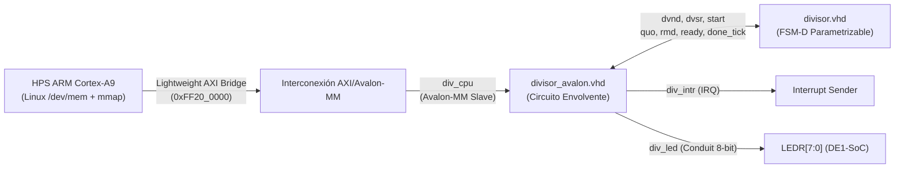

# Pontificia Universidad Javeriana
## Departamento de Electrónica
### System on Chip (SoC)

---

# Taller 8: Construcción e Integración de Componentes a la Medida en Platform Designer

> **Fuente:** *08 - Custom components integration.pdf* — Construcción de Componentes en Platform Designer.

---

## Introducción y Flujo General

**Platform Designer** automatiza la interconexión de componentes para construir sistemas complejos (*System on Programmable Chip*, SPoC), permitiendo integrar módulos personalizados descritos en HDL siempre que cumplan la especificación de las interfaces **Avalon**. El flujo de integración consta de tres etapas:

1. **Diseñar e implementar un sistema digital** en HDL (acelerador en hardware).
2. **Añadir un circuito envolvente (*wrapping circuit*)** que adapte las señales del módulo al estándar de la interfaz **Avalon** (Avalon-MM Slave, Clock, Reset, Interrupt Sender y Conduit).
3. **Utilizar el Editor de Componentes (*Component Editor*)** de Platform Designer para definir el mapa de interfaces, parámetros genéricos y propiedades temporales (*timing*), generando el archivo descriptivo `*_hw.tcl`.

En esta práctica se desarrolla un **acelerador en hardware de división entera sin signo** (integrado al sistema híbrido HPS-FPGA `DE1_SoC_demo` del Taller 7) y, como ejercicio propuesto, una **Unidad Aritmética de Punto Flotante (FPU ALU)** en el bus Avalon.


*Figura 1. Arquitectura de integración del acelerador personalizado `divisor_avalon` en el sistema SoC HPS-FPGA.*

---

## 1. Diseño e Implementación del Divisor Entero Parametrizable (`divisor`)

La división entera no es directamente sintetizable en HDL como operadores básicos (`+`, `-`). Para implementarla se emplea un algoritmo iterativo de desplazamiento y resta sobre una máquina de estados finitos con camino de datos (**FSM-D**) con cuatro estados: **`idle`**, **`op`**, **`last`** y **`done`**:

1. El divisor (`dvsr`) se almacena en el registro `d`, y el dividendo (`dvnd`) en la concatenación de registros `rh` (inicializado en `0`) y `rl`.
2. En el estado **`op`**, se compara `rh` con `d`: si `rh >= d`, se resta (`rh_tmp = rh - d`) y se inserta `q_bit = '1'`; en caso contrario se conserva `rh` y `q_bit = '0'`. Los registros `rh` y `rl` se desplazan a la izquierda una posición ingresando `q_bit` por el LSB de `rl`, decrementando el contador `n` desde `W + 1` hasta `1`.
3. El estado **`last`** ejecuta la última iteración sin desplazar el residuo `rh`, almacenándolo directamente como resto final y registrando el último bit del cociente en `rl`.
4. El estado **`done`** activa la bandera `done_tick = '1'` exactamente durante **un ciclo de reloj** y retorna a `idle` (`ready = '1'`).

### Especificación de la Entidad `divisor` (Figura 2)

| Parámetro / Puerto | Tipo | Ancho / Valor por Defecto | Dirección | Descripción |
| :--- | :--- | :---: | :---: | :--- |
| `W` | `GENERIC INTEGER` | `8` (en instancia standalone) | — | Ancho de palabra en bits |
| `CBIT` | `GENERIC INTEGER` | `4` ($\log_2(W) + 1$) | — | Ancho del contador de iteraciones `n` |
| `clk`, `reset` | `STD_LOGIC` | 1 bit | `IN` | Reloj y reinicio asincrónico activo en alto |
| `start` | `STD_LOGIC` | 1 bit | `IN` | Pulso de inicio de operación (1 ciclo de reloj) |
| `dvnd`, `dvsr` | `STD_LOGIC_VECTOR` | `W` bits | `IN` | Dividendo y divisor enteros sin signo |
| `ready` | `STD_LOGIC` | 1 bit | `OUT` | `'1'` cuando el módulo está disponible en `idle` |
| `done_tick` | `STD_LOGIC` | 1 bit | `OUT` | Pulso de 1 ciclo al finalizar la división |
| `quo`, `rmd` | `STD_LOGIC_VECTOR` | `W` bits | `OUT` | Cociente y residuo resultantes |

### Actividad 1 — Proyecto `divisor`
- Crear un proyecto con nombre **`divisor`** (en `Taller8/ej1_divisor/`).
- Escribir y comprender el código VHDL del divisor entero parametrizable (`divisor.vhd`, Figura 2 de la guía).
- Escribir un archivo **testbench en VHDL** (`divisor_tb.vhd`) para verificar el funcionamiento del circuito divisor tomando como guía el diagrama de tiempos de la Figura 3.

---

## 2. Circuito Envolvente e Interfaz Avalon MM-Slave (`divisor_avalon`)

Para acoplar el divisor al bus del procesador HPS se construye un **circuito envolvente (*wrapping circuit*)** en VHDL (`divisor_avalon.vhd`) con las siguientes interfaces Avalon:

- **Clock Input (`clock`)** y **Reset Input (`reset`)**: reloj y reinicio del sistema.
- **Avalon-MM Slave (`div_cpu`)**: puerto de acceso mapeado en memoria de 32 bits (`W = 32`, `CBIT = 6` por defecto para alinear con el bus ARM; configurable como parámetro en Platform Designer).
- **Interrupt Sender (`div_intr`)**: señal `div_irq` conectada al registro bandera `done_tick_reg`. *(Nota: bajo ARM-Linux con `/dev/mem`, el modelo de interrupciones está enmascarado por el SO, por lo que la aplicación de prueba opera por polling, pero la interfaz IRQ queda disponible en el componente).*
- **Conduit (`div_led`)**: salida `DIV_LED[7:0]` conectada a los 8 bits menos significativos del residuo (`rmd(7 downto 0)`, asumiendo `W > 7`) para exhibir el uso de interfaces externas sobre 8 LEDs de la tarjeta.

### Mapa de Memoria del Componente (`div_address[2:0]`)

| Offset | Dirección (`div_address`) | Acceso | Registro | Descripción |
| :---: | :---: | :---: | :--- | :--- |
| **`0`** | `"000"` | Escritura (CPU $\to$ FPGA) | `dividend register` (`dvnd_reg`) | Bits `W-1..0`: valor del dividendo |
| **`1`** | `"001"` | Escritura (CPU $\to$ FPGA) | `divisor register` (`dvsr_reg`) | Bits `W-1..0`: valor del divisor |
| **`2`** | `"010"` | Escritura (registro *dummy*) | `start register` (`div_start`) | Cualquier escritura genera pulso de inicio de 1 ciclo |
| **`3`** | `"011"` | Lectura (FPGA $\to$ CPU) | `quotient register` (`quo`) | Bits `W-1..0`: cociente calculado |
| **`4`** | `"100"` | Lectura (FPGA $\to$ CPU) | `remainder register` (`rmd`) | Bits `W-1..0`: residuo calculado |
| **`5`** | `"101"` | Lectura (FPGA $\to$ CPU) | `ready register` | Bit `0`: señal `ready` (con relleno de ceros en bits superiores) |
| **`6`** | `"110"` | Lectura / Escritura (*dummy*) | `done_tick register` (`done_tick_reg`) | **Lectura:** bit `0` = bandera `done_tick`. **Escritura:** limpia la bandera e `IRQ` |

### Actividad 2 — Proyecto `divisor_avalon`
- Crear un nuevo proyecto con nombre **`divisor_avalon`** (en `Taller8/ej2_divisor_avalon/`), incluyendo el archivo `divisor.vhd`.
- Escribir y comprender el código VHDL de la interfaz Avalon MM-Slave (`divisor_avalon.vhd`, Figura 4 de la guía), cubriendo sus seis bloques: instanciación de `divisor`, registros internos, lógica de decodificación de escritura, multiplexación de lectura, señal *Conduit* (`DIV_LED`) y señal de interrupción (`div_irq`).
- Escribir un **testbench en VHDL** (`divisor_avalon_tb.vhd`) que verifique ciclos de escritura de registros (`dvnd`, `dvsr`, `start`), espera de finalización, lectura de resultados (`quo`, `rmd`, `ready`, `done_tick`) y limpieza de banderas.

---

## 3. Integración en el Sistema SoC HPS-FPGA (`DE1_SoC_demo`)

Tomar como base una copia de respaldo del proyecto funcional **`DE1_SoC_demo`** del Taller 7 dentro de `Taller8/DE1_SoC_demo/`.

### 3.1 Creación del Componente en Platform Designer (*Component Editor*)
1. Copiar `divisor.vhd` y `divisor_avalon.vhd` en la ruta **`DE1_SoC_demo/hw/hdl/divisor/`**.
2. Abrir `DE1_SoC_demo` en Quartus Prime e iniciar **Platform Designer** sobre `soc_system.qsys`.
3. Abrir `File >> New Component` (o botón **`New...`**) y configurar las pestañas:
   - **`Files`**: agregar `divisor.vhd` y `divisor_avalon.vhd`; verificar/marcar `divisor_avalon.vhd` como **Top-level File** en la columna *Attributes* y presionar **`Analyze Synthesis Files`**.
   - **`Signals & Interfaces`**:
     - Eliminar la interfaz autodetectada incorrecta `avalon_slave_0` (*Remove*).
     - Mantener `clock` sin cambios; en `reset`, eliminar `reset_reset_req` si aparece.
     - Renombrar la interfaz Avalon MM-Slave `div` a **`div_cpu`**, asignar *Associated Reset* = `reset` y cambiar **`Read wait`** de `1` a **`0`**.
     - Añadir interfaz **`Interrupt Sender`** nombrada **`div_intr`**, asignar *Associated Reset* = `reset`, agregar la señal **`div_irq`** (`irq`, 1 bit, `output`) y establecer *Associated addressable interface* = **`div_cpu`**.
     - Añadir interfaz **`Conduit`** nombrada **`div_led`**, asignar *Associated Reset* = `reset` y agregar la señal **`DIV_LED`** (`export`, 8 bits, `output`).
     - Confirmar que no existan errores en el panel *Messages*.
   - **`Parameters`**: verificar que los parámetros genéricos `W` y `CBIT` queden habilitados como **editables**.
   - **`Component Type`**: definir *Name* / *Display name* = `divisor_avalon`, *Group* = **`Others`**, *Description* = `Parametrizable integer divisor`.
   - Presionar **`Finish`** para guardar la definición en **`divisor_avalon_hw.tcl`**.

### 3.2 Ensamblaje en `soc_system.qsys` y Entidad Superior VHDL
1. Instanciar **`divisor_avalon`** desde la categoría **`Others`** con sus parámetros por defecto **`W = 32`** y **`CBIT = 6`**, y renombrar la instancia a **`div`**.
2. Conectar:
   - `div.clock` $\to$ `pll_0.outclk0`
   - `div.reset` $\to$ `hps_0.h2f_reset`
   - `div.div_cpu` $\to$ `hps_0.h2f_lw_axi_master`
   - Exportar `div.div_led` como **`div_led_external_connection`**.
3. Ejecutar **`System >> Assign Base Addresses`** (referencia Figura 22: `div` ubicado tras `leds_0`, a partir de `0x0000_0090`) y generar el HDL en **VHDL** (`Generate HDL`).
4. Modificar `DE1_SoC_demo/hw/hdl/DE1_SoC_top_level.vhd` (Figura 24):
   - Incluir el puerto `div_led_external_connection_export : OUT STD_LOGIC_VECTOR(7 DOWNTO 0)` en la declaración del componente `soc_system`.
   - Declarar `SIGNAL div_led : STD_LOGIC_VECTOR(7 DOWNTO 0);`.
   - Desconectar `leds_0_external_connection_export => OPEN`.
   - Mapear `div_led_external_connection_export => div_led` y asignar `LEDR <= "00" & div_led;`.
5. Realizar compilación completa en Quartus Prime para obtener `DE1_SoC_demo.sof`.

### Actividad 3 — Integración del Sistema SoC
- A partir del sistema `DE1_SoC_demo` trabajado en talleres anteriores, integrar el módulo `divisor_avalon` en Platform Designer según la Figura 22 y compilar la nueva entidad superior en Quartus Prime.

---

## 4. Actualización de la Tarjeta SD y Verificación en Software (`divisor_avalon.c`)

1. Cerrar Quartus Prime y ejecutar desde el *Altera Embedded Command Shell* en `DE1_SoC_demo/` el script de actualización de hardware:
   ```bash
   ./create_linux_changehw.sh
   ```
   *(Este script convierte `.sof` a `socfpga.rbf`, regenera el Preloader `preloader-mkpimage.bin` y actualiza `hps_soc_system.h` sin rehacer el sistema de archivos raíz ni las particiones Linux de la microSD).*
2. Actualizar la partición `a2` y la partición `fat32` de la microSD con el nuevo `preloader-mkpimage.bin` y `socfpga.rbf`, e iniciar la tarjeta DE1-SoC.
3. Implementar y analizar el software de verificación **`divisor_avalon.c`** (Figuras 25–28) en `DE1_SoC_demo/sw/hps/application/`:
   - Mapear el puente *Lightweight HPS-to-FPGA* (`HW_REGS_BASE = 0xFF200000`, `HW_REGS_SPAN = 0x00200000`) mediante `/dev/mem` y `mmap()`.
   - Definir las funciones auxiliares de acceso a registros `iowr(base, offset, data)` e `iord(base, offset)` junto con los offsets del divisor (`0..6`).
   - Solicitar al usuario los enteros `a` (dividendo) y `b` (divisor), escribirlos en los registros `0` y `1`, esperar a que `ready == 1` (`offset 5`), disparar el pulso de inicio (`offset 2`), esperar a que `done == 1` (`offset 6`), limpiar la bandera `done_tick` escribiendo en `offset 6`, leer cociente (`offset 3`) y residuo (`offset 4`), y comparar el resultado del acelerador en hardware contra los operadores en C (`a / b` y `a % b`), observando el residuo en los 8 LEDs (`LEDR[7:0]`).

### Actividad 4 — Verificación del Acelerador en el HPS
- Leer y entender cada una de las rutinas de `divisor_avalon.c`.
- Compilar y ejecutar el programa en el HPS de la tarjeta **DE1-SoC** y verificar su funcionamiento comparando resultados hardware vs. software y la salida de los LEDs.

---

## 5. Ejercicio Propuesto — ALU de Punto Flotante en Bus Avalon

> **Enunciado (pág. 22):** Genere un hardware correspondiente a una **Unidad Aritmética en punto flotante** utilizando *IP cores* para los módulos de **suma, resta, multiplicación y división**. La ALU de punto flotante recibirá los **dos operandos** y un **indicador de la operación a realizar**. Integre el nuevo módulo al **bus Avalon**, y escriba un **programa en C-Linux** que permita al usuario interactuar con las cuatro operaciones en hardware.

### Requerimientos de Implementación
1. **Diseño HDL y Envolvente Avalon (`Taller8/ej3_fpu_avalon/` y `DE1_SoC_demo/hw/hdl/fpu_avalon/`)**:
   - Integrar los *IP cores* de punto flotante IEEE 754 precisión simple (FP32) para suma, resta, multiplicación y división *(reutilizables del Taller 3, `Taller3/ej3_fpu/ip/vhdl/`)* junto con un selector de operación (`op`: `+`, `-`, `*`, `/`) y el control de latencia/validez correspondiente.
   - Diseñar el circuito envolvente Avalon MM-Slave con su mapa de registros documentado (operandos A y B en formato IEEE 754 de 32 bits, selector de operación/control `start`, registro de resultado y banderas de estado `ready`/`done`).
   - Validar el módulo mediante simulación funcional en ModelSim antes de integrarlo.
2. **Integración en Platform Designer y Quartus Prime**:
   - Empaquetar la FPU Avalon mediante el *Component Editor* (`fpu_avalon_hw.tcl`), instanciarla en `soc_system.qsys` conectada a `hps_0.h2f_lw_axi_master`, compilar el sistema y actualizar la tarjeta microSD.
3. **Aplicación de Usuario en C-Linux (`DE1_SoC_demo/sw/hps/application/`)**:
   - Desarrollar un programa en C que solicite al usuario dos números en punto flotante (`float`) y la operación a realizar (`+`, `-`, `*`, `/`), transfiera su representación IEEE 754 de 32 bits a los registros del acelerador por `/dev/mem` + `mmap()`, recupere el resultado calculado por la FPGA y lo compare con el cálculo en software de la CPU ARM.
