# Taller 8: Construcción e Integración de Componentes a la Medida en Platform Designer
**Pontificia Universidad Javeriana**  
**Departamento de Electrónica**  
**System on Chip (SoC)**  

---

## 1. Arquitectura General del Sistema SoC con Aceleradores Personalizados

A partir del sistema híbrido **HPS + FPGA (`DE1_SoC_demo`)** construido en el Taller 7 sobre el dispositivo **Intel Cyclone V SoC (`5CSEMA5F31C6`)** de la tarjeta **Terasic DE1-SoC**, en este taller se diseñaron, simularon, empaquetaron e integraron **dos aceleradores de hardware personalizados** sobre el puente maestro **Lightweight HPS-to-FPGA AXI (`0xFF20_0000`, `32 bits` a $50\text{ MHz}$)**:

1. **`divisor_avalon` (instancia `div`, base `0x0000_00A0`)**: acelerador de **división entera sin signo parametrizable** (`W = 32`, `CBIT = 6`) basado en una FSM-D de desplazamiento y resta, con interfaz Avalon-MM Slave (`div_cpu`), Interrupt Sender (`div_intr`) y salida *Conduit* (`div_led`) conectada a `LEDR[7:0]` para visualizar los 8 bits menos significativos del residuo.
2. **`fpu_avalon` (instancia `fpu`, base `0x0000_00C0`)**: **Unidad Aritmética de Punto Flotante (FPU ALU) IEEE 754 precisión simple (FP32)** que integra los 4 *IP cores* de Intel (`fp_add`, `fp_sub`, `fp_mul`, `fp_div`) con control de latencia mediante FSM, interfaz Avalon-MM Slave (`fpu_cpu`) e Interrupt Sender (`fpu_intr`).

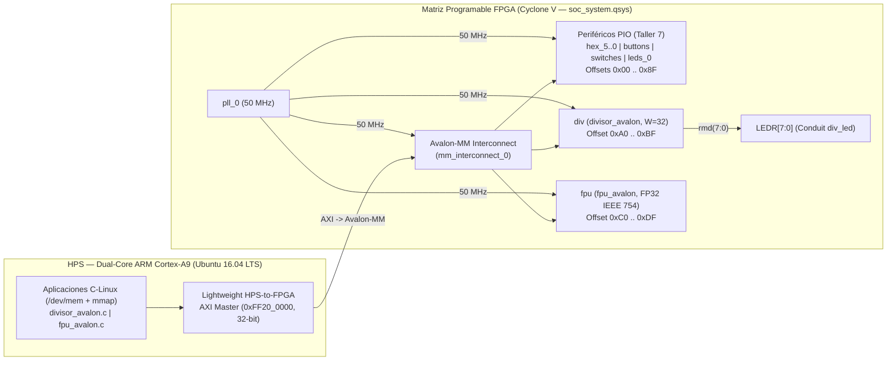
*Figura 1.1. Arquitectura del sistema SoC `DE1_SoC_demo` extendido con los componentes personalizados `div` (`divisor_avalon`) y `fpu` (`fpu_avalon`).*

---

## 2. Actividad 1 — Diseño y Simulación del Divisor Entero Parametrizable (`divisor`)

### 2.1. Arquitectura FSM-D ([divisor.vhd](../../Taller8/ej1_divisor/vhdl/src/divisor.vhd))

Dado que la división entera no es directamente sintetizable en HDL como los operadores aritméticos básicos, el módulo `divisor` implementa un **algoritmo iterativo de desplazamiento y resta (*shift-and-subtract*)** parametrizable en ancho de palabra `W` y ancho de contador `CBIT = log2(W) + 1`, gobernado por una máquina de estados de cuatro estados:

| Estado | Salidas de Control | Operación en el Camino de Datos (`rh_reg`, `rl_reg`, `d_reg`, `n_reg`) | Transición |
| :--- | :---: | :--- | :--- |
| **`idle`** | `ready = '1'`, `done_tick = '0'` | En espera. Si `start = '1'`, carga `rh_next = 0`, `rl_next = dvnd`, `d_next = dvsr` y `n_next = W + 1`. | $\to$ `op` (si `start = '1'`) |
| **`op`** | `ready = '0'`, `done_tick = '0'` | Compara `rh_reg >= d_reg`: si se cumple, `rh_tmp = rh_reg - d_reg` y `q_bit = '1'`; si no, `rh_tmp = rh_reg` y `q_bit = '0'`. Desplaza `{rh_tmp, rl_reg}` a la izquierda ingresando `q_bit` por el LSB de `rl_next`, y decrementa `n_next = n_reg - 1`. | $\to$ `last` (si `n_next = 1`) |
| **`last`** | `ready = '0'`, `done_tick = '0'` | Ejecuta la última iteración desplazando `rl_next <= rl_reg(W-2 downto 0) & q_bit`, pero **sin desplazar `rh`** (`rh_next <= rh_tmp`), preservando el residuo exacto. | $\to$ `done` |
| **`done`** | `ready = '0'`, `done_tick = '1'` | Emite un pulso de finalización `done_tick = '1'` de exactamente **1 ciclo de reloj** con `quo = rl_reg` y `rmd = rh_reg` estables. | $\to$ `idle` |

Para una palabra de ancho $W$, el divisor completa cada operación en $W + 2$ ciclos de reloj desde la captura de `start` hasta el pulso `done_tick` (para $W = 8$: $10$ ciclos = $200\text{ ns}$ a $50\text{ MHz}$; para $W = 32$: $34$ ciclos = $680\text{ ns}$).

### 2.2. Verificación Funcional en ModelSim ([divisor_tb.vhd](../../Taller8/ej1_divisor/vhdl/tb/divisor_tb.vhd))

El testbench `divisor_tb` instancia el módulo con `W = 8`, `CBIT = 4` y reloj de $50\text{ MHz}$ ($T = 20\text{ ns}$), evaluando mediante aserciones automáticas (`assert`) cinco casos representativos (división con residuo, exacta, extremo de 8 bits, dividendo menor que divisor y división por la unidad) ejecutados con [run_divisor_vhdl.do](../../Taller8/ej1_divisor/sim/run_divisor_vhdl.do):

| Caso | Dividendo (`dvnd`) | Divisor (`dvsr`) | Cociente Esperado / Obtenido (`quo`) | Residuo Esperado / Obtenido (`rmd`) | Resultado `assert` |
| :---: | :---: | :---: | :---: | :---: | :---: |
| 1 | `25` | `4` | `6` / `6` | `1` / `1` | **OK** |
| 2 | `100` | `10` | `10` / `10` | `0` / `0` | **OK** |
| 3 | `255` | `16` | `15` / `15` | `15` / `15` | **OK** |
| 4 | `7` | `15` | `0` / `0` | `7` / `7` | **OK** |
| 5 | `255` | `1` | `255` / `255` | `0` / `0` | **OK** |

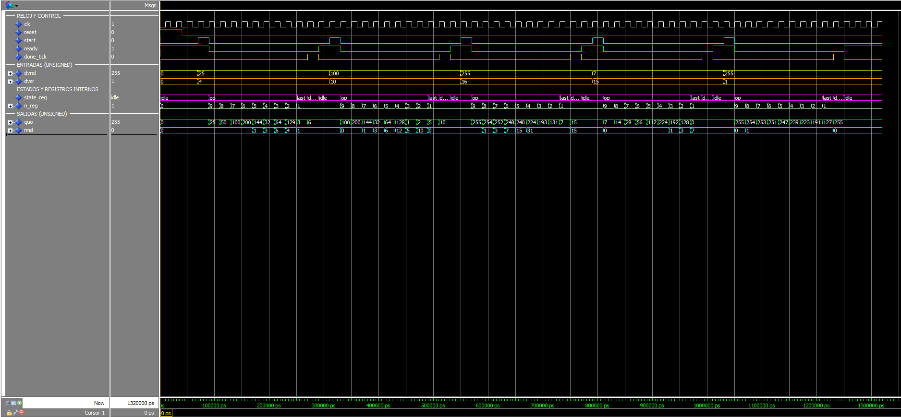
*Figura 2.1. Diagrama de tiempos en ModelSim para `divisor_tb` (`W = 8`, `CBIT = 4`, $50\text{ MHz}$). Se observan los 5 casos de prueba, la secuencia `idle -> op -> last -> done`, la cuenta descendente de `n_reg` (`9..1`), la caída de `ready` durante el cálculo y el pulso `done_tick` de 1 ciclo.*

---

## 3. Actividad 2 — Circuito Envolvente Avalon MM-Slave (`divisor_avalon`)

### 3.1. Diseño del *Wrapper* Avalon ([divisor_avalon.vhd](../../Taller8/ej2_divisor_avalon/vhdl/src/divisor_avalon.vhd))

Para acoplar el divisor al bus de 32 bits del HPS se implementó `divisor_avalon` (`W = 32`, `CBIT = 6` por defecto) estructurado en seis bloques funcionales:
1. **Instanciación del núcleo `divisor`**: propagando los parámetros genéricos `W` y `CBIT`.
2. **Registros internos**: `dvnd_reg` (dividendo), `dvsr_reg` (divisor) y el registro bandera `done_tick_reg` (que captura el pulso de 1 ciclo `div_done_tick` y lo retiene en `'1'` hasta ser limpiado por software).
3. **Decodificación de escritura (`wr_en = div_write and div_chipselect`)**: habilita la escritura sobre `dvnd_reg` (`"000"`), `dvsr_reg` (`"001"`), el pulso combinacional `div_start` (`"010"`) y la limpieza `clr_done_tick` (`"110"`).
4. **Multiplexación de lectura combinacional**: entrega `div_quo`, `div_rmd`, `ready` o `done_tick_reg` en el mismo ciclo (`Read wait = 0` en Platform Designer).
5. **Salida *Conduit* (`DIV_LED`)**: expone `div_rmd(7 downto 0)` directamente hacia los 8 LEDs rojos inferiores de la DE1-SoC.
6. **Salida de interrupción (`div_irq`)**: conectada directamente a `done_tick_reg` para la interfaz *Interrupt Sender*.

| Offset | `div_address` | Acceso | Registro / Señal | Descripción |
| :---: | :---: | :---: | :--- | :--- |
| **`0`** | `"000"` | `W` | `dvnd_reg` | Dividendo sin signo de 32 bits |
| **`1`** | `"001"` | `W` | `dvsr_reg` | Divisor sin signo de 32 bits |
| **`2`** | `"010"` | `W` (*dummy*) | `div_start` | Genera pulso de inicio de 1 ciclo hacia `divisor` |
| **`3`** | `"011"` | `R` | `div_quo` | Cociente resultante de 32 bits |
| **`4`** | `"100"` | `R` | `div_rmd` | Residuo resultante de 32 bits |
| **`5`** | `"101"` | `R` | `div_ready` | Bit `0`: `'1'` cuando el divisor está libre (`idle`) |
| **`6`** | `"110"` | `R / W` | `done_tick_reg` | **Lectura:** bit `0` = fin de operación. **Escritura:** limpia bandera y `div_irq` |

### 3.2. Verificación Funcional del Bus Avalon ([divisor_avalon_tb.vhd](../../Taller8/ej2_divisor_avalon/vhdl/tb/divisor_avalon_tb.vhd))

El testbench modela transacciones reales de lectura y escritura Avalon (`avalon_write` y `avalon_read` con `Read wait = 0`) con `W = 32` y `CBIT = 6` mediante [run_divisor_avalon_vhdl.do](../../Taller8/ej2_divisor_avalon/sim/run_divisor_avalon_vhdl.do), verificando la activación y limpieza de `div_irq` y la correspondencia de `DIV_LED`:

| Caso | Operación (`dvnd / dvsr`) | `quo` | `rmd` | `DIV_LED` (`rmd[7:0]`) | Verificación `div_irq` (set/clear) | Estado |
| :---: | :---: | :---: | :---: | :---: | :---: | :---: |
| 1 | `12345 / 100` | `123` | `45` | `45` (`0x2D`) | `'1'` al finalizar $\to$ `'0'` al escribir offset `6` | **OK** |
| 2 | `1000 / 7` | `142` | `6` | `6` (`0x06`) | `'1'` al finalizar $\to$ `'0'` al escribir offset `6` | **OK** |
| 3 | `65535 / 255` | `257` | `0` | `0` (`0x00`) | `'1'` al finalizar $\to$ `'0'` al escribir offset `6` | **OK** |

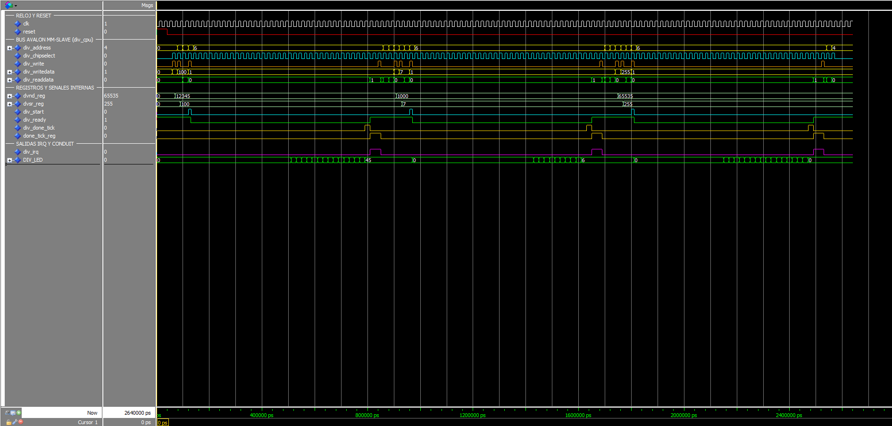
*Figura 3.1. Simulación en ModelSim de `divisor_avalon_tb` (`W = 32`, `CBIT = 6`). Se verifican los ciclos de escritura/lectura Avalon, el polling de `done_tick_reg`, el flanco y limpieza de `div_irq`, y el valor del residuo en `DIV_LED` (`45`, `6`, `0`).*

---

## 4. Actividad 3 — Integración en Platform Designer y Síntesis en Quartus Prime (`DE1_SoC_demo`)

### 4.1. Empaquetado en *Component Editor* (`divisor_avalon_hw.tcl`)

A partir de los archivos copiados en `Taller8/DE1_SoC_demo/hw/hdl/divisor/`, se creó el componente personalizado [divisor_avalon_hw.tcl](../../Taller8/DE1_SoC_demo/hw/quartus/divisor_avalon_hw.tcl) en el **Component Editor** de Platform Designer (grupo `Others`), configurando:
- **`clock`** (*Clock Input*): `clk`.
- **`reset`** (*Reset Input*): `reset` (activo en alto, asociado a `clock`).
- **`div_cpu`** (*Avalon Memory Mapped Slave*): `div_address[2:0]`, `div_chipselect`, `div_write`, `div_writedata[31:0]`, `div_readdata[31:0]` con **`Read wait = 0`**.
- **`div_intr`** (*Interrupt Sender*): `div_irq` asociada a `div_cpu`.
- **`div_led`** (*Conduit*): `DIV_LED[7:0]` exportada como `div_led_external_connection`.
- **Parámetros editables**: `W = 32`, `CBIT = 6`, validados con **0 errores y 0 advertencias**.

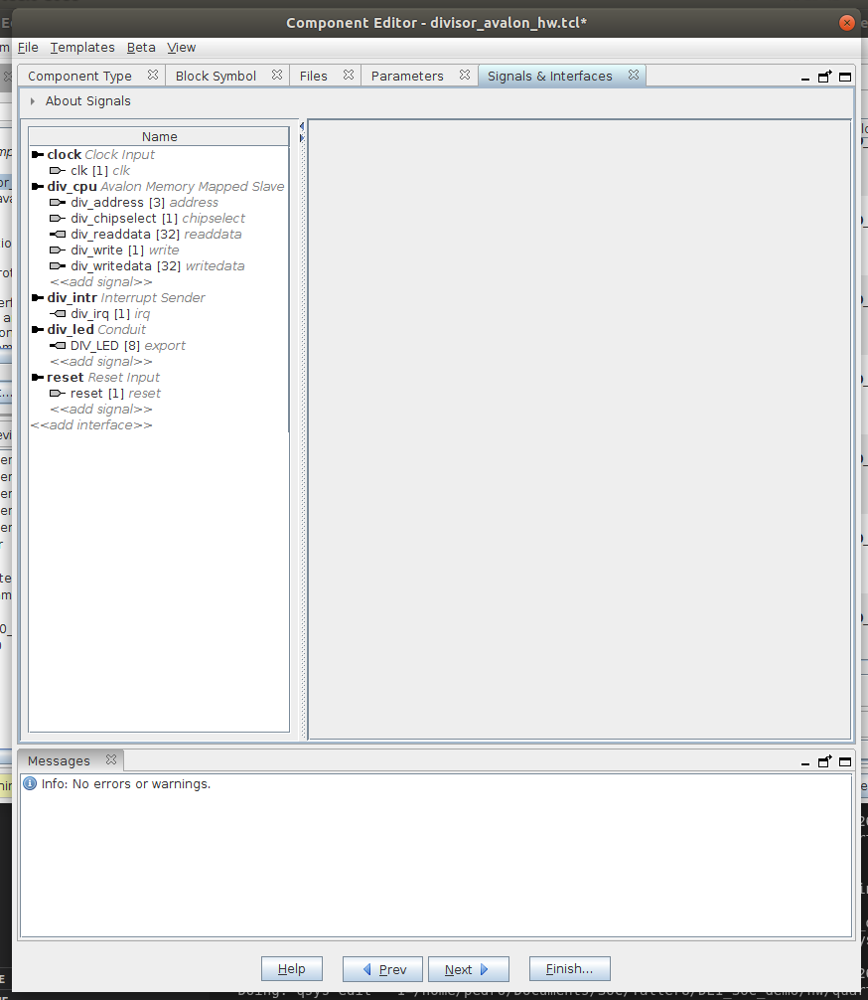
*Figura 4.1. Pestaña Signals & Interfaces en Component Editor para `divisor_avalon_hw.tcl` (`Info: No errors or warnings`).*

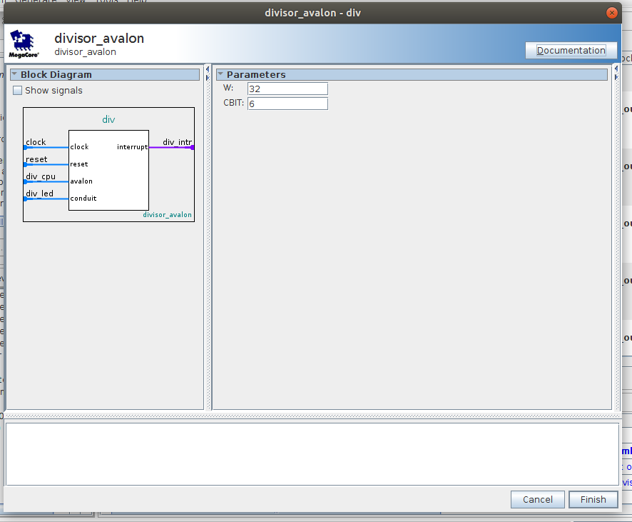
*Figura 4.2. Instanciación del componente `divisor_avalon` (`div`) con los parámetros genéricos editables `W = 32` y `CBIT = 6`.*

### 4.2. Ensamblaje de `soc_system.qsys` y Mapa de Memoria Completo

En [soc_system.qsys](../../Taller8/DE1_SoC_demo/hw/quartus/soc_system.qsys) se instanciaron tanto **`div` (`divisor_avalon`)** como **`fpu` (`fpu_avalon`, del Ejercicio Propuesto)**, ambos sincronizados con `pll_0.outclk0` ($50\text{ MHz}$), reiniciados por `hps_0.h2f_reset` y conectados a `hps_0.h2f_lw_axi_master`. Tras ejecutar **`System >> Assign Base Addresses`** y generar [hps_soc_system.h](../../Taller8/DE1_SoC_demo/sw/hps/application/hps_soc_system.h), el mapa de direcciones quedó definido así:

| Instancia Qsys | Componente IP | Ancho / Interfaz | Offset (`hps_soc_system.h`) | Rango Final | Dirección Física ARM |
| :--- | :---: | :---: | :---: | :---: | :---: |
| **`hex_5 .. hex_0`** ($\times 6$) | `altera_avalon_pio` | Output `7 bits` | `0x0000_0000` .. `0x0000_0050` | `0x005F` | `0xFF20_0000` .. `0xFF20_005F` |
| **`buttons_0`** | `altera_avalon_pio` | Input `4 bits` | `0x0000_0060` | `0x006F` | `0xFF20_0060` .. `0xFF20_006F` |
| **`switches_0`** | `altera_avalon_pio` | Input `10 bits` | `0x0000_0070` | `0x007F` | `0xFF20_0070` .. `0xFF20_007F` |
| **`leds_0`** | `altera_avalon_pio` | Output `10 bits` | `0x0000_0080` | `0x008F` | `0xFF20_0080` .. `0xFF20_008F` |
| **`div`** | **`divisor_avalon`** | **Avalon-MM 32-bit + Conduit 8-bit + IRQ** | **`0x0000_00A0`** | **`0x00BF`** | **`0xFF20_00A0` .. `0xFF20_00BF`** |
| **`fpu`** | **`fpu_avalon`** | **Avalon-MM 32-bit + IRQ** | **`0x0000_00C0`** | **`0x00DF`** | **`0xFF20_00C0` .. `0xFF20_00DF`** |

*(Nota: `div` y `fpu` ocupan ventanas de `32 bytes` = 8 registros de 32 bits cada uno, por lo que Platform Designer alinea automáticamente `div` en `0x00A0` —múltiplo de 32 bytes— tras `leds_0` en `0x0080`..`0x008F`).*

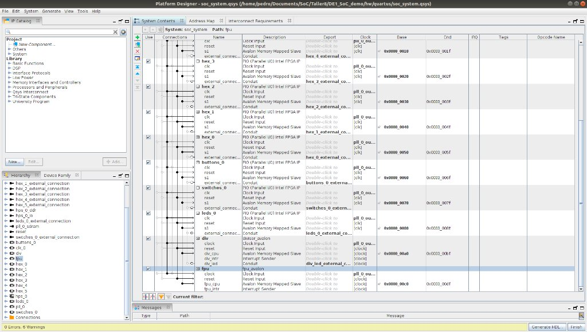
*Figura 4.3. Sistema `soc_system.qsys` en Platform Designer mostrando la integración simultánea de `div` (`0x0000_00A0`) y `fpu` (`0x0000_00C0`) junto a los periféricos PIO del Taller 7, con 0 errores.*

### 4.3. Entidad Superior ([DE1_SoC_top_level.vhd](../../Taller8/DE1_SoC_demo/hw/hdl/DE1_SoC_top_level.vhd)) y Resultados de Compilación

En `DE1_SoC_top_level.vhd` se desconectó el antiguo PIO de LEDs (`leds_0_external_connection_export => OPEN`), se conectó el conducto del divisor (`div_led_external_connection_export => div_led`) y se asignó `LEDR <= "00" & div_led;`, dejando los 8 LEDs inferiores (`LEDR[7:0]`) dedicados al residuo del divisor.

La compilación completa en **Quartus Prime 18.1.0 Build 625 Lite Edition** sobre el dispositivo **`5CSEMA5F31C6`** finalizó con **0 errores**:

| Recurso Físico (`5CSEMA5F31C6`) | Taller 7 (Base PIO) | Taller 8 (`+ div + fpu`) | Porcentaje Utilizado | Desglose Principal |
| :--- | :---: | :---: | :---: | :--- |
| **Logic Utilization (ALMs)** | `1,166 / 32,070` | **`2,356 / 32,070`** | **`7 %`** | `mm_interconnect_0`: `1,432.4` ALMs · **`fpu`**: `795.1` ALMs · **`div`**: `83.0` ALMs · PIOs: `~40` ALMs |
| **Total Registers** | `1,675` | **`3,149`** | — | Registros de pipeline FP32, registros Avalon y puentes AXI |
| **Total Block Memory Bits** | `0` | **`33,792 / 4,065,280`** | **`< 1 %`** | Tablas de búsqueda inversas (`.hex` M10K/MLAB) del núcleo `fp_div` |
| **Total DSP Blocks** | `0` | **`5 / 87`** | **`6 %`** | Multiplicadores de mantisa en `fp_mul` y polinomio de `fp_div` |
| **Total Pins / PLLs / DLLs** | `233` / `1` / `1` | **`233 / 457` · `1 / 6` · `1 / 4`** | `51 %` / `17 %` / `25 %` | Sin cambio en pines ni relojes externos |

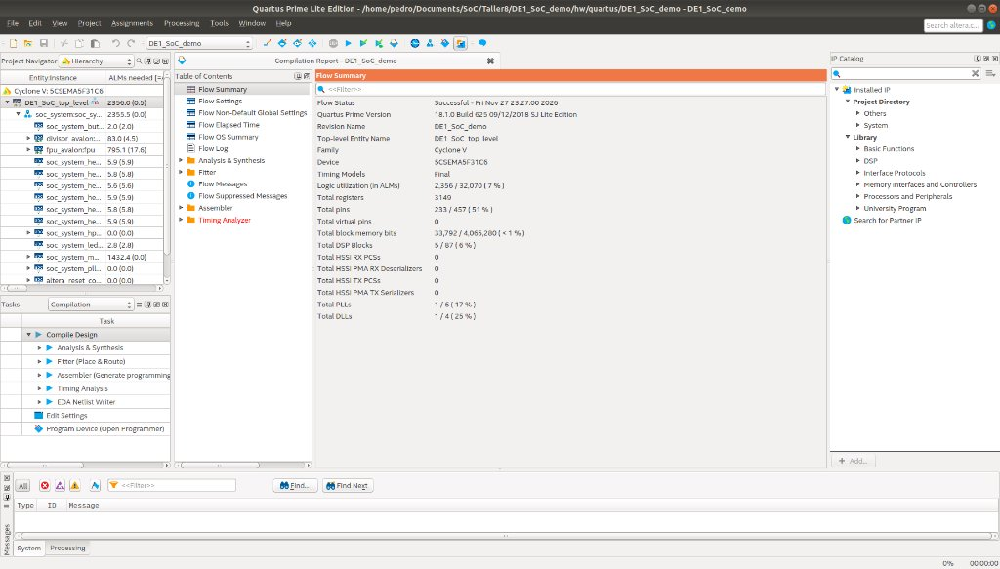
*Figura 4.4. Reporte de compilación (`Flow Summary`) y desglose jerárquico de ALMs en Quartus Prime 18.1: `2,356 ALMs` (`7%`), `3,149` registros, `33,792` bits de BRAM (`< 1%`) y `5` bloques DSP (`6%`).*

---

## 5. Actividad 4 — Actualización de la microSD y Verificación en el HPS (`divisor_avalon.c`)

### 5.1. Actualización del Hardware en la microSD ([create_linux_changehw.sh](../../Taller8/DE1_SoC_demo/create_linux_changehw.sh))

Tras compilar `DE1_SoC_demo.sof`, se ejecutó `./create_linux_changehw.sh` desde el *Intel FPGA Embedded Command Shell* para:
1. Convertir `DE1_SoC_demo.sof` a `sdcard/fat32/socfpga.rbf` mediante `quartus_cpf`.
2. Regenerar el Preloader (`preloader-mkpimage.bin`) y actualizar la partición `0xA2` y la partición `FAT32` de la microSD sin reconstruir el sistema de archivos raíz Ubuntu.
3. Actualizar las direcciones base en `sw/hps/application/hps_soc_system.h` (`DIV_BASE = 0xA0`, `FPU_BASE = 0xC0`).

### 5.2. Aplicación de Verificación ([divisor_avalon.c](../../Taller8/DE1_SoC_demo/sw/hps/application/divisor_avalon.c))

El programa en C mapea el puente Lightweight AXI (`0xFF20_0000`) mediante `/dev/mem` + `mmap()` y opera el acelerador `div` (`div_base = virtual_base + 0xA0`) mediante las rutinas `iowr()` e `iord()` siguiendo la secuencia exacta de registros:
1. Escribe `a` en `DVND_REG_OFT (0)` y `b` en `DVSR_REG_OFT (1)` (validando `b > 0`).
2. Realiza *polling* sobre `RDY_REG_OFT (5)` hasta que `ready == 1`.
3. Dispara el pulso de inicio escribiendo en `STRT_REG_OFT (2)`.
4. Realiza *polling* sobre `DONE_REG_OFT (6)` hasta que `done_tick == 1`, y limpia inmediatamente la bandera escribiendo en el mismo offset `6`.
5. Lee `quo_hw` (`QUOT_REG_OFT = 3`) y `rmd_hw` (`REMN_REG_OFT = 4`), los compara contra `a / b` y `a % b` en la CPU ARM y reporta el valor hexadecimal esperado en `LEDR[7:0]`.

### 5.3. Resultados Experimentales en la Tarjeta DE1-SoC

Compilado de forma nativa en el HPS (`gcc divisor_avalon.c -o divisor_avalon`) y ejecutado por consola serial (`minicom`, `/dev/ttyUSB0`, `115200 8N1`), el acelerador coincidió en el **100 %** de las pruebas contra la CPU ARM:

| Prueba | Operación (`a / b`) | Hardware FPGA (`quo`, `rmd`) | Software ARM (`quo`, `rmd`) | `LEDR[7:0]` (`rmd & 0xFF`) | Verificación |
| :---: | :---: | :---: | :---: | :---: | :---: |
| 1 | `65 / 45` | `quo = 1`, `rmd = 20` | `quo = 1`, `rmd = 20` | `0x14` (`0001_0100`) | **COINCIDE [OK]** |
| 2 | `6 / 3` | `quo = 2`, `rmd = 0` | `quo = 2`, `rmd = 0` | `0x00` (`0000_0000`) | **COINCIDE [OK]** |
| 3 | `54 / 10` | `quo = 5`, `rmd = 4` | `quo = 5`, `rmd = 4` | `0x04` (`0000_0100`) | **COINCIDE [OK]** |
| 4 | `84 / 7` | `quo = 12`, `rmd = 0` | `quo = 12`, `rmd = 0` | `0x00` (`0000_0000`) | **COINCIDE [OK]** |

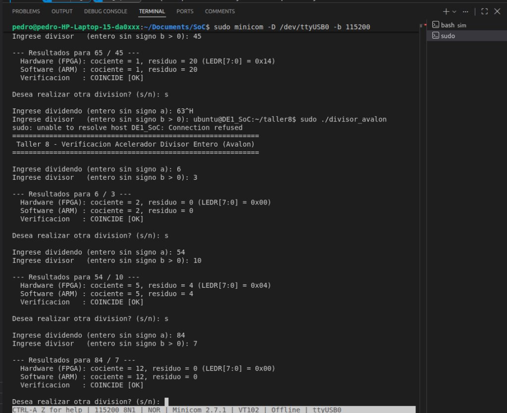
*Figura 5.1. Ejecución interactiva de `sudo ./divisor_avalon` en Ubuntu ARM sobre la DE1-SoC, comparando cociente y residuo entre el acelerador en FPGA y el procesador ARM.*

Adicionalmente se verificó visualmente la interfaz *Conduit* `DIV_LED` sobre `LEDR[7:0]` en la tarjeta física con residuos característicos (`0x2D` = `45` decimal y `0xFF` = `255` decimal):

| Residuo `0x2D` (`0010_1101` = `45`, p. ej. `12345 mod 100`) | Residuo `0xFF` (`1111_1111` = `255`, los 8 LEDs activos) |
| :---: | :---: |
| ![LEDR[7:0] mostrando 0x2D en la DE1-SoC](images/act4_de1_soc_leds_2d.jpg) | ![LEDR[7:0] mostrando 0xFF en la DE1-SoC](images/act4_de1_soc_leds_ff.jpg) |

*Figura 5.2. Verificación física de la salida Conduit `div_led` en `LEDR[7:0]` de la tarjeta DE1-SoC (con `LEDR[9:8]` permanentemente en `'0'`). Izquierda: `0x2D` (`LEDR5, LEDR3, LEDR2, LEDR0` encendidos). Derecha: `0xFF` (`LEDR[7:0]` todos encendidos).*

---

## 6. Ejercicio Propuesto — ALU de Punto Flotante FP32 en Bus Avalon (`fpu_avalon`)

### 6.1. Arquitectura de la ALU FP32 y Envolvente Avalon

Para el ejercicio propuesto se diseñaron dos módulos jerárquicos ubicados en `Taller8/ej3_fpu_avalon/vhdl/src/` (y copiados en `DE1_SoC_demo/hw/hdl/fpu_avalon/`):

1. **`fpu_alu` ([fpu_alu.vhd](../../Taller8/ej3_fpu_avalon/vhdl/src/fpu_alu.vhd))**: instancia en paralelo los 4 *IP cores* IEEE 754 precisión simple (FP32) reutilizados del Taller 3 (`fp_add`, `fp_sub`, `fp_mul`, `fp_div`), selecciona su salida mediante un MUX 4:1 controlado por `op_reg` y sincroniza el tiempo de cómputo con una FSM (`idle -> busy -> done`) que respeta la latencia de cada operación:
   - **`selop = "00"` (`+`), `"01"` (`-`), `"10"` (`*`)**: espera segura `LAT_FAST = 4` ciclos (latencia IP: 2 ciclos).
   - **`selop = "11"` (`/`)**: espera segura `LAT_DIV = 13` ciclos (latencia IP: 11 ciclos).
2. **`fpu_avalon` ([fpu_avalon.vhd](../../Taller8/ej3_fpu_avalon/vhdl/src/fpu_avalon.vhd))**: envolvente Avalon MM-Slave (`fpu_cpu`, `Read wait = 0`) + Interrupt Sender (`fpu_intr`) con el siguiente mapa de registros de 32 bits:

| Offset | `fpu_address` | Acceso | Registro / Señal | Descripción |
| :---: | :---: | :---: | :--- | :--- |
| **`0`** | `"000"` | `W` | `op_a_reg` | Operando `A` en formato IEEE 754 FP32 (32 bits) |
| **`1`** | `"001"` | `W` | `op_b_reg` | Operando `B` en formato IEEE 754 FP32 (32 bits) |
| **`2`** | `"010"` | `W` | `selop_reg` | Bits `1..0`: `"00"` = `+`, `"01"` = `-`, `"10"` = `*`, `"11"` = `/` |
| **`3`** | `"011"` | `W` (*dummy*) | `fpu_start` | Pulso de inicio de 1 ciclo hacia `fpu_alu` |
| **`4`** | `"100"` | `R` | `fpu_result` | Resultado IEEE 754 FP32 (32 bits) |
| **`5`** | `"101"` | `R` | `fpu_ready` | Bit `0`: `'1'` cuando la FPU está disponible (`idle`) |
| **`6`** | `"110"` | `R / W` | `done_tick_reg` | **Lectura:** bit `0` = fin de operación. **Escritura:** limpia bandera y `fpu_irq` |

### 6.2. Simulación Funcional en ModelSim ([fpu_avalon_tb.vhd](../../Taller8/ej3_fpu_avalon/vhdl/tb/fpu_avalon_tb.vhd))

Antes de sintetizar el sistema completo, se validó `fpu_avalon` en ModelSim usando [run_fpu_avalon_vhdl.do](../../Taller8/ej3_fpu_avalon/sim/run_fpu_avalon_vhdl.do) (junto con el wrapper VHDL puro [altera_syncram_sim.vhd](../../Taller8/ej3_fpu_avalon/sim/altera_syncram_sim.vhd) para simular las memorias LUT `.hex` de `fp_div` en ModelSim-Altera Starter Edition sin requerir licencia mixta SystemVerilog/VHDL). Todas las operaciones con `A = 12.5 (0x41480000)` y `B = 2.5 (0x40200000)` arrojaron resultados IEEE 754 bit-exactos:

| `selop` | Operación | `op_a` (Hex) | `op_b` (Hex) | Resultado Esperado (Hex) | Resultado Simulado (Hex) | Estado |
| :---: | :---: | :---: | :---: | :---: | :---: | :---: |
| `"00"` | `12.5 + 2.5 = 15.0` | `0x41480000` | `0x40200000` | `0x41700000` | `0x41700000` | **OK** |
| `"01"` | `12.5 - 2.5 = 10.0` | `0x41480000` | `0x40200000` | `0x41200000` | `0x41200000` | **OK** |
| `"10"` | `12.5 * 2.5 = 31.25` | `0x41480000` | `0x40200000` | `0x41FA0000` | `0x41FA0000` | **OK** |
| `"11"` | `12.5 / 2.5 = 5.0` | `0x41480000` | `0x40200000` | `0x40A00000` | `0x40A00000` | **OK** |

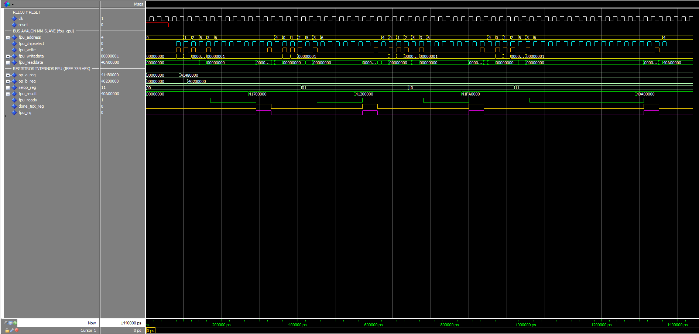
*Figura 6.1. Simulación en ModelSim de `fpu_avalon_tb`. Se observa la escritura de operandos IEEE 754 (`41480000`, `40200000`), el cambio de `selop_reg` (`00`..`11`), la mayor latencia controlada de la división (`selop = 11`) y los cuatro resultados exactos (`41700000`, `41200000`, `41FA0000`, `40A00000`).*

### 6.3. Empaquetado en Platform Designer (`fpu_avalon_hw.tcl`) y Verificación en HPS (`fpu_avalon.c`)

El componente fue empaquetado mediante [fpu_avalon_hw.tcl](../../Taller8/DE1_SoC_demo/hw/quartus/fpu_avalon_hw.tcl) con `0` errores y `0` advertencias, e integrado en `soc_system.qsys` en la dirección base **`0x0000_00C0`** (`0xFF20_00C0` física en ARM), tal como se observó en la Figura 4.3.

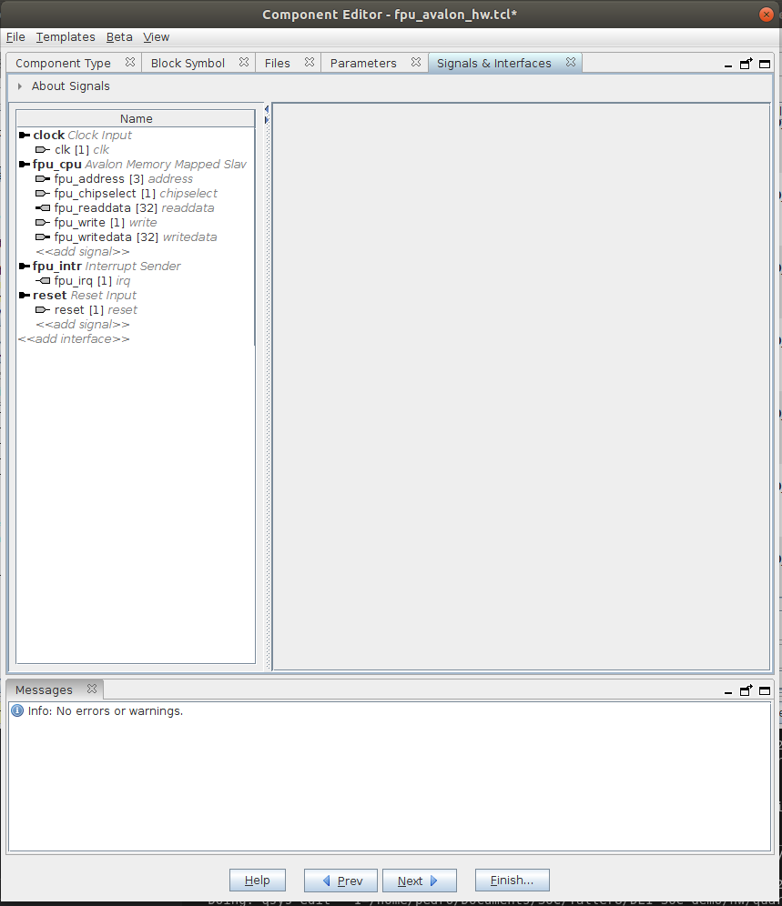
*Figura 6.2. Pestaña Signals & Interfaces en Component Editor para `fpu_avalon_hw.tcl` (`clock`, `reset`, `fpu_cpu` Avalon-MM Slave y `fpu_intr` Interrupt Sender, sin errores ni advertencias).*

La aplicación de usuario [fpu_avalon.c](../../Taller8/DE1_SoC_demo/sw/hps/application/fpu_avalon.c) utiliza una `union { float f; uint32_t u; }` para transferir los 32 bits exactos IEEE 754 sin pérdida de precisión entre C y los registros de la FPGA, comparando el resultado en hardware contra el cálculo nativo de la CPU ARM (compilada con `gcc fpu_avalon.c -o fpu_avalon -lm`):

| Operación Evaluada en DE1-SoC | Hardware FPGA (Decimal / IEEE 754) | Software ARM (Decimal / IEEE 754) | Error Absoluto |
| :--- | :---: | :---: | :---: |
| `12.500000 * 2.500000` | `31.250000` (`0x41FA0000`) | `31.250000` (`0x41FA0000`) | **`0.000e+00`** |
| `35.200001 / 9.500000` | `3.705263` (`0x406D2308`) | `3.705263` (`0x406D2308`) | **`0.000e+00`** |
| `13548.315430 / 12354.871094` | `1.096597` (`0x3F8C5D4B`) | `1.096597` (`0x3F8C5D4B`) | **`0.000e+00`** |
| `135487856.0 * 564862144.0` | `76531962117881856.0` (`0x5B87F2B5`) | `76531962117881856.0` (`0x5B87F2B5`) | **`0.000e+00`** |

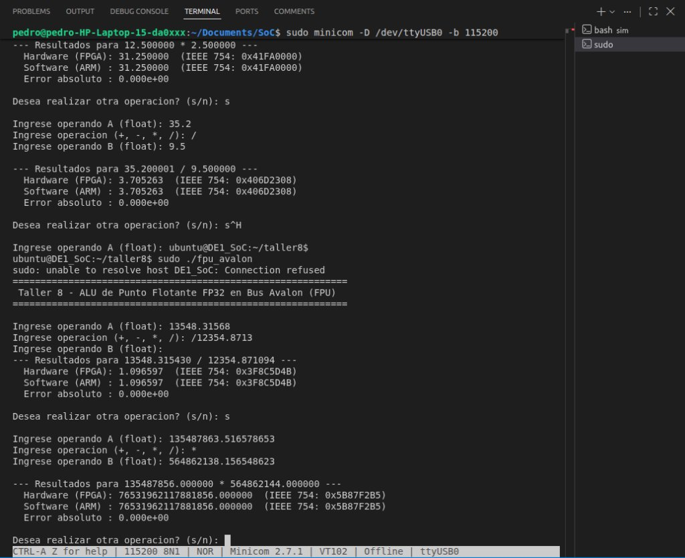
*Figura 6.3. Ejecución interactiva de `sudo ./fpu_avalon` en Ubuntu ARM sobre la DE1-SoC. Todas las operaciones en hardware coinciden bit a bit en representación IEEE 754 con la CPU ARM (`Error absoluto : 0.000e+00`).*

---

## 7. Conclusiones

1. **Flujo modular de diseño e integración en Platform Designer**: separar la lógica algorítmica (`divisor.vhd`, `fpu_alu.vhd`) del circuito envolvente Avalon (`divisor_avalon.vhd`, `fpu_avalon.vhd`) permitió validar ambos niveles de forma independiente en ModelSim antes de empaquetarlos con *Component Editor* (`*_hw.tcl`), reduciendo drásticamente el tiempo de depuración en la tarjeta física.
2. **Costo físico contenido de los aceleradores personalizados**: respecto al sistema base del Taller 7 (`1,166 ALMs`, `4%`), integrar simultáneamente el divisor entero de 32 bits (`83.0 ALMs`) y la ALU de punto flotante FP32 completa (`795.1 ALMs`, `5 DSPs`, `33,792 bits` de BRAM) elevó la ocupación total de la Cyclone V apenas al **`7%` de ALMs (`2,356 / 32,070`)**, demostrando amplio margen para añadir coprocesadores especializados.
3. **Sincronización de latencias variables mediante protocolo *handshake* en bus Avalon**: el uso de registros de estado (`ready` y `done_tick_reg` con limpieza por escritura) desacopla de forma limpia la latencia heterogénea de los aceleradores ($34$ ciclos en `divisor_avalon`, $4$ ciclos en `+`/`-`/`*` y $13$ ciclos en `/` de `fpu_avalon`) frente a los accesos del procesador ARM por `/dev/mem` + `mmap()`, logrando resultados **bit-exactos** (`0.000e+00` de error en IEEE 754) en todas las pruebas experimentales sobre la DE1-SoC.
