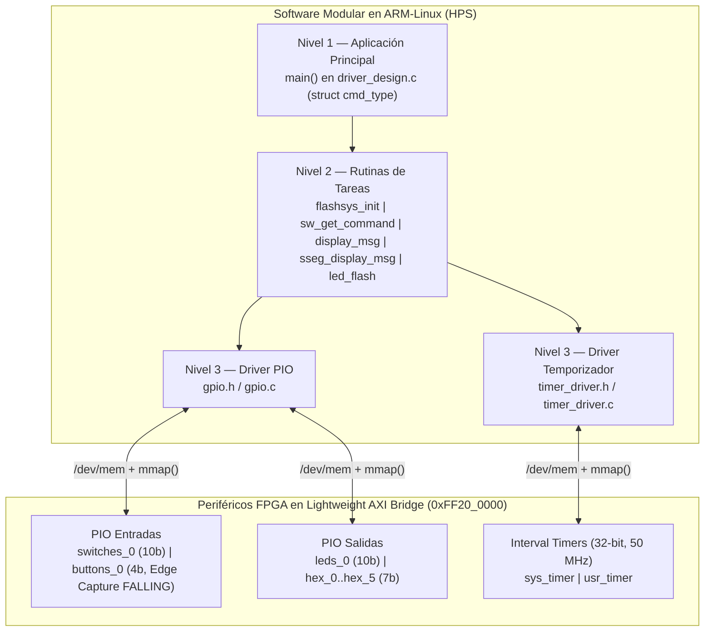

# Pontificia Universidad Javeriana
## Departamento de Electrónica
### System on Chip (SoC)

---

# Taller 9: Uso de Periféricos y Diseño de Manejadores (*Drivers*) en Software

> **Fuente:** *09 - Driver design.pdf* — Uso de periféricos y diseño de manejadores en software.

---

## Introducción y Objetivo

Al incrementar el número de periféricos (*soft cores*) integrados en un SoC sobre **Platform Designer**, el acceso directo a registros mapeados en memoria vuelve complejo y propenso a errores el programa principal. En entornos con sistema operativo (**ARM-Linux**), donde no se utiliza la generación automática del HAL/*Board Support Package* (BSP) propia de sistemas *bare-metal* (como Nios II en Eclipse), resulta necesario diseñar **manejadores (*drivers*) *ad hoc*** en C (`.h` y `.c`) que encapsulen todas las transacciones de configuración, lectura y escritura de bajo nivel.

En este taller se explora la arquitectura interna y mapa de registros de dos periféricos estándar de Intel FPGA —**PIO (*Parallel I/O*)** e **Interval Timer**— y se implementa una arquitectura modular de software en tres niveles sobre la tarjeta **DE1-SoC** retomando el experimento **`flashing_led`**, seguido de dos ejercicios de interacción y control desde consola/teclado.

*Figura 1. Jerarquía modular de software en tres niveles y acoplamiento con los periféricos PIO e Interval Timer en el SoC.*

---

## 1. Periféricos del Sistema y Mapas de Registros

### 1.1 Módulo *Parallel Input/Output* (`altera_avalon_pio`)
Provee una interfaz mapeada en memoria entre el bus Avalon y puertos E/S internos o externos (*Avalon Conduit*). Permite configurar ancho (*Width*), dirección (`Input`, `Output`, `Input and output ports`, `Bidirectional/Tristate`), valor de reset, registros individuales `outset`/`outclear`, captura sincrónica por flanco (**Edge Capture Register**: subida, bajada o ambos) y generación opcional de interrupciones (`IRQ`).

| Offset | Registro | Descripción |
| :---: | :--- | :--- |
| **`0`** | `data` | Registro de datos de entrada/salida (dos registros físicos independientes en la misma dirección) |
| **`1`** | `direction` | Dirección por pin (solo modo bidireccional: `'1'` salida, `'0'` entrada) |
| **`2`** | `interruptmask` | Máscara de habilitación de interrupción `IRQ` por bit |
| **`3`** | `edgecapture` | Bandera por flanco detectado (`'1'` al ocurrir transición; se limpia escribiendo `'1'` en el registro) |
| **`4`** | `outset` | Escritura de `'1'` fija en `'1'` los bits correspondientes de salida |
| **`5`** | `outclear` | Escritura de `'1'` fija en `'0'` los bits correspondientes de salida |

### 1.2 Módulo *Interval Timer* (`altera_avalon_timer`)
Contador descendente desde un valor máximo (`timeout period`) hasta cero alimentado por el reloj del sistema ($50\text{ MHz} \Rightarrow T_{\text{clk}} = 20\text{ ns}$). Un temporizador de **32 bits** cubre hasta $2^{32} \times 20\text{ ns} \approx 85.9\text{ s}$ (y uno de 64 bits más de $10{,}000$ años). Soporta modo único (*count-down-once*) o continuo (*continuous*), *presets* (*Full-featured*, *Simple periodic interrupt*, *Watchdog*, *Custom*) y registros de captura instantánea (*snapshot*).

| Offset | Registro (16 bits) | Campos / Descripción (Temporizador de 32 bits) |
| :---: | :--- | :--- |
| **`0`** | `status` | Bit `0` (**`to`**): bandera de *timeout* (se limpia escribiendo `'0'`). Bit `1` (**`run`**): `'1'` mientras cuenta |
| **`1`** | `control` | Bit `0` (**`ito`**): habilita IRQ; Bit `1` (**`cont`**): modo continuo; Bit `2` (**`start`**): iniciar; Bit `3` (**`stop`**): detener |
| **`2`** | `period_L` | Bits `[15:0]` del periodo de conteo máximo (`timeout period`) |
| **`3`** | `period_H` | Bits `[31:16]` del periodo de conteo máximo (`timeout period`) |
| **`4`** | `snap_L` | Bits `[15:0]` de la lectura instantánea (*requiere escritura dummy previa antes de leer*) |
| **`5`** | `snap_H` | Bits `[31:16]` de la lectura instantánea (*requiere escritura dummy previa antes de leer*) |

---

## 2. Diseño de Hardware del SoC (Sección 3)

Conservar el hardware base `DE1_SoC_demo` trabajado en el Taller 7 (o alternativamente el del Taller 8) dentro de `Taller9/DE1_SoC_demo/`, aplicando las siguientes modificaciones en **Platform Designer** (`soc_system.qsys`):

1. **Reconfigurar el módulo PIO de pulsadores (`buttons_0`, Sección 3.1 — Figura 5):**
   - Mantener `Width = 4`, `Direction = Input`.
   - En *Edge capture register*: activar **`Synchronously capture`** con **`Edge Type = FALLING`** (borde de bajada).
   - Dejar desmarcados *Enable bit-clearing for edge capture register* y *Generate IRQ*.
2. **Añadir y configurar dos módulos temporizadores (Sección 3.2 — Figura 6):**
   - Instanciar dos bloques **`Interval Timer Intel FPGA IP`** con configuración por defecto (`Timeout period = 1 ms`, `Counter Size = 32-bit`, Preset `Full-featured`, `Readable snapshot` habilitado, sin *Fixed period* ni *No Start/Stop*).
   - Renombrarlos **`sys_timer`** (monitoreo interno del sistema) y **`usr_timer`** (temporización de la aplicación de usuario).
   - Conectar en ambos: `clk` $\to$ `pll_0.outclk0`, `reset` $\to$ `hps_0.h2f_reset`, `s1` $\to$ `hps_0.h2f_lw_axi_master`.
3. **Ajustar mapa de direcciones de memoria (Sección 3.3 — Figura 7):**
   - Ejecutar **`System >> Assign Base Addresses`** y verificar las direcciones resultantes (referencia Figura 7):

   | Instancia | Tipo IP | Base (ref. Fig. 7) | Fin |
   | :--- | :--- | :---: | :---: |
   | **`usr_timer`** | `altera_avalon_timer` | `0x0000_0000` | `0x0000_001F` |
   | **`sys_timer`** | `altera_avalon_timer` | `0x0000_0020` | `0x0000_003F` |
   | **`hex_5` .. `hex_0`** | `altera_avalon_pio` (7b Out) | `0x0000_0040` .. `0x0000_0090` | `0x0000_004F` .. `0x0000_009F` |
   | **`buttons_0`** | `altera_avalon_pio` (4b In, Falling) | `0x0000_00A0` | `0x0000_00AF` |
   | **`switches_0`** | `altera_avalon_pio` (10b In) | `0x0000_00B0` | `0x0000_00BF` |
   | **`leds_0`** | `altera_avalon_pio` (10b Out) | `0x0000_00C0` | `0x0000_00CF` |

4. **Generar HDL y compilar en Quartus Prime (Secciones 3.4–3.5):**
   - Generar archivos HDL en **VHDL** (`Generate HDL`).
   - Como no se añadieron nuevos puertos externos, reutilizar `DE1_SoC_top_level.vhd` y `pin_assignment_DE1_SoC.tcl` del proyecto base y compilar en Quartus Prime.
5. **Actualizar la tarjeta microSD (Sección 3.6):**
   - Ejecutar `./create_linux_changehw.sh` desde el *Embedded Command Shell* para regenerar `socfpga.rbf`, `preloader-mkpimage.bin` y `hps_soc_system.h`, actualizar las particiones de arranque en la microSD y conectarse por **SSH** a la tarjeta DE1-SoC.

---

## 3. Desarrollo de Drivers y Aplicación Base `flashing_led` (Sección 4)

### 3.1 Especificación Funcional del Sistema (Sección 4.2)
El sistema base **`flashing_led`** debe operar de la siguiente manera:
- El **periodo de intermitencia** de los LEDs (`LEDR[1:0]` alternando) se define mediante los **10 interruptores (`SW[9:0]`)** y se carga cuando se oprime el pulsador **`KEY1`**.
- La intermitencia de los LEDs puede **pausarse y reanudarse** alternativamente al oprimir el pulsador **`KEY0`**.
- **Cuatro displays 7-segmentos** muestran el estado del sistema: **`HEX3`** despliega la letra **`'P'`** (`0x0C`) si el sistema está pausado (en blanco `0xFF` en operación normal), y **`HEX2`, `HEX1`, `HEX0`** muestran el periodo actual en milisegundos (hasta `999`).
- Cada vez que se carga un nuevo periodo de intermitencia, la consola SSH imprime el mensaje `"New Interval: <valor> ms"` (o `"Interval: XXXX ms"`).
- El temporizador en hardware **`usr_timer`** configurado a **$1\text{ ms}$ (`50,000` ciclos a $50\text{ MHz}$)** controla la base de tiempo mediante espera activa (*busy-waiting*) sobre la bandera `to`.

### 3.2 Estructura Modular y Convenciones de Drivers (Secciones 4.3–4.5)
Seguir la convención de nombres **`<device_name>_<action>_<object>`** y organizar el código en `Taller9/DE1_SoC_demo/sw/hps/application/`:

1. **Driver PIO (`drivers/gpio.h`, `drivers/gpio.c` — Figuras 10 y 11):**
   - Offsets: `PIO_DATA_REG_OFT (0)`, `PIO_DIRT_REG_OFT (1)`, `PIO_INTM_REG_OFT (2)`, `PIO_EDGE_REG_OFT (3)`.
   - Macros de bajo nivel y abstracción: `iord(base, offset)`, `iowr(base, offset, data)`, `pio_read(base)`, `pio_write(base, data)`, `btn_read(base)`, `btn_clear(base)` (escribiendo `0xF` al registro `edgecapture`), `btn_is_pressed(base)`.
   - Funciones para 7-segmentos (lógica activa en bajo): `sseg_conv_hex(int hex)` (tabla `HEX_LUT[16]`) y `sseg_disp_ptn(int *hex_base, char ptn)`.
2. **Driver Temporizador (`drivers/timer_driver.h`, `drivers/timer_driver.c` — Figuras 13 y 14):**
   - Offsets: `TIMER_STAT_REG_OFT (0)`, `TIMER_CTRL_REG_OFT (1)`, `TIMER_PRDL_REG_OFT (2)`, `TIMER_PRDH_REG_OFT (3)`.
   - Macros: `timer_read_tick(base)` (`iord(base, TIMER_STAT_REG_OFT) & 0x01`) y `timer_clear_tick(base)` (`iowr(base, TIMER_STAT_REG_OFT, 0)`).
   - Función `timer_wr_prd(int *timer_base, int prd)`: divide el periodo de 32 bits en `high` (`prd >> 16`) y `low` (`prd & 0xFFFF`), los escribe en `period_H` y `period_L`, y configura el registro de control con `0x007` (`cont = 1`, `start = 1`, `ito = 1`).
3. **Aplicación Principal y Rutinas de Tareas (`flashing_led/driver_design.c` — Figuras 9 y 15–19):**
   - Definir la estructura `cmd_type` (`int pause; int prd;`), mapear `/dev/mem` (`0xFF200000`, ventana `0x00200000`) verificando coincidencia exacta de offsets con `hps_soc_system.h` / Figura 7, e implementar las cinco rutinas:
     - `flashsys_init(btn_base, timer_base)`: limpia captura de botones y configura `usr_timer` en `50000` ciclos (`1 ms`).
     - `sw_get_command(btn_base, sw_base, cmd)`: lee `edgecapture` de `buttons_0`; si bit 0 (`KEY0`) alterna `pause`, si bit 1 (`KEY1`) lee `SW[9:0] & 0x3FF` en `prd`, y limpia `edgecapture`.
     - `display_msg(cmd)`: usa variable `static int current` para detectar cambios de periodo e imprimir en consola.
     - `sseg_display_msg(hex_0..3, cmd)`: limita la visualización a `999`, separa centenas/decenas/unidades, muestra `'P'` (`0x0C`) o blanco (`0xFF`) en `HEX3` y escribe en los cuatro displays.
     - `led_flash(led_base, timer_base, cmd)`: si no está pausado alterna `LEDR[1:0]` (`^= 0x03`) y espera `cmd.prd` ticks de `1 ms` consultando `timer_read_tick()` y limpiando con `timer_clear_tick()`.

---

## 4. Ejercicios Propuestos (Sección 6)

### 4.1 Interacción por Teclado (Sección 6.1 — `ej1_kbd_interval/`)
Diseñe las rutinas requeridas para recibir desde el PC (vía consola SSH) el valor del intervalo de intermitencia:
- En el momento en que el botón 2 (**`KEY2`**) sea presionado, la consola debe desplegar el mensaje **`"Type new interval: "`**.
- El usuario deberá ingresar **3 dígitos** que serán capturados mediante una función `scanf()`.
- El programa deberá **verificar que la entrada sea correcta** (3 dígitos válidos), convertir los tres caracteres a un número entero y configurar el nuevo tiempo de intermitencia.

### 4.2 Control con Teclado (Sección 6.2 — `ej2_kbd_control/`)
Modifique el código anterior de tal forma que se pueda controlar toda la operación del sistema **utilizando el teclado del PC**, reemplazando el uso de los pulsadores físicos de la tarjeta, con el siguiente código de caracteres:
- Carácter **`'C'`** usado como señal **`"clear"`**.
- Carácter **`'S'`** usado como señal **`"start"`**.
- Carácter **`'P'`** usado como señal **`"pause"`**.
- **Cualquier otro carácter será ignorado.**
