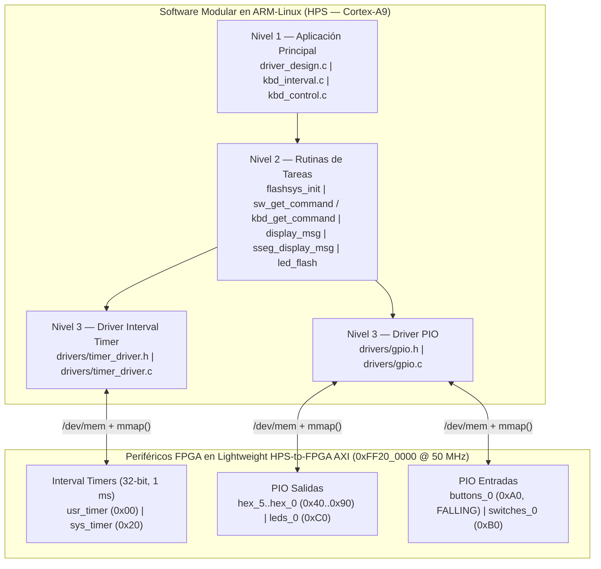
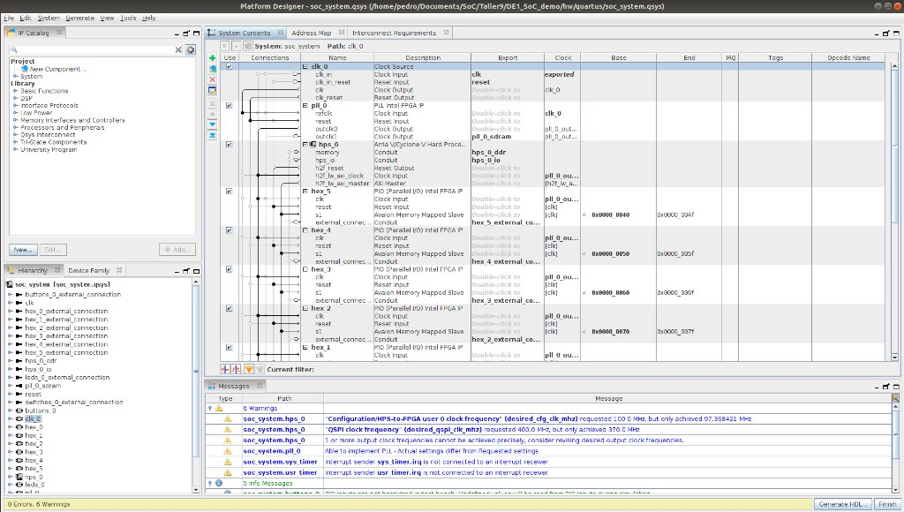
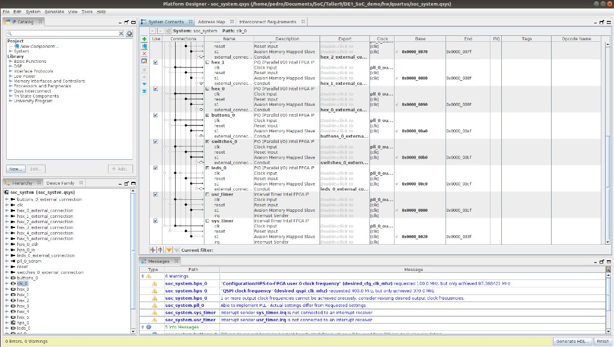
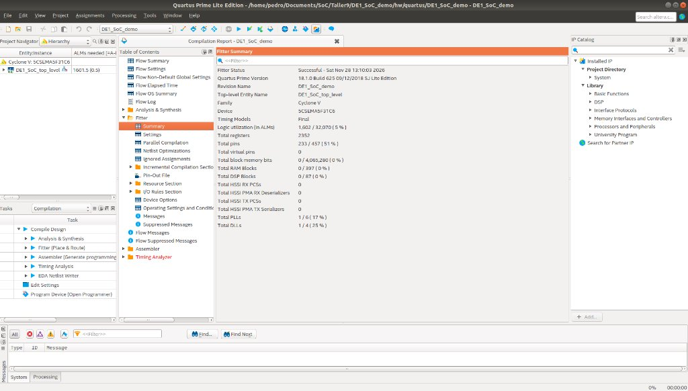
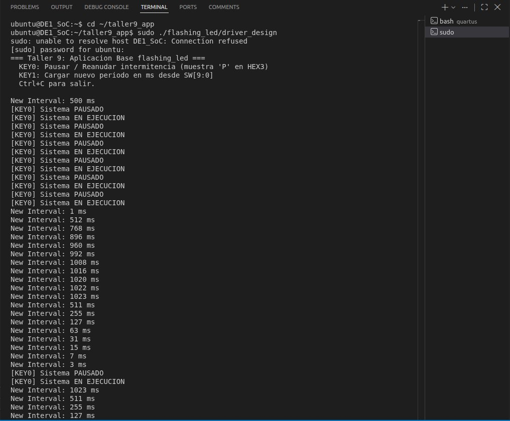
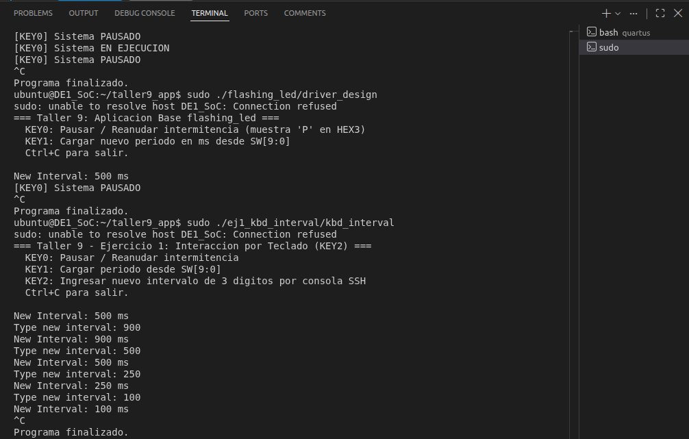
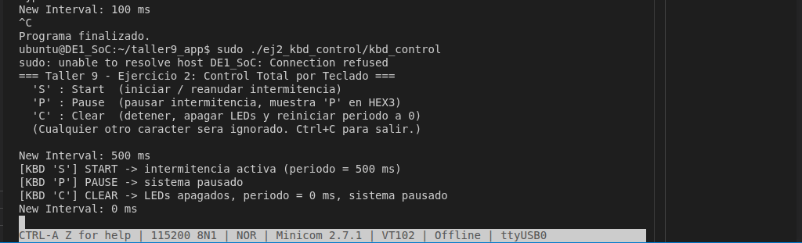

# Taller 9: Uso de Periféricos y Diseño de Manejadores (*Drivers*) en Software
**Pontificia Universidad Javeriana**  
**Departamento de Electrónica**  
**System on Chip (SoC)**  

---

## 1. Introducción y Arquitectura Modular del Sistema SoC

Al escalar el número de periféricos (*soft cores*) integrados sobre un SoC en **Platform Designer**, acceder directamente a registros mapeados en memoria desde la función `main()` incrementa la complejidad y la probabilidad de error. En entornos **ARM-Linux** sobre la tarjeta **Terasic DE1-SoC** (`Cyclone V 5CSEMA5F31C6`), donde no se dispone de la generación automática del HAL/*Board Support Package* (BSP) propia de entornos *bare-metal*, se diseñan **manejadores (*drivers*) *ad hoc*** en C (`.h` y `.c`) que encapsulan las operaciones de configuración, lectura y escritura de bajo nivel.

En este taller se extendió el sistema base **`DE1_SoC_demo`** con dos temporizadores **Interval Timer** de 32 bits (`usr_timer` y `sys_timer`) y captura de flanco de bajada (*Edge Capture FALLING*) en `buttons_0`, y se desarrolló una **arquitectura de software modular en tres niveles** sobre ARM-Linux para la aplicación base **`flashing_led`** y los dos ejercicios de control e interacción por teclado.

*Figura 1.1. Jerarquía modular de software en tres niveles y acoplamiento con los periféricos PIO e Interval Timer en el SoC `DE1_SoC_demo`.*

---

## 2. Diseño de Hardware en Platform Designer y Síntesis en Quartus Prime

### 2.1. Modificaciones sobre `soc_system.qsys`

Partiendo del proyecto base `DE1_SoC_demo` del Taller 7 dentro de [Taller9/DE1_SoC_demo/hw/quartus/](../../Taller9/DE1_SoC_demo/hw/quartus/), se aplicaron las modificaciones mediante el script [modify_taller9_qsys.tcl](../../Taller9/DE1_SoC_demo/hw/quartus/modify_taller9_qsys.tcl) en **Platform Designer (Quartus Prime 18.1)**:

1. **Reconfiguración de `buttons_0` (`altera_avalon_pio`, 4 bits entrada):**
   - `captureEdge = true` (*Synchronously capture*), `edgeType = FALLING` (detección por flanco de bajada al presionar `KEY[3:0]`, activos en bajo).
   - `bitClearingEdgeCapReg = false` y `generateIRQ = false`.
2. **Adición de dos temporizadores `Interval Timer Intel FPGA IP` (`altera_avalon_timer`):**
   - Instancias **`usr_timer`** (temporización de la aplicación de usuario) y **`sys_timer`** (monitoreo del sistema).
   - Configuración: `counterSize = 32` bits, `period = 1 ms` (`50,000` ciclos a $50\text{ MHz}$), *Preset* `Full-featured`, `snapshot = true`, `alwaysRun = false`, `fixedPeriod = false`.
   - Conexiones: `clk` $\to$ `pll_0.outclk0` ($50\text{ MHz}$), `reset` $\to$ `hps_0.h2f_reset`, `s1` $\to$ `hps_0.h2f_lw_axi_master`.
3. **Mapa de direcciones en el puente Lightweight AXI (`0xFF20_0000`):**

| Instancia | Tipo IP | Dirección Base | Dirección Fin | Función |
| :--- | :--- | :---: | :---: | :--- |
| **`usr_timer`** | `altera_avalon_timer` (32b) | `0x0000_0000` | `0x0000_001F` | Base de tiempo de $1\text{ ms}$ para `led_flash` |
| **`sys_timer`** | `altera_avalon_timer` (32b) | `0x0000_0020` | `0x0000_003F` | Temporizador auxiliar del sistema |
| **`hex_5` .. `hex_0`** | `altera_avalon_pio` (7b Out) | `0x0000_0040` .. `0x0000_0090` | `0x0000_004F` .. `0x0000_009F` | Displays 7-segmentos (activos en bajo) |
| **`buttons_0`** | `altera_avalon_pio` (4b In) | `0x0000_00A0` | `0x0000_00AF` | Pulsadores `KEY[3:0]` con *Edge Capture FALLING* |
| **`switches_0`** | `altera_avalon_pio` (10b In) | `0x0000_00B0` | `0x0000_00BF` | Interruptores `SW[9:0]` |
| **`leds_0`** | `altera_avalon_pio` (10b Out) | `0x0000_00C0` | `0x0000_00CF` | LEDs rojos `LEDR[9:0]` |

*Figura 2.1. Vista superior de `soc_system.qsys` en Platform Designer (`clk_0`, `pll_0`, `hps_0` y displays `hex_5..hex_2`, `0 Errors`).*

*Figura 2.2. Vista inferior de `soc_system.qsys` mostrando `hex_1..hex_0`, `buttons_0` (`0x00A0`), `switches_0` (`0x00B0`), `leds_0` (`0x00C0`), `usr_timer` (`0x0000`) y `sys_timer` (`0x0020`).*

### 2.2. Compilación en Quartus Prime y Actualización del Sistema de Arranque

Como no se modificaron puertos externos del SoC, se reutilizó [DE1_SoC_top_level.vhd](../../Taller9/DE1_SoC_demo/hw/hdl/DE1_SoC_top_level.vhd) y [pin_assignment_DE1_SoC.tcl](../../Taller9/DE1_SoC_demo/hw/quartus/pin_assignment_DE1_SoC.tcl). Tras generar el HDL en VHDL (`qsys-generate soc_system.qsys --synthesis=VHDL`), se compiló completamente el proyecto en **Quartus Prime 18.1 Lite Edition** (`quartus_sh --flow compile DE1_SoC_demo`) con **0 errores** en `00:05:41`:

| Métrica de Síntesis / Fitter (`5CSEMA5F31C6`) | Resultado |
| :--- | :--- |
| **Fitter Status** | `Successful` (`0 errors`) |
| **Logic utilization (in ALMs)** | `1,602 / 32,070` (`5 %`) |
| **Total registers** | `2,352` |
| **Total pins** | `233 / 457` (`51 %`) |
| **Total block memory bits / DSP Blocks** | `0 / 4,065,280` (`0 %`) / `0 / 87` (`0 %`) |
| **Total PLLs / DLLs** | `1 / 6` (`17 %`) / `1 / 4` (`25 %`) |

*Figura 2.3. Compilation Report (Fitter Summary) de `DE1_SoC_demo` en Quartus Prime 18.1 Lite Edition.*

Posteriormente se ejecutó [create_linux_changehw.sh](../../Taller9/DE1_SoC_demo/create_linux_changehw.sh) dentro del *Intel SoC EDS Embedded Command Shell*, generando:
- `sdcard/fat32/socfpga.rbf` (`6.7 MB`), copiado a la partición FAT32 (`/dev/sdb1`) de la microSD.
- `sdcard/a2/preloader-mkpimage.bin` (`256 KB`), escrito en la partición `a2` (`/dev/sdb3`) mediante `dd`.
- [hps_soc_system.h](../../Taller9/DE1_SoC_demo/sw/hps/application/hps_soc_system.h), regenerado automáticamente a partir de `soc_system.sopcinfo` con `sopc-create-header-files`.

---

## 3. Diseño de Drivers en C (Nivel 3)

Siguiendo la convención **`<device_name>_<action>_<object>`**, se encapsuló todo el acceso a registros en dos módulos independientes bajo [Taller9/DE1_SoC_demo/sw/hps/application/drivers/](../../Taller9/DE1_SoC_demo/sw/hps/application/drivers/):

### 3.1. Driver PIO ([gpio.h](../../Taller9/DE1_SoC_demo/sw/hps/application/drivers/gpio.h) / [gpio.c](../../Taller9/DE1_SoC_demo/sw/hps/application/drivers/gpio.c))
- **Offsets en palabras de 32 bits:** `PIO_DATA_REG_OFT (0)`, `PIO_DIRT_REG_OFT (1)`, `PIO_INTM_REG_OFT (2)`, `PIO_EDGE_REG_OFT (3)`, `PIO_OSET_REG_OFT (4)`, `PIO_OCLR_REG_OFT (5)`.
- **Macros de bajo nivel y abstracción:**
  - `iord(base, offset)` e `iowr(base, offset, data)` sobre punteros `volatile int *`.
  - `pio_read(base)` y `pio_write(base, data)` para lectura/escritura sobre el registro `data`.
  - `btn_read(base)` (lee `edgecapture & 0x0F`), `btn_clear(base)` (escribe `0x0F` en `edgecapture` para limpiar banderas de flanco) y `btn_is_pressed(base)`.
- **Displays 7-segmentos (lógica activa en bajo):**
  - `sseg_conv_hex(int hex)`: tabla `HEX_LUT[16]` (`0x40` para `0`, ..., `0x0E` para `F`), retornando `SSEG_BLANK_PTN (0xFF)` fuera de rango.
  - `sseg_disp_ptn(volatile int *hex_base, unsigned char ptn)`: escribe directamente el patrón al PIO del display (`SSEG_CHAR_P_PTN = 0x0C` para la letra `'P'`).

### 3.2. Driver Interval Timer ([timer_driver.h](../../Taller9/DE1_SoC_demo/sw/hps/application/drivers/timer_driver.h) / [timer_driver.c](../../Taller9/DE1_SoC_demo/sw/hps/application/drivers/timer_driver.c))
- **Offsets:** `TIMER_STAT_REG_OFT (0)`, `TIMER_CTRL_REG_OFT (1)`, `TIMER_PRDL_REG_OFT (2)`, `TIMER_PRDH_REG_OFT (3)`, `TIMER_SNPL_REG_OFT (4)`, `TIMER_SNPH_REG_OFT (5)`.
- **Base de tiempo:** `TIMER_1MS_CYCLES = 50000` ($50{,}000 \times 20\text{ ns} = 1\text{ ms}$).
- **Macros y configuración:**
  - `timer_read_tick(base)`: consulta el bit `0` (`to`, *timeout*) del registro `status`.
  - `timer_clear_tick(base)`: limpia la bandera `to` escribiendo `0` en `status`.
  - `timer_wr_prd(volatile int *timer_base, int prd)`: detiene el temporizador (`stop = 1`, `0x0008`), limpia `to`, divide el periodo de 32 bits en `period_L` (`prd & 0xFFFF`) y `period_H` (`(prd >> 16) & 0xFFFF`), y lo inicia en modo continuo escribiendo `0x0007` (`ito = 1`, `cont = 1`, `start = 1`).

---

## 4. Implementación y Validación en Hardware (DE1-SoC)

Las tres aplicaciones fueron compiladas con [Makefile](../../Taller9/DE1_SoC_demo/sw/hps/application/Makefile) usando el *cross-compiler* de SoC EDS (`arm-linux-gnueabihf-gcc -Wall -Wextra -O2`, **0 errores y 0 warnings**) y ejecutadas en la tarjeta **DE1-SoC** sobre Ubuntu ARM-Linux mediante consola serial **`minicom 2.7.1`** (`115200 8N1`, `/dev/ttyUSB0`).

### 4.1. Aplicación Base `flashing_led` ([driver_design.c](../../Taller9/DE1_SoC_demo/sw/hps/application/flashing_led/driver_design.c))

Implementa la estructura compartida `cmd_type { int pause; int prd; }`, el mapeo de `/dev/mem` (`0xFF200000`, ventana `0x00200000`) y las cinco rutinas de tareas:
- `flashsys_init()`: limpia `edgecapture` en `buttons_0` y configura `usr_timer` a $1\text{ ms}$ (`50,000` ciclos).
- `sw_get_command()`: consulta `btn_read(btn_base)`; `KEY0` (`bit 0`) alterna `cmd->pause`, `KEY1` (`bit 1`) carga `SW[9:0] & 0x3FF` en `cmd->prd`, y limpia `edgecapture`.
- `display_msg()`: emplea `static int current` para imprimir `"New Interval: <val> ms"` únicamente cuando cambia el periodo.
- `sseg_display_msg()`: satura la visualización en `999`, descompone centenas/decenas/unidades en `HEX2..HEX0` y despliega `'P'` (`0x0C`) o blanco (`0xFF`) en `HEX3`.
- `led_flash()`: alterna `LEDR[1:0]` (`^= 0x03`) si no está pausado y realiza espera activa de `cmd.prd` ticks de $1\text{ ms}$ sobre `usr_timer`.

*Figura 4.1. Consola `minicom` ejecutando `sudo ./flashing_led/driver_design`. Se observa el periodo inicial de `500 ms`, múltiples ciclos de pausa/reanudación con `KEY0` y la carga de intervalos desde `SW[9:0]` con `KEY1` (`1`, `512`, `768`, ..., `1023`, `511`, ..., `3 ms`), verificando en la tarjeta el despliegue simultáneo en `HEX3..HEX0` y la variación de frecuencia en `LEDR[1:0]`.*

### 4.2. Ejercicio 1 — Interacción por Teclado con `KEY2` ([kbd_interval.c](../../Taller9/DE1_SoC_demo/sw/hps/application/ej1_kbd_interval/kbd_interval.c))

Extiende `sw_get_command()` para atender el pulsador **`KEY2` (`bit 2`)** invocando la rutina `kbd_read_interval_3digits(int *out_prd)`:
1. Despliega el mensaje **`"Type new interval: "`**.
2. Captura la cadena mediante `scanf("%31s", buf)` y descarta caracteres sobrantes del búfer `stdin`.
3. Valida que la longitud sea exactamente `3` y que cada carácter cumpla `isdigit()`, rechazando entradas inválidas sin alterar el periodo activo.
4. Convierte los tres caracteres ASCII a entero (`(buf[0]-'0')*100 + (buf[1]-'0')*10 + (buf[2]-'0')`) y actualiza `cmd->prd`, reflejándose inmediatamente en consola, `HEX2..HEX0` y `LEDR[1:0]`.

*Figura 4.2. Consola `minicom` ejecutando `sudo ./ej1_kbd_interval/kbd_interval`. Al presionar `KEY2` se solicita `"Type new interval: "` y se actualizan correctamente los periodos ingresados por teclado (`900 ms`, `500 ms`, `250 ms` y `100 ms`).*

### 4.3. Ejercicio 2 — Control Total con Teclado ([kbd_control.c](../../Taller9/DE1_SoC_demo/sw/hps/application/ej2_kbd_control/kbd_control.c))

Reemplaza los pulsadores físicos de la tarjeta por control directo desde el teclado del PC configurando `stdin` en modo no canónico y sin eco mediante `termios` (`~(ICANON | ECHO)`) y sondeo no bloqueante con `select()` en cada tick de $1\text{ ms}$ dentro de `led_flash_kbd()`:
- **`'S'` (*Start*):** inicia o reanuda la intermitencia (`pause = 0`; si `prd == 0`, carga `SW[9:0]` o `500 ms` por defecto).
- **`'P'` (*Pause*):** pausa la intermitencia (`pause = 1`) y muestra `'P'` en `HEX3`.
- **`'C'` (*Clear*):** detiene la intermitencia, apaga `LEDR[1:0]` (`0x00`) y reinicia `prd = 0` (`P000` en `HEX3..HEX0`).
- **Cualquier otro carácter:** es ignorado por la cláusula `default`. Al finalizar con `Ctrl+C`, `restore_terminal()` restaura los atributos originales de la terminal.

*Figura 4.3. Consola `minicom` ejecutando `sudo ./ej2_kbd_control/kbd_control`. Se evidencia la respuesta inmediata a `'S'` (`START`, `500 ms`), `'P'` (`PAUSE`) y `'C'` (`CLEAR`, LEDs apagados y `New Interval: 0 ms`), ignorando cualquier otro carácter.*

---

## 5. Conclusiones

1. **Abstracción mediante drivers en 3 niveles:** Separar los registros de hardware en [gpio.h](../../Taller9/DE1_SoC_demo/sw/hps/application/drivers/gpio.h)/[gpio.c](../../Taller9/DE1_SoC_demo/sw/hps/application/drivers/gpio.c) y [timer_driver.h](../../Taller9/DE1_SoC_demo/sw/hps/application/drivers/timer_driver.h)/[timer_driver.c](../../Taller9/DE1_SoC_demo/sw/hps/application/drivers/timer_driver.c) permitió reutilizar exactamente la misma base de bajo nivel en las tres aplicaciones (`flashing_led`, `kbd_interval` y `kbd_control`) sin duplicar aritmética de punteros ni máscaras de registros.
2. **Detección confiable de pulsadores con *Edge Capture*:** Habilitar la captura sincrónica por flanco de bajada (`FALLING`) en `buttons_0` eliminó la pérdida de pulsaciones cortas durante el *busy-waiting* de `led_flash()`, ya que el evento queda retenido en el registro `edgecapture` hasta que el software ejecuta `btn_clear()`.
3. **Temporización determinística en hardware:** El uso de `usr_timer` ($50{,}000$ ciclos a $50\text{ MHz}$) garantiza una base de tiempo precisa de $1\text{ ms}$ independiente de la carga del procesador ARM, y en `kbd_control.c` permitió muestrear el teclado cada milisegundo con respuesta instantánea sin bloquear la intermitencia de los LEDs.
4. **Costo reducido en FPGA:** La integración de ambos temporizadores de 32 bits y el registro *Edge Capture* en `buttons_0` mantuvo la ocupación total del SoC en apenas **5% de los ALMs** (`1,602 / 32,070`) del Cyclone V, compilando con 0 errores.
